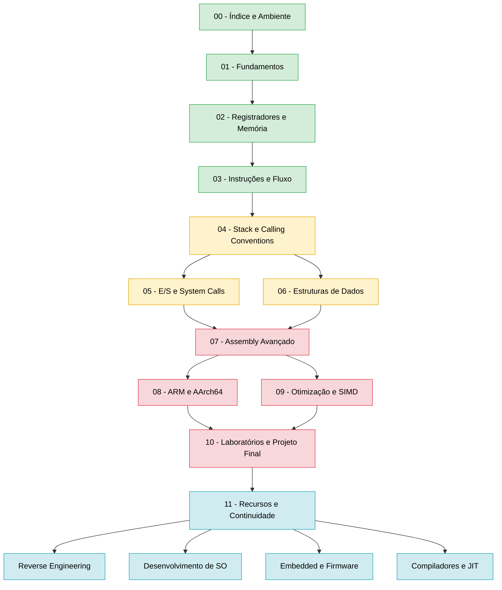

# Trilha de aprendizado - Assembly

Ordem sugerida de estudo do curso de Assembly, do básico ao avançado, e os destinos possíveis depois dele. Os módulos estão listados no [[Índice - Assembly]].

## Roadmap visual

**Legenda:** verde = básico, amarelo = intermediário, vermelho = avançado, azul = destinos após o curso.

> [!note] Trilhas alternativas
> - **Foco em Reverse Engineering:** 01 → 02 → 03 → 04 → 05 → 07 (inline/PIC/exceções) → 11.
> - **Foco em performance:** 01 → 04 → 06 → 07 → 09.
> - **Foco em mobile/embarcado (ARM):** 01 → 02 → 03 → 04 → 08, comparando sempre com x64.

## Veja também

- [[Home - Assembly]]
- [[Índice - Assembly]]
- [[Glossário#Assembly (x86-64 e ARM)]]
