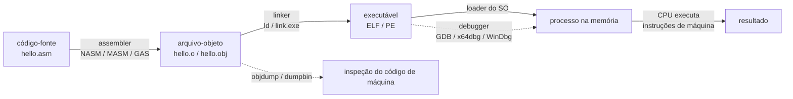

# Índice - Assembly

> [!abstract] Resumo
> Este vault é um curso completo de **Assembly**, do zero ao avançado, em 12 módulos (00 a 11). Cobre x86/x64 (NASM no Linux e MASM no Windows), ARM/AArch64, otimização com SIMD e 8 laboratórios práticos. Esta nota é o **ponto de entrada**: mostra o mapa do curso, como navegar e como montar o ambiente de desenvolvimento.

Tags desta nota: #assembly #roadmap #nasm #masm #x86 #x64 #arm

---

## 1. Como usar este vault

1. **Comece por aqui.** Leia as seções 1 a 6 e monte o ambiente (seção 5). Só então vá para [[01 - Fundamentos de Arquitetura e Assembly]].
2. **Siga a ordem dos módulos** até o 04. A partir do 05 há alguma flexibilidade (veja o [[#3. Roadmap visual|roadmap]]).
3. **Faça os laboratórios junto com a teoria.** Cada laboratório do [[10 - Laboratórios e Projetos Práticos]] indica após qual módulo ele pode ser feito (tabela na seção 2).
4. **Digite o código, não copie e cole.** Em Assembly, errar um operando e depurar é metade do aprendizado.
5. **Use o graph view** (`Ctrl/Cmd + G`) para ver como os conceitos se conectam. Os wikilinks (`[[nome da nota]]`) foram pensados para isso.

> [!tip] Ritmo sugerido
> Um módulo por semana, com 1 ou 2 laboratórios, leva cerca de 3 meses. O módulo 08 (ARM) e o 09 (otimização) podem ser adiados se o seu foco imediato for Windows/Linux x64.

> [!note] Convenção de arquitetura
> Salvo indicação contrária, "x86" significa 32 bits (IA-32) e "x64" significa 64 bits (x86-64, também chamado AMD64 ou Intel 64). Sintaxe **Intel** é a padrão em todo o vault, mesmo para GAS e GDB.

---

## 2. Índice dos módulos

| # | Módulo | Nível | Arquitetura | Laboratório associado |
|---|--------|-------|-------------|-----------------------|
| 00 | [[Índice - Assembly]] (esta nota) | Iniciante | x86/x64/ARM | — |
| 01 | [[01 - Fundamentos de Arquitetura e Assembly]] | Iniciante | x86/x64 | [[Lab 01 - Hello World e Operações Básicas]] (parcial) |
| 02 | [[02 - Registradores e Memória]] | Iniciante | x86/x64 | — |
| 03 | [[03 - Instruções Básicas e Controle de Fluxo]] | Iniciante | x86/x64 | [[Lab 01 - Hello World e Operações Básicas]], [[Lab 02 - Calculadora em Assembly]] |
| 04 | [[04 - Procedimentos, Stack e Calling Conventions]] | Intermediário | x86/x64 | — |
| 05 | [[05 - Entrada-Saída e System Calls]] | Intermediário | x64 (Linux/Windows) | [[Lab 03 - Manipulação de Strings e Arrays]], [[Lab 05 - Sistema de Arquivos Simples]] |
| 06 | [[06 - Estruturas de Dados e Arrays]] | Intermediário | x64 | [[Lab 03 - Manipulação de Strings e Arrays]], [[Lab 04 - Funções da libc]], [[Lab 06 - Ordenação]] |
| 07 | [[07 - Assembly Avançado (x86-x64)]] | Avançado | x86/x64 | [[Lab 07 - Floating Point e SIMD]] |
| 08 | [[08 - ARM e AArch64]] | Avançado | ARM/AArch64 | Reescrever o Lab 04 em AArch64 |
| 09 | [[09 - Otimização, SIMD e Performance]] | Avançado | x64 | Análise de performance dos Labs 04, 06 e 07 |
| 10 | [[10 - Laboratórios e Projetos Práticos]] | Todos | x64 (+ ARM) | [[Lab 08 - Projeto Final]] |
| 11 | [[11 - Recursos e Referências]] | Todos | Todas | — |

Notas de apoio (criadas ao longo do curso): [[Glossário#Assembly (x86-64 e ARM)]], [[Cheat Sheet de Instruções]], [[Cheat Sheet de Calling Conventions]], [[Cheat Sheet de GDB]].

---

## 3. Roadmap visual

O roadmap do curso e as trilhas alternativas (Reverse Engineering, performance e ARM) estão em [[Trilha de aprendizado - Assembly]].

---

## 4. Estrutura de pastas do vault

```text
Vault Assembly/
├── 00 - Índice/
│   └── 00 - Índice.md                  ← você está aqui
├── 01 - Fundamentos de Arquitetura e Assembly/
├── 02 - Registradores e Memória/
├── 03 - Instruções Básicas e Controle de Fluxo/
├── 04 - Procedimentos, Stack e Calling Conventions/
├── 05 - Entrada-Saída e System Calls/
├── 06 - Estruturas de Dados e Arrays/
├── 07 - Assembly Avançado (x86-x64)/
├── 08 - ARM e AArch64/
├── 09 - Otimização, SIMD e Performance/
├── 10 - Laboratórios e Projetos Práticos/
│   └── Soluções/                       ← soluções comentadas, em notas separadas
└── 11 - Recursos e Referências/
```

> [!tip] Código-fonte fora das notas
> Guarde os arquivos `.asm` reais dos laboratórios em `Anexos/src/` (pasta na raiz do vault) (ou em um repositório Git ao lado) e referencie-os nas notas. Assim você compila direto da pasta, sem copiar de blocos de código.

---

## 5. Configurando o ambiente de desenvolvimento

### 5.1 Qual assembler usar?

| Assembler | Sintaxe | Plataforma típica | Quando usar | Módulos |
|-----------|---------|-------------------|-------------|---------|
| **NASM** | Intel | Linux, Windows, macOS | Padrão do curso para Linux; muito portável | 01–10 |
| **MASM** (`ml`/`ml64`) | Intel (dialeto MASM) | Windows (Visual Studio) | Padrão do curso para Windows | 01–10 |
| **GAS** (`as`, GNU Assembler) | AT&T (ou Intel com `.intel_syntax noprefix`) | Linux, macOS, bare-metal, ARM | Saída do GCC; necessário em ARM/AArch64 | 07, 08 |
| **YASM** | Intel (compatível com NASM) | Linux, Windows | Alternativa ao NASM; hoje pouco mantido | opcional |

> [!warning] Sintaxe Intel vs AT&T
> A mesma instrução tem ordem de operandos **invertida** entre as duas sintaxes. Esta é a armadilha número 1 de quem lê saída do GCC ou do `objdump` pela primeira vez.
>
> | Intel (NASM/MASM) | AT&T (GAS padrão) |
> |-------------------|-------------------|
> | `mov rax, 1` | `movq $1, %rax` |
> | `mov rax, [rbx+8]` | `movq 8(%rbx), %rax` |
> | `add eax, ebx` | `addl %ebx, %eax` |
>
> Em Intel: **destino primeiro**. Em AT&T: **origem primeiro**, com `%` nos registradores e `$` nos imediatos.

### 5.2 Linux (Debian/Ubuntu)

```bash
sudo apt update
sudo apt install -y nasm yasm binutils gcc gcc-multilib gdb make build-essential \
                    strace ltrace xxd
```

- `binutils` traz `as` (GAS), `ld`, `objdump`, `readelf` e `nm`.
- `gcc-multilib` permite montar e linkar programas de 32 bits (`-m32`, `-felf32`).
- Verifique as versões:

```bash
nasm -v && as --version | head -1 && ld --version | head -1 && gdb --version | head -1
```

### 5.3 Windows (MASM)

1. Instale o **Visual Studio Build Tools** (ou o Visual Studio Community) com a carga de trabalho **"Desenvolvimento para desktop com C++"**. Isso inclui `ml.exe` (32 bits), `ml64.exe` (64 bits), `link.exe` e as bibliotecas do Windows SDK.
2. Abra o **"x64 Native Tools Command Prompt for VS"** (ou o x86, para 32 bits). Ele já configura o `PATH` e as variáveis de ambiente.
3. Verifique:

```bat
ml64 /?
link /?
```

4. Instale um debugger: **x64dbg** (rápido, ótimo para aprender) e/ou **WinDbg** (Microsoft Store).
5. Opcional: instale o **NASM para Windows** para praticar a mesma sintaxe dos exemplos Linux.

> [!tip] Alternativa: WSL2
> Se você usa Windows, o **WSL2** com Ubuntu dá um ambiente Linux completo para NASM, GAS e GDB sem dual boot. Use o Windows nativo apenas para os trechos de MASM e Windows API.

### 5.4 macOS e Apple Silicon

- **Mac com Apple Silicon (M1+)** executa AArch64 nativamente. Isso é ótimo para o módulo 08, mas os exemplos x64 precisam de uma VM/contêiner Linux x86-64 ou do Rosetta 2.
- As Xcode Command Line Tools trazem `as`, `ld` e `lldb`. Observação: a ABI e as syscalls do macOS **diferem** das do Linux.
- Para o curso, a opção mais simples é usar **Linux em VM, contêiner ou WSL2**.

### 5.5 ARM/AArch64 em máquina x64 (para o módulo 08)

```bash
sudo apt install -y gcc-aarch64-linux-gnu binutils-aarch64-linux-gnu qemu-user gdb-multiarch
# montar e linkar:
aarch64-linux-gnu-as   prog.s -o prog.o
aarch64-linux-gnu-ld   prog.o -o prog
# executar via emulação em modo usuário:
qemu-aarch64 ./prog
```

### 5.6 O pipeline: do `.asm` ao processo em execução



> [!note] O que o assembler realmente faz
> O assembler traduz mnemônicos (`mov`, `add`) em **bytes de código de máquina** (por exemplo, `xor eax, eax` vira `31 C0`) e monta tabelas de símbolos. O **linker** resolve os endereços entre arquivos-objeto, e o **loader** do sistema operacional mapeia o executável na memória e entrega o controle à CPU no ponto de entrada. Veremos o formato desses arquivos com calma no [[01 - Fundamentos de Arquitetura e Assembly]].

### 5.7 Teste de fogo: Hello World

> [!example] NASM, Linux x64
> Arquivo `hello.asm`:
>
> ```nasm
> ; hello.asm - NASM, Linux x86-64, sem libc
> global _start                 ; ponto de entrada visível ao linker
>
> section .data
>     msg db "Olá, Assembly!", 10    ; texto + quebra de linha (10 = LF)
>     len equ $ - msg                ; tamanho em bytes, calculado pelo assembler
>
> section .text
> _start:
>     mov rax, 1                ; número da syscall write
>     mov rdi, 1                ; fd 1 = stdout
>     lea rsi, [rel msg]        ; endereço do texto
>     mov rdx, len              ; quantidade de bytes
>     syscall                   ; entra no kernel
>
>     mov rax, 60               ; número da syscall exit
>     xor edi, edi              ; código de saída 0
>     syscall
> ```
>
> Montar, linkar e executar:
>
> ```bash
> nasm -f elf64 hello.asm -o hello.o
> ld hello.o -o hello
> ./hello
> echo $?        # deve imprimir 0
> ```

> [!example] MASM, Windows x64
> Arquivo `hello.asm`:
>
> ```nasm
> ; hello.asm - MASM, Windows x64, usando a Windows API (kernel32)
> extrn GetStdHandle : proc
> extrn WriteConsoleA : proc
> extrn ExitProcess : proc
>
> .data
> msg     db "Ola, Assembly!", 13, 10   ; texto + CR LF
> len     = $ - msg
> escritos dq 0                          ; recebe o nº de bytes escritos
>
> .code
> main proc
>     sub rsp, 40               ; 32 bytes de shadow space + 8 p/ 5º argumento e alinhamento
>     mov ecx, -11              ; STD_OUTPUT_HANDLE
>     call GetStdHandle         ; handle retorna em RAX
>
>     mov rcx, rax              ; 1º arg: handle
>     lea rdx, msg              ; 2º arg: buffer
>     mov r8d, len              ; 3º arg: tamanho
>     lea r9, escritos          ; 4º arg: ponteiro p/ bytes escritos
>     mov qword ptr [rsp+32], 0 ; 5º arg: reservado (NULL)
>     call WriteConsoleA
>
>     xor ecx, ecx              ; código de saída 0
>     call ExitProcess
> main endp
> end
> ```
>
> Montar, linkar e executar (no "x64 Native Tools Command Prompt"):
>
> ```bat
> ml64 hello.asm /link /subsystem:console /entry:main kernel32.lib
> hello.exe
> ```

#### Linha por linha: o que o processador faz

| Trecho | O que acontece no hardware |
|--------|----------------------------|
| `mov rax, 1` | A CPU carrega o valor imediato `1` no registrador de 64 bits `RAX` (dentro do próprio núcleo, sem acessar a RAM). |
| `lea rsi, [rel msg]` | Calcula o endereço de `msg` relativo a `RIP` e grava em `RSI`. **Não lê a memória**, só faz aritmética de endereço. |
| `syscall` | Instrução especial que muda o nível de privilégio (ring 3 → ring 0) e salta para o ponto de entrada do kernel. O kernel lê `RAX`, `RDI`, `RSI`, `RDX` e executa o `write`. |
| `sub rsp, 40` (MASM) | Move o topo da pilha para reservar espaço. A *Microsoft x64 calling convention* exige 32 bytes de *shadow space* e `RSP` alinhado em 16 bytes na chamada. |

> [!note] Versão ingênua vs versão otimizada
> Zerar um registrador mostra a diferença de mentalidade:
>
> ```nasm
> mov edi, 0      ; ingênua: 5 bytes (BF 00 00 00 00), carrega um imediato de 32 bits
> xor edi, edi    ; otimizada: 2 bytes (31 FF), e a CPU a reconhece como "zeragem"
> ```
>
> Ambas deixam `RDI = 0`, mas a segunda ocupa menos espaço no cache de instruções, e os processadores modernos tratam esse padrão como idioma de zeragem, sem esperar o valor antigo do registrador. Detalhes no [[09 - Otimização, SIMD e Performance]]. Note que `xor` altera as flags e `mov` não.

> [!warning] Armadilhas comuns no primeiro programa
> - **Esquecer `global _start`** (NASM): o `ld` avisa `cannot find entry symbol _start`.
> - **Formato errado:** `-f elf64` no Linux, `-f win64` no Windows (NASM), `-f elf32` para 32 bits. Misturar formatos gera erros de linker.
> - **Não encerrar o programa:** sem a syscall `exit` (ou `ExitProcess`), a CPU continua executando bytes aleatórios depois do seu código e o programa acaba em *segmentation fault*.
> - **Pilha desalinhada no Windows x64:** funciona às vezes e quebra em outras (principalmente com funções que usam SSE).
> - **Contar bytes de texto com acento:** em UTF-8, `á` ocupa 2 bytes. Por isso usamos `$ - msg` em vez de contar à mão.

> [!question] Exercício de verificação do ambiente
> 1. Monte e execute o Hello World da sua plataforma.
> 2. Altere a mensagem e confirme que o tamanho (`len`) se ajusta sozinho.
> 3. Mude o código de saída para `42` e confira com `echo $?` (Linux) ou `echo %ERRORLEVEL%` (Windows).
> 4. **Desafio:** com `objdump -d -M intel hello` (Linux), encontre os bytes de máquina da instrução `syscall` (dica: `0F 05`).

> [!success] Solução (resumo)
> - Passo 3 (Linux): troque `xor edi, edi` por `mov edi, 42`. No Windows, troque `xor ecx, ecx` por `mov ecx, 42`.
> - Passo 4: `objdump -d -M intel hello` mostra três colunas (endereço, bytes, mnemônico). Procure a linha `0f 05  syscall`; ela aparece duas vezes (`write` e `exit`).

---

## 6. Ferramentas essenciais

### 6.1 Debuggers

| Ferramenta | Plataforma | Perfil | Observações |
|------------|------------|--------|-------------|
| **GDB** | Linux, macOS (via port), Windows (MinGW) | Linha de comando, muito poderoso | Padrão do curso no Linux. Extensões: GEF, pwndbg, PEDA. |
| **LLDB** | macOS, Linux | Linha de comando | Debugger padrão do macOS/LLVM. |
| **x64dbg / x32dbg** | Windows | Gráfico, código aberto | Ótimo para aprender e para engenharia reversa. |
| **WinDbg** | Windows | Gráfico + comandos | Debug de usuário e de kernel; o mais completo no Windows. |
| **OllyDbg** | Windows 32 bits | Gráfico, clássico | Descontinuado e só 32 bits; útil por razões históricas e por muito material antigo. |
| **Visual Studio Debugger** | Windows | Gráfico integrado | Janelas de Registers, Memory e Disassembly são suficientes para MASM. |

#### GDB: configuração mínima

Crie `~/.gdbinit`:

```text
set disassembly-flavor intel
set pagination off
set history save on
```

Comandos que você vai usar o tempo todo (guardados em [[Cheat Sheet de GDB]]):

| Comando | Função |
|---------|--------|
| `break _start` / `b *0x401000` | Breakpoint em símbolo ou endereço |
| `run` / `r` | Inicia o programa |
| `stepi` / `si` | Executa **uma instrução** de máquina |
| `nexti` / `ni` | Igual a `si`, mas não entra em `call` |
| `info registers` / `i r rax` | Mostra registradores |
| `x/8xb &msg` | Examina 8 bytes em hexa a partir de `msg` |
| `x/4gx $rsp` | Examina 4 quad-words no topo da pilha |
| `x/5i $rip` | Desmonta as próximas 5 instruções |
| `layout asm` / `layout regs` | Interface TUI com código e registradores |

### 6.2 Utilitários de inspeção

| Ferramenta | Para que serve |
|------------|----------------|
| `objdump -d -M intel` | Desmontar um binário em sintaxe Intel |
| `readelf -h -S` | Ler cabeçalhos e seções de um ELF |
| `nm` | Listar símbolos |
| `strace` | Ver as syscalls que um programa faz (ótimo para o módulo 05) |
| `xxd` / `hexdump` | Ver os bytes brutos de um arquivo |
| `dumpbin /headers` | Equivalente ao `readelf` para PE (Windows) |
| **Compiler Explorer** (godbolt.org) | Ver o Assembly que GCC/Clang/MSVC geram para um trecho de C |

> [!tip] Aprenda lendo o compilador
> Escreva uma função em C e olhe o resultado no Compiler Explorer (ou `gcc -S -masm=intel -O0 arquivo.c`). Compare `-O0` e `-O2`: é uma das melhores formas de aprender idiomas de Assembly e de enxergar otimizações. Usaremos isso bastante no [[09 - Otimização, SIMD e Performance]].

### 6.3 Emuladores e ambientes isolados

| Ferramenta | Uso |
|------------|-----|
| **QEMU** (`qemu-user`, `qemu-system-*`) | Executar binários de outras arquiteturas (ARM) e testar código de bootloader/SO |
| **Máquina virtual** (VirtualBox, VMware, UTM) | Ambiente isolado, ideal para experimentar com syscalls e código de baixo nível |
| **Contêiner Docker** | Ambiente Linux reproduzível com NASM/GDB já instalados |
| **Emuladores educacionais** (ex.: Unicorn Engine, emu8086) | Executar instruções em ambiente controlado, útil para ver o efeito instrução a instrução |

> [!warning] Teste sempre em ambiente isolado
> Programas em Assembly acessam diretamente registradores, memória e syscalls. Um erro comum é gravar em endereço inválido (*segfault*), mas em código de baixo nível mais sofisticado (bootloaders, drivers) um erro pode corromper dados. Para esses casos, use VM ou QEMU.

---

## 7. Assembly inline, standalone e uso em C/C++

Há três formas de usar Assembly em um projeto real. Elas aparecem ao longo de todo o curso:

| Forma | Como é | Vantagens | Desvantagens | Onde veremos |
|-------|--------|-----------|--------------|--------------|
| **Standalone** | Programa inteiro em `.asm`/`.s`, sem C | Controle total; ideal para aprender | Mais trabalhoso; você cuida de tudo (entrada, saída, pilha) | Módulos 01–06, 10 |
| **Módulo `.asm` + C/C++** | Funções em Assembly em arquivo separado, chamadas pelo C | Mantém o Assembly só onde importa; segue a *calling convention* | Você precisa respeitar a ABI | [[04 - Procedimentos, Stack e Calling Conventions]], [[09 - Otimização, SIMD e Performance]] |
| **Inline** | Trechos de Assembly dentro do código C/C++ | Acesso a instruções específicas sem arquivo extra | Sintaxe confusa (GCC) ou limitada (MSVC) | [[07 - Assembly Avançado (x86-x64)]] |

> [!example] Mesma função de três jeitos
> **a) Em C puro (referência):**
>
> ```c
> int soma(int a, int b) { return a + b; }
> ```
>
> **b) Módulo NASM chamado pelo C** (System V AMD64: argumentos em `EDI` e `ESI`, retorno em `EAX`):
>
> ```nasm
> ; soma.asm  -  nasm -f elf64 soma.asm -o soma.o
> global soma
> section .text
> soma:
>     lea eax, [rdi + rsi]    ; eax = a + b, sem alterar flags e sem mov extra
>     ret
> ```
>
> ```c
> // main.c  -  gcc main.c soma.o -o prog
> #include <stdio.h>
> int soma(int a, int b);
> int main(void) { printf("%d\n", soma(2, 3)); return 0; }
> ```
>
> **c) Inline em GCC** (sintaxe AT&T por padrão, com operandos de entrada e saída):
>
> ```c
> int soma_inline(int a, int b) {
>     int r;
>     __asm__ ("addl %2, %0"
>              : "=r"(r)          // saída: r em algum registrador
>              : "0"(a), "r"(b)); // entradas: a no mesmo registrador de r; b em outro
>     return r;
> }
> ```

> [!warning] MSVC x64 não suporta inline Assembly
> O compilador da Microsoft aceita `__asm { ... }` apenas em **x86 de 32 bits**. Em x64 é preciso usar um arquivo `.asm` separado (MASM) ou *intrinsics* (`<immintrin.h>`). O módulo 07 detalha as alternativas.

> [!note] Por que isso importa
> Em projetos reais, raramente se escreve um programa inteiro em Assembly. O uso típico é um **módulo pequeno** em um ponto crítico (criptografia, codecs, kernel, inicialização) ou a **leitura** de Assembly gerado/encontrado (depuração, engenharia reversa). O curso treina as duas habilidades: escrever e ler.

---

## 8. Plugins recomendados do Obsidian

**Plugins essenciais do núcleo (ative em *Settings → Core plugins*):** Backlinks, Outgoing links, Graph view, Outline, Templates, Tags view, Properties.

**Plugins da comunidade (opcionais, mas úteis):**

| Plugin | Para que serve neste vault |
|--------|----------------------------|
| **Dataview** | Listas automáticas de notas a partir do frontmatter |
| **Templater** | Templates dinâmicos para novas notas de módulo e de laboratório (veja a pasta `Templates/` na raiz do vault) |
| **Advanced Tables** | Edição confortável das muitas tabelas de instruções e comparativos |
| **Obsidian Git** | Versionar o vault e os códigos dos laboratórios |
| **Tag Wrangler** | Renomear e organizar tags |
| **Excalidraw** | Desenhar stack frames e diagramas de memória à mão livre |
| **Spaced Repetition** | Flashcards de instruções, registradores e calling conventions |
| **Shiki Highlighter** ou **Code Styler** | Melhor destaque de sintaxe para `nasm`, `asm` e números de linha |

> [!warning] Destaque de sintaxe para Assembly
> O realce de código padrão do Obsidian pode não reconhecer todas as linguagens (`nasm`, `asm`, `masm`). Se os blocos aparecerem sem cor, instale um dos plugins de realce acima ou use o identificador `asm` como fallback. O conteúdo do vault funciona igual; muda só a estética.

> [!example] Lista de módulos com Dataview
> Cole em qualquer nota para listar todos os módulos:
>
> ````text
> ```dataview
> TABLE nivel, arquitetura
> FROM #assembly
> WHERE tipo = "modulo"
> SORT file.name ASC
> ```
> ````
>
> Para isso funcionar, cada nota-índice de módulo deve ter `tipo: modulo` no frontmatter (já incluído no template [[Template - Nota de Módulo]]).

---

## 9. Convenções do vault

### Frontmatter padrão

```yaml
---
titulo: "Nome da nota"
tipo: modulo            # indice | modulo | lab | solucao | referencia
tags: [assembly, x64, nasm]
nivel: iniciante        # iniciante | intermediario | avancado | todos
arquitetura: [x64]      # x86 | x64 | ARM | AArch64
---
```

### Callouts usados

| Callout | Uso |
|---------|-----|
| `> [!abstract]` | Resumo no início ou no fim de cada nota |
| `> [!note]` | Informação importante |
| `> [!tip]` | Dica prática |
| `> [!warning]` | Armadilha comum |
| `> [!example]` | Exemplo de código |
| `> [!question]` | Exercício |
| `> [!success]` | Solução |

### Tags consistentes

- **Arquitetura:** `#x86` `#x64` `#arm` `#aarch64`
- **Ferramenta:** `#nasm` `#masm` `#gas` `#gdb`
- **Tema:** `#stack` `#registradores` `#syscall` `#simd` `#calling-convention` `#otimizacao`
- **Tipo:** `#lab` `#referencia` `#roadmap`

### Nomes de notas

- Módulos: `NN - Título` (ex.: `04 - Procedimentos, Stack e Calling Conventions`).
- Laboratórios: `Lab NN - Título`; soluções: `Lab NN - Título (Solução)` dentro de `10 - Laboratórios e Projetos Práticos/Soluções/`.
- Evite renomear notas depois de criadas: os wikilinks do graph view dependem dos nomes.

---

## 10. Checklist do ambiente

- [ ] Assembler instalado e verificado (`nasm -v` ou `ml64`)
- [ ] Linker funcionando (`ld` ou `link`)
- [ ] Debugger instalado (GDB, x64dbg ou WinDbg) e `.gdbinit` configurado
- [ ] `objdump`/`dumpbin` disponível
- [ ] Hello World montado, linkado e executado
- [ ] Hello World depurado instrução a instrução (`stepi` + `info registers`)
- [ ] (Opcional) Toolchain ARM + QEMU para o [[08 - ARM e AArch64]]
- [ ] (Opcional) Plugins do Obsidian instalados
- [ ] Repositório Git para os códigos dos laboratórios

---

## 11. Próximos passos

> [!abstract] Resumo do módulo 00
> - O curso tem 12 módulos (00–11) e 8 laboratórios, do zero ao avançado, com foco em x86/x64 e uma incursão em ARM/AArch64.
> - O padrão é **NASM no Linux** e **MASM no Windows**, com GAS para ARM e saída do GCC.
> - A cadeia é *fonte → assembler → objeto → linker → executável → loader → CPU*, e o debugger permite acompanhar cada instrução.
> - Assembly pode ser standalone, módulo ligado ao C/C++ ou inline. Em MSVC x64, só as duas primeiras formas existem.
> - Sintaxe **Intel** (destino, origem) é a usada no curso; cuidado com a inversão em AT&T.

Continue em [[01 - Fundamentos de Arquitetura e Assembly]].

Ver também: [[11 - Recursos e Referências]] · [[Glossário#Assembly (x86-64 e ARM)]] · [[10 - Laboratórios e Projetos Práticos]]
