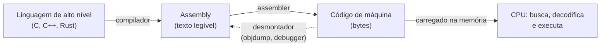
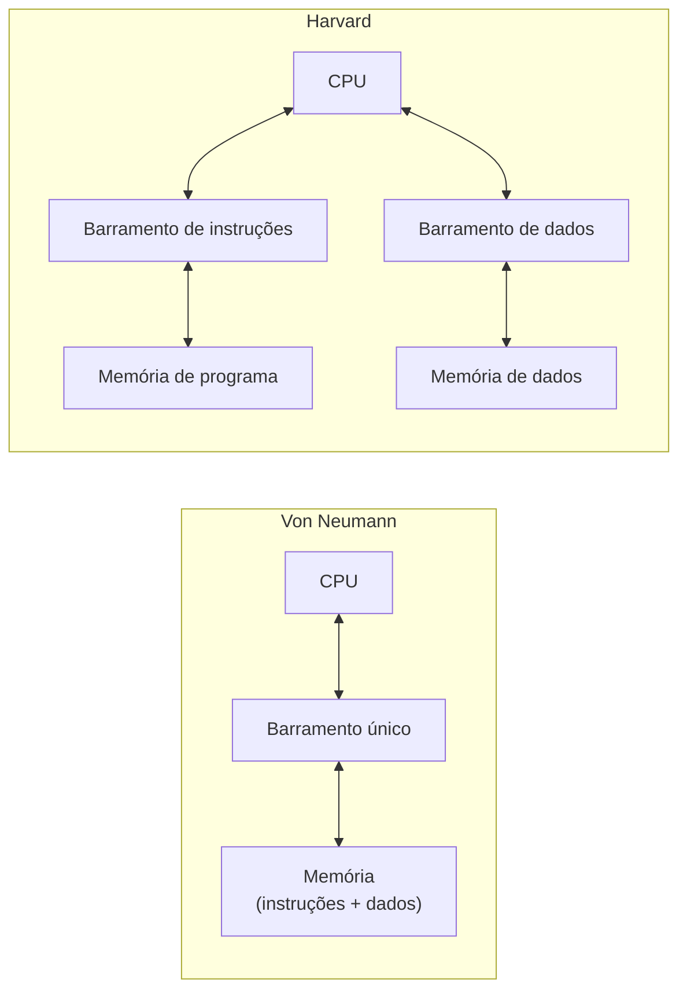
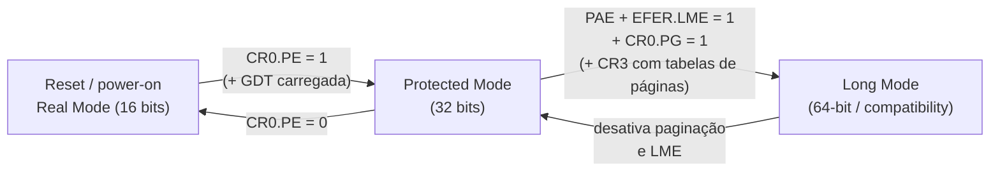
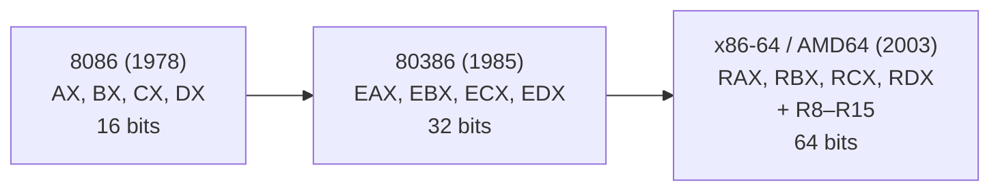
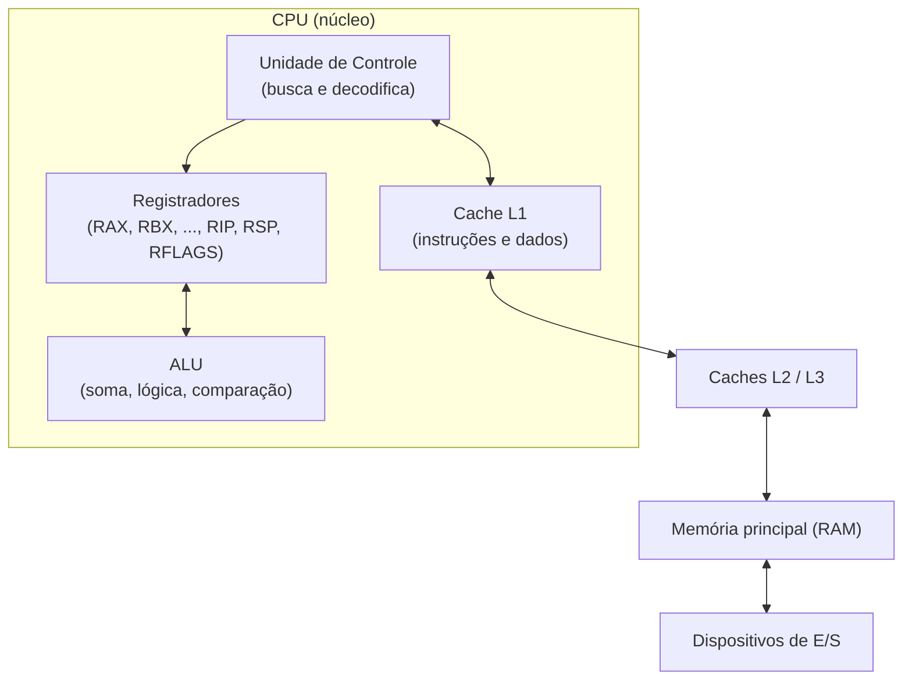

# 01 - Fundamentos de Arquitetura e Assembly

> [!abstract] Resumo
> Neste módulo você aprende **o que é Assembly**, como ele se relaciona com a linguagem de máquina e com o processador, quais são os modelos de arquitetura (von Neumann e Harvard), os modos de operação do x86 (Real, Protegido e Longo), o que é *endianness*, como uma CPU executa instruções (registradores, ALU, pipeline) e, por fim, escreve seu primeiro programa em **NASM** (Linux) e **MASM** (Windows), em 32 e 64 bits.

Voltar ao índice: [[00 - Índice]] · Próximo módulo: [[02 - Registradores e Memória]]

**Pré-requisitos:** nenhum além do ambiente configurado em [[00 - Índice#5. Configurando o ambiente de desenvolvimento|Configurando o ambiente]].

**Objetivos:**
- Explicar com suas palavras o que é Assembly e por que ainda vale a pena aprendê-lo.
- Diferenciar código-fonte Assembly, código de máquina e execução na CPU.
- Reconhecer os modos de operação do x86 e a evolução 16 → 32 → 64 bits.
- Ler e escrever valores respeitando a ordem de bytes (*endianness*).
- Montar, linkar, executar e depurar um Hello World nas duas plataformas.

Tags: #assembly #fundamentos #cpu #endianness #x86 #x64

---

## 1. O que é Assembly e por que aprender

**Assembly** é uma linguagem de programação de **baixo nível** em que cada linha corresponde (quase sempre) a **uma instrução** do processador. Em vez de números como `B8 05 00 00 00`, você escreve um **mnemônico** legível: `mov eax, 5`.

Cada família de processadores tem seu próprio conjunto de instruções (*ISA*, *Instruction Set Architecture*). Por isso **não existe "um" Assembly**: existe Assembly de x86/x64, de ARM, de RISC-V, de MIPS etc. Esta nota trata de x86/x64; o [[08 - ARM e AArch64]] mostra a diferença.

```nasm
mov eax, 5        ; coloca o valor 5 no registrador EAX
add eax, 3        ; EAX = EAX + 3  → 8
ret               ; retorna para quem chamou
```

### Por que aprender Assembly hoje?

| Motivo | Exemplo prático |
|--------|-----------------|
| **Entender o computador de verdade** | Por que `int` tem 4 bytes? O que é a pilha? O que acontece em uma chamada de função? |
| **Depurar e ler código sem fonte** | Engenharia reversa, análise de *crashes* (*core dumps*), análise de malware |
| **Desempenho** | Rotinas críticas (criptografia, codecs, matemática) usam SIMD; compiladores nem sempre geram o ideal. Veja o [[09 - Otimização, SIMD e Performance]] |
| **Software de baixo nível** | Kernels, bootloaders, drivers, firmware, microcontroladores |
| **Segurança** | Entender *buffer overflow*, ROP e mitigações exige conhecer pilha, registradores e ABI |
| **Escrever compiladores e JITs** | Quem gera código de máquina precisa conhecer a ISA |

> [!note] Quando **não** escrever Assembly
> Na maioria dos projetos, um compilador moderno (GCC, Clang, MSVC) com `-O2` ou `-O3` gera código tão bom quanto ou melhor que o seu, e muito mais portável e fácil de manter. O objetivo do curso é **entender e ler** Assembly bem, e escrevê-lo apenas onde compensa. O [[09 - Otimização, SIMD e Performance]] discute o critério.

---

## 2. Assembly, linguagem de máquina e processador

A CPU só entende **código de máquina**: sequências de bytes que codificam instruções. O Assembly é uma representação textual dessa linguagem, e o **assembler** faz a tradução, quase um-para-um.



### Mesmo trecho em três níveis

| Nível | Representação |
|-------|---------------|
| C | `x = x + 3;` (com `x` em um registrador) |
| Assembly (Intel) | `add eax, 3` |
| Código de máquina (hex) | `83 C0 03` |
| Código de máquina (binário) | `10000011 11000000 00000011` |

Alguns exemplos reais de x86/x64 (a codificação varia conforme os operandos e o modo):

| Assembly | Bytes (hex) | Tamanho |
|----------|-------------|---------|
| `nop` | `90` | 1 |
| `ret` | `C3` | 1 |
| `syscall` | `0F 05` | 2 |
| `xor eax, eax` | `31 C0` | 2 |
| `add eax, 3` | `83 C0 03` | 3 |
| `mov eax, 5` | `B8 05 00 00 00` | 5 |

> [!note] Instruções de tamanho variável
> No x86, instruções têm de **1 a 15 bytes** (*CISC* com codificação variável). Já no ARM de 64 bits (AArch64), toda instrução tem **4 bytes** (*RISC*, tamanho fixo). Isso afeta o projeto do decodificador da CPU e a forma de desmontar código. Veja o [[08 - ARM e AArch64]].

> [!tip] Veja com seus próprios olhos
> Monte qualquer exemplo e rode `objdump -d -M intel programa` (Linux) ou use a janela de disassembly do x64dbg/Visual Studio. A coluna do meio mostra exatamente os bytes que a CPU executa.

### O que o assembler faz (e o que não faz)

- **Traduz** mnemônicos e operandos em bytes.
- **Resolve** nomes simbólicos (rótulos, variáveis) em endereços ou deslocamentos.
- **Organiza** o código e os dados em **seções** (`.text`, `.data`, `.bss`).
- **Processa diretivas** (`db`, `dd`, `equ`, `section`), que **não são instruções**: não existem para a CPU, só orientam o assembler.
- **Não otimiza** nada: o que você escreve é o que é gerado. Esse é o grande contraste com um compilador.

> [!warning] Instrução × diretiva × macro
> `mov` é **instrução** (vira bytes executáveis). `db "Oi", 10` é **diretiva** (reserva e preenche bytes de dados). `%define` e `%macro` (NASM) são **pré-processador** (expandidos antes da montagem). Confundir os três é muito comum no início.

---

## 3. Arquitetura von Neumann vs Harvard

Os dois modelos descrevem **como a CPU enxerga instruções e dados na memória**.



| Característica | Von Neumann | Harvard |
|----------------|-------------|---------|
| Memória de instruções e dados | **Unificada** | **Separada** |
| Barramentos | Um | Dois (ou mais) |
| Acesso simultâneo a instrução e dado | Não (gargalo) | Sim |
| Código pode ser tratado como dado | Sim (permite JIT, *loaders*, *self-modifying code*) | Normalmente não |
| Exemplos | Modelo clássico de PCs | Microcontroladores (AVR, PIC), DSPs |

> [!note] E os processadores modernos?
> CPUs x86 e ARM de uso geral são, de fato, **Harvard modificada**: para o programador, há um único espaço de endereçamento (visão von Neumann), mas **por dentro** os caches de nível 1 são separados (*L1 instruction cache* e *L1 data cache*), o que dá o benefício de buscar instrução e dado ao mesmo tempo. O módulo [[09 - Otimização, SIMD e Performance]] retoma isso ao falar de cache.

> [!warning] Consequência prática: código também é dado
> Como a memória é unificada, é possível sobrescrever bytes de código ou executar bytes de dados. Sistemas modernos impedem isso com permissões de página (**W^X**/**NX**: uma página é gravável *ou* executável, não as duas). É por isso que, ao testar *shellcode* ou JIT, você precisa pedir ao SO permissão de execução explicitamente.

---

## 4. Modos de operação do x86 (Real, Protegido e Longo)

O x86 carrega mais de 40 anos de compatibilidade. Para isso, a CPU pode operar em **modos** diferentes.

| Modo | Largura típica | Endereçamento | Características |
|------|----------------|---------------|-----------------|
| **Real Mode** | 16 bits | 20 bits (1 MiB) via `segmento × 16 + offset` | Sem proteção de memória, sem paginação. É onde a CPU **começa** após o reset; BIOS e bootloaders iniciais rodam aqui. |
| **Protected Mode** | 32 bits | 32 bits (até 4 GiB) | Segmentação com descritores, **níveis de privilégio (rings 0–3)**, paginação, multitarefa. Base dos SO de 32 bits. |
| **Long Mode** | 64 bits | Endereços virtuais de 48 bits (canônicos); até 57 bits com paginação de 5 níveis | Obrigatoriamente com paginação. Tem dois submodos: **64-bit mode** e **compatibility mode** (roda código de 32 e 16 bits protegidos sob um SO de 64 bits). |

> [!note] Outros modos
> Existem ainda o **Virtual-8086** (rodar programas de Real Mode dentro do Protegido) e o **SMM** (*System Management Mode*, usado pelo firmware). Não são necessários para o curso.



> [!tip] Na prática
> Você **não** precisa trocar de modo em programas de usuário: o SO já escolheu. Em Linux x64 seu programa roda em *64-bit mode* (ring 3). Só em desenvolvimento de bootloader ou SO (veja a trilha em [[11 - Recursos e Referências]]) essas transições viram trabalho seu.

### Evolução dos registradores



Em x64, `RAX` contém `EAX` (32 bits baixos), que contém `AX` (16 bits baixos), que contém `AH`/`AL`. O [[02 - Registradores e Memória]] detalha isso.

---

## 5. Endianness (little-endian vs big-endian)

*Endianness* é a **ordem em que os bytes de um valor multi-byte são guardados na memória**.

Considere o valor de 32 bits `0x12345678` gravado a partir do endereço `0x1000`:

| Endereço | Little-endian | Big-endian |
|----------|---------------|------------|
| `0x1000` | `78` (byte menos significativo) | `12` (byte mais significativo) |
| `0x1001` | `56` | `34` |
| `0x1002` | `34` | `56` |
| `0x1003` | `12` | `78` |

- **Little-endian**: o byte **menos** significativo vem primeiro (menor endereço). É o caso de **x86, x64** e, na prática, do ARM em Linux/Windows/Android/iOS.
- **Big-endian**: o byte **mais** significativo vem primeiro. É o formato da **ordem de bytes de rede** (*network byte order*: TCP/IP) e de algumas arquiteturas (SPARC, PowerPC clássico, s390x).

> [!example] Observando no NASM + GDB
> ```nasm
> ; endian.asm
> global _start
> section .data
>     valor dd 0x12345678          ; 4 bytes (double word)
> section .text
> _start:
>     mov eax, [valor]             ; carrega os 4 bytes: EAX = 0x12345678
>     mov bl, [valor]              ; carrega só o 1º byte: BL = 0x78 (menor endereço)
>     mov eax, 60
>     xor edi, edi
>     syscall
> ```
>
> No GDB (depois de `si` algumas vezes, ou com `break _start` e `run`):
>
> ```text
> (gdb) x/4xb &valor
> 0x402000 <valor>:  0x78  0x56  0x34  0x12
> (gdb) x/xw &valor
> 0x402000 <valor>:  0x12345678
> ```
> O comando `x/4xb` mostra **byte a byte** (revela a ordem real); `x/xw` mostra **uma palavra de 32 bits** já interpretada pela ordem da CPU. (Os endereços variam.)

> [!warning] Armadilhas comuns
> - **Ler dump de memória "ao contrário"**: ao ver `78 56 34 12` num hex editor, o valor é `0x12345678`, não `0x78563412`.
> - **Dados de rede/arquivos**: formatos como TCP/IP e vários formatos de arquivo são big-endian; é preciso converter. Em x86 existe a instrução `bswap` para inverter bytes de um registrador (em C: `htonl`/`ntohl`).
> - **Strings não são afetadas**: `"ABCD"` fica `41 42 43 44` em qualquer ordem, porque são bytes independentes. A ordem só importa para valores de **2 bytes ou mais** (inteiros, ponteiros, floats).

> [!question] Exercício 1
> Em um sistema little-endian, o valor de 32 bits `0x0A0B0C0D` é gravado em `0x2000`. Que bytes aparecem de `0x2000` até `0x2003`? E se o valor fosse de 64 bits, `0x0000000A0B0C0D0E`?

> [!success] Solução
> - 32 bits: `0D 0C 0B 0A`.
> - 64 bits: `0E 0D 0C 0B 0A 00 00 00` (o byte menos significativo primeiro, e os zeros de maior ordem por último).

---

## 6. A CPU por dentro: registradores, ALU e pipeline

### Componentes principais



| Componente | Função |
|------------|--------|
| **Registradores** | Memórias minúsculas e **extremamente rápidas** dentro da CPU; guardam operandos, resultados, endereços e estado |
| **ALU** (*Arithmetic Logic Unit*) | Executa soma, subtração, AND, OR, XOR, deslocamentos, comparações |
| **Unidade de controle** | Busca instruções, decodifica e coordena as demais unidades |
| **Contador de programa** (`RIP`/`EIP`) | Guarda o endereço da **próxima instrução** a executar |
| **Flags** (`RFLAGS`) | Bits que registram o resultado da última operação (zero, sinal, carry, overflow...) |
| **Cache** | Memória intermediária entre CPU e RAM; reduz a latência de acesso |

### O ciclo busca–decodifica–executa


Em Assembly, "quase tudo" acontece assim. Um `jmp`, por exemplo, apenas **altera o valor de `RIP`** em vez de somá-lo ao tamanho da instrução.

> [!example] Mini-simulação mental
> ```nasm
> mov eax, 5        ; RIP aponta aqui → EAX = 5;           RIP avança 5 bytes
> add eax, 3        ; → EAX = 8;   flags: ZF=0, SF=0, ...; RIP avança 3 bytes
> sub eax, 8        ; → EAX = 0;   ZF = 1 (resultado zero); RIP avança 3 bytes
> ```
> A flag `ZF` (*Zero Flag*) vira 1 porque o resultado foi zero. Os saltos condicionais (módulo [[03 - Instruções Básicas e Controle de Fluxo]]) olham essas flags.

### Pipeline básico

Executar uma instrução por vez, de ponta a ponta, deixaria a maior parte do hardware ociosa. O **pipeline** divide a execução em **estágios** e deixa **várias instruções em andamento ao mesmo tempo**, como uma linha de montagem. O modelo clássico (RISC) tem 5 estágios: **IF** (busca), **ID** (decodificação), **EX** (execução), **MEM** (acesso à memória) e **WB** (escrita no registrador).

| Ciclo | 1 | 2 | 3 | 4 | 5 | 6 | 7 | 8 |
|-------|---|---|---|---|---|---|---|---|
| Instrução 1 | IF | ID | EX | MEM | WB | | | |
| Instrução 2 | | IF | ID | EX | MEM | WB | | |
| Instrução 3 | | | IF | ID | EX | MEM | WB | |
| Instrução 4 | | | | IF | ID | EX | MEM | WB |

Sem pipeline, 4 instruções levariam 20 ciclos; com o pipeline cheio, termina-se (idealmente) **uma instrução por ciclo**.

> [!warning] O pipeline nem sempre flui: *hazards*
> - **Dados**: uma instrução precisa do resultado da anterior (`add eax, 1` seguido de `add ebx, eax`).
> - **Controle**: um salto condicional faz a CPU não saber qual é a próxima instrução; ela **prevê** o desvio (*branch prediction*), e se errar, descarta o trabalho especulativo.
> - **Estrutural**: duas instruções disputam a mesma unidade de hardware.
>
> Vamos estudá-los com medidas reais no [[09 - Otimização, SIMD e Performance]].

> [!note] E os x86 de hoje?
> Processadores x86 modernos **traduzem** cada instrução em *micro-operações* (µops) internas, têm pipelines profundos, são **superescalares** (vários µops por ciclo) e executam **fora de ordem** (*out-of-order*), sempre preservando o resultado "como se" fosse sequencial. Para o programador, o modelo mental simples (uma instrução depois da outra) continua válido; as diferenças aparecem só ao medir desempenho.

---

## 7. Primeiro programa: Hello World

Um Hello World em Assembly precisa fazer **duas chamadas ao sistema operacional**: escrever o texto e encerrar o processo. Sem libc, isso é feito por **system calls** (Linux) ou por funções da **Windows API**. O [[05 - Entrada-Saída e System Calls]] aprofunda o assunto.

> [!note] Já viu o x64 no módulo 00?
> Sim, [[00 - Índice#5.7 Teste de fogo: Hello World|o módulo 00]] trouxe a versão x64 como teste de ambiente. Aqui vamos **entender cada parte** e comparar com as versões de **32 bits**, para você enxergar o que muda entre as arquiteturas.

### 7.1 Anatomia de um programa NASM

```nasm
global _start               ; 1) exporta o símbolo de entrada para o linker

section .data               ; 2) seção de dados inicializados
    msg db "Ola, Assembly!", 10
    len equ $ - msg         ;    $ = endereço atual; len = tamanho de msg

section .text               ; 3) seção de código
_start:                     ; 4) rótulo: ponto de entrada
    ...instruções...
```

| Elemento | Significado |
|----------|-------------|
| `global _start` | Torna `_start` visível ao `ld` (o linker procura esse símbolo como entrada padrão) |
| `section .data` | Dados com valor inicial; vão para o executável |
| `section .bss` | Dados **sem** valor inicial (só reserva espaço); veja o [[02 - Registradores e Memória]] |
| `section .text` | Código executável |
| `db`, `dw`, `dd`, `dq` | Definem 1, 2, 4 e 8 bytes de dados |
| `equ` | Define uma constante (não ocupa memória) |
| `$` | Posição atual no assembler (usada para calcular tamanhos) |

### 7.2 Linux x64 (NASM)

```nasm
; hello64.asm - NASM, Linux x86-64
global _start

section .data
    msg db "Ola, Assembly!", 10
    len equ $ - msg

section .text
_start:
    mov rax, 1              ; syscall número 1 = write
    mov rdi, 1              ; 1º argumento: descritor 1 (stdout)
    lea rsi, [rel msg]      ; 2º argumento: endereço do buffer
    mov rdx, len            ; 3º argumento: nº de bytes
    syscall                 ; chama o kernel

    mov rax, 60             ; syscall número 60 = exit
    xor edi, edi            ; 1º argumento: código de saída = 0
    syscall
```

```bash
nasm -f elf64 hello64.asm -o hello64.o
ld hello64.o -o hello64
./hello64
```

**Convenção de syscalls no Linux x64:** número em `RAX`; argumentos em `RDI`, `RSI`, `RDX`, `R10`, `R8`, `R9`; retorno em `RAX`. A instrução `syscall` **sobrescreve `RCX` e `R11`**.

### 7.3 Linux x86 de 32 bits (NASM)

```nasm
; hello32.asm - NASM, Linux 32 bits (int 0x80)
global _start

section .data
    msg db "Ola, Assembly!", 10
    len equ $ - msg

section .text
_start:
    mov eax, 4              ; syscall número 4 = write (tabela de 32 bits!)
    mov ebx, 1              ; 1º argumento: stdout
    mov ecx, msg            ; 2º argumento: endereço do buffer
    mov edx, len            ; 3º argumento: nº de bytes
    int 0x80                ; interrupção de software → kernel

    mov eax, 1              ; syscall número 1 = exit
    xor ebx, ebx            ; 1º argumento: código de saída = 0
    int 0x80
```

```bash
nasm -f elf32 hello32.asm -o hello32.o
ld -m elf_i386 hello32.o -o hello32
./hello32
```

> [!warning] Números de syscall diferem entre 32 e 64 bits
> `write` é **4** em x86 (`int 0x80`) e **1** em x64 (`syscall`); `exit` é **1** em x86 e **60** em x64. Os registradores de argumento também mudam (`EBX, ECX, EDX` vs `RDI, RSI, RDX`). Misturar tabelas é um erro clássico. Se o kernel do seu sistema tiver a emulação de 32 bits desativada, o programa de 32 bits pode falhar; nesse caso use o de 64 bits.

### 7.4 Windows x64 (MASM)

```nasm
; hello64.asm - MASM, Windows x64 (ml64)
extrn GetStdHandle : proc
extrn WriteConsoleA : proc
extrn ExitProcess : proc

.data
msg      db "Ola, Assembly!", 13, 10
len      = $ - msg
escritos dq 0

.code
main proc
    sub rsp, 40                 ; shadow space (32) + alinhamento/5º arg (8)
    mov ecx, -11                ; STD_OUTPUT_HANDLE
    call GetStdHandle           ; retorna o handle em RAX

    mov rcx, rax                ; 1º arg: handle
    lea rdx, msg                ; 2º arg: buffer
    mov r8d, len                ; 3º arg: tamanho
    lea r9, escritos            ; 4º arg: &bytes escritos
    mov qword ptr [rsp+32], 0   ; 5º arg: NULL (na pilha)
    call WriteConsoleA

    xor ecx, ecx
    call ExitProcess
main endp
end
```

```bat
ml64 hello64.asm /link /subsystem:console /entry:main kernel32.lib
hello64.exe
```

### 7.5 Windows x86 de 32 bits (MASM)

```nasm
; hello32.asm - MASM, Windows 32 bits (ml, stdcall)
.386
.model flat, stdcall
option casemap:none

GetStdHandle  PROTO :DWORD
WriteConsoleA PROTO :DWORD, :DWORD, :DWORD, :DWORD, :DWORD
ExitProcess   PROTO :DWORD
includelib kernel32.lib

.data
msg      db "Ola, Assembly!", 13, 10
len      = $ - msg
escritos dd 0

.code
main PROC
    push -11                    ; STD_OUTPUT_HANDLE
    call GetStdHandle           ; handle em EAX (stdcall: a função limpa a pilha)

    push 0                      ; 5º arg (empilhado primeiro: ordem direita → esquerda)
    push OFFSET escritos        ; 4º arg
    push len                    ; 3º arg
    push OFFSET msg             ; 2º arg
    push eax                    ; 1º arg: handle
    call WriteConsoleA

    push 0
    call ExitProcess
main ENDP
END main
```

```bat
rem No "x86 Native Tools Command Prompt for VS"
ml hello32.asm /link /subsystem:console /entry:main
hello32.exe
```

### 7.6 Comparativo: o que muda entre as quatro versões

| Aspecto | Linux x86 (32) | Linux x64 | Windows x86 (32) | Windows x64 |
|---------|----------------|-----------|------------------|-------------|
| Assembler | NASM | NASM | MASM (`ml`) | MASM (`ml64`) |
| Chamar o SO | `int 0x80` | `syscall` | funções da Windows API (`kernel32`) | funções da Windows API (`kernel32`) |
| Argumentos | registradores (`EBX, ECX, EDX...`) | registradores (`RDI, RSI, RDX...`) | **pilha** (`stdcall`) | `RCX, RDX, R8, R9` + pilha + *shadow space* |
| Retorno | `EAX` | `RAX` | `EAX` | `RAX` |
| Ponto de entrada | `_start` | `_start` | `main` (via `/entry:main`) | `main` (via `/entry:main`) |
| Fim do programa | syscall `exit` | syscall `exit` | `ExitProcess` | `ExitProcess` |

> [!note] Por que o Windows não usa syscalls direto?
> No Windows, os números de syscalls do kernel **mudam entre versões**; por isso o caminho suportado é chamar a **API** (`kernel32.dll` e `ntdll.dll`). No Linux, a interface de syscalls é **estável** e documentada, e por isso podemos usá-la diretamente.

### 7.7 Versão ingênua vs versão otimizada

A versão x64 acima é correta, mas dá para ser mais econômico:

```nasm
; --- Ingênua ---
mov rax, 1              ; 48 C7 C0 01 00 00 00   (7 bytes)
mov rdi, 1              ; 48 C7 C7 01 00 00 00   (7 bytes)
mov rdx, len            ; 48 C7 C2 xx xx xx xx   (7 bytes)

; --- Otimizada ---
mov eax, 1              ; B8 01 00 00 00         (5 bytes)
mov edi, eax            ; 89 C7                  (2 bytes)  ← reaproveita o valor 1
mov edx, len            ; BA xx xx xx xx         (5 bytes)
```

**Por quê?** Em x64, **escrever em um registrador de 32 bits zera automaticamente os 32 bits superiores**. Assim, `mov eax, 1` deixa `RAX = 1` por completo, com uma codificação menor, e `mov edi, eax` copia o valor em 2 bytes. Menos bytes de código significa menos pressão no cache de instruções. Em um Hello World isso não muda nada perceptível, mas é o tipo de idioma que o compilador usa em todo lugar; você o verá no `objdump` de qualquer binário.

> [!warning] Cuidado com a otimização "esperta"
> Isso só vale para **escritas em 32 bits** (`eax`, `edi`...). Escritas em 8 ou 16 bits (`al`, `ax`) **não** zeram o restante do registrador. Veremos esse detalhe com cuidado no [[02 - Registradores e Memória]].

### 7.8 Depurando o Hello World instrução a instrução

```text
$ gdb ./hello64
(gdb) break _start
(gdb) run
(gdb) layout regs            # painel com registradores (Ctrl+X, A para sair)
(gdb) x/6i $rip              # próximas 6 instruções
(gdb) stepi                  # executa 1 instrução (ou "si")
(gdb) info registers rax rdi rsi rdx
(gdb) x/s &msg               # imprime msg como string
```

> [!tip] O que observar
> 1. `RIP` **avança** o tamanho de cada instrução depois de executá-la (5 bytes após um `mov eax, imm32`).
> 2. Depois do `syscall` do `write`, o texto aparece na tela e `RAX` passa a valer o **número de bytes escritos** (o retorno da syscall).
> 3. No `exit`, o programa termina e o GDB avisa `exited normally`.

---

## 8. Erros comuns do iniciante

> [!warning] Lista de armadilhas do módulo 01
> 1. **Confundir diretiva com instrução** (`db`/`dd` não executam nada).
> 2. **Inverter a ordem dos operandos** ao ler saída do GCC/`objdump` em AT&T. No curso: sempre `destino, origem`.
> 3. **Ignorar a endianness** ao ler dumps de memória.
> 4. **Não encerrar o programa**: sem `exit`, a CPU continua a executar bytes seguintes (provavelmente lixo) e ocorre *segmentation fault*.
> 5. **Usar a tabela de syscalls da arquitetura errada** (32 vs 64 bits).
> 6. **Contar bytes de texto à mão** com acentos: `á` ocupa 2 bytes em UTF-8; use `$ - msg`.
> 7. **Executar o formato errado**: gerar `elf32` e linkar sem `-m elf_i386`, ou misturar `win32`/`win64` no NASM.

---

## 9. Exercícios

> [!question] Exercício 2: Decodificando bytes
> Os bytes `B8 2A 00 00 00 C3` formam uma pequena função. Consultando a tabela da seção 2, o que ela faz?

> [!success] Solução
> `B8 2A 00 00 00` é `mov eax, 0x2A` (42 decimal; o imediato de 4 bytes está em little-endian) e `C3` é `ret`. A função **retorna 42** (o valor de retorno de 32 bits fica em `EAX`).

> [!question] Exercício 3: Mensagem personalizada
> Modifique o Hello World x64 para imprimir **duas linhas** diferentes usando **duas chamadas** à syscall `write`. Calcule os tamanhos com `equ $ - rótulo`.

> [!success] Solução
> ```nasm
> global _start
> section .data
>     m1 db "Linha 1", 10
>     l1 equ $ - m1
>     m2 db "Linha 2", 10
>     l2 equ $ - m2
> section .text
> _start:
>     mov eax, 1
>     mov edi, 1
>     lea rsi, [rel m1]
>     mov edx, l1
>     syscall
>
>     mov eax, 1              ; RAX foi sobrescrito pelo retorno de write: reponha!
>     mov edi, 1              ; RDI pode ser preservado, mas repor é mais seguro
>     lea rsi, [rel m2]
>     mov edx, l2
>     syscall
>
>     mov eax, 60
>     xor edi, edi
>     syscall
> ```
> **Atenção:** `l1` é calculado logo após `m1`, antes de `m2` ser definido; por isso cada `equ` fica **imediatamente depois** da sua mensagem.

> [!question] Exercício 4: Código de saída
> Faça o programa terminar com código de saída **7** e confirme com `echo $?`. Depois descubra por que o valor máximo observável no Linux é **255**.

> [!success] Solução
> Troque `xor edi, edi` por `mov edi, 7`. O shell lê apenas **os 8 bits baixos** do código de saída (`exit_status & 0xFF`), logo valores como 256 viram 0 e 300 viram 44.

> [!question] Exercício 5: Mapeando conceitos
> Para cada item, diga se é **instrução**, **diretiva** ou **rótulo**: `mov eax, 1` · `msg db "Oi"` · `_start:` · `syscall` · `len equ $ - msg` · `section .text`.

> [!success] Solução
> Instruções: `mov eax, 1`, `syscall`. Diretivas: `msg db "Oi"`, `len equ $ - msg`, `section .text`. Rótulo: `_start:` (um nome que representa um endereço e não gera bytes).

> [!question] Exercício 6 (desafio): Ver os bytes
> Monte o `hello64.asm` e execute `objdump -d -M intel hello64`. Anote os bytes de cada instrução e compare com a tabela da seção 7.7. Qual instrução do seu programa gerou os bytes `0F 05`?

> [!success] Solução
> Os bytes `0F 05` são a instrução `syscall`, que aparece duas vezes (uma para `write` e outra para `exit`). Os demais bytes dependem de como você escreveu cada `mov`; se usou a versão de 64 bits (`mov rax, 1`), verá `48 C7 C0 01 00 00 00`; com a otimizada (`mov eax, 1`), `B8 01 00 00 00`.

Os laboratórios que acompanham este módulo: [[Lab 01 - Hello World e Operações Básicas]].

---

## 10. Resumo

> [!abstract] Resumo do módulo 01
> - **Assembly** é a representação textual da linguagem de máquina de uma ISA específica; o **assembler** a traduz quase um-para-um e **não otimiza**.
> - O código de máquina x86 tem instruções de **tamanho variável** (1–15 bytes); AArch64 usa tamanho fixo de 4 bytes.
> - **von Neumann** = memória unificada; **Harvard** = separada. CPUs modernas são Harvard modificada (caches L1 separados).
> - O x86 tem modos **Real (16), Protegido (32) e Longo (64)**; a CPU inicia em Real Mode.
> - x86/x64 são **little-endian**: o byte menos significativo fica no menor endereço.
> - A CPU executa em ciclo **busca → decodificação → execução → escrita**, com **pipeline** para sobrepor instruções; *hazards* podem atrasá-lo.
> - Hello World exige **escrever** e **encerrar**; no Linux via `syscall` (x64) ou `int 0x80` (x86), no Windows via Windows API.
> - Em x64, escrever em registrador de **32 bits zera os 32 superiores**, o que permite instruções menores (`mov eax, 1` em vez de `mov rax, 1`).

**Próximo:** [[02 - Registradores e Memória]] · **Ver também:** [[Glossário#Assembly (x86-64 e ARM)]] · [[Cheat Sheet de Instruções]] · [[00 - Índice]]
