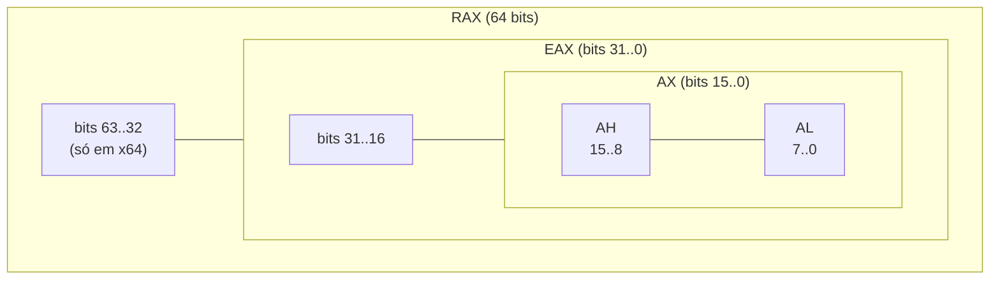
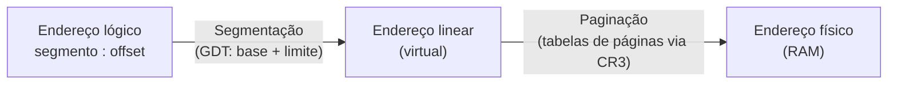
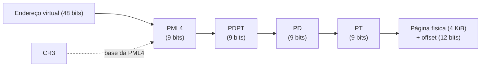
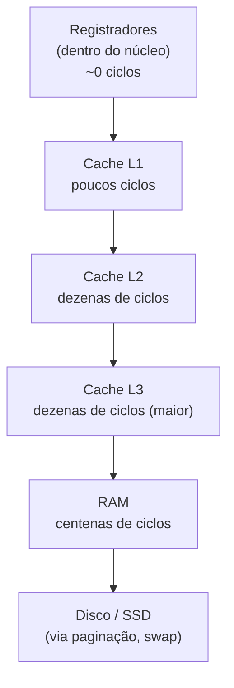

# 02 - Registradores e Memória

> [!abstract] Resumo
> Registradores são o "espaço de trabalho" da CPU; a memória é onde vivem código, dados e pilha. Neste módulo você aprende **todos os registradores relevantes do x86 e do x64** (propósito geral, segmento, flags, ponteiros), como a CPU **traduz endereços** (segmentação e paginação), como o **processo é organizado na memória** (text, data, bss, heap, stack), os **modos de endereçamento** (incluindo `base + index*scale + displacement`) e por que o **alinhamento** importa.

Voltar ao índice: [[Índice - Assembly]] · Módulo anterior: [[01 - Fundamentos de Arquitetura e Assembly]] · Próximo: [[03 - Instruções Básicas e Controle de Fluxo]]

**Pré-requisitos:** ter feito o Hello World do [[01 - Fundamentos de Arquitetura e Assembly]] e saber usar `stepi` e `info registers` no GDB (ou o equivalente no x64dbg/Visual Studio).

**Objetivos:**
- Nomear os registradores de propósito geral em 8, 16, 32 e 64 bits e saber o que acontece ao escrever em cada tamanho.
- Interpretar as principais flags do `RFLAGS` depois de uma operação.
- Explicar, em alto nível, como um endereço virtual vira um endereço físico.
- Desenhar o mapa de memória de um processo e dizer onde cada coisa do seu programa fica.
- Escrever qualquer operando de memória usando os modos de endereçamento do x86.
- Alinhar dados corretamente e entender o *padding* de structs.

Tags: #assembly #registradores #memoria #flags #enderecamento #x64

---

## 1. Registradores de propósito geral

**Registradores** são posições de armazenamento **dentro da CPU**. Acessá-los não envolve cache nem barramento de memória: é a operação mais rápida que existe. Por isso o código eficiente tenta manter dados "quentes" neles.

> [!note] Ordem de grandeza
> Ler um registrador custa praticamente zero ciclos adicionais; um acesso ao cache L1 costuma levar na ordem de 4 a 5 ciclos; à RAM, centenas de ciclos. Os valores exatos variam de processador para processador. O módulo [[09 - Otimização, SIMD e Performance]] mede isso na prática.

### 1.1 Os 16 registradores de 64 bits (x64) e os 8 de 32 bits (x86)

Em **x86 (32 bits)** há 8 registradores de propósito geral (`EAX, EBX, ECX, EDX, ESI, EDI, EBP, ESP`). O **x64** os estende para 64 bits (`RAX...RSP`) e acrescenta **8 novos**: `R8` a `R15`.

| 64 bits | 32 bits | 16 bits | 8 bits (baixo) | 8 bits (alto) | Papel histórico |
|---------|---------|---------|----------------|---------------|-----------------|
| `RAX` | `EAX` | `AX` | `AL` | `AH` | **A**cumulador; retorno de funções; operações `mul`/`div` |
| `RBX` | `EBX` | `BX` | `BL` | `BH` | **B**ase |
| `RCX` | `ECX` | `CX` | `CL` | `CH` | **C**ontador (loops, deslocamentos) |
| `RDX` | `EDX` | `DX` | `DL` | `DH` | **D**ados; parte alta em `mul`/`div` |
| `RSI` | `ESI` | `SI` | `SIL` | — | **S**ource **I**ndex (instruções de string) |
| `RDI` | `EDI` | `DI` | `DIL` | — | **D**estination **I**ndex |
| `RBP` | `EBP` | `BP` | `BPL` | — | **B**ase **P**ointer (*frame* da pilha) |
| `RSP` | `ESP` | `SP` | `SPL` | — | **S**tack **P**ointer (topo da pilha) |
| `R8` … `R15` | `R8D` … `R15D` | `R8W` … `R15W` | `R8B` … `R15B` | — | Apenas x64; sem papel fixo |



> [!note] "Papel histórico" não é regra
> Hoje quase todos os registradores servem para qualquer coisa. As exceções são instruções que **usam registradores fixos** (por exemplo, `mul` e `div` usam `RAX`/`RDX`; `shl reg, cl` usa `CL`; `rep movsb` usa `RSI`, `RDI` e `RCX`; `syscall` usa `RAX`, `RDI`, `RSI`, `RDX`...). Além disso, as **calling conventions** (módulo [[04 - Procedimentos, Stack e Calling Conventions]]) reservam funções específicas para cada registrador.

> [!warning] `RSP` e `RBP` são "de propósito geral" só no papel
> `RSP` aponta para o topo da pilha e é modificado por `push`, `pop`, `call` e `ret` implicitamente. Usá-lo como acumulador quebra a pilha. `RBP` é frequentemente usado como *frame pointer*, mas compiladores com otimização também o liberam como registrador comum.

### 1.2 Regras de escrita em sub-registradores (importante!)

A forma como a CPU trata a escrita em partes de um registrador é uma fonte clássica de bugs:

| Escrita em | Efeito nos bits restantes (x64) |
|------------|---------------------------------|
| **64 bits** (`RAX`) | Substitui tudo |
| **32 bits** (`EAX`) | **Zera** os 32 bits superiores (extensão com zeros) |
| **16 bits** (`AX`) | **Preserva** os bits 63..16 |
| **8 bits** (`AL`, `AH`) | **Preserva** todos os outros bits |

> [!example] Demonstração: `regs.asm`
> ```nasm
> ; regs.asm - NASM, Linux x64. Depure com GDB e use "info registers rax" a cada passo.
> global _start
> section .text
> _start:
>     mov rax, 0x1122334455667788   ; instrução de 10 bytes (mov com imediato de 64 bits)
>
>     mov eax, 0xAABBCCDD           ; RAX = 0x00000000AABBCCDD  (32 bits superiores zerados!)
>
>     mov rax, 0x1122334455667788
>     mov ax,  0xAABB               ; RAX = 0x112233445566AABB  (só os 16 baixos mudam)
>
>     mov rax, 0x1122334455667788
>     mov al,  0xFF                 ; RAX = 0x11223344556677FF
>     mov ah,  0x00                 ; RAX = 0x11223344556600FF
>
>     mov eax, 60                   ; exit
>     xor edi, edi
>     syscall
> ```
> Rode `gdb ./regs`, `break _start`, `run`, e use `si` + `p/x $rax` após cada `mov`.

> [!warning] Armadilhas
> - **`AH`, `BH`, `CH`, `DH` não podem ser usados em instruções que exijam o prefixo REX** (por exemplo, junto com `R8B`, `SIL` ou `DIL`). O assembler recusa com um erro de codificação.
> - **Ler `RAX` depois de escrever só `AL`**: o valor antigo dos bits superiores continua lá. Se você queria um valor limpo (por exemplo, um byte lido como número de 64 bits), use `movzx eax, byte [mem]` (módulo [[03 - Instruções Básicas e Controle de Fluxo]]).
> - Em 32 bits (x86), **não há** extensão automática: `EAX` é o limite do registrador.

> [!note] Por que a escrita em 32 bits zera a parte alta?
> É uma decisão de projeto do AMD64: evita *dependências falsas* entre o valor antigo e o novo. Escritas parciais (8 e 16 bits) fundem o novo valor com o antigo, o que pode criar dependência e atrasar a execução (*partial register stall*) em alguns processadores. Isso explica por que compiladores preferem `xor eax, eax` e `mov eax, imm32` a variantes de 8 ou 16 bits.

### 1.3 Registradores que você ainda não vê, mas existem

| Grupo | Registradores | Onde estudar |
|-------|---------------|--------------|
| SIMD (128/256/512 bits) | `XMM0–XMM15`, `YMM0–YMM15`, `ZMM` | [[07 - Assembly Avançado (x86-x64)]], [[09 - Otimização, SIMD e Performance]] |
| FPU x87 | `ST0–ST7` | [[07 - Assembly Avançado (x86-x64)]] |
| Controle | `CR0, CR2, CR3, CR4` | Só em ring 0 (SO); `CR3` aponta para a tabela de páginas (seção 4 deste módulo) |
| Depuração | `DR0–DR7` | Breakpoints de hardware; depuradores usam |
| MSR | *Model-Specific Registers* (`rdmsr`/`wrmsr`) | Só ring 0 |

---

## 2. Registradores de segmento e flags

### 2.1 Registradores de segmento

Seis registradores de **16 bits**: `CS` (código), `DS` (dados), `ES`, `SS` (pilha), `FS` e `GS` (extras).

| Modo | Papel |
|------|-------|
| **Real mode (16 bits)** | Guardam um **número de segmento**; endereço físico = `segmento × 16 + deslocamento` |
| **Protected mode (32 bits)** | Guardam um **seletor** que indica uma entrada na **GDT/LDT** (descritor com base, limite e permissões) |
| **64-bit mode** | `CS`, `DS`, `ES`, `SS` têm base tratada como **0** (modelo "flat"); só `FS` e `GS` ainda têm uma **base** utilizável |

> [!example] Real mode: o clássico `segmento:offset`
> `1234h:0010h` → `0x1234 × 16 + 0x10 = 0x12340 + 0x10 = 0x12350`.
> Vários pares `segmento:offset` apontam para o mesmo endereço físico (por exemplo, `1235h:0000h` também resulta em `0x12350`).

> [!note] Para que servem `FS` e `GS` hoje?
> São usados para **dados por *thread***:
>
> | Sistema | Registrador | Aponta para |
> |---------|-------------|-------------|
> | Linux x64 | `FS` | *Thread Local Storage* (TLS) |
> | Windows x64 | `GS` | `TEB` (*Thread Environment Block*); `gs:[0x60]` é o `PEB` |
> | Windows x86 | `FS` | `TEB`; `fs:[0x30]` é o `PEB` |
>
> Analistas de malware e de *reverse engineering* encontram `gs:[0x60]` e `fs:[0x30]` o tempo todo.

### 2.2 Flags: `EFLAGS` e `RFLAGS`

O registrador de flags guarda **bits de estado** (resultado da última operação aritmética/lógica) e **bits de controle**. Em x64 se chama `RFLAGS` (64 bits, mas só os 32 baixos são usados), em x86 `EFLAGS`.

| Bit | Sigla | Nome | Significado |
|-----|-------|------|-------------|
| 0 | **CF** | Carry | Houve "vai-um" (ou "empréstimo") em operação **sem sinal** |
| 2 | **PF** | Parity | Número de bits 1 **no byte baixo** do resultado é par |
| 4 | **AF** | Auxiliary Carry | "Vai-um" entre os bits 3 e 4 (usado em BCD) |
| 6 | **ZF** | Zero | Resultado foi **zero** |
| 7 | **SF** | Sign | Bit mais significativo do resultado (**negativo** se sinalizado) |
| 8 | TF | Trap | Modo passo-a-passo (usado por debuggers) |
| 9 | IF | Interrupt Enable | Interrupções mascaráveis habilitadas (controlado pelo SO) |
| 10 | **DF** | Direction | Sentido das instruções de string (0 = crescente, 1 = decrescente) |
| 11 | **OF** | Overflow | **Estouro** em operação **com sinal** |

As flags **CF, ZF, SF, OF** (e em menor grau PF e DF) são as que você usará todos os dias; elas alimentam os saltos condicionais do módulo [[03 - Instruções Básicas e Controle de Fluxo]].

> [!example] CF e OF não são a mesma coisa
> ```nasm
> mov eax, 0xFFFFFFFF
> add eax, 1            ; EAX = 0
>                       ; CF = 1 (sem sinal: 4.294.967.295 + 1 estoura 32 bits)
>                       ; ZF = 1 (resultado zero)
>                       ; OF = 0 (com sinal: -1 + 1 = 0, sem estouro)
>
> mov eax, 0x7FFFFFFF
> add eax, 1            ; EAX = 0x80000000
>                       ; CF = 0 (sem sinal: 2.147.483.647 + 1 cabe em 32 bits)
>                       ; OF = 1 (com sinal: positivo + positivo = negativo → estouro)
>                       ; SF = 1 (bit mais significativo = 1)
> ```
> **A mesma instrução, interpretada como sem sinal ou com sinal.** O processador atualiza as duas flags; **você** decide qual interpretar (com `jc`/`jb` para sem sinal e `jo`/`jg`/`jl` para com sinal).

> [!warning] Quais instruções mexem nas flags?
> - **Alteram:** `add`, `sub`, `cmp`, `and`, `or`, `xor`, `test`, `neg`, deslocamentos, `mul`/`imul` (parcialmente).
> - **`inc` e `dec` alteram quase tudo, mas NÃO alteram `CF`.**
> - **Não alteram:** `mov`, `lea`, `push`, `pop`, `jmp`, `call`, `ret`, `movzx`/`movsx`.
>
> Por isso `xor eax, eax` e `mov eax, 0` **não são idênticas**: a primeira altera flags (ZF = 1, CF = 0, OF = 0); a segunda, não. Entre um `cmp` e o `jcc` que o usa, não coloque instruções que mudem flags.

---

## 3. Registradores de ponteiro: `RIP`, `RSP`, `RBP`

| Registrador | x86 | Função |
|-------------|-----|--------|
| `RIP` | `EIP` | **Instruction Pointer**: endereço da próxima instrução a executar |
| `RSP` | `ESP` | **Stack Pointer**: topo da pilha (menor endereço em uso) |
| `RBP` | `EBP` | **Base Pointer**: referência fixa dentro do *stack frame* da função |

- **`RIP` não pode ser lido nem escrito com `mov`.** Só muda por `jmp`, `jcc`, `call`, `ret` e interrupções. Em x64 ele pode aparecer em **endereçamento relativo**: `lea rsi, [rel msg]` calcula `msg` como `RIP + deslocamento`. Isso torna o código independente de posição (módulo [[07 - Assembly Avançado (x86-x64)]], PIC).
- **`RSP`** é atualizado por `push` (decrementa) e `pop` (incrementa); a pilha **cresce para endereços menores**.
- **`RBP`** guarda uma "âncora" para acessar parâmetros e variáveis locais por deslocamentos fixos (por exemplo, `[rbp-8]`). Veja [[04 - Procedimentos, Stack e Calling Conventions]].

---

## 4. Segmentação e paginação: visão prática

Seu programa nunca usa endereços físicos diretamente. Os endereços que aparecem no Assembly são **virtuais** (ou "lineares", depois da segmentação) e a CPU os converte, com ajuda do SO.



- Em **64-bit mode** a segmentação é praticamente neutra (bases 0), então **endereço linear = offset** (exceto `FS`/`GS`).
- A **paginação** divide o espaço virtual em **páginas** (4 KiB é o tamanho padrão; também há de 2 MiB e 1 GiB). O SO mantém, para cada processo, **tabelas de páginas** que dizem qual página física corresponde a cada página virtual e **com quais permissões** (ler, escrever, executar; usuário ou kernel).

### 4.1 Tradução de endereços em x64 (4 níveis)

Um endereço virtual de 48 bits é dividido em cinco campos:

| Bits | Campo | Função |
|------|-------|--------|
| 47..39 | índice PML4 | Escolhe a entrada na tabela de nível 4 (apontada por `CR3`) |
| 38..30 | índice PDPT | Nível 3 |
| 29..21 | índice PD | Nível 2 |
| 20..12 | índice PT | Nível 1 (aponta para a página física) |
| 11..0 | *offset* | Posição **dentro** da página de 4 KiB (`2^12 = 4096`) |



Quatro leituras de memória por tradução soariam proibitivas; por isso a CPU guarda traduções recentes na **TLB** (*Translation Lookaside Buffer*), um cache especializado.

> [!note] Endereços "canônicos"
> Com 48 bits efetivos, os bits 63..48 do endereço precisam ser **cópia do bit 47**. Endereços fora desse padrão são **não canônicos** e causam exceção. Isso divide o espaço em duas metades: **baixa** (`0x0000_0000_0000_0000` a `0x0000_7FFF_FFFF_FFFF`, usuário) e **alta** (`0xFFFF_8000_0000_0000` em diante, kernel). Com paginação de 5 níveis são 57 bits.

> [!tip] Falha de página (*page fault*)
> Quando a CPU não encontra uma tradução válida, ou o acesso viola as permissões (escrever em página só de leitura, executar página sem permissão de execução), ela dispara uma **exceção #PF**. O SO decide: carregar a página (*demand paging*), ou terminar o processo com **segmentation fault (SIGSEGV)** no Linux ou **access violation** no Windows. É a origem do erro que você vai ver muitas vezes ao aprender.

### 4.2 Veja o mapa de memória do seu programa

```bash
# Em um processo qualquer:
cat /proc/self/maps

# Dentro do GDB, com seu programa parado:
(gdb) info proc mappings
```

A saída lista, por linha: faixa de endereços, permissões (`r-xp` = leitura/execução, `rw-p` = leitura/escrita, ...), deslocamento, dispositivo e nome do arquivo ou região (`[heap]`, `[stack]`).

---

## 5. Organização da memória de um processo

```text
Endereços altos
0xFFFF_FFFF_FFFF_FFFF  ┌────────────────────────────┐
                       │  Espaço do kernel          │  (inacessível em modo usuário)
0xFFFF_8000_0000_0000  ├────────────────────────────┤
                       │  (região não canônica)     │
0x0000_7FFF_FFFF_FFFF  ├────────────────────────────┤
                       │  Pilha (stack)         ↓   │  cresce para baixo
                       │                            │
                       │  Mapeamentos (mmap):       │
                       │  bibliotecas, arquivos     │
                       │                            │
                       │  Heap                  ↑   │  cresce para cima
                       ├────────────────────────────┤
                       │  .bss   (dados zerados)    │
                       │  .data  (dados com valor)  │
                       │  .rodata (constantes)      │
                       │  .text  (código)           │
0x0000_0000_0040_0000  └────────────────────────────┘  (endereço típico em executável não-PIE no Linux)
Endereços baixos
```

| Região | Conteúdo | Permissões típicas | Tamanho |
|--------|----------|--------------------|---------|
| **`.text`** | Instruções do programa | leitura + execução (`r-x`) | Fixo |
| **`.rodata`** | Constantes (strings literais) | só leitura (`r--`) | Fixo |
| **`.data`** | Variáveis globais **inicializadas** | leitura + escrita (`rw-`) | Fixo |
| **`.bss`** | Variáveis globais **não inicializadas** (zeradas pelo SO) | leitura + escrita (`rw-`) | Fixo (**não ocupa espaço no arquivo**) |
| **Heap** | Memória dinâmica (`malloc`, `brk`/`mmap`) | leitura + escrita | Varia em tempo de execução |
| **Stack** | Endereços de retorno, parâmetros, variáveis locais | leitura + escrita | Cresce e encolhe a cada chamada |

> [!note] Valores reais variam
> O endereço `0x400000` vale para executáveis não-PIE linkados com `ld` padrão. Em executáveis **PIE** e com **ASLR** (*Address Space Layout Randomization*), as bases de código, bibliotecas, heap e pilha são **sorteadas a cada execução**. Se os endereços mudarem toda vez que você rodar o programa, é o ASLR funcionando, não um bug.

> [!example] Seções em NASM e MASM
> | Propósito | NASM | MASM |
> |-----------|------|------|
> | Código | `section .text` | `.code` |
> | Dados inicializados | `section .data` | `.data` |
> | Dados não inicializados | `section .bss` + `resb`/`resw`/`resd`/`resq` | `.data?` |
> | Constantes | `section .rodata` | `.const` |
>
> ```nasm
> ; NASM
> section .data
>     contador  dd 10                 ; 4 bytes, valor inicial 10
>     tabela    db 1, 2, 3, 4, 5      ; 5 bytes
>     zeros     times 8 db 0          ; 8 bytes zero
>     texto     db "Oi", 0            ; string terminada em zero
> section .bss
>     buffer    resb 64               ; reserva 64 bytes (sem valor)
>     total     resq 1                ; reserva 1 quad-word (8 bytes)
> ```
> ```nasm
> ; MASM
> .data
>     contador  dd 10
>     tabela    db 1, 2, 3, 4, 5
>     zeros     db 8 dup(0)
>     texto     db "Oi", 0
> .data?
>     buffer    db 64 dup(?)
>     total     dq ?
> ```

### Diretivas de dados

| Tamanho | Bytes | NASM (definir) | NASM (reservar) | MASM |
|---------|-------|----------------|-----------------|------|
| byte | 1 | `db` | `resb` | `db` / `byte` |
| word | 2 | `dw` | `resw` | `dw` / `word` |
| double word | 4 | `dd` | `resd` | `dd` / `dword` |
| quad word | 8 | `dq` | `resq` | `dq` / `qword` |
| ten bytes | 10 | `dt` | `rest` | `dt` / `tbyte` |

> [!tip] Onde fica a pilha no Assembly?
> Nada a declarar: o SO já criou a pilha e `RSP` já aponta para ela quando o programa começa. Você só a usa via `push`/`pop`/`call`/`ret` e acessos `[rsp+...]`. Aprofundamos no [[04 - Procedimentos, Stack e Calling Conventions]].

---

## 6. Modos de endereçamento

Um **operando** pode ser de três tipos: **imediato** (o valor está na instrução), **registrador** ou **memória**. Para memória, o x86 usa uma forma geral e flexível:

```text
[ base + índice × escala + deslocamento ]
```

| Parte | Pode ser | Observação |
|-------|----------|------------|
| **base** | qualquer registrador de propósito geral | opcional |
| **índice** | qualquer registrador, **exceto** `RSP` | opcional |
| **escala** | `1`, `2`, `4` ou `8` | casa com o tamanho do elemento do array |
| **deslocamento** (*displacement*) | constante de 8 ou 32 bits (com sinal) | opcional |

### 6.1 Os modos, em ordem de complexidade

| # | Modo | Exemplo NASM | Significado |
|---|------|--------------|-------------|
| 1 | **Imediato** | `mov eax, 42` | O valor 42 está na própria instrução |
| 2 | **Registrador** | `mov eax, ebx` | Copia de registrador para registrador |
| 3 | **Memória direta** | `mov eax, [contador]` | Lê da posição do rótulo `contador` |
| 4 | **Indireto por registrador** | `mov eax, [rbx]` | Lê da memória apontada por `RBX` |
| 5 | **Base + deslocamento** | `mov eax, [rbx+8]` | Campo de uma struct, ou variável local `[rbp-4]` |
| 6 | **Base + índice** | `mov al, [rbx+rcx]` | Array de bytes: `base[i]` |
| 7 | **Índice × escala + deslocamento** | `mov eax, [tabela+rcx*4]` | Array de `int` com base fixa |
| 8 | **Completo** | `mov eax, [rbx+rcx*4+16]` | `base + i × 4 + 16` |
| 9 | **RIP-relativo** (x64) | `mov eax, [rel contador]` | `RIP + deslocamento` |

> [!example] Cálculo do endereço efetivo
> Com `RBX = 0x1000` e `RCX = 3`:
> `[rbx + rcx*8 + 16]` → `0x1000 + 3×8 + 16 = 0x1000 + 0x18 + 0x10 =` **`0x1028`**.
> O processador calcula esse endereço **por hardware**, em uma unidade própria (AGU), antes de acessar a memória.

### 6.2 Diferenças NASM × MASM que pegam todo mundo

| Situação | NASM | MASM |
|----------|------|------|
| **Valor** da variável | `mov eax, [var]` (colchetes = conteúdo) | `mov eax, var` (sem colchetes já é conteúdo!) |
| **Endereço** da variável | `mov rax, var` ou `lea rax, [rel var]` | `lea rax, var` (ou `mov rax, offset var`) |
| Tamanho do acesso à memória | `mov dword [rbx], 5` | `mov dword ptr [rbx], 5` |
| Deslocamento em RIP (x64) | explícito: `[rel var]` ou `default rel` | implícito (padrão no `ml64`) |
| Dados em linha | `db "Oi", 0` | `db "Oi", 0` |

> [!warning] Armadilha nº 1 de quem alterna entre NASM e MASM
> Em NASM, `mov eax, var` carrega o **endereço** de `var` e `mov eax, [var]` carrega o **conteúdo**. Em MASM, `mov eax, var` carrega o **conteúdo**, e para o endereço você usa `offset var` ou `lea`. O mesmo texto, resultados diferentes.

> [!warning] Quando o tamanho é ambíguo
> `mov [rbx], 5` não diz **quantos bytes** escrever (1, 2, 4 ou 8?). O assembler exige um especificador: `mov byte [rbx], 5`, `mov dword [rbx], 5`, etc. Quando há um registrador de tamanho conhecido no outro operando (`mov [rbx], eax`), o tamanho é deduzido.

### 6.3 `LEA`: calcula endereço sem acessar memória

`lea` (*Load Effective Address*) executa **somente o cálculo do endereço** e coloca o resultado no destino, **sem ler a memória e sem alterar flags**. Por isso é um truque aritmético:

```nasm
lea eax, [rax + rax*4]      ; EAX = EAX × 5
lea eax, [rbx + rcx*2 + 7]  ; EAX = RBX + 2×RCX + 7, em uma só instrução
```

> [!question] Exercício 1: multiplicar por 10
> Usando apenas `lea` e `add`, multiplique `EAX` por 10.

> [!success] Solução
> ```nasm
> lea eax, [rax + rax*4]   ; EAX = 5 × EAX
> add eax, eax             ; EAX = 10 × EAX
> ```
> (`lea` com escala 4 e base igual ao índice dá ×5; depois dobramos com `add`.)

### 6.4 Versão ingênua vs versão otimizada: somando um array

```nasm
section .data
    arr dd 10, 20, 30, 40, 50      ; 5 inteiros de 4 bytes

section .text
; --- Ingênua: calcula o deslocamento "na mão" a cada volta ---
    lea rbx, [rel arr]
    xor eax, eax                   ; soma = 0
    xor ecx, ecx                   ; i = 0
.laco1:
    mov edx, ecx
    shl edx, 2                     ; edx = i × 4      (escala feita manualmente)
    add eax, [rbx + rdx]           ; soma += arr[i]
    inc ecx
    cmp ecx, 5
    jl  .laco1

; --- Otimizada: o hardware aplica a escala no próprio endereçamento ---
    xor eax, eax
    xor ecx, ecx
.laco2:
    add eax, [rbx + rcx*4]         ; soma += arr[i]   (escala ×4 grátis)
    inc ecx
    cmp ecx, 5
    jl  .laco2
```

A versão otimizada tem **duas instruções a menos por iteração** e menos dependência entre registradores. `cmp`, `jl` e laços serão estudados no [[03 - Instruções Básicas e Controle de Fluxo]]; por enquanto, foque no operando `[rbx + rcx*4]`. Esse padrão é a base de [[06 - Estruturas de Dados e Arrays]].

---

## 7. Alinhamento de dados

Um dado de **N bytes** está **naturalmente alinhado** quando seu endereço é **múltiplo de N**.

| Tipo | Tamanho | Endereço alinhado se for múltiplo de |
|------|---------|--------------------------------------|
| byte | 1 | 1 (sempre) |
| word | 2 | 2 |
| dword (`int`, `float`) | 4 | 4 |
| qword (`long long`, ponteiro x64, `double`) | 8 | 8 |
| `XMM` (SIMD de 128 bits) | 16 | 16 |
| `YMM` (AVX de 256 bits) | 32 | 32 (para instruções que exigem) |

### Por que importa?

- **Desempenho.** x86 aceita acessos desalinhados em instruções comuns, mas um acesso que **atravessa uma linha de cache** (tipicamente **64 bytes**) ou **uma fronteira de página** custa mais, pois exige duas buscas.
- **Correção.** Algumas instruções **exigem** alinhamento (por exemplo, `movaps` e `movdqa` com operando de memória de 16 bytes); desalinhado, ocorre exceção (**#GP**, que o SO costuma reportar como *segfault*). A variante `movups`/`movdqu` aceita desalinhado.
- **Pilha.** As calling conventions de x64 exigem `RSP` **alinhado em 16 bytes** no momento de um `call` (veja o [[04 - Procedimentos, Stack e Calling Conventions]]).
- **ARM.** Alguns acessos desalinhados são restritos ou mais caros (veja o [[08 - ARM e AArch64]]).

```nasm
; NASM
section .data
    align 16                ; próximo dado em endereço múltiplo de 16
    vetor dd 1.0, 2.0, 3.0, 4.0
section .bss
    alignb 16
    area  resb 64
```
```nasm
; MASM
.data
    align 16
    vetor dd 4 dup(1.0)
```

### *Padding* em structs

O compilador insere **bytes de preenchimento** (*padding*) para alinhar cada campo e o tamanho total da struct:

| Campo | Offset | Tamanho | Observação |
|-------|--------|---------|------------|
| `char a` | 0 | 1 | |
| *(padding)* | 1–3 | 3 | para alinhar `b` em 4 |
| `int b` | 4 | 4 | |
| `char c` | 8 | 1 | |
| *(padding)* | 9–11 | 3 | tamanho total múltiplo de 4 |
| **Total** | | **12** | |

```c
struct Ruim  { char a; int b; char c; };   // sizeof = 12
struct Melhor{ int b; char a; char c; };   // sizeof = 8  (6 + 2 de padding final)
```

> [!tip] Ordene os campos do maior para o menor
> Reordenar campos da maior para a menor alinhamento reduz o *padding*. Em Assembly você faz isso **manualmente**, calculando offsets (veja [[06 - Estruturas de Dados e Arrays]]).

---

## 8. Visão de conjunto: do registrador à RAM



> [!note] Como isso se conecta ao Assembly
> Cada operando `[...]` que você escreve vira, no hardware: **cálculo do endereço efetivo** → **tradução virtual→física (TLB/paginação)** → **busca no cache (L1 → L2 → L3 → RAM)**. Operandos de registrador pulam tudo isso. É por isso que, em código crítico, se evita reler da memória o que já está em um registrador. Retomamos em [[09 - Otimização, SIMD e Performance]].

---

## 9. Erros comuns do módulo 02

> [!warning] Lista de armadilhas
> 1. **Esquecer que `mov eax, ...` zera `RAX` superior**, enquanto `mov ax, ...` e `mov al, ...` **não**.
> 2. **Interpretar `CF` e `OF` como a mesma coisa.** `CF` = estouro sem sinal; `OF` = estouro com sinal.
> 3. **Mudar flags entre `cmp` e o salto condicional** (por exemplo, inserindo um `add`).
> 4. **Confundir `mov eax, var` (NASM: endereço) com `mov eax, [var]` (conteúdo)**, e o oposto no MASM.
> 5. **Omitir o tamanho** em `mov [mem], imediato`.
> 6. **Usar `RSP` como índice** (`[rbx+rsp*4]` é inválido).
> 7. **Ler `[array + i*3]`**: a escala só pode ser 1, 2, 4 ou 8. Para ×3, use `lea r, [i + i*2]` antes.
> 8. **Esperar endereços fixos** em programas PIE/ASLR.
> 9. **Escrever em `.rodata` ou `.text`**: gera *segfault*, pois as páginas não são graváveis.

---

## 10. Exercícios

> [!question] Exercício 2: Sub-registradores
> Com `RAX = 0x1122334455667788`, quais os valores de `RAX` após cada instrução, **em sequência**?
> ```nasm
> mov eax, 0xAABBCCDD
> mov ax,  0x1234
> mov al,  0xFF
> mov ah,  0x00
> ```

> [!success] Solução
> 1. `mov eax, 0xAABBCCDD` → `RAX = 0x00000000AABBCCDD` (32 bits superiores zerados)
> 2. `mov ax, 0x1234` → `RAX = 0x00000000AABB1234`
> 3. `mov al, 0xFF` → `RAX = 0x00000000AABB12FF`
> 4. `mov ah, 0x00` → `RAX = 0x00000000AABB00FF`

> [!question] Exercício 3: Flags
> Para `sub eax, ebx`, indique `ZF`, `CF`, `SF` e `OF` quando: (a) `EAX = 5`, `EBX = 5`; (b) `EAX = 3`, `EBX = 5`.

> [!success] Solução
> (a) Resultado `0`: `ZF = 1`, `CF = 0`, `SF = 0`, `OF = 0`.
> (b) Resultado `0xFFFFFFFE` (−2): `ZF = 0`, `CF = 1` (houve "empréstimo": 3 < 5 sem sinal), `SF = 1`, `OF = 0` (−2 é representável com sinal).

> [!question] Exercício 4: Endereço efetivo
> Com `RBX = 0x2000`, `RSI = 5` e `RDI = 0x10`, calcule os endereços de: (a) `[rbx + rsi*4]`; (b) `[rbx + rdi*2 + 8]`; (c) `[rsi*8 + 0x3000]`.

> [!success] Solução
> (a) `0x2000 + 5×4 = 0x2014`
> (b) `0x2000 + 0x10×2 + 8 = 0x2000 + 0x20 + 0x8 = 0x2028`
> (c) `5×8 + 0x3000 = 0x28 + 0x3000 = 0x3028`

> [!question] Exercício 5: Padding
> Calcule `sizeof` e os offsets de `struct { char a; double b; char c; }` em x64.

> [!success] Solução
> `a` em 0; *padding* 1–7; `b` em 8 (8 bytes); `c` em 16; *padding* 17–23 (para a struct ter tamanho múltiplo de 8). **Total: 24 bytes.**

> [!question] Exercício 6: Layout de memória
> Monte o `hello64` do módulo 01, rode no GDB com `break _start` + `run` e execute `info proc mappings`. Identifique (a) a faixa do código (`r-x`), (b) a dos dados (`rw-`) e (c) a pilha. Depois imprima `$rsp` e confirme que está dentro da região `[stack]`.

> [!success] Solução (guia)
> Procure a linha com `r-xp` (código), outra com `rw-p` (dados) e a marcada `[stack]`. `p/x $rsp` deve cair dentro da faixa da pilha (algo como `0x7ffc...`). Com ASLR desligado pelo GDB, os endereços se repetem entre execuções.

> [!question] Exercício 7 (desafio): NASM ↔ MASM
> Traduza para MASM e diga o que cada linha faz: `mov eax, [valor]`, `mov rbx, valor`, `mov dword [rcx], 7`.

> [!success] Solução
> | NASM | MASM | Efeito |
> |------|------|--------|
> | `mov eax, [valor]` | `mov eax, valor` | EAX = **conteúdo** de `valor` |
> | `mov rbx, valor` | `lea rbx, valor` (ou `mov rbx, offset valor`) | RBX = **endereço** de `valor` |
> | `mov dword [rcx], 7` | `mov dword ptr [rcx], 7` | grava 7 (4 bytes) na memória apontada por RCX |

Laboratórios relacionados: [[Lab 01 - Hello World e Operações Básicas]] e [[Lab 03 - Manipulação de Strings e Arrays]].

---

## 11. Resumo

> [!abstract] Resumo do módulo 02
> - x64 tem **16 registradores de propósito geral** (`RAX…R15`), cada um acessível em 64, 32, 16 e 8 bits. **Escrita de 32 bits zera a parte alta; escritas de 16 e 8 bits preservam.**
> - `RFLAGS` registra o estado das operações: **CF** (sem sinal), **OF** (com sinal), **ZF**, **SF**, **PF**, **DF**. `mov` e `lea` não alteram flags; `inc`/`dec` não alteram `CF`.
> - `RIP`, `RSP` e `RBP` controlam o fluxo, a pilha e o *frame*; `RIP` só muda via saltos/chamadas.
> - O endereço virtual passa por **segmentação** (praticamente neutra em x64, exceto `FS`/`GS`) e **paginação** (4 níveis, páginas de 4 KiB, TLB); falhas viram *segfault*.
> - O processo se organiza em **`.text`, `.rodata`, `.data`, `.bss`, heap, mmap e stack**, e a pilha cresce para baixo.
> - O endereçamento geral é `[base + índice×escala + deslocamento]`, com escala 1, 2, 4 ou 8; `lea` calcula esse endereço sem acessar a memória.
> - **NASM**: colchetes = conteúdo; **MASM**: nome da variável sozinho = conteúdo.
> - **Alinhamento natural** melhora o desempenho e é obrigatório em algumas instruções SIMD; structs recebem *padding*.

**Próximo:** [[03 - Instruções Básicas e Controle de Fluxo]] · **Ver também:** [[Glossário#Assembly (x86-64 e ARM)]] · [[Cheat Sheet de Instruções]] · [[Índice - Assembly]]
