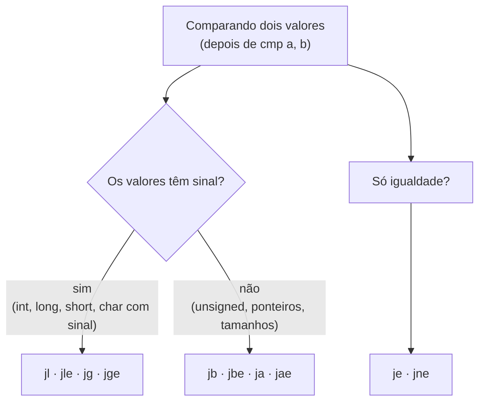
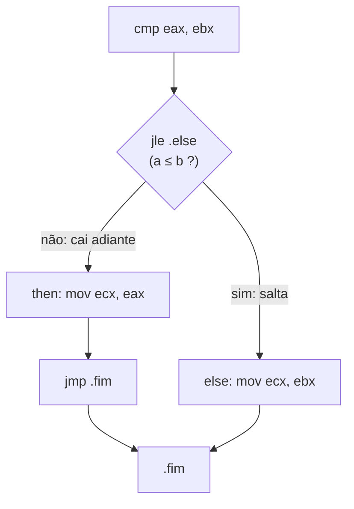

# 03 - Instruções Básicas e Controle de Fluxo

> [!abstract] Resumo
> Este módulo apresenta o **repertório essencial do x86/x64**: mover dados (`MOV`, `LEA`, `XCHG`, `MOVZX`, `MOVSX`), fazer **aritmética** (`ADD`, `SUB`, `MUL`, `DIV`...) e **lógica** (`AND`, `OR`, `XOR`, deslocamentos), **comparar** (`CMP`, `TEST`) e **desviar o fluxo** (`JMP` e os saltos condicionais `Jcc`). Com isso você já implementa `if/else`, `while`, `for` e `switch`, versão ingênua e versão otimizada, e entende por que o desvio é tão importante para o pipeline.

Voltar ao índice: [[Índice - Assembly]] · Módulo anterior: [[02 - Registradores e Memória]] · Próximo: [[04 - Procedimentos, Stack e Calling Conventions]]

**Pré-requisitos:** registradores e sub-registradores, flags (`ZF`, `CF`, `SF`, `OF`) e endereçamento, do [[02 - Registradores e Memória]].

**Objetivos:**
- Usar as instruções de movimentação, aritmética e lógica corretamente, sabendo **quais flags** cada uma altera.
- Escolher o salto condicional certo para comparações **com sinal** e **sem sinal**.
- Traduzir `if/else`, `while`, `for` e `switch` de C para Assembly.
- Reconhecer idiomas otimizados (`xor reg, reg`, `test reg, reg`, `lea` aritmético, `cmov`, inversão de laço).
- Evitar os erros clássicos: `div` sem preparar `EDX`, `ja` no lugar de `jg`, `loop` com `RCX = 0`.

Tags: #assembly #instrucoes #saltos #flags #x64 #nasm #masm

---

## 1. Convenções usadas neste módulo

- **Sintaxe Intel:** `instrução destino, origem`.
- Exemplos em **NASM** (Linux x64) com a versão **MASM** quando houver diferença relevante.
- Rótulos **locais** em NASM começam com ponto (`.laco`) e pertencem ao último rótulo não local. Em MASM, rótulos dentro de um `PROC` são locais a ele por padrão, e existem os rótulos anônimos `@@:` (com `@F` para frente e `@B` para trás).
- Notação de operandos: `r` = registrador, `m` = memória, `imm` = imediato, e `r/m` = registrador **ou** memória.

> [!warning] Regra de ouro do x86: no máximo **um** operando de memória
> A maioria das instruções aceita **só um** operando em memória. `mov [a], [b]` e `add [a], [b]` **não existem**: passe por um registrador (`mov eax, [b]` / `mov [a], eax`).

> [!note] Valores imediatos de 64 bits
> A maioria das instruções aceita no máximo um imediato de **32 bits** (estendido com sinal para 64). Só `mov r64, imm64` aceita 64 bits completos. No NASM, `mov rax, 0x1122334455667788` usa essa forma de 10 bytes.

---

## 2. Instruções de movimentação de dados

### 2.1 `MOV`: copiar

```nasm
mov eax, 5              ; registrador ← imediato
mov eax, ebx            ; registrador ← registrador
mov eax, [rsi]          ; registrador ← memória
mov [rdi], eax          ; memória ← registrador
mov dword [rdi], 7      ; memória ← imediato (o tamanho é obrigatório!)
```

- **`mov` não altera nenhuma flag.**
- **Os dois operandos precisam ter o mesmo tamanho** (`mov eax, bl` é inválido).
- Não existe `mov` memória→memória.

> [!warning] Armadilha: `mov rax, -1` × `mov eax, -1`
> ```nasm
> mov rax, -1       ; 48 C7 C0 FF FF FF FF   → RAX = 0xFFFFFFFFFFFFFFFF  (-1 em 64 bits)
> mov eax, -1       ; B8 FF FF FF FF         → RAX = 0x00000000FFFFFFFF  (4.294.967.295!)
> ```
> A segunda é mais curta, mas zera a metade alta (regra do módulo [[02 - Registradores e Memória]]). Se você quer o valor `-1` em 64 bits, use a primeira (ou `or rax, -1`).

### 2.2 `MOVZX`, `MOVSX`, `MOVSXD`: ampliar valores

Para carregar um valor **menor** em um registrador **maior** é preciso dizer **como preencher os bits novos**:

| Instrução | Preenche com | Exemplo | Uso típico |
|-----------|--------------|---------|------------|
| `MOVZX` | **zeros** | `movzx eax, byte [rsi]` | Valores **sem sinal** (`unsigned char`) |
| `MOVSX` | **cópia do bit de sinal** | `movsx eax, word [rsi]` | Valores **com sinal** (`short`, `signed char`) |
| `MOVSXD` | cópia do bit de sinal (32 → 64) | `movsxd rax, ecx` | `int` → `long` |

```nasm
; byte 0xF0 na memória
movzx eax, byte [rsi]   ; EAX = 0x000000F0  (240)
movsx eax, byte [rsi]   ; EAX = 0xFFFFFFF0  (-16)
```

> [!note] 32 → 64 sem sinal não precisa de instrução
> `mov eax, ebx` já zera os 32 bits superiores de `RAX`. É a ampliação "sem sinal" de graça. A com sinal exige `movsxd`.

### 2.3 `LEA`: calcular endereço

```nasm
lea rsi, [rel msg]          ; endereço de msg (RIP-relativo)
lea eax, [rbx + rcx*4 + 8]  ; aritmética: EAX = RBX + 4×RCX + 8, sem tocar flags
```

Já vimos no módulo anterior: `lea` **não acessa a memória** e **não altera flags**.

### 2.4 `XCHG`: trocar

```nasm
xchg eax, ebx          ; troca o conteúdo dos dois registradores
xchg eax, [rdi]        ; troca registrador com memória
```

> [!warning] `xchg` com memória tem *lock* implícito
> Quando um dos operandos está em memória, o processador executa a troca de forma **atômica** (como se houvesse `lock`), o que é **bem mais lento** que três `mov`. Use só quando precisar da atomicidade (sincronização entre threads).

### 2.5 `CMOVcc`: mover só se a condição for verdadeira

`cmovcc` (`cmove`, `cmovne`, `cmovg`, `cmovl`, `cmova`, `cmovb`...) copia **apenas se** a condição sobre as flags for verdadeira. Veremos na seção de saltos como evitar desvios com ele.

### 2.6 `SETcc`: transformar uma condição em 0 ou 1

```nasm
cmp eax, ebx
setl al                 ; AL = 1 se EAX < EBX (com sinal), senão 0
movzx eax, al           ; amplia para 32 bits
```

Equivale ao `int r = (a < b);` de C.

### 2.7 `PUSH` e `POP` (prévia)

```nasm
push rax        ; RSP ← RSP - 8; [RSP] ← RAX
pop  rbx        ; RBX ← [RSP]; RSP ← RSP + 8
```

Em x64, `push`/`pop` operam com **8 bytes**. Os detalhes estão em [[04 - Procedimentos, Stack e Calling Conventions]].

---

## 3. Operações aritméticas

### 3.1 Soma, subtração e variações

| Instrução | Efeito | Flags afetadas |
|-----------|--------|----------------|
| `add d, s` | `d = d + s` | CF, OF, ZF, SF, PF, AF |
| `sub d, s` | `d = d - s` | CF, OF, ZF, SF, PF, AF |
| `inc d` | `d = d + 1` | OF, ZF, SF, PF, AF (**não CF**) |
| `dec d` | `d = d - 1` | OF, ZF, SF, PF, AF (**não CF**) |
| `neg d` | `d = -d` (complemento de dois) | todas; **CF = 1 se `d` ≠ 0** |
| `adc d, s` | `d = d + s + CF` | todas |
| `sbb d, s` | `d = d - s - CF` | todas |

> [!example] Soma de 128 bits com `add` + `adc`
> `adc` reaproveita o *carry* da soma anterior; é assim que se somam números maiores que um registrador:
> ```nasm
> ; (RDX:RAX) = (RDX:RAX) + (RBX:RCX)     → 128 bits = alta:baixa
> add rax, rcx        ; soma as partes baixas; CF = "vai-um"
> adc rdx, rbx        ; soma as partes altas + CF
> ```

### 3.2 Multiplicação

| Forma | Exemplo | Resultado |
|-------|---------|-----------|
| `mul r/m` (sem sinal, 1 operando) | `mul ecx` | `EDX:EAX = EAX × ECX` (64 bits de resultado) |
| `mul r/m64` | `mul rcx` | `RDX:RAX = RAX × RCX` (128 bits) |
| `imul r/m` (com sinal, 1 operando) | `imul ecx` | igual a `mul`, mas com sinal |
| `imul r, r/m` (2 operandos) | `imul eax, ebx` | `EAX = EAX × EBX` (trunca para 32 bits) |
| `imul r, r/m, imm` (3 operandos) | `imul eax, ebx, 10` | `EAX = EBX × 10` |

- `mul`/`imul` de **um operando** usam registradores **fixos** (`AL/AX/EAX/RAX` com `DX/EDX/RDX` para a metade alta). **Isso sobrescreve `RDX`.**
- Nas formas de 2 e 3 operandos, o resultado é truncado e `CF`/`OF` indicam se **houve perda**.
- Multiplicar por potência de 2 é mais barato com deslocamento (`shl`); por 3, 5 ou 9, com `lea`.

```nasm
imul eax, ebx, 10       ; EAX = EBX × 10
lea  eax, [rbx + rbx*4] ; EAX = EBX × 5
shl  eax, 3             ; EAX = EAX × 8
```

### 3.3 Divisão

A divisão **usa o par `RDX:RAX`** como dividendo (o dobro do tamanho do divisor):

| Tamanho | Dividendo | Divisor | Quociente | Resto |
|---------|-----------|---------|-----------|-------|
| 8 bits | `AX` | `r/m8` | `AL` | `AH` |
| 16 bits | `DX:AX` | `r/m16` | `AX` | `DX` |
| 32 bits | `EDX:EAX` | `r/m32` | `EAX` | `EDX` |
| 64 bits | `RDX:RAX` | `r/m64` | `RAX` | `RDX` |

**Antes** de dividir, **prepare a metade alta do dividendo**:

```nasm
; Sem sinal: 17 / 5
mov eax, 17
xor edx, edx            ; EDX = 0  (obrigatório!)
mov ecx, 5
div ecx                 ; EAX = 3 (quociente), EDX = 2 (resto)

; Com sinal: -7 / 2
mov eax, -7
cdq                     ; estende o sinal de EAX para EDX:EAX  (EDX = 0xFFFFFFFF)
mov ecx, 2
idiv ecx                ; EAX = -3 (quociente), EDX = -1 (resto)
```

| Instrução | Estende o sinal de... |
|-----------|-----------------------|
| `cbw` / `cwde` / `cdqe` | `AL→AX` / `AX→EAX` / `EAX→RAX` |
| `cwd` | `AX → DX:AX` |
| `cdq` | `EAX → EDX:EAX` |
| `cqo` | `RAX → RDX:RAX` |

> [!warning] Erros que derrubam o programa
> - **Dividir por zero**, ou um quociente que não cabe no registrador, gera a exceção **#DE** (no Linux, o processo recebe `SIGFPE`; no Windows, *integer divide by zero* ou *overflow*).
> - **Esquecer de zerar `EDX`** (ou de usar `cdq`) é o motivo mais comum de `div` falhar com valores "aleatórios": o lixo em `EDX` faz o dividendo ficar gigante.
> - `idiv` **trunca em direção a zero** (`-7 / 2 = -3`, resto `-1`) e o resto tem o **sinal do dividendo**, como em C.

> [!note] Divisão é cara
> `div`/`idiv` estão entre as instruções mais lentas da CPU (dezenas de ciclos, dependendo do modelo e do tamanho). Compiladores trocam divisão por **constante** por multiplicações e deslocamentos. Falaremos disso no [[09 - Otimização, SIMD e Performance]].

---

## 4. Operações lógicas e deslocamentos

### 4.1 Lógicas bit a bit

| Instrução | Efeito | Flags |
|-----------|--------|-------|
| `and d, s` | AND bit a bit | `CF = OF = 0`; ZF, SF, PF pelo resultado |
| `or d, s` | OR bit a bit | idem |
| `xor d, s` | XOR bit a bit | idem |
| `not d` | inverte todos os bits | **nenhuma** |
| `test a, b` | AND, **sem guardar** o resultado | idem `and` |

```nasm
and  eax, 0x0F          ; mantém só os 4 bits baixos        (máscara)
or   eax, 0x80          ; liga o bit 7                      (set bit)
and  eax, ~0x80         ; desliga o bit 7                   (clear bit; NASM aceita ~)
xor  eax, 0x01          ; inverte o bit 0                   (toggle)
xor  eax, eax           ; zera EAX                          (idioma!)
test eax, eax           ; ZF = 1 se EAX = 0; SF = bit de sinal
```

> [!tip] Idiomas que você verá em todo `objdump`
> | Em vez de... | Prefira | Por quê |
> |--------------|---------|---------|
> | `mov eax, 0` | `xor eax, eax` | Menor (2 bytes contra 5); reconhecido pela CPU como zeragem (**mas altera flags**) |
> | `cmp eax, 0` | `test eax, eax` | Menor (2 bytes contra 3) e equivalente para `ZF`/`SF` |
> | `imul eax, eax, 5` | `lea eax, [rax + rax*4]` | Mais simples para a CPU; não toca flags |

### 4.2 Deslocamentos e rotações

| Instrução | Operação | Equivalente aritmético |
|-----------|----------|------------------------|
| `shl d, n` (= `sal`) | desloca à esquerda, entra 0 | `d × 2ⁿ` |
| `shr d, n` | desloca à direita, entra 0 (**lógico**) | `d ÷ 2ⁿ` **sem sinal** |
| `sar d, n` | desloca à direita, **replica o sinal** (**aritmético**) | `d ÷ 2ⁿ` **com sinal**, arredondando para −∞ |
| `rol d, n` / `ror d, n` | rotaciona (o bit que sai entra do outro lado) | |

`n` é um imediato ou o registrador **`CL`** (`shl eax, cl`). O último bit que "sai" fica em **`CF`**.

```nasm
mov eax, 0x80000001
shl eax, 1              ; EAX = 0x00000002, CF = 1 (o bit 31 saiu)
mov eax, -8
sar eax, 1              ; EAX = -4   (mantém o sinal)
mov eax, 0xFFFFFFF8
shr eax, 1              ; EAX = 0x7FFFFFFC (entra 0 no bit 31; -8 vira número enorme)
```

> [!warning] `sar` e `idiv` não arredondam igual
> Para negativos ímpares, `sar` arredonda para **−∞** e `idiv` **trunca para zero**:
> `-7 >> 1` com `sar` dá **−4**; `-7 / 2` com `idiv` dá **−3**. Compiladores corrigem isso ao otimizar divisões com sinal por potências de 2.

---

## 5. Comparação e flags

`cmp` e `test` **só atualizam flags**; não guardam resultado.

| Instrução | Faz internamente | Uso |
|-----------|------------------|-----|
| `cmp a, b` | `a - b` (descarta o resultado) | comparar valores |
| `test a, b` | `a AND b` (descarta o resultado) | testar bits; testar zero com `test eax, eax` |

Depois de `cmp a, b`:

| Condição | Flag(s) |
|----------|---------|
| `a == b` | `ZF = 1` |
| `a < b` **sem sinal** | `CF = 1` |
| `a < b` **com sinal** | `SF ≠ OF` |

```nasm
cmp eax, ebx            ; calcula EAX - EBX, só pra atualizar as flags
je  igual               ; salta se ZF = 1
```

> [!note] Macrofusão
> Em muitos processadores modernos, `cmp`/`test` imediatamente seguidos de um `jcc` são **fundidos em uma única micro-operação**. Mais uma razão para manter os dois **juntos**, sem nada no meio.

---

## 6. Saltos: `JMP` e `Jcc`

### 6.1 Salto incondicional

```nasm
jmp .fim            ; vai para o rótulo (RIP recebe o novo endereço)
jmp rax             ; salto indireto: endereço em registrador
jmp [tabela + rax*8]; salto indireto: endereço lido da memória (tabela de saltos)
```

Um salto **relativo** é codificado como *deslocamento a partir de `RIP`*: **curto** (`rel8`, −128 a +127 bytes, 2 bytes de instrução) ou **próximo** (`rel32`, 5 bytes). O NASM escolhe sozinho para `jmp` e `jcc`.

### 6.2 Saltos condicionais: tabela completa

> [!abstract] Como ler
> O salto **só é tomado** se a condição sobre as flags for verdadeira; caso contrário, a execução **cai** para a instrução seguinte.

**Igualdade e flags individuais**

| Instrução | Sinônimo | Condição | Significado |
|-----------|----------|----------|-------------|
| `je` | `jz` | `ZF = 1` | igual / zero |
| `jne` | `jnz` | `ZF = 0` | diferente / não zero |
| `js` | | `SF = 1` | negativo |
| `jns` | | `SF = 0` | não negativo |
| `jo` / `jno` | | `OF = 1` / `OF = 0` | overflow com sinal |
| `jc` / `jnc` | | `CF = 1` / `CF = 0` | carry |
| `jp` / `jnp` | `jpe` / `jpo` | `PF = 1` / `PF = 0` | paridade |

**Comparação SEM sinal** (*above / below*): use com `unsigned`, ponteiros, tamanhos

| Instrução | Sinônimos | Condição | Significa |
|-----------|-----------|----------|-----------|
| `ja` | `jnbe` | `CF = 0` **e** `ZF = 0` | acima (`a > b`) |
| `jae` | `jnb`, `jnc` | `CF = 0` | acima ou igual (`a ≥ b`) |
| `jb` | `jnae`, `jc` | `CF = 1` | abaixo (`a < b`) |
| `jbe` | `jna` | `CF = 1` **ou** `ZF = 1` | abaixo ou igual (`a ≤ b`) |

**Comparação COM sinal** (*greater / less*): use com `int`, `long`, `signed`

| Instrução | Sinônimos | Condição | Significa |
|-----------|-----------|----------|-----------|
| `jg` | `jnle` | `ZF = 0` **e** `SF = OF` | maior (`a > b`) |
| `jge` | `jnl` | `SF = OF` | maior ou igual (`a ≥ b`) |
| `jl` | `jnge` | `SF ≠ OF` | menor (`a < b`) |
| `jle` | `jng` | `ZF = 1` **ou** `SF ≠ OF` | menor ou igual (`a ≤ b`) |

**Contador**

| Instrução | Condição |
|-----------|----------|
| `jrcxz` / `jecxz` / `jcxz` | `RCX` / `ECX` / `CX` = 0 (não olha as flags e **só** salta curto) |



> [!warning] A armadilha mais clássica: `ja` × `jg`
> Com `EAX = -1` (`0xFFFFFFFF`) e `EBX = 1`, depois de `cmp eax, ebx`:
> - `jg` **não** salta (−1 não é maior que 1 com sinal);
> - `ja` **salta** (`0xFFFFFFFF` é maior que 1 sem sinal).
>
> A **CPU não sabe** se seus dados têm sinal; a escolha do salto é **a sua interpretação**. Errou o par, o `if` fica invertido para valores negativos, e esse é um bug de segurança comum (verificações de tamanho com sinal contornadas por valores negativos).

> [!note] A condição é a negação do `if` de C
> Em C, `if (a > b) { ... }` vira, em Assembly, **saltar por cima** do bloco quando a condição for **falsa**: `jle .pula`. O compilador (e você) quase sempre usa a condição **inversa**.

### 6.3 Instrução e processador: o custo de um desvio

Para manter o pipeline cheio, a CPU **prevê** o resultado dos saltos condicionais (*branch prediction*) e já busca instruções do caminho previsto. Se errar, descarta o trabalho especulativo, o que custa algo da ordem de **15 a 20 ciclos** em muitos processadores. Por isso:

- saltos **previsíveis** (por exemplo, o de volta de um laço) são baratos;
- saltos **imprevisíveis** (por exemplo, `if (dado[i] > 128)` em dados aleatórios) são caros;
- `cmov` e `setcc` **eliminam o salto**, trocando o risco de má previsão por uma dependência de dados.

Veja medições no [[09 - Otimização, SIMD e Performance]].

---

## 7. Padrões de controle de fluxo

### 7.1 `if` / `else`

```c
if (a > b) m = a; else m = b;     // a em EAX, b em EBX, m em ECX (com sinal)
```



**Versão ingênua (com saltos):**

```nasm
    cmp eax, ebx
    jle .else               ; se a <= b, vai para o else (condição invertida!)
    mov ecx, eax            ; then: m = a
    jmp .fim
.else:
    mov ecx, ebx            ; else: m = b
.fim:
```

**Versão otimizada (sem saltos, `cmov`):**

```nasm
    mov ecx, ebx            ; m = b
    cmp eax, ebx
    cmovg ecx, eax          ; se a > b, m = a
```

> [!note] `cmov` nem sempre ganha
> Se o desvio for **muito previsível**, o salto pode ser mais rápido, porque a CPU só executa o lado necessário. `cmov` **sempre** calcula os dois lados e cria dependência entre as instruções. O compilador decide caso a caso; em código "quente" a resposta vem de **medir**.

### 7.2 `while`

```c
soma = 0; while (n > 0) { soma += n; n--; }     // n em ECX, soma em EAX
```

**Ingênua:** condição no topo, **dois** saltos por volta:

```nasm
    xor eax, eax
.while:
    test ecx, ecx
    jle  .fimwhile
    add  eax, ecx
    dec  ecx
    jmp  .while             ; salto incondicional EXTRA a cada volta
.fimwhile:
```

**Otimizada, com inversão de laço** (*loop inversion*): testa uma vez antes e deixa **um único salto condicional** no fim:

```nasm
    xor eax, eax
    test ecx, ecx
    jle  .fim               ; se n <= 0, nem entra
.laco:
    add eax, ecx
    dec ecx
    jnz .laco               ; 1 salto por volta (e previsível)
.fim:
```

### 7.3 `for`

```c
for (i = 1; i <= 10; i++) soma += i;      // resultado: 55
```

```nasm
    xor eax, eax            ; soma = 0
    mov ecx, 1              ; i = 1
.for:
    cmp ecx, 10
    jg  .fimfor             ; if (i > 10) sai
    add eax, ecx
    inc ecx
    jmp .for
.fimfor:
```

**Contando regressivamente** (comum em Assembly, porque `dec` já atualiza `ZF`):

```nasm
    xor eax, eax
    mov ecx, 10
.l: add eax, ecx            ; soma 10, 9, ..., 1 (mesma soma, 55)
    dec ecx
    jnz .l
```

### 7.4 `LOOP`: a instrução de laço do x86

```nasm
    xor eax, eax
    mov ecx, 10
.l: add eax, ecx
    loop .l                 ; RCX = RCX - 1;  se RCX ≠ 0, salta   (não altera flags)
```

| Instrução | Operação |
|-----------|----------|
| `loop rótulo` | decrementa `RCX`; salta se `RCX ≠ 0` |
| `loope` / `loopz` | decrementa; salta se `RCX ≠ 0` **e** `ZF = 1` |
| `loopne` / `loopnz` | decrementa; salta se `RCX ≠ 0` **e** `ZF = 0` |

> [!warning] Por que quase ninguém usa `loop`
> - Em muitos processadores, **`loop` é mais lento que `dec` + `jnz`** (é implementado com várias micro-operações).
> - Se `RCX = 0` **antes** do `loop`, ele decrementa para `0xFFFFFFFFFFFFFFFF` e roda **2⁶⁴ vezes** (na prática, um travamento). Teste `jrcxz` antes.
> - Só salta **curto** (−128 a +127 bytes): "relocation truncated" / "short jump out of range" no assembler.
>
> Aprenda `loop` para **ler** código antigo; **escreva** `dec` + `jnz`.

### 7.4.1 Laço sobre um array (revisitando o módulo anterior)

```nasm
; máximo de um array de int (com sinal); resultado no código de saída
global _start
section .data
    arr dd 3, 17, 5, 42, 8
    n   equ ($ - arr) / 4           ; nº de elementos = 20 bytes / 4 = 5

section .text
_start:
    lea  rsi, [rel arr]
    mov  eax, [rsi]                 ; max = arr[0]
    mov  ecx, 1                     ; i = 1
.laco:
    mov  edx, [rsi + rcx*4]         ; edx = arr[i]
    cmp  edx, eax
    cmovg eax, edx                  ; se arr[i] > max, max = arr[i]
    inc  ecx
    cmp  ecx, n
    jl   .laco                      ; repete enquanto i < n   (precisa de n >= 2)

    mov  edi, eax                   ; código de saída = max (42)
    mov  eax, 60
    syscall
```

```bash
nasm -f elf64 maximo.asm -o maximo.o && ld maximo.o -o maximo && ./maximo; echo $?   # 42
```

### 7.5 `switch` e tabela de saltos

Para poucos casos, o compilador gera uma **cadeia de `cmp`/`je`**. Para muitos casos **consecutivos**, usa uma **tabela de saltos** (*jump table*): um array de endereços indexado pelo valor, e um **salto indireto**.

```nasm
; switch (eax) { case 0: ...; case 1: ...; case 2: ...; default: ... }
    cmp  eax, 2
    ja   padrao                     ; sem sinal: cobre também valores "negativos"
    jmp  [tabela + rax*8]           ; salta para o endereço tabela[eax]
caso0:  ; ... código do caso 0 ...
        jmp fim
caso1:  ; ... código do caso 1 ...
        jmp fim
caso2:  ; ... código do caso 2 ...
        jmp fim
padrao: ; ... código do default ...
fim:

section .data
tabela: dq caso0, caso1, caso2      ; use rótulos globais: ".caso0" dentro de .data pertenceria a "tabela"
```

> [!warning] Detalhes que dão erro
> - Um **único** `ja` (comparação **sem sinal**) já rejeita índices negativos e grandes demais. É um bom uso de `ja` contra `jg`.
> - Este exemplo usa endereço absoluto na tabela, o que funciona em executáveis **não-PIE** (como os que montamos com `ld`). Em executáveis PIE, usa-se uma tabela de **deslocamentos relativos**, somados à base por `lea`.
> - Use **rótulos globais** (sem ponto) na tabela: um rótulo local como `.caso0` pertence ao último rótulo global, então escrito em `.data` viraria `tabela.caso0`. Este exemplo foi montado e testado com os valores 0, 1, 2, 9 e `0xFFFFFFFF` (os dois últimos caem no `default`).

### 7.6 O mesmo fluxo em MASM

```nasm
; MASM x64: if (a > b) m = a else m = b
    cmp  eax, ebx
    jle  @F                 ; @F = próximo rótulo anônimo "@@:" para frente
    mov  ecx, eax
    jmp  fim
@@:                         ; rótulo anônimo
    mov  ecx, ebx
fim:
```

> [!tip] O MASM tem diretivas de alto nível
> `.if eax > ebx ... .else ... .endif`, `.while`, `.repeat`/`.until` geram os `cmp`/`jcc` para você. Elas ajudam a escrever rápido, mas **escondem** o que você veio aprender. Neste curso, usamos os saltos explícitos (e vale conhecer as diretivas ao **ler** código MASM de terceiros).

| Aspecto | NASM | MASM |
|---------|------|------|
| Rótulo local | `.nome` (pertence ao último rótulo global) | rótulos dentro de `PROC` + anônimos `@@`/`@F`/`@B` |
| Hexadecimal | `0x1F` ou `1Fh` | `1Fh` (começando por dígito: `0FFh`) |
| Tamanho em memória | `dword [x]` | `dword ptr [x]` |
| Estruturas de controle | só instruções | + `.if`/`.while`/`.repeat` |
| `movsxd` | `movsxd rax, ecx` | `movsxd rax, ecx` |

---

## 8. Tabela das instruções mais usadas

| Categoria | Instrução | Exemplo | Efeito | Altera flags? |
|-----------|-----------|---------|--------|---------------|
| Movimentação | `mov` | `mov eax, [rsi]` | copia | Não |
| | `movzx` | `movzx eax, byte [rsi]` | amplia com zeros | Não |
| | `movsx` / `movsxd` | `movsx eax, word [rsi]` | amplia com sinal | Não |
| | `lea` | `lea eax, [rbx+rcx*4]` | calcula endereço | Não |
| | `xchg` | `xchg eax, ebx` | troca | Não |
| | `cmovcc` | `cmovg eax, ebx` | copia se condição | Não |
| | `setcc` | `setl al` | 0/1 conforme condição | Não |
| | `push` / `pop` | `push rax` | pilha | Não |
| Aritmética | `add` / `sub` | `add eax, 5` | soma / subtrai | Sim |
| | `inc` / `dec` | `dec ecx` | ±1 | Sim (**exceto CF**) |
| | `neg` | `neg eax` | negativa | Sim |
| | `adc` / `sbb` | `adc rdx, rbx` | com *carry* | Sim |
| | `mul` / `imul` | `imul eax, ebx, 10` | multiplica | CF/OF |
| | `div` / `idiv` | `idiv ecx` | divide | Indefinidas |
| | `cdq` / `cqo` | `cdq` | estende sinal para `EDX`/`RDX` | Não |
| Lógica | `and` / `or` / `xor` | `xor eax, eax` | bit a bit | Sim |
| | `not` | `not eax` | inverte bits | Não |
| | `test` | `test eax, eax` | AND sem guardar | Sim |
| Deslocamento | `shl` / `shr` / `sar` | `shl eax, 3` | desloca | Sim |
| | `rol` / `ror` | `rol eax, 8` | rotaciona | CF/OF |
| Comparação | `cmp` | `cmp eax, ebx` | subtrai sem guardar | Sim |
| Desvio | `jmp` | `jmp .fim` | salto incondicional | Não |
| | `jcc` | `jne .laco` | salto condicional | Não (**lê** flags) |
| | `loop` | `loop .l` | `RCX--`, salta se ≠ 0 | Não |
| | `call` / `ret` | `call func` | chamada/retorno | Não |
| Sistema | `syscall` | `syscall` | chamada ao kernel (Linux x64) | `RCX`/`R11` sobrescritos |
| | `nop` | `nop` | não faz nada | Não |

Esta tabela evolui na nota de referência [[Cheat Sheet de Instruções]].

---

## 9. Erros comuns do módulo 03

> [!warning] Lista de armadilhas
> 1. **`div` sem zerar `EDX`** (ou sem `cdq` no `idiv`): resultado errado ou *SIGFPE*.
> 2. **`mul`/`div` destroem `RDX`**: se você guardava algo lá, perdeu.
> 3. **Misturar `ja`/`jb` com `jg`/`jl`**: sem sinal × com sinal.
> 4. **Colocar instrução que muda flags entre `cmp` e `jcc`**.
> 5. **`mov rax, -1` × `mov eax, -1`**: a segunda deixa `RAX = 0x00000000FFFFFFFF`.
> 6. **Condição não invertida** ao traduzir `if`: o bloco roda quando deveria pular.
> 7. **`inc`/`dec` e `CF`**: não esperar que atualizem o *carry*.
> 8. **`loop` com `RCX = 0`**: laço de 2⁶⁴ voltas.
> 9. **Operandos de memória nos dois lados** (`add [a], [b]`): inválido.
> 10. **Omitir o tamanho** em `mov [mem], imm`: ambiguidade.
> 11. **Esquecer a saída** (`exit`) depois do último laço: a CPU executa o que vier depois do seu código.

---

## 10. Exercícios

> [!question] Exercício 1: Divisão
> Quais os valores de `EAX` e `EDX` depois de `mov eax, 100 / mov edx, 0 / mov ecx, 7 / div ecx`? E o que acontece se você omitir `mov edx, 0` e `EDX` valer `5`?

> [!success] Solução
> `100 ÷ 7`: `EAX = 14` (quociente), `EDX = 2` (resto). Se `EDX = 5`, o dividendo vira `0x0000000500000064` = 21.474.836.580, e o quociente (≈ 3 bilhões) **não cabe em 32 bits**: a CPU gera **#DE** (*SIGFPE*).

> [!question] Exercício 2: Com sinal × sem sinal
> Com `EAX = -1` e `EBX = 1`, depois de `cmp eax, ebx`, indique se `jg`, `jl`, `ja` e `jb` saltam.

> [!success] Solução
> `EAX - EBX = 0xFFFFFFFE`. Com sinal, −1 < 1: **`jl` salta, `jg` não**. Sem sinal, `0xFFFFFFFF` > 1: **`ja` salta, `jb` não**. (As flags são as mesmas; muda a interpretação.)

> [!question] Exercício 3: Valor absoluto
> Escreva `abs(EAX)`: (a) com `cmov` e (b) **sem saltos nem `cmov`**. Atenção ao caso `0x80000000`.

> [!success] Solução
> ```nasm
> ; (a) com cmov: resultado em EDX
> mov  edx, eax
> neg  edx                 ; EDX = -EAX   (SF = 1 se -EAX < 0, isto é, EAX era positivo)
> cmovs edx, eax           ; se SF = 1, EAX era positivo → EDX = EAX
>
> ; (b) sem desvio: resultado em EAX
> mov  edx, eax
> sar  edx, 31             ; EDX = 0 (positivo) ou 0xFFFFFFFF (negativo)
> xor  eax, edx            ; se negativo, inverte os bits
> sub  eax, edx            ; se negativo, soma 1 (complemento de dois)
> ```
> **Caso especial:** `abs(0x80000000)` (o menor `int`) é `0x80000000`, pois `+2³¹` não cabe em 32 bits com sinal. Em C é *comportamento indefinido*.

> [!question] Exercício 4: Fibonacci
> Calcule `fib(10)` (com `fib(0)=0`, `fib(1)=1`) e devolva o resultado como código de saída (esperado: **55**).

> [!success] Solução
> ```nasm
> global _start
> section .text
> _start:
>     xor eax, eax            ; a = fib(0)
>     mov ebx, 1              ; b = fib(1)
>     mov ecx, 10             ; 10 iterações
> .l: lea edx, [rax + rbx]    ; t = a + b
>     mov eax, ebx            ; a = b
>     mov ebx, edx            ; b = t
>     dec ecx
>     jnz .l                  ; ao final, EAX = fib(10) = 55
>     mov edi, eax
>     mov eax, 60
>     syscall
> ```

> [!question] Exercício 5: Contar bits 1
> Conte quantos bits valem 1 em `EAX = 0xF0F0` (esperado: 8). Use um laço com `shr` e `adc`/`jnz`, ou com `test`/`and`.

> [!success] Solução
> ```nasm
>     mov  eax, 0xF0F0
>     xor  ebx, ebx            ; contador
> .l: test eax, eax
>     jz   .fim
>     shr  eax, 1              ; o bit que sai vai para CF
>     adc  ebx, 0              ; soma o bit (CF) ao contador
>     jmp  .l
> .fim:                        ; EBX = 8
> ```
> (A instrução `popcnt ebx, eax` faz isso em uma só, nos processadores que a suportam; veja o [[07 - Assembly Avançado (x86-x64)]].)

> [!question] Exercício 6: Divisão por potência de 2
> Mostre que `sar` e `idiv` dão resultados diferentes para `-7 / 2` e proponha uma correção para que `sar` imite `idiv` (truncando em direção a zero).

> [!success] Solução
> `sar eax, 1` com `EAX = -7` dá **−4** (arredonda para −∞); `idiv` por 2 dá **−3**. Correção: somar `2ⁿ − 1` aos **negativos** antes de deslocar (aqui, `+1`):
> ```nasm
> mov  edx, eax
> shr  edx, 31             ; EDX = 1 se EAX negativo, 0 caso contrário
> add  eax, edx            ; -7 + 1 = -6   (para n=1, 2^n - 1 = 1)
> sar  eax, 1              ; -6 >> 1 = -3  ✔
> ```

> [!question] Exercício 7 (desafio): do C ao Assembly
> Traduza para NASM, usando `jcc` explícitos (sem `cmov`): contar quantos elementos **negativos** existem em um array de `int` de 6 posições, e devolver a contagem como código de saída.

> [!success] Solução (esboço)
> ```nasm
> global _start
> section .data
>     arr dd 5, -3, 8, -1, -7, 2          ; 3 negativos
>     n   equ ($ - arr) / 4
> section .text
> _start:
>     lea  rsi, [rel arr]
>     xor  eax, eax                       ; contador
>     xor  ecx, ecx                       ; i
> .l: cmp  dword [rsi + rcx*4], 0
>     jge  .prox                          ; com sinal: se >= 0, ignora
>     inc  eax
> .prox:
>     inc  ecx
>     cmp  ecx, n
>     jl   .l
>     mov  edi, eax
>     mov  eax, 60
>     syscall                             ; código de saída = 3
> ```

Laboratórios relacionados: [[Lab 01 - Hello World e Operações Básicas]] e [[Lab 02 - Calculadora em Assembly]].

---

## 11. Resumo

> [!abstract] Resumo do módulo 03
> - **`mov`/`lea`/`xchg`/`movzx`/`movsx`** movem e ampliam dados; **`mov` e `lea` não mexem em flags**; só **um** operando pode estar em memória.
> - **Aritmética:** `add`/`sub`/`inc`/`dec`/`neg`/`adc`/`sbb`; `mul`/`imul` e `div`/`idiv` usam **`RAX`/`RDX`** e exigem preparo (`xor edx, edx` ou `cdq`/`cqo`).
> - **Lógica e deslocamentos:** `and`/`or`/`xor`/`not`/`test`, `shl`/`shr`/`sar`/`rol`/`ror`; `sar` ≠ `idiv` para negativos ímpares.
> - **`cmp` e `test`** só ajustam flags; os **`Jcc`** as leem. **Sem sinal:** `ja/jae/jb/jbe`. **Com sinal:** `jg/jge/jl/jle`. Igualdade: `je/jne`.
> - O **`if` de C vira um salto com a condição invertida**; `while`/`for` ficam melhores com **inversão de laço** e contagem regressiva com `dec`/`jnz`.
> - **`cmov`/`setcc`** eliminam desvios imprevisíveis, mas nem sempre são mais rápidos.
> - **`loop`** existe, porém `dec` + `jnz` costuma ser melhor.
> - Idiomas do compilador: `xor r, r`, `test r, r`, `lea` aritmético.

**Próximo:** [[04 - Procedimentos, Stack e Calling Conventions]] · **Ver também:** [[Glossário#Assembly (x86-64 e ARM)]] · [[Cheat Sheet de Instruções]] · [[Índice - Assembly]]
