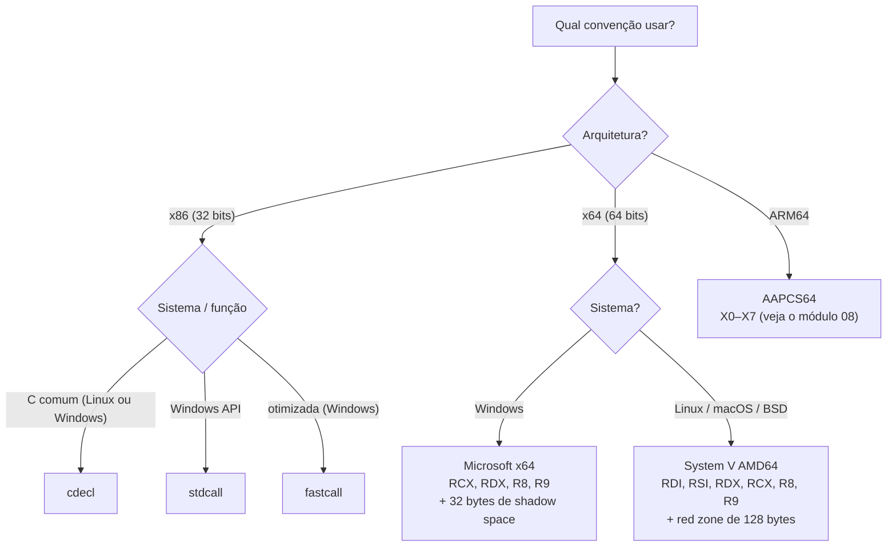
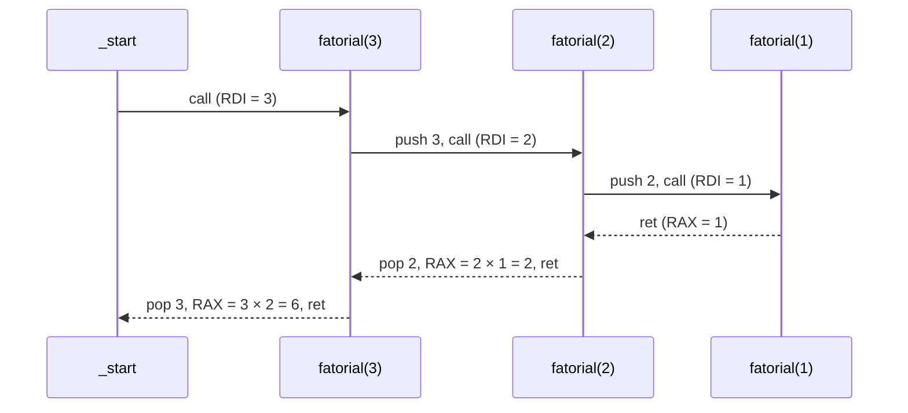

# 04 - Procedimentos, Stack e Calling Conventions

> [!abstract] Resumo
> Funções (procedimentos) são o que permite reaproveitar código, e a **pilha** (*stack*) é o mecanismo que faz isso funcionar: guarda o **endereço de retorno**, os **parâmetros** (às vezes), os **registradores salvos** e as **variáveis locais**. Este módulo explica `PUSH`, `POP`, `CALL`, `RET`, o **stack frame** (prólogo e epílogo), as principais **calling conventions** (cdecl, stdcall, fastcall, Microsoft x64 e System V AMD64), a passagem de parâmetros e valores de retorno, a **recursão** e as variáveis locais.

Voltar ao índice: [[Índice - Assembly]] · Módulo anterior: [[03 - Instruções Básicas e Controle de Fluxo]] · Próximo: [[05 - Entrada-Saída e System Calls]]

**Pré-requisitos:** registradores `RSP`/`RBP`/`RIP` ([[02 - Registradores e Memória]]), instruções de movimentação, saltos e comparação ([[03 - Instruções Básicas e Controle de Fluxo]]).

**Objetivos:**
- Descrever, instrução a instrução, o que `push`, `pop`, `call` e `ret` fazem com `RSP` e `RIP`.
- Desenhar o *stack frame* de uma função e escrever prólogo e epílogo.
- Aplicar corretamente cada calling convention: onde ficam os argumentos, quem limpa a pilha, quais registradores são preservados.
- Escrever funções recursivas e funções com variáveis locais.
- Chamar funções de C (e ser chamado por C) a partir de Assembly, em Linux e Windows.

Tags: #assembly #stack #calling-convention #abi #recursao #x64 #cdecl #stdcall

---

## 1. Como a pilha funciona

A **pilha** é uma região da memória usada em modo **LIFO** (*last in, first out*). O registrador `RSP` (`ESP` em 32 bits) aponta para o **topo**, e a pilha **cresce em direção a endereços menores**.

| Instrução | Em x64 (8 bytes) | Em x86 (4 bytes) |
|-----------|------------------|------------------|
| `push src` | `RSP ← RSP − 8`; `[RSP] ← src` | `ESP ← ESP − 4`; `[ESP] ← src` |
| `pop dst` | `dst ← [RSP]`; `RSP ← RSP + 8` | `dst ← [ESP]`; `ESP ← ESP + 4` |

```text
Antes de "push rax"           Depois de "push rax"
(endereços altos)             (endereços altos)
  0x7FFE_0018  ...              0x7FFE_0018  ...
  0x7FFE_0010  dado A           0x7FFE_0010  dado A
  0x7FFE_0008  dado B  ← RSP    0x7FFE_0008  dado B
  0x7FFE_0000  (livre)          0x7FFE_0000  [valor de RAX]  ← RSP
(endereços baixos)            (endereços baixos)
```

> [!note] A pilha é só memória
> `push` e `pop` são açúcar sintático para "mover `RSP` e acessar `[RSP]`". `pop` **não apaga** o dado: ele continua na memória até ser sobrescrito. Você pode ler `[rsp+8]`, `[rsp+16]` etc. sem fazer `pop`.

### 1.1 `CALL` e `RET`


| Instrução | Equivale a | Observações |
|-----------|-----------|-------------|
| `call alvo` | `push <endereço da próxima instrução>` + `jmp alvo` | O alvo pode ser rótulo, registrador (`call rax`) ou memória (`call [rax+8]`) |
| `ret` | `pop rip` | Se o topo da pilha **não** for o endereço de retorno, o programa "volta" para lugar nenhum |
| `ret n` | `pop rip` + `RSP ← RSP + n` | Usado por funções **stdcall** para limpar os argumentos |
| `leave` | `mov rsp, rbp` + `pop rbp` | Desfaz o *stack frame* |

> [!warning] A regra de ouro: a pilha tem que estar equilibrada no `ret`
> Quando `ret` executa, `[RSP]` **precisa** ser o endereço de retorno. Cada `push` na função precisa ter um `pop` correspondente (ou um `add rsp, n`) antes do `ret`. Se sobrar ou faltar algo, o `ret` pula para um valor de lixo e o resultado é *segmentation fault* ou, pior, um desvio de fluxo controlável por um atacante.

### 1.2 O que acontece no processador real

- A CPU mantém um **preditor de endereços de retorno** (*return stack buffer*), um pequeno cache de endereços empilhados por `call`, para prever o destino de `ret` com precisão. **Combine sempre `call` com `ret`.** Truques como `push endereço` + `ret` ou `call` sem `ret` correspondente quebram a previsão e custam dezenas de ciclos.
- Processadores recentes oferecem **pilha sombra** (*shadow stack*, tecnologia CET da Intel e equivalentes), uma cópia protegida dos endereços de retorno para detectar corrupção da pilha.
- Os acessos à pilha são acessos normais à memória e quase sempre acertam no cache L1, pois a região ativa é pequena.

---

## 2. Stack frames: prólogo e epílogo

Cada chamada de função ganha um **stack frame** (ou registro de ativação): a porção da pilha que pertence àquela invocação. O `RBP` (`EBP`) costuma servir de **âncora fixa** para acessar o frame, enquanto `RSP` varia com `push`/`pop`.

### 2.1 Prólogo e epílogo clássicos

```nasm
funcao:
    push rbp                ; prólogo: salva o RBP do chamador
    mov  rbp, rsp           ;          RBP passa a apontar para o frame desta função
    sub  rsp, 16            ;          reserva 16 bytes para variáveis locais
    ; ... corpo da função ...
    mov  rsp, rbp           ; epílogo: descarta as locais   (ou "leave", que faz as duas linhas)
    pop  rbp                ;          restaura o RBP do chamador
    ret                     ;          volta ao chamador
```

Equivalente com `leave`:

```nasm
funcao:
    push rbp
    mov  rbp, rsp
    sub  rsp, 16
    ; ...
    leave                   ; = mov rsp, rbp  /  pop rbp
    ret
```

### 2.2 Layout do frame (x64, System V, depois do prólogo)

```text
endereços altos
        ┌─────────────────────────┐
[rbp+24]│ argumento 8 (se houver) │  ┐
[rbp+16]│ argumento 7 (se houver) │  ┘ argumentos que não couberam nos registradores
        ├─────────────────────────┤
[rbp+8] │ endereço de retorno     │  ← empilhado pelo CALL
        ├─────────────────────────┤
[rbp]   │ RBP salvo do chamador   │  ← RBP aponta aqui
        ├─────────────────────────┤
[rbp-8] │ variável local 1        │
[rbp-16]│ variável local 2        │  ← RSP aponta aqui (depois do sub rsp, 16)
        └─────────────────────────┘
endereços baixos
```

### 2.3 Layout do frame em 32 bits (cdecl)

```text
endereços altos
[ebp+16] │ argumento 3  │
[ebp+12] │ argumento 2  │
[ebp+8]  │ argumento 1  │
[ebp+4]  │ endereço de retorno
[ebp]    │ EBP salvo    │  ← EBP
[ebp-4]  │ variável local 1
endereços baixos
```

> [!tip] Memorize a "regra do +8"
> Em x64 com `push rbp / mov rbp, rsp`, o endereço de retorno está em `[rbp+8]` e o **primeiro argumento de pilha** em `[rbp+16]`. Em x86, o **primeiro argumento** está em `[ebp+8]`. Variáveis locais ficam em **offsets negativos** (`[rbp-4]`, `[rbp-8]`...).

### 2.4 Versão ingênua vs versão otimizada

```c
int soma_quadrados(int a, int b) { return a*a + b*b; }
```

**Ingênua** (parecida com o que `gcc -O0` gera): tudo passa pela pilha.

```nasm
soma_quadrados:
    push rbp
    mov  rbp, rsp
    sub  rsp, 16
    mov  [rbp-4], edi        ; guarda a  (System V: 1º arg em EDI)
    mov  [rbp-8], esi        ; guarda b  (2º arg em ESI)
    mov  eax, [rbp-4]
    imul eax, eax            ; a*a
    mov  edx, [rbp-8]
    imul edx, edx            ; b*b
    add  eax, edx
    leave
    ret
```

**Otimizada** (parecida com `gcc -O2`): tudo em registradores, **sem frame**.

```nasm
soma_quadrados:
    imul edi, edi            ; a*a
    imul esi, esi            ; b*b
    lea  eax, [rdi + rsi]    ; resultado em EAX
    ret
```

A segunda é uma **função-folha** (*leaf function*: não chama ninguém e usa poucos registradores). Sem frame, sem acessos à memória, 4 instruções contra 11.

> [!note] Frame pointer é opcional
> Compiladores com otimização costumam usar a flag `-fomit-frame-pointer` e liberar o `RBP` como registrador comum, acessando locais por `[rsp + offset]`. O frame com `RBP` facilita depuração e *stack traces*, e é por isso que continua sendo ensinado (e usado em `-O0`).

> [!warning] Windows x64: funções que mexem na pilha precisam de *unwind info*
> No Windows x64, funções **não folha** que alteram `RSP` precisam declarar seu prólogo (diretivas `PROC FRAME`, `.PUSHREG`, `.ALLOCSTACK`, `.ENDPROLOG` no MASM) para que exceções (SEH) e debuggers consigam "desenrolar" a pilha. Funções-folha simples dispensam isso. Os exemplos didáticos deste módulo omitem as diretivas para manter o foco; o módulo [[07 - Assembly Avançado (x86-x64)]] retoma o assunto em *exception handling*.

---

## 3. Calling conventions

Uma **calling convention** (parte da **ABI**, *Application Binary Interface*) é o **contrato** entre quem chama e quem é chamado:

1. **Onde** vão os argumentos (registradores? pilha? em que ordem?)
2. **Onde** vem o valor de retorno
3. **Quem limpa** a pilha depois da chamada (chamador ou chamado)
4. **Quais registradores** a função precisa preservar (*callee-saved*) e quais pode destruir (*caller-saved* ou *voláteis*)
5. **Alinhamento** da pilha e outros detalhes (*shadow space*, *red zone*)

> [!note] Por que isso importa tanto?
> Código escrito em C, Assembly, Rust ou qualquer outra linguagem só consegue **chamar uns aos outros** porque seguem a mesma convenção. Para engenharia reversa, conhecê-la é o que permite saber, olhando um `call`, **quais registradores são argumentos**.

### 3.1 Convenções de 32 bits

#### cdecl (padrão do C em x86)

- Argumentos na **pilha**, **da direita para a esquerda**.
- O **chamador** limpa a pilha (`add esp, n`), o que permite **funções variádicas** (`printf`).
- Retorno em `EAX` (e `EDX:EAX` para 64 bits; `ST0` para `float`/`double`).
- **Voláteis:** `EAX`, `ECX`, `EDX`. **Preservados:** `EBX`, `ESI`, `EDI`, `EBP`.

```nasm
; int soma(int a, int b)    — cdecl, NASM 32 bits
soma:
    push ebp
    mov  ebp, esp
    mov  eax, [ebp+8]        ; a
    add  eax, [ebp+12]       ; + b
    pop  ebp
    ret                      ; NÃO limpa argumentos: é trabalho do chamador

; chamada: soma(3, 4)
    push 4                   ; b  (último argumento primeiro!)
    push 3                   ; a
    call soma
    add  esp, 8              ; chamador remove os 2 argumentos (2 × 4 bytes)
```

#### stdcall (Windows API de 32 bits)

- Argumentos na pilha, da direita para a esquerda (como cdecl).
- O **chamado** limpa a pilha, com **`ret n`** (`n` = bytes de argumentos).
- Não suporta funções variádicas (o chamado precisa saber `n` em tempo de compilação).
- Registradores iguais ao cdecl.

```nasm
soma_stdcall:
    push ebp
    mov  ebp, esp
    mov  eax, [ebp+8]
    add  eax, [ebp+12]
    pop  ebp
    ret  8                   ; retorna E remove 8 bytes de argumentos

; chamada
    push 4
    push 3
    call soma_stdcall        ; sem "add esp, 8"
```

#### fastcall (Microsoft, 32 bits)

- Os **dois primeiros** argumentos de 32 bits ou menos vão em **`ECX`** e **`EDX`**; os demais, na pilha (da direita para a esquerda).
- O **chamado** limpa a pilha (`ret n`).
- Existem variações (a do GCC e a de outros compiladores diferem em detalhes); confira sempre a documentação do compilador.

```nasm
soma_fastcall:               ; a em ECX, b em EDX
    lea  eax, [ecx + edx]
    ret
```

#### Decoração de nomes (Windows 32 bits)

| Convenção | Nome do símbolo para `int soma(int, int)` |
|-----------|-------------------------------------------|
| cdecl | `_soma` |
| stdcall | `_soma@8` |
| fastcall | `@soma@8` |

No Linux i386, o símbolo é simplesmente `soma` (sem sublinhado).

### 3.2 Microsoft x64 (Windows)

| Item | Regra |
|------|-------|
| Argumentos inteiros/ponteiros | **`RCX`, `RDX`, `R8`, `R9`** (nessa ordem); os demais na **pilha** |
| Argumentos de ponto flutuante | `XMM0`–`XMM3` (a mesma posição do argumento: o 2º argumento `double` vai em `XMM1`) |
| Retorno | `RAX` (inteiro/ponteiro), `XMM0` (`float`/`double`) |
| **Shadow space** | O chamador **sempre reserva 32 bytes** logo acima do endereço de retorno, mesmo que a função use menos de 4 argumentos |
| Quem limpa | O **chamador** |
| Voláteis (*caller-saved*) | `RAX`, `RCX`, `RDX`, `R8`–`R11`, `XMM0`–`XMM5` |
| Preservados (*callee-saved*) | `RBX`, `RBP`, `RDI`, `RSI`, `RSP`, `R12`–`R15`, `XMM6`–`XMM15` |
| Alinhamento | `RSP` **múltiplo de 16 no momento do `call`** |
| *Red zone* | **Não existe**: nada abaixo de `RSP` é seguro |

> [!note] Shadow space (ou *home space*)
> São 32 bytes (4 × 8) que o **chamado** pode usar para despejar os 4 registradores de argumento na pilha (por exemplo, para depuração ou para pegar o endereço de um argumento). Se você chamar uma função da Windows API sem reservá-los, ela pode **corromper sua pilha**. O 5º argumento em diante começa em `[RSP+32]` no ponto do `call`.

```nasm
; MASM x64: ExitProcess(0)
    sub  rsp, 40             ; 32 (shadow) + 8 (alinhamento: na entrada RSP ≡ 8 mod 16)
    xor  ecx, ecx            ; 1º argumento em ECX
    call ExitProcess
```

**Onde estão os argumentos dentro da função chamada (Windows x64)?** Na entrada, `[RSP]` é o endereço de retorno, `[RSP+8]` a `[RSP+32]` o shadow space (parte do *frame* do chamador) e o **5º argumento em `[RSP+40]`**, o 6º em `[RSP+48]`.

### 3.3 System V AMD64 (Linux, macOS, BSD)

| Item | Regra |
|------|-------|
| Argumentos inteiros/ponteiros | **`RDI`, `RSI`, `RDX`, `RCX`, `R8`, `R9`**; os demais na pilha (da direita para a esquerda) |
| Argumentos de ponto flutuante | `XMM0`–`XMM7` |
| Retorno | `RAX` (e `RDX:RAX` para 128 bits), `XMM0` (e `XMM1`) para `float`/`double` |
| Funções variádicas | `AL` = número de registradores `XMM` usados (um limite superior serve) |
| Quem limpa | O **chamador** |
| Voláteis (*caller-saved*) | `RAX`, `RCX`, `RDX`, `RSI`, `RDI`, `R8`–`R11`, todos os `XMM` |
| Preservados (*callee-saved*) | **`RBX`, `RBP`, `R12`–`R15`** (e `RSP`) |
| Alinhamento | `RSP` **múltiplo de 16 no momento do `call`** (portanto, **`RSP ≡ 8 (mod 16)` na entrada da função**, por causa do endereço de retorno) |
| *Red zone* | **128 bytes abaixo de `RSP`** podem ser usados por funções-folha sem mover `RSP` |
| Shadow space | **Não existe** |

> [!tip] Decore a ordem do System V com uma frase
> **Di**ga **Si**m, **D**eu **C**erto, **R8**, **R9**: `RDI, RSI, RDX, RCX, R8, R9`. Na Microsoft são só quatro: **`RCX, RDX, R8, R9`**.

> [!warning] A pegadinha clássica: `syscall` × `call`
> Os argumentos de **syscall** no Linux usam `RDI, RSI, RDX, **R10**, R8, R9` (o 4º é `R10`, porque `syscall` destrói `RCX`). Os de **funções** (System V) usam `RCX` como 4º. Não misture os dois.

### 3.4 Quadro comparativo

| | cdecl (x86) | stdcall (x86) | fastcall MS (x86) | Microsoft x64 | System V AMD64 |
|---|---|---|---|---|---|
| **Argumentos** | pilha (dir→esq) | pilha (dir→esq) | `ECX`, `EDX` + pilha | `RCX, RDX, R8, R9` + pilha | `RDI, RSI, RDX, RCX, R8, R9` + pilha |
| **Floats** | pilha / `ST0` | pilha / `ST0` | pilha | `XMM0–3` | `XMM0–7` |
| **Retorno** | `EAX` | `EAX` | `EAX` | `RAX` / `XMM0` | `RAX` (`RDX:RAX`) / `XMM0` |
| **Limpa a pilha** | chamador | **chamado** (`ret n`) | **chamado** (`ret n`) | chamador | chamador |
| **Variádicas** | sim | não | não | sim | sim (`AL` = nº de `XMM`) |
| **Preservados** | `EBX ESI EDI EBP` | `EBX ESI EDI EBP` | `EBX ESI EDI EBP` | `RBX RBP RDI RSI RSP R12–R15 XMM6–15` | `RBX RBP R12–R15` |
| **Shadow space** | — | — | — | **32 bytes** | — |
| **Red zone** | — | — | — | não | **128 bytes** |
| **Alinhamento** | 4 (16 em alguns SO) | 4 | 4 | 16 | 16 |
| **Plataforma típica** | Linux/Windows C 32-bit | Windows API 32-bit | Windows | Windows | Linux/macOS |



A convenção de ARM está no [[08 - ARM e AArch64]]; as notas de apoio ficam em [[Cheat Sheet de Calling Conventions]].

---

## 4. Passagem de parâmetros e retorno de valores

### 4.1 Argumentos: valor, ponteiro e estruturas

| Tipo | System V AMD64 | Microsoft x64 |
|------|----------------|---------------|
| `int`, `long`, ponteiro, `char`, `bool` | registrador inteiro (valores menores ficam nos bits baixos; **não conte com a parte alta**) | idem |
| `float` / `double` | `XMM0`–`XMM7` | `XMM0`–`XMM3` |
| *struct* pequena | até **16 bytes**: passada em registradores (conforme a classificação dos campos) | tamanho exatamente **1, 2, 4 ou 8 bytes**: em registrador |
| *struct* grande | cópia na **pilha** | **ponteiro** para uma cópia feita pelo chamador |
| Retorno de *struct* grande | ponteiro oculto em `RDI`; a função devolve esse ponteiro em `RAX` | ponteiro oculto em `RCX`; devolvido em `RAX` |

> [!warning] Tipos menores que o registrador
> Quando uma função recebe um `int` (32 bits), só `EDI` é garantido; os 32 bits altos de `RDI` podem ter **lixo**. Se você precisar do valor como 64 bits, estenda: `movsxd rax, edi` (com sinal) ou `mov eax, edi` (sem sinal). O mesmo vale para retornos: ao devolver um `int`, só `EAX` importa.

### 4.2 Mais de 6 argumentos (System V)

```nasm
; int soma8(int a1..a8):  a1..a6 em EDI, ESI, EDX, ECX, R8D, R9D;  a7 e a8 na pilha
soma8:
    lea  eax, [rdi + rsi]
    add  eax, edx
    add  eax, ecx
    add  eax, r8d
    add  eax, r9d
    add  eax, [rsp + 8]      ; a7  (em [rsp] está o endereço de retorno)
    add  eax, [rsp + 16]     ; a8
    ret

; chamador (RSP já alinhado em 16)
    mov  edi, 1
    mov  esi, 2
    mov  edx, 3
    mov  ecx, 4
    mov  r8d, 5
    mov  r9d, 6
    push 8                   ; a8 primeiro (direita → esquerda)
    push 7                   ; a7
    call soma8               ; EAX = 36
    add  rsp, 16             ; chamador limpa os 2 × 8 bytes
```

> [!note] Alinhamento no exemplo
> Dois `push` de 8 bytes somam 16 bytes: o alinhamento de 16 é **mantido**. Com um número **ímpar** de argumentos na pilha, o chamador precisa inserir 8 bytes de preenchimento (`sub rsp, 8`) **antes** de empilhar, para que o `call` ocorra com `RSP` múltiplo de 16.

### 4.3 Preservando registradores (*callee-saved*)

Se sua função precisa de `RBX`, `R12`–`R15` (System V) ou `RSI`, `RDI` (Windows), ela **deve salvá-los e restaurá-los**:

```nasm
funcao:
    push rbx                 ; salva o registrador preservado
    push r12
    ; ... usa RBX e R12 à vontade ...
    pop  r12                 ; restaura na ordem INVERSA
    pop  rbx
    ret
```

> [!warning] Um dos bugs mais difíceis de achar
> Se você alterar `RBX` e **não** restaurar, a função chamadora continuará "normalmente" com um `RBX` corrompido; o crash aparece **bem depois**, em outro lugar. Quando um programa quebra de forma aparentemente aleatória depois de chamar sua função, **cheque os registradores preservados primeiro**.

### 4.4 Alinhamento da pilha: o que fazer na prática

```text
Na entrada da função (depois do CALL):   RSP ≡ 8  (mod 16)   ← o CALL empilhou 8 bytes
Depois de "push rbp":                    RSP ≡ 0  (mod 16)   ← alinhado, pronto para chamar outras funções
Depois de "sub rsp, 16":                 RSP ≡ 0  (mod 16)
```

Se sua função tem **número par** de `push` + `sub rsp, múltiplo de 16` após o `push rbp`, tudo permanece alinhado. Caso contrário, ajuste com `sub rsp, 8`.

> [!warning] Sintoma de pilha desalinhada
> `movaps` com operando de pilha, e funções da libc ou da Windows API que usam SSE, **travam** com *segmentation fault* ou *access violation* quando `RSP` não é múltiplo de 16 no `call`. É um clássico: "funciona com `printf("x")`, trava com `printf("%f")`".

---

## 5. Variáveis locais

### 5.1 Pela pilha (com ou sem `RBP`)

```nasm
; int dobra_e_soma(int a, int b)  →  (2a) + (2b), usando duas variáveis locais
dobra_e_soma:
    push rbp
    mov  rbp, rsp
    sub  rsp, 16              ; 2 locais de 4 bytes (16 mantém o alinhamento)
    lea  eax, [rdi + rdi]     ; 2a
    mov  [rbp-4], eax         ; local1 = 2a
    lea  eax, [rsi + rsi]     ; 2b
    mov  [rbp-8], eax         ; local2 = 2b
    mov  eax, [rbp-4]
    add  eax, [rbp-8]
    leave
    ret
```

### 5.2 Na *red zone* (somente System V, funções-folha)

```nasm
funcao_folha:                 ; não chama ninguém → pode usar os 128 bytes abaixo de RSP
    mov  [rsp-4], edi
    mov  [rsp-8], esi
    mov  eax, [rsp-4]
    add  eax, [rsp-8]
    ret
```

> [!warning] Red zone: não no Windows, e não se você chamar outra função
> Um `call` empilha o endereço de retorno **dentro** da *red zone* e destrói suas variáveis. No Windows, **não existe** red zone. Código de **kernel** também não pode usá-la (interrupções usam a pilha).

### 5.3 Em registradores

O ideal. Se as variáveis cabem nos registradores disponíveis, **não use a pilha** (versão otimizada da seção 2.4). A pilha serve para o que **não cabe** (arrays locais, estruturas) ou para quando o endereço da variável é necessário (`lea rdi, [rbp-16]`).

---

## 6. Recursão em Assembly

Uma função recursiva funciona porque **cada chamada tem seu próprio frame**. O que a chamada precisa guardar entre uma recursão e outra (`n`, resultados parciais) vai para a pilha.

### 6.1 Fatorial (System V AMD64, NASM)

```c
uint64_t fatorial(uint64_t n) { return (n <= 1) ? 1 : n * fatorial(n - 1); }
```

```nasm
; uint64_t fatorial(uint64_t n)       n em RDI  →  resultado em RAX
fatorial:
    cmp  rdi, 1
    ja   .recursivo          ; sem sinal: n > 1
    mov  eax, 1              ; caso base: fatorial(0) = fatorial(1) = 1
    ret
.recursivo:
    push rdi                 ; guarda n   (e alinha a pilha: entrada ≡ 8, agora ≡ 0 mod 16)
    dec  rdi                 ; n - 1
    call fatorial            ; RAX = fatorial(n-1)
    pop  rdi                 ; recupera n
    imul rax, rdi            ; RAX = n * fatorial(n-1)
    ret
```

Programa completo, com o resultado como código de saída (`fatorial(5) = 120`):

```nasm
global _start
section .text
_start:                      ; (kernel entrega RSP alinhado em 16)
    mov  edi, 5
    call fatorial
    mov  edi, eax            ; código de saída = 120
    mov  eax, 60
    syscall
; ... (função fatorial acima) ...
```

```bash
nasm -f elf64 fat.asm -o fat.o && ld fat.o -o fat && ./fat; echo $?     # 120
```



**O estado da pilha** no ponto mais profundo (`fatorial(1)`, caso base):

```text
  endereços altos
  ┌──────────────────────────┐
  │ retorno → _start         │
  │ n = 3  (push rdi)        │  ← frame de fatorial(3)
  │ retorno → fatorial(3)    │
  │ n = 2  (push rdi)        │  ← frame de fatorial(2)
  │ retorno → fatorial(2)    │  ← RSP (fatorial(1) está executando o caso base)
  └──────────────────────────┘
  endereços baixos
```

### 6.2 Versão ingênua (recursiva) vs versão otimizada (iterativa)

```nasm
; Iterativa: nenhum call, nenhuma pilha — a CPU adora
fatorial_it:
    mov  eax, 1
.l: cmp  rdi, 1
    jbe  .fim
    imul rax, rdi
    dec  rdi
    jmp  .l
.fim:
    ret
```

A recursão de cauda poderia ser convertida em laço pelo compilador (*tail call optimization*); mas **neste** fatorial a multiplicação acontece **depois** do `call`, então não é recursão de cauda. A iterativa evita o custo do `call`/`ret` e o **risco de estouro de pilha** (*stack overflow*) para entradas grandes.

> [!warning] Stack overflow
> A pilha tem tamanho limitado (tipicamente 8 MiB no Linux e 1 MiB no Windows por thread, configuráveis). Uma recursão muito profunda ou um array local gigante a esgota, e o processo morre com *segfault* ao tocar a página de guarda abaixo da pilha. Em Assembly, **você** é responsável por controlar a profundidade.

### 6.3 Fatorial em Windows x64 (MASM)

```nasm
; uint64_t fatorial(uint64_t n)        n em RCX → resultado em RAX
fatorial proc
    cmp  rcx, 1
    ja   recursivo
    mov  eax, 1
    ret
recursivo:
    push rcx                 ; guarda n (entrada ≡ 8; depois do push ≡ 0 mod 16)
    sub  rsp, 32             ; shadow space para a chamada recursiva (mantém ≡ 0)
    dec  rcx
    call fatorial
    add  rsp, 32
    pop  rcx
    imul rax, rcx
    ret
fatorial endp
```

Chamando a partir de `main` e usando o resultado como código de saída:

```nasm
extrn ExitProcess : proc
.code
; ... fatorial acima ...
main proc
    sub  rsp, 40             ; 32 (shadow) + 8 (alinhamento)
    mov  ecx, 5
    call fatorial
    mov  ecx, eax            ; código de saída
    call ExitProcess
main endp
end
```

```bat
ml64 fat.asm /link /subsystem:console /entry:main kernel32.lib
fat.exe & echo %ERRORLEVEL%
```

---

## 7. Misturando Assembly e C

### 7.1 C chama Assembly (NASM, Linux)

```nasm
; soma.asm
global soma_quadrados
section .text
soma_quadrados:                ; int soma_quadrados(int a, int b)
    imul edi, edi
    imul esi, esi
    lea  eax, [rdi + rsi]
    ret
```

```c
/* main.c */
#include <stdio.h>
int soma_quadrados(int a, int b);
int main(void) { printf("%d\n", soma_quadrados(3, 4)); return 0; }   /* 25 */
```

```bash
nasm -f elf64 soma.asm -o soma.o
gcc main.c soma.o -o prog && ./prog
```

### 7.2 Assembly chama C (`printf` com varargs)

```nasm
; fat_printf.asm
default rel
extern printf
global main

section .data
    fmt db "fatorial(5) = %d", 10, 0

section .text
main:                          ; chamado pela libc: entrada com RSP ≡ 8 (mod 16)
    sub  rsp, 8                ; alinha a pilha
    mov  edi, 5
    call fatorial
    lea  rdi, [rel fmt]        ; 1º argumento: formato
    mov  esi, eax              ; 2º argumento: valor
    xor  eax, eax              ; AL = 0: nenhum registrador XMM usado (função variádica!)
    call printf wrt ..plt
    xor  eax, eax              ; return 0
    add  rsp, 8
    ret

fatorial:                      ; mesma função da seção 6.1
    cmp  rdi, 1
    ja   .recursivo
    mov  eax, 1
    ret
.recursivo:
    push rdi
    dec  rdi
    call fatorial
    pop  rdi
    imul rax, rdi
    ret
```

```bash
nasm -f elf64 fat_printf.asm -o fat_printf.o
gcc fat_printf.o -o fat_printf && ./fat_printf        # fatorial(5) = 120
```

> [!warning] Três detalhes obrigatórios ao chamar `printf` a partir do Assembly
> 1. **Pilha alinhada em 16** no `call` (por isso o `sub rsp, 8`).
> 2. **`AL` = número de registradores vetoriais** usados (aqui, 0). Sem isso, o comportamento é indefinido.
> 3. **Registradores voláteis** (`RAX`, `RCX`, `RDX`, `RSI`, `RDI`, `R8`–`R11`) podem ter sido **alterados** pela chamada: guarde em `RBX`/`R12`+ (preservados) o que precisar manter.

### 7.3 O que o compilador gera (use isto para estudar)

```bash
gcc -O0 -S -masm=intel soma.c -o - | less     # prólogo/epílogo "de livro"
gcc -O2 -S -masm=intel soma.c -o - | less     # frame eliminado, registradores
```

Ou cole a função no **Compiler Explorer** (godbolt.org) e alterne entre `-O0`, `-O2` e as convenções (`-m32`, `-mabi=ms` etc.).

---

## 8. Depurando a pilha

```text
(gdb) break fatorial
(gdb) run
(gdb) x/6gx $rsp          # 6 quad-words a partir do topo da pilha
(gdb) info frame          # descreve o frame atual (endereço de retorno, RBP salvo)
(gdb) bt                  # backtrace: a cadeia de chamadas
(gdb) finish              # executa até a função retornar e mostra o valor
(gdb) p/x $rsp
```

> [!tip] Em funções sem `RBP` como frame pointer
> `bt` pode mostrar um *backtrace* incompleto para código Assembly sem informação de depuração (*CFI*). Em NASM, as diretivas `.cfi_*` não existem; no GAS você tem `.cfi_startproc`/`.cfi_endproc` para ensinar o debugger a "desenrolar" a pilha. Por isso, em laboratórios, é mais fácil usar o frame clássico com `RBP`.

> [!note] Segurança: por que o endereço de retorno é tão importante
> Como o endereço de retorno fica **na pilha, ao lado das variáveis locais**, um *buffer overflow* que escreva além de um array local pode sobrescrevê-lo e redirecionar o fluxo. Mitigações modernas: **canários de pilha** (valor sentinela antes do endereço de retorno), **NX** (pilha não executável), **ASLR**, **pilha sombra (CET)**. Entender o frame é o primeiro passo para entender essas defesas.

---

## 9. Erros comuns do módulo 04

> [!warning] Lista de armadilhas
> 1. **Pilha desequilibrada no `ret`**: `push` sem `pop` (ou o contrário).
> 2. **Não alinhar `RSP` em 16 antes de `call`** (principalmente para `printf`, `memcpy` e Windows API).
> 3. **Esquecer o shadow space** (32 bytes) no Windows x64.
> 4. **Não preservar registradores *callee-saved*** (`RBX`, `R12`–`R15`; no Windows, também `RSI`, `RDI`).
> 5. **Usar a ordem de argumentos errada**: `RDI, RSI, RDX, RCX` (System V) × `RCX, RDX, R8, R9` (Windows).
> 6. **Confundir `syscall` e `call`**: `R10` × `RCX` como 4º argumento.
> 7. **Contar com a parte alta de `RDI`/`RSI`** para `int` de 32 bits.
> 8. **Em cdecl, esquecer o `add esp, n`**; em stdcall, **fazê-lo** (limpar duas vezes).
> 9. **Empilhar argumentos na ordem errada** em 32 bits (o último argumento vai primeiro).
> 10. **Usar a *red zone* depois de um `call`** ou no Windows.
> 11. **Chamada variádica sem `AL`** configurado (System V).
> 12. **Recursão sem caso base** ou sem proteção de profundidade.

---

## 10. Exercícios

> [!question] Exercício 1: Rastreando a pilha
> `RSP = 0x7FFE0000`. Execute mentalmente: `push rax` · `call f` · (em `f`:) `push rbp` · `pop rbp` · `ret`. Qual o valor de `RSP` depois de cada instrução e o que está em `[RSP]` logo depois do `call`?

> [!success] Solução
> `push rax` → `0x7FFDFFF8`. `call f` → `0x7FFDFFF0`, com `[RSP]` = **endereço da instrução seguinte ao `call`** (o endereço de retorno). `push rbp` → `0x7FFDFFE8`. `pop rbp` → `0x7FFDFFF0`. `ret` → `0x7FFDFFF8` (o retorno foi consumido); o `push rax` original continua na pilha, e `RSP` só volta a `0x7FFE0000` com um `pop` (ou `add rsp, 8`).

> [!question] Exercício 2: Máximo de três números
> Escreva `int max3(int a, int b, int c)` (System V, com sinal), **sem frame**.

> [!success] Solução
> ```nasm
> max3:                     ; a em EDI, b em ESI, c em EDX
>     mov   eax, edi
>     cmp   esi, eax
>     cmovg eax, esi        ; eax = max(a, b)
>     cmp   edx, eax
>     cmovg eax, edx        ; eax = max(max(a, b), c)
>     ret
> ```

> [!question] Exercício 3: Convenções lado a lado
> Escreva a função `int soma3(int a, int b, int c)` em **System V** e em **Microsoft x64**. Em que registradores chegam os argumentos?

> [!success] Solução
> ```nasm
> ; System V: a=EDI, b=ESI, c=EDX
> soma3:
>     lea eax, [rdi + rsi]
>     add eax, edx
>     ret
> ```
> ```nasm
> ; Microsoft x64: a=ECX, b=EDX, c=R8D
> soma3 proc
>     lea eax, [rcx + rdx]
>     add eax, r8d
>     ret
> soma3 endp
> ```

> [!question] Exercício 4: Onde está o 5º argumento?
> Em uma função **Microsoft x64**, onde (relativo a `RSP`, na entrada) está o 5º argumento? E em uma função **System V**, onde está o 7º?

> [!success] Solução
> Windows x64: `[RSP+40]` (8 de endereço de retorno + 32 de shadow space). System V: `[RSP+8]` (logo depois do endereço de retorno; os 6 primeiros vão em registradores).

> [!question] Exercício 5: Encontre o bug
> ```nasm
> conta_pares:                 ; System V
>     xor  eax, eax
>     xor  ebx, ebx            ; ← usa RBX como contador
> .l: ; ... laço que usa RBX ...
>     ret
> ```
> A função funciona sozinha, mas o programa que a chama quebra depois da chamada. Por quê? Corrija.

> [!success] Solução
> `RBX` é **callee-saved** no System V; a função o alterou e não o restaurou, corrompendo o estado do chamador. Correção: `push rbx` no início e `pop rbx` antes do `ret` (lembre que o `push` altera o alinhamento: se a função fizer `call`, ajuste com `sub rsp, 8`), ou usar um registrador **volátil** (`ECX`, `EDX`, `ESI`...) que não exija salvamento.

> [!question] Exercício 6: Pilha de 32 bits
> Escreva em NASM 32 bits (cdecl) uma função `int max2(int a, int b)` e a chamada `max2(10, 20)`, incluindo a limpeza da pilha. Depois, converta para **stdcall**.

> [!success] Solução
> ```nasm
> max2:                        ; cdecl
>     push ebp
>     mov  ebp, esp
>     mov  eax, [ebp+8]        ; a
>     mov  ecx, [ebp+12]       ; b
>     cmp  ecx, eax
>     cmovg eax, ecx
>     pop  ebp
>     ret
>
> ; chamada
>     push 20
>     push 10
>     call max2
>     add  esp, 8              ; cdecl: o chamador limpa
> ```
> Em **stdcall**: troque `ret` por `ret 8` e **remova** o `add esp, 8` do chamador.

> [!question] Exercício 7 (desafio): Fibonacci recursivo
> Implemente `fib(n)` recursivo (System V): `fib(0)=0`, `fib(1)=1`, `fib(n)=fib(n-1)+fib(n-2)`. Devolva `fib(10)` como código de saída (55). Depois compare com a versão iterativa do [[03 - Instruções Básicas e Controle de Fluxo]]: quantas chamadas a recursiva faz?

> [!success] Solução
> ```nasm
> ; uint64_t fib(uint64_t n)  — n em RDI → RAX
> fib:
>     cmp  rdi, 1
>     ja   .rec
>     mov  rax, rdi            ; fib(0)=0, fib(1)=1
>     ret
> .rec:
>     push rbx                 ; callee-saved: guardaremos fib(n-1) em RBX  (entrada ≡ 8 → agora ≡ 0)
>     push rdi                 ; guarda n                                    (agora ≡ 8!)
>     sub  rsp, 8              ; realinha em 16
>     dec  rdi
>     call fib                 ; fib(n-1)
>     mov  rbx, rax            ; RBX = fib(n-1)
>     mov  rdi, [rsp + 8]      ; recupera n
>     sub  rdi, 2
>     call fib                 ; fib(n-2)
>     add  rax, rbx            ; fib(n-1) + fib(n-2)
>     add  rsp, 8
>     pop  rdi
>     pop  rbx
>     ret
> ```
> A recursiva faz **177 chamadas** para `fib(10)`, contra **10 iterações** da versão iterativa (o número de chamadas cresce exponencialmente, ≈ φⁿ). Para valores grandes, a diferença é brutal.

Laboratório relacionado: [[Lab 04 - Funções da libc]] (todas as funções seguem a calling convention deste módulo).

---

## 11. Resumo

> [!abstract] Resumo do módulo 04
> - A **pilha** cresce para baixo; `push`/`pop` movem `RSP`; **`call`** empilha o endereço de retorno e salta; **`ret`** desempilha-o em `RIP`. Pilha equilibrada = `ret` correto.
> - O **stack frame** (prólogo `push rbp / mov rbp, rsp / sub rsp, N`, epílogo `leave / ret`) dá a cada chamada seu espaço de locais; endereço de retorno em `[rbp+8]`, argumentos de pilha a partir de `[rbp+16]`.
> - **Convenções de 32 bits:** *cdecl* (pilha, chamador limpa), *stdcall* (pilha, chamado limpa com `ret n`), *fastcall* (`ECX`, `EDX`).
> - **Microsoft x64:** `RCX, RDX, R8, R9`, **32 bytes de shadow space**, sem red zone. **System V:** `RDI, RSI, RDX, RCX, R8, R9`, **red zone de 128 bytes**, `AL` em funções variádicas.
> - Em ambas, `RSP` **alinhado em 16 bytes no `call`**; funções devem **preservar** os registradores *callee-saved* (`RBX`, `RBP`, `R12`–`R15`; no Windows, também `RSI`, `RDI`).
> - **Recursão** = um frame por chamada; guarde na pilha o que a recursão precisa; cuide do caso base e da profundidade.
> - Em código otimizado, **funções-folha sem frame** usam só registradores.
> - A pilha é alvo de ataques (*buffer overflow*) e por isso tem proteções (canário, NX, ASLR, CET).

**Próximo:** [[05 - Entrada-Saída e System Calls]] · **Ver também:** [[Cheat Sheet de Calling Conventions]] · [[Glossário#Assembly (x86-64 e ARM)]] · [[Índice - Assembly]]
