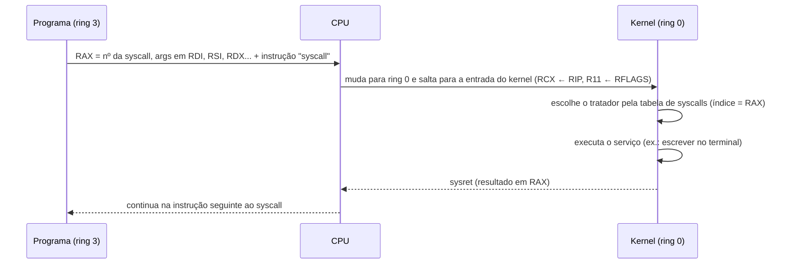
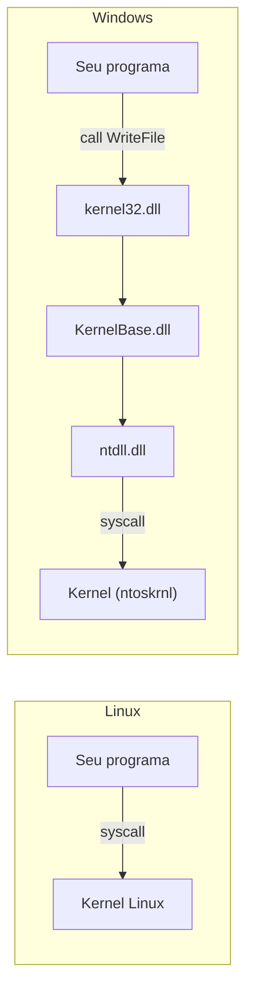

# 05 - Entrada/Saída e System Calls

> [!abstract] Resumo
> Um programa em Assembly não "imprime" nem "lê arquivos" sozinho: **pede ao sistema operacional**. Neste módulo você aprende a fazer isso no **Linux** (instrução `syscall` em x64 e `int 0x80` em x86) e no **Windows** (funções da Windows API), lê e escreve **arquivos**, interage com **teclado e tela**, e escreve à mão as rotinas de **strings** que a libc normalmente esconde (`strlen`, impressão de números, conversão de texto para inteiro, maiúsculas, cópia).

Voltar ao índice: [[Índice - Assembly]] · Módulo anterior: [[04 - Procedimentos, Stack e Calling Conventions]] · Próximo: [[06 - Estruturas de Dados e Arrays]]

**Pré-requisitos:** procedimentos e calling conventions ([[04 - Procedimentos, Stack e Calling Conventions]]), registradores preservados e voláteis, instruções do [[03 - Instruções Básicas e Controle de Fluxo]].

**Objetivos:**
- Explicar o que é uma *system call* e por que ela é o único caminho para o kernel.
- Usar `read`, `write`, `open`, `close`, `lseek` e `exit` no Linux x64 e x86, **tratando erros**.
- Fazer E/S equivalente no Windows com `GetStdHandle`, `ReadFile`, `WriteFile`, `CreateFileA`, `CloseHandle` e `ExitProcess`.
- Implementar `strlen`, `print_str`, `print_uint`, `atoi`, `upper` e usar as instruções de string (`rep movsb`, `stosb`, `scasb`...).
- Ler `argc` e `argv` e escrever um `cat` mínimo.

Tags: #assembly #syscall #io #arquivos #strings #windows-api #linux

---

## 1. O que é uma system call

Seu programa roda em **modo usuário** (ring 3): não pode acessar o disco, o teclado, a tela nem a rede diretamente. Só o **kernel** (ring 0) pode. Uma **system call** (*syscall*) é o mecanismo controlado pelo qual o programa **pede um serviço** ao kernel.



> [!note] O que a CPU faz de verdade
> A instrução `syscall` troca o nível de privilégio e o ponteiro de instrução de forma **atômica**, usando valores previamente configurados pelo SO em registradores especiais (MSRs). Cada ida e volta ao kernel custa da ordem de **centenas de ciclos ou mais** (mitigações de segurança contra ataques de execução especulativa, como a isolação de tabelas de páginas, aumentam o custo). Por isso programas reais **agrupam** (*buffer*) as operações de E/S em vez de fazer uma syscall por byte. Algumas chamadas muito frequentes, como ler o relógio, são resolvidas sem entrar no kernel via **vDSO** no Linux.

### 1.1 Linux × Windows: duas filosofias

| | **Linux** | **Windows** |
|---|-----------|-------------|
| Interface estável | **As próprias syscalls** (números documentados e estáveis) | **A Windows API** (`kernel32.dll` etc.); os números de syscall mudam entre versões |
| Como chamar | `syscall` (x64), `int 0x80` (x86) | `call` de funções importadas (`WriteFile`...) |
| Argumentos | Registradores específicos de syscall | **Calling convention** normal (Microsoft x64 ou stdcall) |
| Retorno | `RAX` (negativo = `-errno`) | Valor de retorno (`BOOL`, *handle*...) + `GetLastError()` |



---

## 2. System calls no Linux

### 2.1 Convenção de chamada

| | **x64** (`syscall`) | **x86** (`int 0x80`) |
|---|---------------------|----------------------|
| Número da syscall | `RAX` | `EAX` |
| Argumentos 1 a 6 | `RDI`, `RSI`, `RDX`, **`R10`**, `R8`, `R9` | `EBX`, `ECX`, `EDX`, `ESI`, `EDI`, `EBP` |
| Retorno | `RAX` | `EAX` |
| Registradores destruídos | **`RCX` e `R11`** (e `RAX`) | só `EAX` |
| Instrução | `syscall` | `int 0x80` |

> [!warning] O 4º argumento é `R10`, não `RCX`
> Em chamadas de **função** (System V), o 4º argumento vai em `RCX`. Em **syscalls**, vai em `R10`, porque a instrução `syscall` usa `RCX` para guardar o endereço de retorno. Os demais registradores (`RBX`, `RBP`, `R12`–`R15`, e os argumentos `RDI`, `RSI`, `RDX`, `R8`, `R9`) são **preservados** pelo kernel.

### 2.2 Syscalls mais usadas (números)

| Syscall | Protótipo | **x64** | **x86** |
|---------|-----------|:-------:|:-------:|
| `read` | `read(fd, buf, n)` | 0 | 3 |
| `write` | `write(fd, buf, n)` | 1 | 4 |
| `open` | `open(caminho, flags, modo)` | 2 | 5 |
| `close` | `close(fd)` | 3 | 6 |
| `lseek` | `lseek(fd, deslocamento, origem)` | 8 | 19 |
| `brk` | `brk(endereço)` (heap) | 12 | 45 |
| `getpid` | `getpid()` | 39 | 20 |
| `unlink` | `unlink(caminho)` (apagar arquivo) | 87 | 10 |
| `exit` | `exit(código)` | 60 | 1 |
| `exit_group` | `exit_group(código)` (encerra todas as threads) | 231 | 252 |
| `openat` | `openat(dirfd, caminho, flags, modo)` | 257 | 295 |

> [!tip] Onde conferir
> As tabelas oficiais ficam nos arquivos `syscall_64.tbl` / `syscall_32.tbl` do código-fonte do kernel; a página `man 2 syscalls` lista tudo, e `man 2 write` (por exemplo) explica cada chamada. Para ver quais syscalls um programa usa: `strace ./programa`.

> [!warning] Números de x86 e x64 não se misturam
> `write` é **4** em x86 e **1** em x64. `int 0x80` **funciona** dentro de um programa x64 (usa a tabela de 32 bits!), mas **trunca ponteiros para 32 bits** e quebra com endereços altos (pilha e heap). Em x64, **use sempre `syscall`**.

> [!note] ARM64 tem outra tabela
> No AArch64 (módulo [[08 - ARM e AArch64]]) a instrução é `svc #0`, o número vai em `X8`, e chamadas como `open` **não existem** (só `openat`).

### 2.3 Descritores de arquivo (*file descriptors*)

No Unix, **tudo é arquivo**: um *descritor* é um número pequeno que identifica um recurso aberto (arquivo, terminal, *pipe*, socket).

| fd | Nome | Padrão |
|----|------|--------|
| 0 | `stdin` | teclado (entrada) |
| 1 | `stdout` | tela (saída) |
| 2 | `stderr` | tela (mensagens de erro) |
| 3, 4, ... | abertos pelo programa | retornados por `open` |

### 2.4 Retorno e tratamento de erros

Se a syscall der certo, `RAX` ≥ 0 (por exemplo, bytes lidos ou o novo descritor). Se falhar, `RAX` é um **valor negativo entre −4095 e −1**, igual a **`-errno`**:

| errno | Nome | Significado |
|:-----:|------|-------------|
| 2 | `ENOENT` | arquivo ou diretório inexistente |
| 9 | `EBADF` | descritor inválido |
| 13 | `EACCES` | permissão negada |
| 14 | `EFAULT` | endereço inválido passado ao kernel |
| 22 | `EINVAL` | argumento inválido |

```nasm
    syscall
    test rax, rax
    js   .erro               ; RAX < 0 → erro (SF = 1)
    ...
.erro:
    neg  rax                 ; RAX = errno (positivo)
    mov  edi, eax            ; usa o errno como código de saída
    mov  eax, 60
    syscall
```

> [!warning] Nunca ignore o retorno
> `write` pode escrever **menos** bytes do que o pedido (disco cheio, *pipe*, sinal). `read` retorna **0 no fim do arquivo (EOF)**. Em programas reais, verifique ambos; neste curso, para manter os exemplos curtos, fazemos isso apenas onde faz diferença.

### 2.5 Saída: `write`

```nasm
; write(1, msg, len)
mov  eax, 1                  ; syscall write (x64)
mov  edi, 1                  ; fd = stdout
lea  rsi, [rel msg]          ; buffer
mov  edx, len                ; quantidade de bytes
syscall                      ; RAX = bytes escritos (ou -errno)
```

Para escrever em **stderr**, use `fd = 2`. Teste com redirecionamento: `./prog 2> erros.txt`.

### 2.6 Entrada: `read` (teclado)

```nasm
; n = read(0, buffer, 64)
xor  eax, eax                ; syscall read = 0 (x64)
xor  edi, edi                ; fd = stdin
lea  rsi, [rel buffer]
mov  edx, 64
syscall                      ; RAX = bytes lidos; 0 = EOF; <0 = erro
```

> [!note] Como o terminal entrega a linha
> Em modo padrão (*canônico*), o terminal só entrega os dados quando você aperta **Enter**, e o **`\n` (10) vem junto** no buffer. Se digitar `42` e Enter, `read` devolve `RAX = 3` com os bytes `'4' '2' '\n'`. Se a linha tiver mais caracteres do que o buffer, o **restante fica para o próximo `read`**. Ctrl+D numa linha vazia produz EOF (`RAX = 0`).

### 2.7 Exemplo completo: pergunta e resposta

```nasm
; saudacao.asm  —  nasm -f elf64 saudacao.asm -o saudacao.o && ld saudacao.o -o saudacao
global _start

section .data
    pergunta db "Qual o seu nome? "
    plen     equ $ - pergunta
    ola      db "Ola, "
    olen     equ $ - ola

section .bss
    nome resb 64

section .text
_start:
    ; write(1, pergunta, plen)
    mov  eax, 1
    mov  edi, 1
    lea  rsi, [rel pergunta]
    mov  edx, plen
    syscall

    ; n = read(0, nome, 64)
    xor  eax, eax
    xor  edi, edi
    lea  rsi, [rel nome]
    mov  edx, 64
    syscall
    test rax, rax
    jle  .sair               ; EOF ou erro: não há o que mostrar
    mov  r12, rax            ; guarda o nº de bytes (R12 é preservado pelo kernel)

    ; write(1, ola, olen)
    mov  eax, 1
    mov  edi, 1
    lea  rsi, [rel ola]
    mov  edx, olen
    syscall

    ; write(1, nome, n)      — inclui o '\n' digitado, então a linha já termina certinho
    mov  eax, 1
    mov  edi, 1
    lea  rsi, [rel nome]
    mov  rdx, r12
    syscall

.sair:
    xor  edi, edi
    mov  eax, 60
    syscall
```

### 2.8 Versão ingênua vs versão otimizada: menos syscalls

```nasm
; --- Ingênua: 1 syscall por caractere (13 syscalls para "Hello World!\n") ---
    lea  rbx, [rel msg]
.l: mov  eax, 1
    mov  edi, 1
    mov  rsi, rbx
    mov  edx, 1
    syscall
    inc  rbx
    cmp  byte [rbx], 0
    jne  .l

; --- Otimizada: 1 syscall para a mensagem inteira ---
    mov  eax, 1
    mov  edi, 1
    lea  rsi, [rel msg]
    mov  edx, len
    syscall
```

Compare com `strace -c ./prog` (conta syscalls e tempo). Para saída frequente, a solução profissional é montar tudo em um **buffer** e escrever **uma vez** (é o que o `stdout` da libc faz).

---

## 3. Arquivos no Linux

### 3.1 `open`, `read`, `write`, `close`

Flags principais de `open` (Linux, x86 e x64):

| Flag | Valor (hex) | Significado |
|------|:-----------:|-------------|
| `O_RDONLY` | `0x000` | somente leitura |
| `O_WRONLY` | `0x001` | somente escrita |
| `O_RDWR` | `0x002` | leitura e escrita |
| `O_CREAT` | `0x040` | cria o arquivo se não existir (exige o 3º argumento, `modo`) |
| `O_TRUNC` | `0x200` | zera o arquivo existente |
| `O_APPEND` | `0x400` | escreve sempre no fim |

Combinações usuais: **criar/sobrescrever** = `O_WRONLY | O_CREAT | O_TRUNC` = `0x241`; **ler** = `0`. O `modo` (permissões ao criar) em octal `0644` equivale a **`0x1A4`** (decimal 420): dono lê/escreve; grupo e outros só leem.

```nasm
; arquivo.asm — cria saida.txt, escreve, fecha, reabre, lê e mostra na tela
global _start

section .data
    nome  db "saida.txt", 0                  ; caminho: string terminada em zero
    texto db "Ola, arquivo!", 10
    tlen  equ $ - texto

section .bss
    buf resb 64

section .text
_start:
    ; fd = open("saida.txt", O_WRONLY|O_CREAT|O_TRUNC, 0644)
    mov  eax, 2
    lea  rdi, [rel nome]
    mov  esi, 0x241
    mov  edx, 0x1A4
    syscall
    test rax, rax
    js   .erro
    mov  r12, rax                            ; r12 = fd

    ; write(fd, texto, tlen)
    mov  eax, 1
    mov  rdi, r12
    lea  rsi, [rel texto]
    mov  edx, tlen
    syscall

    ; close(fd)
    mov  eax, 3
    mov  rdi, r12
    syscall

    ; fd = open("saida.txt", O_RDONLY)
    mov  eax, 2
    lea  rdi, [rel nome]
    xor  esi, esi
    xor  edx, edx
    syscall
    test rax, rax
    js   .erro
    mov  r12, rax

    ; n = read(fd, buf, 64)
    xor  eax, eax
    mov  rdi, r12
    lea  rsi, [rel buf]
    mov  edx, 64
    syscall
    mov  r13, rax                            ; r13 = bytes lidos

    ; close(fd)
    mov  eax, 3
    mov  rdi, r12
    syscall

    ; write(1, buf, n)
    mov  eax, 1
    mov  edi, 1
    lea  rsi, [rel buf]
    mov  rdx, r13
    syscall

    xor  edi, edi                            ; exit(0)
    mov  eax, 60
    syscall

.erro:
    neg  rax                                 ; errno positivo
    mov  edi, eax                            ; vira o código de saída
    mov  eax, 60
    syscall
```

```bash
nasm -f elf64 arquivo.asm -o arquivo.o && ld arquivo.o -o arquivo
./arquivo && cat saida.txt
strace ./arquivo          # veja open/write/close/read/write/exit na ordem
```

> [!tip] Por que usamos `R12` e `R13`?
> O kernel **preserva** todos os registradores, exceto `RAX`, `RCX` e `R11`. Então `R12` e `R13` sobrevivem às syscalls sem precisarmos usar a pilha. É um dos pequenos prazeres do Assembly sem libc.

### 3.2 `lseek`: movendo-se dentro do arquivo

```nasm
; lseek(fd, 0, SEEK_END): RAX = tamanho do arquivo
mov  eax, 8
mov  rdi, r12
xor  esi, esi                ; deslocamento 0
mov  edx, 2                  ; SEEK_END (0 = SEEK_SET, 1 = SEEK_CUR, 2 = SEEK_END)
syscall
```

### 3.3 Linha de comando: `argc` e `argv`

No `_start` (sem libc), o kernel entrega a pilha assim:

```text
RSP →  [rsp]       argc
       [rsp+8]     argv[0]  (ponteiro para o nome do programa)
       [rsp+16]    argv[1]  (primeiro argumento)
       ...
       0           (NULL que termina argv)
       ponteiros de envp ...
```

> [!example] `cat` mínimo: copia o arquivo `argv[1]` para a tela
> ```nasm
> ; cat.asm — uso: ./cat arquivo.txt
> global _start
> section .bss
>     buf resb 4096
> section .text
> _start:
>     cmp  qword [rsp], 2            ; argc >= 2 ?
>     jl   .uso
>     mov  rdi, [rsp + 16]           ; argv[1]
>     mov  eax, 2                    ; open(argv[1], O_RDONLY)
>     xor  esi, esi
>     xor  edx, edx
>     syscall
>     test rax, rax
>     js   .erro
>     mov  r12, rax                  ; fd
> .le:
>     xor  eax, eax                  ; read(fd, buf, 4096)
>     mov  rdi, r12
>     lea  rsi, [rel buf]
>     mov  edx, 4096
>     syscall
>     test rax, rax
>     jle  .fim                      ; 0 = EOF, <0 = erro
>     mov  rdx, rax                  ; write(1, buf, n)
>     mov  eax, 1
>     mov  edi, 1
>     lea  rsi, [rel buf]
>     syscall
>     jmp  .le
> .fim:
>     mov  eax, 3                    ; close(fd)
>     mov  rdi, r12
>     syscall
>     xor  edi, edi
>     jmp  .sai
> .uso:
>     mov  edi, 1
>     jmp  .sai
> .erro:
>     mov  edi, 2
> .sai:
>     mov  eax, 60
>     syscall
> ```
> Este exemplo ignora escritas parciais para ficar curto. Um `cat` de produção repetiria o `write` até enviar todos os bytes.

### 3.4 Em 32 bits (x86)

```nasm
; write(1, msg, len) em x86
mov  eax, 4                  ; syscall write (tabela de 32 bits)
mov  ebx, 1                  ; fd
mov  ecx, msg                ; buffer
mov  edx, len
int  0x80
```

Os exemplos de Linux deste módulo são x64; para portá-los, troque números de syscall e registradores conforme a tabela 2.1/2.2.

---

## 4. Windows API em Assembly

### 4.1 O modelo: *handles* e funções

No Windows, em vez de descritores numéricos fixos, você obtém **handles** com `GetStdHandle` (para console) ou `CreateFileA` (para arquivos) e os passa às funções.

| Tarefa | Linux (syscall) | Windows (API) |
|--------|-----------------|---------------|
| Obter o handle de `stdin`/`stdout`/`stderr` | fd `0`/`1`/`2` | `GetStdHandle(-10 / -11 / -12)` |
| Escrever | `write` | `WriteFile` (ou `WriteConsoleA`, só console) |
| Ler | `read` | `ReadFile` (ou `ReadConsoleA`) |
| Abrir/criar | `open` | `CreateFileA` |
| Fechar | `close` | `CloseHandle` |
| Encerrar | `exit` | `ExitProcess` |

> [!warning] `WriteConsoleA` falha com redirecionamento
> `WriteConsoleA` **só** funciona quando `stdout` é um console de verdade; com `prog.exe > saida.txt` ela falha. **`WriteFile`** funciona nos dois casos (console, arquivo e *pipe*), por isso é a escolha mais robusta. O mesmo vale para `ReadFile` × `ReadConsoleA`.

### 4.2 Chamando a API em x64 (lembrete do módulo 04)

- Argumentos em **`RCX`, `RDX`, `R8`, `R9`**, os demais na pilha a partir de `[RSP+32]`.
- **32 bytes de shadow space** reservados pelo chamador; `RSP` alinhado em 16 no `call`.
- Retorno em `RAX`; registradores **voláteis**: `RAX`, `RCX`, `RDX`, `R8`–`R11`. Guarde handles em **`RBX`, `RSI`, `RDI`, `R12`–`R15`** (preservados).

### 4.3 Eco no console: `ReadFile` + `WriteFile`

```nasm
; eco.asm (MASM x64)  —  ml64 eco.asm /link /subsystem:console /entry:main kernel32.lib
extrn GetStdHandle : proc
extrn ReadFile     : proc
extrn WriteFile    : proc
extrn ExitProcess  : proc

.data
buf       db 128 dup(?)
lidos     dd 0
escritos  dd 0

.code
main proc
    sub  rsp, 40                  ; 32 (shadow) + 8 (5º argumento / alinhamento)

    mov  ecx, -10                 ; STD_INPUT_HANDLE
    call GetStdHandle
    mov  r12, rax                 ; r12 = handle de entrada (preservado)
    mov  ecx, -11                 ; STD_OUTPUT_HANDLE
    call GetStdHandle
    mov  r13, rax                 ; r13 = handle de saída

    ; ReadFile(hIn, buf, 128, &lidos, NULL)
    mov  rcx, r12
    lea  rdx, buf
    mov  r8d, 128
    lea  r9, lidos
    mov  qword ptr [rsp+32], 0    ; 5º argumento: lpOverlapped = NULL
    call ReadFile

    ; WriteFile(hOut, buf, lidos, &escritos, NULL)
    mov  rcx, r13
    lea  rdx, buf
    mov  r8d, lidos               ; quantos bytes foram lidos (inclui CR LF)
    lea  r9, escritos
    mov  qword ptr [rsp+32], 0
    call WriteFile

    xor  ecx, ecx
    call ExitProcess
main endp
end
```

### 4.4 Criando e escrevendo um arquivo

`CreateFileA` tem **7 parâmetros**: os 4 primeiros em registradores e os **3 últimos na pilha** (`[RSP+32]`, `[RSP+40]`, `[RSP+48]`).

```nasm
; escreve.asm (MASM x64)  —  ml64 escreve.asm /link /subsystem:console /entry:main kernel32.lib
extrn CreateFileA : proc
extrn WriteFile   : proc
extrn CloseHandle : proc
extrn ExitProcess : proc

.data
nome      db "saida.txt", 0
texto     db "Ola, arquivo!", 13, 10
tlen      = $ - texto
escritos  dd 0

.code
main proc
    sub  rsp, 56                      ; 32 (shadow) + 24 (3 args de pilha); mantém RSP alinhado

    ; CreateFileA(nome, GENERIC_WRITE, 0, NULL, CREATE_ALWAYS, FILE_ATTRIBUTE_NORMAL, NULL)
    lea  rcx, nome
    mov  edx, 40000000h               ; GENERIC_WRITE
    xor  r8d, r8d                     ; dwShareMode = 0
    xor  r9d, r9d                     ; lpSecurityAttributes = NULL
    mov  qword ptr [rsp+32], 2        ; dwCreationDisposition = CREATE_ALWAYS
    mov  qword ptr [rsp+40], 80h      ; dwFlagsAndAttributes = FILE_ATTRIBUTE_NORMAL
    mov  qword ptr [rsp+48], 0        ; hTemplateFile = NULL
    call CreateFileA
    cmp  rax, -1                      ; INVALID_HANDLE_VALUE?
    je   erro
    mov  rbx, rax                     ; handle do arquivo (RBX é preservado)

    ; WriteFile(handle, texto, tlen, &escritos, NULL)
    mov  rcx, rbx
    lea  rdx, texto
    mov  r8d, tlen
    lea  r9, escritos
    mov  qword ptr [rsp+32], 0
    call WriteFile

    mov  rcx, rbx
    call CloseHandle

    xor  ecx, ecx
    call ExitProcess
erro:
    mov  ecx, 1
    call ExitProcess
main endp
end
```

> [!note] Constantes úteis da Windows API
> | Constante | Valor |
> |-----------|-------|
> | `STD_INPUT_HANDLE` / `STD_OUTPUT_HANDLE` / `STD_ERROR_HANDLE` | `-10` / `-11` / `-12` |
> | `GENERIC_READ` / `GENERIC_WRITE` | `80000000h` / `40000000h` |
> | `CREATE_ALWAYS` / `OPEN_EXISTING` | `2` / `3` |
> | `FILE_ATTRIBUTE_NORMAL` | `80h` |
> | `INVALID_HANDLE_VALUE` | `-1` |

> [!tip] Em 32 bits (stdcall)
> Os mesmos parâmetros são empilhados **da direita para a esquerda** e a própria função limpa a pilha: `push 0 / push OFFSET escritos / push tlen / push OFFSET texto / push handle / call WriteFile`. Veja o [[04 - Procedimentos, Stack e Calling Conventions]] e o Hello World de 32 bits do [[01 - Fundamentos de Arquitetura e Assembly]].

> [!note] Sem libc? Ou com libc?
> Chamar `printf`, `puts`, `scanf`, `fopen` etc. da libc (como fizemos no módulo 04) é **mais cômodo**: elas formatam, fazem *buffering* e lidam com erros. Chamar syscalls/API direto dá **controle total e zero dependências**, e é o que se vê em *shellcode*, bootloaders e programas minúsculos. Use cada um onde faz sentido.

---

## 5. Strings: manipulação manual

Em C, uma *string* é uma sequência de bytes terminada por `0`. No Assembly, ela é só **um endereço** e você é responsável por saber onde ela acaba.

### 5.1 `strlen`

**Compacta, porém lenta: instruções de string**

```nasm
; size_t strlen(const char *s)   RDI = s → RAX = tamanho
strlen_scasb:
    xor  eax, eax                ; AL = 0 (o byte procurado)
    mov  rcx, -1                 ; "sem limite"
    repne scasb                  ; compara AL com [RDI], avança RDI, decrementa RCX, até achar 0
    not  rcx                     ; RCX = -(n+2) → n+1  (conta o terminador)
    lea  rax, [rcx - 1]          ; n
    ret
```

**Laço com ponteiro (melhor na prática)**

```nasm
strlen:
    mov  rax, rdi
.l: cmp  byte [rax], 0
    je   .fim
    inc  rax
    jmp  .l
.fim:
    sub  rax, rdi                ; fim - início = tamanho
    ret
```

> [!note] E a versão realmente rápida?
> Bibliotecas modernas usam **SIMD** (`pcmpeqb` + `pmovmskb`) para examinar 16 ou 32 bytes por vez. Veremos no [[09 - Otimização, SIMD e Performance]]. `repne scasb` é pequena, mas na maioria dos processadores perde para um laço simples ou SIMD.

### 5.2 `print_str`: imprime uma string terminada em zero

```nasm
; void print_str(const char *s)    RDI = s
print_str:
    push rdi                     ; guarda s
    call strlen                  ; RAX = comprimento
    pop  rsi                     ; RSI = s
    mov  rdx, rax                ; RDX = comprimento
    mov  edi, 1                  ; stdout
    mov  eax, 1                  ; write
    syscall
    ret
```

### 5.3 `print_uint`: número → texto decimal

A ideia: dividir por 10 repetidamente; o **resto** é o dígito, que sai de trás para frente. Escrevemos os dígitos de **trás para frente** em um buffer na pilha.

**Ingênua (com `div`):**

```nasm
; void print_uint(uint64_t n)      RDI = n
print_uint:
    push rbp
    mov  rbp, rsp
    sub  rsp, 32                 ; buffer de 32 bytes: [rbp-32, rbp)  (um uint64 tem até 20 dígitos)
    mov  rsi, rbp                ; RSI = "um depois do último" (preenchemos para trás)
    mov  rax, rdi
    mov  ecx, 10
.l: xor  edx, edx
    div  rcx                     ; RAX = n / 10,  RDX = n % 10
    add  dl, '0'                 ; dígito → caractere ASCII
    dec  rsi
    mov  [rsi], dl
    test rax, rax
    jnz  .l
    mov  rdx, rbp
    sub  rdx, rsi                ; RDX = quantidade de dígitos
    mov  edi, 1
    mov  eax, 1
    syscall                      ; write(1, rsi, rdx)
    leave
    ret
```

**Otimizada: divisão por 10 via multiplicação** (o que os compiladores fazem; `div` de 64 bits é lento):

```nasm
    mov  r8, 0xCCCCCCCCCCCCCCCD  ; constante mágica ≈ 2^67 / 10  (fora do laço)
.l: mov  rax, rdi
    mul  r8                      ; RDX:RAX = n × mágica
    shr  rdx, 3                  ; RDX = n / 10   (quociente)
    lea  rax, [rdx + rdx*4]      ; 5 × q
    add  rax, rax                ; 10 × q
    sub  rdi, rax                ; RDI = n − 10q = n % 10   (o dígito)
    add  dil, '0'
    dec  rsi
    mov  [rsi], dil
    mov  rdi, rdx                ; n = n / 10
    test rdi, rdi
    jnz  .l
```

> [!note] Por que isso funciona?
> Dividir por uma **constante** é o mesmo que multiplicar por seu "inverso" em ponto fixo e pegar a metade alta do produto (`RDX` depois de `mul`), seguida de um deslocamento. Dá o mesmo resultado que `div`, em poucos ciclos em vez de dezenas.

### 5.4 `atoi_u`: texto decimal → número

```nasm
; uint64_t atoi_u(const char *s)   RDI = s → RAX = valor (para no 1º caractere que não for dígito)
atoi_u:
    xor  eax, eax
.l: movzx ecx, byte [rdi]
    sub  ecx, '0'                ; caractere → 0..9 (se for dígito)
    cmp  ecx, 9
    ja   .fim                    ; SEM sinal: pega < '0' (vira número enorme) e > '9'
    lea  rax, [rax + rax*4]      ; RAX × 5
    lea  rax, [rcx + rax*2]      ; RAX × 10 + dígito
    inc  rdi
    jmp  .l
.fim:
    ret
```

> [!tip] O truque do `ja` com um único `cmp`
> `sub ecx, '0'` + `cmp ecx, 9` + **`ja`** (sem sinal) testa `'0' ≤ c ≤ '9'` com **um** só salto: caracteres menores que `'0'` "dão a volta" e viram valores enormes, que também passam de 9. É o mesmo idioma que os compiladores usam para testar intervalos.

### 5.5 Programa completo: "dobro"

```nasm
; dobro.asm  — lê um número, imprime o dobro   (junte as rotinas 5.3 e 5.4 no mesmo arquivo)
global _start
section .data
    msg    db "Digite um numero: "
    msglen equ $ - msg
    nl     db 10
section .bss
    entrada resb 32
section .text
_start:
    mov  eax, 1                  ; write(1, msg, msglen)
    mov  edi, 1
    lea  rsi, [rel msg]
    mov  edx, msglen
    syscall

    xor  eax, eax                ; read(0, entrada, 32)
    xor  edi, edi
    lea  rsi, [rel entrada]
    mov  edx, 32
    syscall
    test rax, rax
    jle  .sair

    lea  rdi, [rel entrada]
    call atoi_u                  ; RAX = número (o '\n' para a conversão)
    add  rax, rax                ; dobro
    mov  rdi, rax
    call print_uint

    mov  eax, 1                  ; write(1, nl, 1)
    mov  edi, 1
    lea  rsi, [rel nl]
    mov  edx, 1
    syscall
.sair:
    xor  edi, edi
    mov  eax, 60
    syscall
; ... atoi_u e print_uint aqui ...
```

### 5.6 Maiúsculas no lugar

```nasm
; void upper(char *s)   RDI = s  (modifica a string; exige memória gravável: .data ou .bss, NÃO .rodata)
upper:
.l: movzx eax, byte [rdi]
    test al, al
    jz   .fim
    lea  ecx, [rax - 'a']
    cmp  cl, 25                  ; 'a'..'z' ?
    ja   .prox                   ; não é minúscula
    and  al, 0xDF                ; limpa o bit 5 (0x20): 'a' (0x61) → 'A' (0x41)
    mov  [rdi], al
.prox:
    inc  rdi
    jmp  .l
.fim:
    ret
```

> [!note] Por que `and al, 0xDF` funciona
> Em ASCII, a letra minúscula e a maiúscula diferem **apenas no bit 5** (valor `0x20`): `'a'` = `0x61`, `'A'` = `0x41`. Limpar esse bit converte. (Isso só vale para ASCII; em UTF-8 com acentos, é preciso mais cuidado.)

### 5.7 Instruções de string do x86

Há um conjunto de instruções feitas para varrer memória: usam **`RSI`** (origem), **`RDI`** (destino), **`RCX`** (contador) e **`AL`/`AX`/`EAX`/`RAX`**; o **flag `DF`** define o sentido (`cld` = crescente, `std` = decrescente).

| Instrução | Operação (versão de 1 byte) |
|-----------|-----------------------------|
| `movsb` | `[RDI] ← [RSI]`; avança `RSI` e `RDI` |
| `stosb` | `[RDI] ← AL`; avança `RDI` |
| `lodsb` | `AL ← [RSI]`; avança `RSI` |
| `scasb` | compara `AL` com `[RDI]`; avança `RDI` |
| `cmpsb` | compara `[RSI]` com `[RDI]`; avança ambos |

Variações de tamanho: `...b` (1 byte), `...w` (2), `...d` (4), `...q` (8). Com o prefixo **`rep`** repetem `RCX` vezes; `repe`/`repne` repetem também enquanto `ZF = 1` / `ZF = 0` (para `scas` e `cmps`).

```nasm
; memcpy(dst, src, n):  RDI = dst, RSI = src, RDX = n
    mov  rcx, rdx
    cld                          ; DF = 0 (a ABI exige DF = 0 na entrada/saída das funções)
    rep movsb                    ; copia RCX bytes de [RSI] para [RDI]

; memset(dst, 0, n):    RDI = dst, RCX = n
    xor  eax, eax
    rep stosb                    ; preenche RCX bytes com AL
```

> [!note] `rep movsb` é bom hoje
> Em processadores recentes, a microcodificação de `rep movsb` (extensões como *ERMSB* e *FSRM*) o torna **competitivo ou mais rápido** que laços manuais para blocos médios e grandes. Já `repne scasb`/`repe cmpsb` continuam lentos. Medições no [[09 - Otimização, SIMD e Performance]].

---

## 6. `strace`: veja o que seu programa realmente pede ao kernel

```bash
strace ./hello64                      # só 2 syscalls: write e exit
strace -c ./arquivo                   # resumo: contagem e tempo por syscall
strace -e trace=openat,read,write ./prog
```

Um "Hello World" em C com libc, para comparar, faz **dezenas** de syscalls antes do `main` (carregar bibliotecas dinâmicas, mapear memória). O seu, em Assembly puro, faz exatamente as que você escreveu.

---

## 7. Erros comuns do módulo 05

> [!warning] Lista de armadilhas
> 1. **Usar a tabela de syscalls errada** (x86 × x64) ou `int 0x80` em programa x64 (ponteiros truncados).
> 2. **`RCX` em vez de `R10`** como 4º argumento de syscall; esquecer que `syscall` **destrói `RCX` e `R11`**.
> 3. **Ignorar `RAX` negativo** (erro) depois de `open`: usar o "fd" `-2` e depois se perguntar por que `read` falha.
> 4. **Não terminar o caminho com `0`**: `open` lê além da string.
> 5. **Esquecer `O_CREAT` ao criar** (o `open` falha com `ENOENT`) ou o `modo` (permissões estranhas).
> 6. **Contar o `\n`**: `read` devolve a linha com `\n`; `atoi` precisa parar nele e `strlen` o conta.
> 7. **Modificar strings em `.rodata`** (segfault) com rotinas como `upper`.
> 8. **Buffer pequeno demais**: `read` em 64 bytes não "avisa" que havia mais.
> 9. **Windows: omitir o shadow space ou desalinhar a pilha** antes de `ReadFile`/`WriteFile`.
> 10. **Windows: usar `WriteConsoleA` com saída redirecionada.**
> 11. **Windows: guardar handles em registradores voláteis** (`RCX`, `RDX`...), que a API destrói; use `RBX`, `R12`–`R15`.
> 12. **`rep movsb`/`stosb` com `DF = 1`** (esquecer `cld` depois de usar `std`).
> 13. **Esquecer `exit`/`ExitProcess`**: a CPU continua executando o que vier depois do código.

---

## 8. Exercícios

> [!question] Exercício 1: stderr
> Escreva um programa que imprima "erro!\n" em **stderr** e "ok\n" em **stdout**. Como você confirma, no terminal, que foram para fluxos diferentes?

> [!success] Solução
> Duas chamadas `write`: uma com `edi = 2` e a mensagem de erro; outra com `edi = 1` e a de sucesso. Rode `./prog 2> erros.txt`: "ok" aparece na tela e "erro!" vai para `erros.txt`. Com `./prog > saida.txt` ocorre o inverso.

> [!question] Exercício 2: Soma de dois números
> Altere o "dobro" para ler **dois números** (em duas linhas) e imprimir a **soma**.

> [!success] Solução
> ```nasm
> section .bss
>     b1 resb 32
>     b2 resb 32
> section .text
> ; ... depois de mostrar o prompt:
>     xor  eax, eax            ; read(0, b1, 32)
>     xor  edi, edi
>     lea  rsi, [rel b1]
>     mov  edx, 32
>     syscall
>     xor  eax, eax            ; read(0, b2, 32)
>     xor  edi, edi
>     lea  rsi, [rel b2]
>     mov  edx, 32
>     syscall
>     lea  rdi, [rel b1]
>     call atoi_u
>     mov  r12, rax            ; r12 = primeiro número (preservado pelo kernel; atoi_u não o toca)
>     lea  rdi, [rel b2]
>     call atoi_u
>     add  rax, r12
>     mov  rdi, rax
>     call print_uint
> ```
> (Com entrada **redirecionada** de um arquivo, o primeiro `read` pode consumir as duas linhas de uma vez; em terminal interativo, cada `read` devolve uma linha.)

> [!question] Exercício 3: Tratamento de erro
> Faça `open("nao_existe.txt", O_RDONLY)` e termine com o **errno** como código de saída. Qual valor você espera? Confirme com `echo $?`.

> [!success] Solução
> O arquivo não existe, então `RAX = -2` (`-ENOENT`); `neg rax` dá `2`, e `echo $?` mostra **2**.

> [!question] Exercício 4: Contando syscalls
> Compile um `hello.c` com `printf` (`gcc hello.c -o hello_c`) e o `hello64` em Assembly. Compare `strace -c ./hello_c` com `strace -c ./hello64`.

> [!success] Solução
> O binário em C faz dezenas de syscalls (`execve`, `brk`, `mmap`, `openat` para bibliotecas, `read`, `fstat`, `write`, `exit_group`...); o seu, apenas `execve`, `write` e `exit`. A diferença mostra o que a libc e o *loader* dinâmico fazem por trás dos panos.

> [!question] Exercício 5: Mapeando Linux → Windows
> Para cada syscall do Linux, indique a função da Windows API que faz o equivalente: `read`, `write`, `open`, `close`, `exit`.

> [!success] Solução
> `read` → `ReadFile` · `write` → `WriteFile` · `open` → `CreateFileA`/`CreateFileW` · `close` → `CloseHandle` · `exit` → `ExitProcess`.

> [!question] Exercício 6: Inverter uma string
> Escreva `reverse(char *s)` que inverta a string no lugar (use `strlen` e dois ponteiros). Teste com `"Assembly"` → `"ylbmessA"`.

> [!success] Solução
> ```nasm
> ; void reverse(char *s)   RDI = s
> reverse:
>     push rdi
>     call strlen              ; RAX = n
>     pop  rdi
>     lea  rsi, [rdi + rax - 1]; RSI aponta para o último caractere
> .l: cmp  rdi, rsi
>     jae  .fim                ; ponteiros se encontraram
>     mov  al, [rdi]
>     mov  cl, [rsi]
>     mov  [rdi], cl
>     mov  [rsi], al
>     inc  rdi
>     dec  rsi
>     jmp  .l
> .fim:
>     ret
> ```
> (Para `n = 0`, `RSI = RDI - 1` e `jae` sai imediatamente.)

> [!question] Exercício 7 (desafio): `wc -c`
> Escreva um programa que conte quantos **bytes** tem o arquivo passado em `argv[1]` e imprima o número (dica: `lseek(fd, 0, SEEK_END)` e `print_uint`).

> [!success] Solução (esboço)
> Abra o arquivo (como no `cat`), chame `lseek(fd, 0, 2)` (`eax = 8`, `rdi = fd`, `esi = 0`, `edx = 2`); o tamanho volta em `RAX`. Passe-o a `print_uint` (`mov rdi, rax`), escreva um `\n` e termine. Compare com `wc -c arquivo`.

Laboratórios relacionados: [[Lab 03 - Manipulação de Strings e Arrays]] e [[Lab 05 - Sistema de Arquivos Simples]].

---

## 9. Resumo

> [!abstract] Resumo do módulo 05
> - **System call** = pedido ao kernel; custa centenas de ciclos ou mais, então se agrupa a E/S em buffers.
> - **Linux x64:** número em `RAX`; argumentos em `RDI, RSI, RDX, R10, R8, R9`; `syscall` destrói `RCX` e `R11`; retorno em `RAX` (**negativo = `-errno`**). **Linux x86:** `int 0x80`, `EBX, ECX, EDX, ESI, EDI, EBP`, tabela de números **diferente**.
> - Descritores: `0` = stdin, `1` = stdout, `2` = stderr. `read` devolve `0` em EOF e o terminal entrega a linha com `\n`.
> - Arquivos: `open` (flags `0x241` para criar/sobrescrever, modo `0x1A4` = `0644`), `read`, `write`, `lseek`, `close`; `argc`/`argv` ficam no topo da pilha em `_start`.
> - **Windows:** use a **API** (`GetStdHandle`, `ReadFile`, `WriteFile`, `CreateFileA`, `CloseHandle`, `ExitProcess`) com a convenção Microsoft x64 (shadow space!); `WriteFile` > `WriteConsoleA` por funcionar com redirecionamento.
> - **Strings:** `strlen` por laço, `print_uint` com divisão (ou multiplicação mágica), `atoi` com o truque `sub '0'` + `cmp 9` + `ja`, instruções `rep movsb`/`stosb`/`scasb` (com `cld`).
> - Use `strace` para enxergar as syscalls reais do programa.

**Próximo:** [[06 - Estruturas de Dados e Arrays]] · **Ver também:** [[Glossário#Assembly (x86-64 e ARM)]] · [[Cheat Sheet de Instruções]] · [[Índice - Assembly]]
