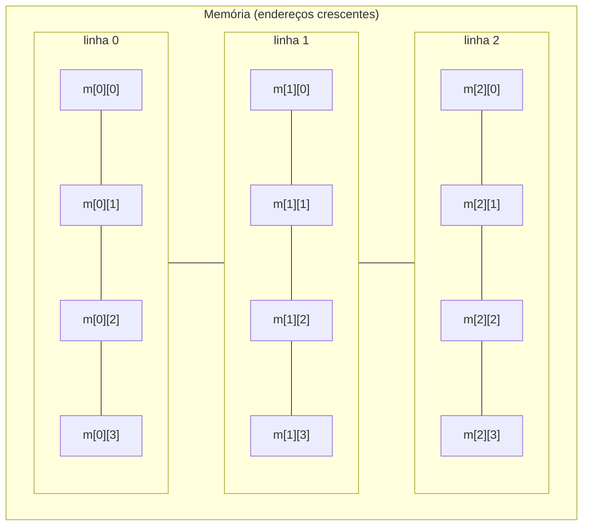
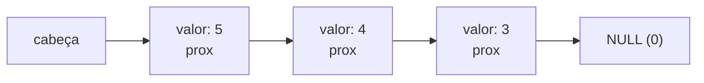
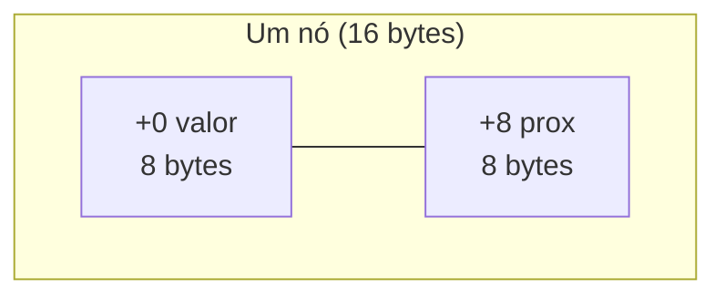

# 06 - Estruturas de Dados e Arrays

> [!abstract] Resumo
> Em Assembly não existem "arrays", "structs" ou "listas": existem **endereços, tamanhos e deslocamentos**. Este módulo mostra como cada estrutura de dados de linguagens de alto nível se reduz a **aritmética de endereços**: arrays 1D e multidimensionais (`base + i×tamanho`), strings, **structs** (campos = *offsets* fixos, com *padding*), **ponteiros** (registradores que guardam endereços) e **estruturas dinâmicas** (alocador simples e **lista encadeada**). Você também vê por que o *layout* na memória decide o desempenho (cache).

Voltar ao índice: [[00 - Índice]] · Módulo anterior: [[05 - Entrada-Saída e System Calls]] · Próximo: [[07 - Assembly Avançado (x86-x64)]]

**Pré-requisitos:** endereçamento `[base + índice×escala + deslocamento]` e alinhamento ([[02 - Registradores e Memória]]), laços e saltos ([[03 - Instruções Básicas e Controle de Fluxo]]), calling conventions e registradores preservados ([[04 - Procedimentos, Stack e Calling Conventions]]), rotinas de string e syscalls ([[05 - Entrada-Saída e System Calls]]).

**Objetivos:**
- Calcular o endereço de qualquer elemento de array 1D/2D e de qualquer campo de struct.
- Percorrer arrays por índice e por ponteiro, e saber qual é mais eficiente.
- Definir structs em NASM (`struc`) e MASM (`STRUCT`), prevendo o *padding*.
- Traduzir expressões com ponteiros de C para Assembly (`*p`, `p[i]`, `p+1`, `q-p`, `p->campo`).
- Implementar um alocador simples e uma lista encadeada (inserir, percorrer, buscar, inverter).
- Relacionar a estrutura de dados com o comportamento do cache.

Tags: #assembly #arrays #structs #ponteiros #listas #memoria #x64

---

## 1. Arrays unidimensionais

Um array é uma **sequência contígua** de elementos do mesmo tamanho. O endereço do elemento `i` é:

```text
endereço(a[i]) = base + i × tamanho_do_elemento
```

Graças à escala do endereçamento x86 (1, 2, 4 ou 8), isso cabe **em um único operando**: `[base + i*4]` para `int`.

### 1.1 Declarando arrays

```nasm
; NASM
section .data
    bytes   db 10, 20, 30, 40            ; 4 elementos de 1 byte
    inteiros dd 1, 2, 3, 4, 5            ; 5 elementos de 4 bytes
    n       equ ($ - inteiros) / 4       ; nº de elementos = bytes totais / tamanho do elemento
    zeros   times 8 dd 0                 ; 8 inteiros zerados
section .bss
    buffer  resd 100                     ; 100 inteiros sem valor inicial (400 bytes)
```

```nasm
; MASM
.data
    inteiros dd 1, 2, 3, 4, 5
    n        = ($ - inteiros) / 4        ; ou: LENGTHOF inteiros
    zeros    dd 8 dup(0)
.data?
    buffer   dd 100 dup(?)
```

> [!warning] Não há verificação de limites
> `[inteiros + 100*4]` lê memória que não pertence ao array, e o processador não reclama (a menos que a página não exista). Escrever fora dos limites é a causa clássica de *buffer overflow*. **Você** é responsável por conhecer `n`.

### 1.2 Tamanho do elemento × escala

| Elemento | Tamanho | Acesso | Carregar com extensão |
|----------|:-------:|--------|------------------------|
| `char`, `uint8_t` | 1 | `[base + i]` | `movzx eax, byte [base + i]` |
| `short` | 2 | `[base + i*2]` | `movsx eax, word [base + i*2]` |
| `int`, `float` | 4 | `[base + i*4]` | `mov eax, [base + i*4]` |
| `long`, `double`, ponteiro | 8 | `[base + i*8]` | `mov rax, [base + i*8]` |
| struct de 12 bytes | 12 | **não cabe na escala** | `lea r, [i + i*2]` × 4, depois `[base + r]` |

> [!tip] Tamanhos que não são 1, 2, 4 ou 8
> Para elementos de 12, 24, 40 bytes etc., calcule o deslocamento antes: `imul rcx, rcx, 12` (ou `lea rcx, [rcx + rcx*2]` seguido de `shl rcx, 2`) e use `[rdi + rcx]`. Quando o tamanho é potência de 2 (16, 32, 64...), `shl` basta.

### 1.3 Somando um array (versão ingênua e otimizada)

```c
int soma(const int *a, size_t n);      // a em RDI, n em RSI → resultado em EAX
```

**Ingênua:** índice, teste de limite no topo, dois saltos por volta.

```nasm
soma_ingenua:
    xor  eax, eax
    xor  ecx, ecx                      ; i = 0
.l: cmp  rcx, rsi
    jae  .f                            ; i >= n → sai
    add  eax, [rdi + rcx*4]
    inc  rcx
    jmp  .l
.f: ret
```

**Otimizada:** ponteiro percorrendo até um **ponteiro final**, inversão de laço, um salto por volta.

```nasm
soma:
    xor  eax, eax
    test rsi, rsi
    jz   .f                            ; n == 0 → retorna 0
    lea  rdx, [rdi + rsi*4]            ; fim = a + n (um depois do último)
.l: add  eax, [rdi]
    add  rdi, 4                        ; avança um elemento
    cmp  rdi, rdx
    jb   .l                            ; enquanto ptr < fim
.f: ret
```

> [!note] Índice × ponteiro
> Os dois fazem o mesmo, e o hardware executa o endereçamento `[rdi + rcx*4]` sem custo extra. A versão com ponteiro tem **uma instrução a menos por volta** (não precisa incrementar o índice *e* calcular o endereço) e deixa explícito o idioma "início/fim" que o C++ usa em iteradores. Nos módulos [[07 - Assembly Avançado (x86-x64)]] e [[09 - Otimização, SIMD e Performance]], o mesmo laço será vetorizado com SSE/AVX para somar 4 a 8 inteiros por instrução.

### 1.4 Busca linear

```nasm
; ssize_t busca(const int *a, size_t n, int x)   RDI = a, RSI = n, EDX = x
; devolve o índice de x, ou -1 se não existir
busca:
    xor  ecx, ecx
.l: cmp  rcx, rsi
    jae  .nao
    cmp  [rdi + rcx*4], edx            ; compara memória com registrador (um operando de memória só)
    je   .sim
    inc  rcx
    jmp  .l
.sim:
    mov  rax, rcx
    ret
.nao:
    mov  rax, -1
    ret
```

### 1.5 Busca binária (array ordenado, com sinal)

```nasm
; ssize_t busca_bin(const int *a, size_t n, int x)   RDI = a, RSI = n, EDX = x
busca_bin:
    xor  ecx, ecx                      ; lo = 0
    mov  r8, rsi                       ; hi = n         (intervalo semiaberto [lo, hi))
.l: cmp  rcx, r8
    jae  .nao                          ; lo >= hi → não achou
    mov  rax, r8
    sub  rax, rcx
    shr  rax, 1
    add  rax, rcx                      ; mid = lo + (hi - lo) / 2   (evita estouro de lo + hi)
    mov  r9d, [rdi + rax*4]
    cmp  r9d, edx
    je   .sim                          ; a[mid] == x
    jl   .dir                          ; a[mid] <  x → procura na metade direita
    mov  r8, rax                       ; a[mid] >  x → hi = mid
    jmp  .l
.dir:
    lea  rcx, [rax + 1]                ; lo = mid + 1
    jmp  .l
.sim:
    ret                                ; RAX = mid
.nao:
    mov  rax, -1
    ret
```

> [!warning] O clássico bug do ponto médio
> `(lo + hi) / 2` pode **estourar** quando `lo + hi` passa do limite do tipo. `lo + (hi - lo) / 2` nunca estoura. Esse bug ficou escondido em bibliotecas padrão por anos.

---

## 2. Arrays multidimensionais

A memória é **linear**; uma matriz precisa ser **achatada**. Em C (e na maioria das linguagens), a ordem é ***row-major***: uma linha inteira, depois a próxima.

Matriz `int m[3][4]` (3 linhas, 4 colunas):



```text
endereço(m[i][j]) = base + (i × COLUNAS + j) × tamanho_do_elemento
```

| Matriz | Elemento | Expressão | Exemplo (`base = 0x2000`, `m[2][3]`, 4×5 `int`s) |
|--------|----------|-----------|--------------------------------------------------|
| `int m[L][C]` | `m[i][j]` | `base + (i×C + j)×4` | `0x2000 + (2×5 + 3)×4 = 0x2000 + 52 =` **`0x2034`** |

```nasm
; int get(const int *m, size_t i, size_t j, size_t cols)   RDI = m, RSI = i, RDX = j, RCX = cols
get:
    imul rsi, rcx                      ; i × cols
    add  rsi, rdx                      ; + j
    mov  eax, [rdi + rsi*4]
    ret
```

**Ingênua × otimizada:** quando `cols` é **constante e potência de 2** (por exemplo, 4), `imul` vira deslocamento:

```nasm
; colunas = 4 (constante)
    shl  rsi, 2                        ; i × 4
    add  rsi, rdx
    mov  eax, [rdi + rsi*4]            ; ou, com tudo em uma linha: ver "lea" abaixo
```

### 2.1 Percorrendo por coluna (passo / *stride*)

Somar a coluna `j` percorre elementos separados por `COLS × 4` bytes. Esse intervalo é o **passo** (*stride*).

```nasm
; coluna.asm — soma a coluna 2 de uma matriz 3×4; resultado (3 + 7 + 11 = 21) no código de saída
global _start

section .data
    mat    dd  1,  2,  3,  4
           dd  5,  6,  7,  8
           dd  9, 10, 11, 12
    LINHAS equ 3
    COLS   equ 4

section .text
_start:
    lea  rsi, [rel mat + 2*4]          ; &mat[0][2]
    xor  eax, eax                      ; soma = 0
    mov  ecx, LINHAS
.l: add  eax, [rsi]
    add  rsi, COLS*4                   ; passo = uma linha inteira (16 bytes)
    dec  ecx
    jnz  .l
    mov  edi, eax                      ; exit(soma)
    mov  eax, 60
    syscall
```

> [!warning] A ordem de percurso importa muito para o desempenho
> Percorrer **por linha** (`j` varia mais rápido) lê endereços **consecutivos**: cada linha de cache (tipicamente 64 bytes = 16 `int`s) é aproveitada por inteiro. Percorrer **por coluna** em uma matriz grande salta `COLS × 4` bytes a cada acesso: cada leitura pode trazer uma **linha de cache nova** e usar só 4 bytes dela. Em matrizes grandes, a diferença chega a várias vezes. Veja o [[09 - Otimização, SIMD e Performance]].

### 2.2 Array de ponteiros (matriz "denteada")

Em vez de um bloco contíguo, pode-se ter um **array de ponteiros** para linhas separadas (como `int **m` em C): o acesso `m[i][j]` faz **dois** acessos à memória.

```nasm
; int get_pp(int **m, size_t i, size_t j)   RDI = m, RSI = i, RDX = j
get_pp:
    mov  rax, [rdi + rsi*8]            ; 1º acesso: ponteiro da linha i (ponteiros têm 8 bytes)
    mov  eax, [rax + rdx*4]            ; 2º acesso: elemento j da linha
    ret
```

| | Matriz contígua | Array de ponteiros |
|---|-----------------|--------------------|
| Acessos por elemento | 1 | 2 |
| Linhas de tamanhos diferentes | não | **sim** |
| Localidade de cache | ótima | depende de onde cada linha foi alocada |

---

## 3. Strings e caracteres

Já escrevemos `strlen`, `print_str`, `atoi_u`, `upper`, `reverse` e as instruções `rep movsb`/`scasb` no [[05 - Entrada-Saída e System Calls]]. Três complementos importantes:

### 3.1 Duas formas de representar tamanho

| Representação | Layout | Vantagens | Desvantagens |
|---------------|--------|-----------|--------------|
| **Terminada em zero** (C) | `"Oi"` → `4F 69 00` | Simples; formato do SO e da libc | Achar o tamanho custa **O(n)**; não pode conter `0` |
| **Com prefixo de tamanho** (Pascal) | `"Oi"` → `02 4F 69` | Tamanho em **O(1)**; pode conter `0` | Precisa de campo extra; limite de tamanho |

```nasm
texto_c  db "Ola", 0                    ; 4 bytes
texto_p  db 3, "Ola"                    ; 4 bytes: [tamanho][dados]
```

### 3.2 Contar ocorrências de um caractere

```nasm
; size_t conta(const char *s, char c)   RDI = s, SIL = c → RAX = ocorrências
conta:
    xor  eax, eax
.l: movzx ecx, byte [rdi]
    test cl, cl
    jz   .f                            ; terminador
    cmp  cl, sil
    jne  .p
    inc  rax
.p: inc  rdi
    jmp  .l
.f: ret
```

### 3.3 UTF-8: bytes ≠ caracteres

Em UTF-8, um caractere ocupa de **1 a 4 bytes**. O primeiro byte de cada caractere **não** tem o padrão `10xxxxxx`; os bytes de continuação, sim. Para contar **caracteres** (pontos de código), conte os bytes que **não** são de continuação:

```nasm
; size_t utf8_len(const char *s)   RDI = s → RAX = nº de caracteres
utf8_len:
    xor  eax, eax
.l: movzx ecx, byte [rdi]
    test cl, cl
    jz   .f
    and  ecx, 0xC0                     ; isola os 2 bits mais altos
    cmp  ecx, 0x80                     ; 10xxxxxx = byte de continuação
    setne cl                           ; 1 se NÃO for continuação (primeiro byte de um caractere)
    movzx ecx, cl
    add  rax, rcx                      ; soma 0 ou 1 — sem desvio
    inc  rdi
    jmp  .l
.f: ret
```

> [!note] Exemplo
> `"ação"` ocupa **6 bytes** (`a` = 1, `ç` = 2, `ã` = 2, `o` = 1) mas tem **4 caracteres**. `strlen` devolve 6; `utf8_len` devolve 4. No Windows, as funções "W" usam **UTF-16** (2 ou 4 bytes por caractere): em NASM, `du "abc", 0`; em MASM, `dw 'a','b','c',0`.

---

## 4. Estruturas (*structs*)

Uma struct é uma **região contígua** em que cada campo vive em um **deslocamento fixo** (*offset*) a partir do início. Acessar `p->campo` é `[p + offset_do_campo]`.

```c
struct Aluno {
    uint32_t id;          // offset  0   (4 bytes)
    uint16_t idade;       // offset  4   (2 bytes)
                          // padding     6–7  (2 bytes, para alinhar o próximo em 8)
    uint64_t matricula;   // offset  8   (8 bytes)
    char     nome[16];    // offset 16   (16 bytes)
};                        // tamanho 32, alinhamento 8
```

| Campo | Offset | Tamanho | Alinhamento exigido |
|-------|:------:|:-------:|:-------------------:|
| `id` | 0 | 4 | 4 |
| `idade` | 4 | 2 | 2 |
| *(padding)* | 6 | 2 | — |
| `matricula` | 8 | 8 | 8 |
| `nome` | 16 | 16 | 1 |
| **Total** | | **32** | **8** (o maior dos campos) |

> [!tip] Verifique o layout com um programa em C
> A forma mais segura de **não errar offsets** é perguntar ao compilador:
> ```c
> #include <stdio.h>
> #include <stddef.h>
> #include <stdint.h>
> struct Aluno { uint32_t id; uint16_t idade; uint64_t matricula; char nome[16]; };
> int main(void) {
>     printf("idade=%zu matricula=%zu nome=%zu tamanho=%zu\n",
>            offsetof(struct Aluno, idade), offsetof(struct Aluno, matricula),
>            offsetof(struct Aluno, nome), sizeof(struct Aluno));
> }   /* idade=4 matricula=8 nome=16 tamanho=32 */
> ```

### 4.1 Definindo structs: NASM e MASM

```nasm
; NASM: struc/endstruc só definem OFFSETS (não reservam memória)
struc Aluno
    .id:        resd 1               ; offset 0   → Aluno.id
    .idade:     resw 1               ; offset 4   → Aluno.idade
                resw 1               ; offset 6   (padding explícito)
    .matricula: resq 1               ; offset 8   → Aluno.matricula
    .nome:      resb 16              ; offset 16  → Aluno.nome
endstruc                             ; Aluno_size = 32
```

```nasm
; MASM
Aluno STRUCT
    id        DWORD ?                ; offset 0
    idade     WORD  ?                ; offset 4
              WORD  ?                ; offset 6  (padding explícito)
    matricula QWORD ?                ; offset 8
    nome      BYTE 16 dup(?)         ; offset 16
Aluno ENDS                           ; SIZEOF Aluno = 32
```

> [!warning] Alinhamento automático de campos
> Em C, o compilador insere *padding* sozinho. Em NASM, `struc` **não** alinha por você: os offsets são exatamente a soma dos tamanhos que você declarou, então escreva o *padding* explicitamente (ou use `alignb 8`). Em MASM, o alinhamento dos campos depende da opção de empacotamento (`/Zp`, e o padrão **difere** entre `ml` e `ml64`), então inclua o *padding* explícito e **confirme com `SIZEOF`** que o tamanho bate com o da struct em C com a qual você interage.

### 4.2 Acessando campos

```nasm
; NASM: RDI aponta para um Aluno
mov  eax, [rdi + Aluno.id]            ; p->id
movzx ecx, word [rdi + Aluno.idade]   ; p->idade (16 bits → 32, sem sinal)
mov  rdx, [rdi + Aluno.matricula]     ; p->matricula
lea  rsi, [rdi + Aluno.nome]          ; &p->nome  (endereço do vetor de caracteres)
```

```nasm
; MASM: RCX aponta para um Aluno
mov  eax, (Aluno PTR [rcx]).id
movzx edx, (Aluno PTR [rcx]).idade
mov  r8,  (Aluno PTR [rcx]).matricula
lea  r9,  (Aluno PTR [rcx]).nome
```

> [!example] `bool eh_adulto(const Aluno *a)` (idade ≥ 18)
> ```nasm
> eh_adulto:                            ; System V: RDI = a
>     movzx ecx, word [rdi + Aluno.idade]
>     xor   eax, eax                    ; zera ANTES do cmp: xor altera as flags!
>     cmp   ecx, 18
>     setae al                          ; AL = 1 se idade >= 18 (sem sinal)
>     ret
> ```
> O `xor eax, eax` vem **antes** do `cmp` porque `xor` mexe nas flags; colocá-lo entre o `cmp` e o `setae` destruiria a comparação.

### 4.3 Array de structs

O elemento `i` fica em `base + i × sizeof(struct)`. Como `Aluno_size = 32` é potência de 2, o cálculo é um deslocamento (`shl rcx, 5`). Para percorrer em sequência, basta **somar o tamanho** ao ponteiro:

```nasm
; uint32_t soma_idades(const Aluno *v, size_t n)    RDI = v, RSI = n
soma_idades:
    xor  eax, eax
    test rsi, rsi
    jz   .f
.l: movzx ecx, word [rdi + Aluno.idade]
    add  eax, ecx
    add  rdi, Aluno_size               ; próximo elemento: +32 bytes
    dec  rsi
    jnz  .l
.f: ret
```

```nasm
; acesso aleatório: v[i].id
    mov  rcx, rsi                      ; i
    shl  rcx, 5                        ; i × 32     (para tamanhos fora da escala: imul rcx, rcx, Aluno_size)
    mov  eax, [rdi + rcx + Aluno.id]
```

### 4.4 *Array of Structs* × *Struct of Arrays*

```c
struct { int x[N]; int y[N]; } SoA;       // struct de arrays
struct { int x, y; } AoS[N];              // array de structs
```

| | **AoS** (`{x,y}`, `{x,y}`, ...) | **SoA** (`x,x,x...`, `y,y,y...`) |
|---|---------------------------------|-----------------------------------|
| Acessar **todos os campos** de um elemento | ótimo (mesma linha de cache) | pior (campos em regiões distantes) |
| Processar **um campo** em todos os elementos | desperdiça cache | **ótimo**, e fácil de vetorizar com SIMD |

O módulo [[09 - Otimização, SIMD e Performance]] explica por que código SIMD prefere SoA.

### 4.5 Uniões e campos de bits

- **União:** vários campos no **mesmo** offset. Em Assembly, basta reservar o tamanho do maior campo e usar nomes diferentes para o mesmo offset.
- **Campos de bits:** não existem no Assembly; você os implementa com **máscaras e deslocamentos**:

```nasm
; data empacotada em 16 bits:  ano(7) | mês(4) | dia(5)    bits 15..9 | 8..5 | 4..0
; extrair o dia, o mês e o ano de AX
    mov  ecx, eax
    and  ecx, 0x1F                     ; dia  = bits 4..0
    mov  edx, eax
    shr  edx, 5
    and  edx, 0x0F                     ; mês  = bits 8..5
    shr  eax, 9                        ; ano  = bits 15..9 (relativo a um ano-base)
```

---

## 5. Ponteiros e aritmética de ponteiros

Um **ponteiro** é um **valor que é um endereço**. Em Assembly, é um registrador (ou uma posição de memória) cujo conteúdo você usa entre colchetes. Em x64 ocupa **8 bytes** (4 em x86).

### 5.1 Tradução de C para Assembly

Assuma `int *p` em `RDI`, `int *q` em `RSI`, `size_t i` em `RCX`, `struct Aluno *s` em `RDX`:

| C | Assembly (NASM) | Observação |
|---|-----------------|------------|
| `*p` | `mov eax, [rdi]` | Dereferência |
| `p[i]` | `mov eax, [rdi + rcx*4]` | Escala = tamanho do tipo |
| `p + i` | `lea rax, [rdi + rcx*4]` | Ponteiro, não valor: **`lea`** |
| `*(p + 1)` | `mov eax, [rdi + 4]` | `+1` em `int*` = **+4 bytes** |
| `p++` | `add rdi, 4` | Avança um elemento |
| `q - p` (em elementos) | `mov rax, rsi` / `sub rax, rdi` / `sar rax, 2` | Subtração em bytes ÷ tamanho (aqui `sar`, com sinal) |
| `*p = 7` | `mov dword [rdi], 7` | Tamanho explícito |
| `s->id` | `mov eax, [rdx + Aluno.id]` | Offset do campo |
| `&s->nome` | `lea rax, [rdx + Aluno.nome]` | Endereço do campo |
| `**pp` | `mov rax, [rdi]` / `mov eax, [rax]` | Dois acessos |
| `p == NULL` | `test rdi, rdi` / `jz ...` | NULL é o endereço `0` |

> [!note] Aritmética de ponteiros é escalada pelo tipo
> Em C, `p + 1` avança **um elemento**. Em Assembly, **você** faz a conversão: `+4` para `int*`, `+8` para `long*`/ponteiros, `+1` para `char*`, `+sizeof(struct)` para ponteiro de struct. Esquecer a escala é um erro muito comum.

### 5.2 Trocando dois valores por ponteiros

```nasm
; void troca(int *a, int *b)        RDI = a, RSI = b
troca:
    mov  eax, [rdi]
    mov  ecx, [rsi]
    mov  [rdi], ecx
    mov  [rsi], eax
    ret
```

### 5.3 Array de ponteiros para strings

```nasm
; tabela.asm — imprime três nomes usando print_str do módulo 05
section .data
    n1      db "Ana", 10, 0
    n2      db "Bruno", 10, 0
    n3      db "Carla", 10, 0
    nomes   dq n1, n2, n3             ; 3 ponteiros de 8 bytes cada
    NNOMES  equ 3

section .text
    lea  rbx, [rel nomes]
    mov  r12d, NNOMES
.l: mov  rdi, [rbx]                    ; RDI = ponteiro da string atual
    call print_str
    add  rbx, 8                        ; próximo ponteiro
    dec  r12d
    jnz  .l
```

> [!warning] Endereços absolutos em `dq`
> `dq n1, n2, n3` grava os **endereços** absolutos. Isso funciona nos executáveis estáticos/não-PIE que montamos com `ld`. Em executáveis PIE o linker gera **relocações** (`R_X86_64_RELATIVE`) para corrigir esses valores na carga, o que é normal em `.data`, mas é uma das razões pelas quais PIE prefere tabelas de **deslocamentos relativos** em código sensível.

### 5.4 Ponteiros para funções

Uma função também tem **endereço**. Chamá-la por ponteiro é um `call` indireto:

```nasm
; void aplica(void (*f)(int), int x)     RDI = f, ESI = x
aplica:
    mov  rax, rdi
    mov  edi, esi                      ; o argumento da função vai em EDI
    jmp  rax                           ; "tail call": a função f retorna direto ao nosso chamador
```

Tabelas de funções (*vtables* de C++, *callbacks*, *dispatch*) são arrays de ponteiros de função: `call [tabela + rax*8]`.

### 5.5 Erros clássicos com ponteiros

| Erro | O que acontece em Assembly |
|------|---------------------------|
| **Ponteiro nulo** (`mov eax, [0]`) | Página 0 não mapeada → *segmentation fault* |
| **Ponteiro solto** (*dangling*) | Aponta para memória liberada/pilha já descartada; funciona "às vezes" |
| **Ponteiro não inicializado** | Lixo em um registrador; acesso aleatório |
| **Desalinhado** | Mais lento, ou exceção em instruções SIMD alinhadas |
| **Escala errada** | `[rdi + rcx]` em vez de `[rdi + rcx*4]`: lê no meio dos inteiros |
| **Ponteiro de 32 bits em x64** | `mov eax, ptr` **trunca** o endereço (a parte alta é zerada) |

---

## 6. Alocação de memória e estruturas dinâmicas

Até aqui os dados estavam em `.data`, `.bss` ou na pilha. Para estruturas cujo tamanho só se conhece **em tempo de execução**, é preciso pedir memória ao SO (o **heap**).

| Estratégia | Como | Quando usar |
|------------|------|-------------|
| **Reservar em `.bss`** | `pool resb 65536` | Tamanho máximo conhecido; zero syscalls |
| **`brk` + ponteiro de avanço** (*arena*/*bump allocator*) | Syscall `brk` (12) e um ponteiro que só cresce | Simples e rápido; **sem `free`** individual |
| **`mmap`** | Syscall `mmap` (9) | Blocos grandes; controle de permissões |
| **libc: `malloc`/`free`** | `call malloc wrt ..plt` | Programas que misturam C e Assembly |
| **Windows** | `GetProcessHeap` + `HeapAlloc` / `HeapFree` (ou `VirtualAlloc`) | Programas Windows |

### 6.1 Um alocador simples (arena sobre `brk`)

```nasm
section .bss
    arena_cur resq 1                   ; próximo endereço livre
    arena_fim resq 1                   ; fim da região obtida

section .text
; int arena_init(size_t tamanho)    RDI = tamanho → RAX = 0 (ok) ou -1 (erro)
arena_init:
    mov  r8, rdi                       ; guarda o tamanho (R8 sobrevive ao syscall)
    mov  eax, 12                       ; brk(0): devolve o break atual
    xor  edi, edi
    syscall
    mov  [rel arena_cur], rax          ; início da arena
    lea  rdi, [rax + r8]               ; novo break = início + tamanho
    mov  eax, 12
    syscall                            ; brk(novo): devolve o break efetivo (o antigo, se falhou)
    mov  rdx, [rel arena_cur]
    lea  rcx, [rdx + r8]
    cmp  rax, rcx
    jb   .erro                         ; break obtido < desejado → sem memória
    mov  [rel arena_fim], rax
    xor  eax, eax
    ret
.erro:
    mov  rax, -1
    ret

; void *arena_alloc(size_t n)       RDI = n → RAX = ponteiro (alinhado em 8) ou 0
arena_alloc:
    add  rdi, 7
    and  rdi, -8                       ; arredonda n para cima, múltiplo de 8
    mov  rax, [rel arena_cur]
    lea  rdx, [rax + rdi]              ; novo cur
    cmp  rdx, [rel arena_fim]
    ja   .falta                        ; passou do fim
    mov  [rel arena_cur], rdx
    ret                                ; RAX = bloco alocado
.falta:
    xor  eax, eax
    ret
```

> [!note] Como funciona e quais as limitações
> `brk(0)` devolve o fim atual do heap; `brk(endereço)` tenta movê-lo e devolve o fim resultante. A "arena" apenas **avança um ponteiro**: alocar é somar, e **liberar tudo** é voltar o ponteiro ao início. Não dá para liberar um bloco isolado, o que é aceitável em programas curtos, compiladores e jogos (alocação por quadro). `malloc` de verdade mantém listas de blocos livres, junta blocos vizinhos e usa `mmap` para blocos grandes.

### 6.2 Lista encadeada simples

Cada **nó** guarda um valor e o **ponteiro para o próximo**; o último aponta para `NULL` (0).



```nasm
struc No
    .valor: resq 1                     ; offset 0
    .prox:  resq 1                     ; offset 8
endstruc                               ; No_size = 16
```



**Inserir no início** (retorna a nova cabeça):

```nasm
; No *push_front(No *cabeca, uint64_t valor)    RDI = cabeça, RSI = valor → RAX = nova cabeça (0 se faltou memória)
push_front:
    push rbx                           ; entrada ≡ 8 (mod 16) → ≡ 0
    push r12                           ;                       ≡ 8
    sub  rsp, 8                        ;                       ≡ 0  → alinhada para o call
    mov  rbx, rdi                      ; guarda a cabeça antiga  (RBX e R12 são callee-saved)
    mov  r12, rsi                      ; guarda o valor
    mov  edi, No_size
    call arena_alloc                   ; RAX = novo nó
    test rax, rax
    jz   .fim                          ; falhou: devolve 0
    mov  [rax + No.valor], r12
    mov  [rax + No.prox], rbx          ; novo->prox = cabeça antiga
.fim:
    add  rsp, 8
    pop  r12
    pop  rbx
    ret
```

**Percorrer e somar:**

```nasm
; uint64_t lista_soma(const No *cabeca)     RDI = cabeça
lista_soma:
    xor  eax, eax
    test rdi, rdi
    jz   .f                            ; lista vazia
.l: add  rax, [rdi + No.valor]
    mov  rdi, [rdi + No.prox]          ; avança: atual = atual->prox
    test rdi, rdi
    jnz  .l
.f: ret
```

**Buscar um valor** (devolve o ponteiro do nó, ou 0):

```nasm
; No *lista_busca(const No *cabeca, uint64_t valor)    RDI = cabeça, RSI = valor
lista_busca:
.l: test rdi, rdi
    jz   .nao
    cmp  [rdi + No.valor], rsi
    je   .sim
    mov  rdi, [rdi + No.prox]
    jmp  .l
.sim:
    mov  rax, rdi
    ret
.nao:
    xor  eax, eax
    ret
```

**Inverter a lista no lugar** (três ponteiros: anterior, atual, próximo):

```nasm
; No *lista_inverte(No *cabeca)             RDI = cabeça → RAX = nova cabeça
lista_inverte:
    xor  eax, eax                      ; anterior = NULL
.l: test rdi, rdi
    jz   .f
    mov  rdx, [rdi + No.prox]          ; prox = atual->prox
    mov  [rdi + No.prox], rax          ; atual->prox = anterior
    mov  rax, rdi                      ; anterior = atual
    mov  rdi, rdx                      ; atual = prox
    jmp  .l
.f: ret
```

**Programa completo:** monta a lista 5 → 4 → 3 → 2 → 1 e devolve a soma (15) como código de saída.

```nasm
global _start
section .text
_start:                                ; (RSP entra alinhado em 16)
    mov  edi, 4096
    call arena_init
    test rax, rax
    js   .erro
    xor  ebx, ebx                      ; cabeça = NULL           (RBX preservado por push_front)
    mov  r12d, 1                       ; valor = 1
.l: mov  rdi, rbx
    mov  rsi, r12
    call push_front
    test rax, rax
    jz   .erro
    mov  rbx, rax                      ; nova cabeça
    inc  r12
    cmp  r12, 5
    jbe  .l                            ; insere 1..5
    mov  rdi, rbx
    call lista_soma
    mov  edi, eax                      ; exit(15)
    mov  eax, 60
    syscall
.erro:
    mov  edi, 1
    mov  eax, 60
    syscall
; ... arena_init, arena_alloc, push_front, lista_soma acima ...
```

### 6.3 Em Windows (MASM x64)

```nasm
No STRUCT
    valor QWORD ?
    prox  QWORD ?
No ENDS

; uint64_t lista_soma(const No *cabeca)       RCX = cabeça (Microsoft x64)
lista_soma proc
    xor  eax, eax
    test rcx, rcx
    jz   fim
laco:
    add  rax, (No PTR [rcx]).valor
    mov  rcx, (No PTR [rcx]).prox
    test rcx, rcx
    jnz  laco
fim:
    ret
lista_soma endp
```

E, para obter memória no Windows em vez de `brk`:

```nasm
extrn GetProcessHeap : proc
extrn HeapAlloc : proc
    ; ... (com shadow space reservado e pilha alinhada)
    call GetProcessHeap                ; RAX = handle do heap padrão
    mov  rcx, rax                      ; hHeap
    xor  edx, edx                      ; dwFlags = 0
    mov  r8d, SIZEOF No                ; dwBytes
    call HeapAlloc                     ; RAX = ponteiro (ou NULL)
```

### 6.4 Outras estruturas básicas

| Estrutura | Representação em Assembly | Observações |
|-----------|---------------------------|-------------|
| **Pilha** (stack de dados) | Array + contador (`push`: `[base + len*8] = x; len++`) | Verifique estouro (`len == cap`) |
| **Fila circular** | Array + `ini`/`fim` com módulo (`and idx, cap-1` se `cap` é potência de 2) | Sem alocação |
| **Array dinâmico** | `{dados, tamanho, capacidade}`; ao encher, aloca o **dobro** e copia (`rep movsq`) | Custo amortizado O(1) por inserção |
| **Lista dupla** | Nó com `prev` e `next` | Remoção O(1) com o ponteiro do nó |
| **Árvore binária** | Nó `{chave, esq, dir}` | Cada descida é um acesso dependente |

### 6.5 Estrutura de dados × cache

| | **Array** | **Lista encadeada** |
|---|-----------|---------------------|
| Acesso ao i-ésimo | O(1): `[base + i*s]` | O(i): percorrer nós |
| Inserir no início | O(n) (deslocar) | **O(1)** |
| Percorrer | Endereços **consecutivos** → o *prefetcher* adivinha o próximo | Cada nó depende do **anterior** (`mov rdi, [rdi+8]`) → cadeia de latências |
| Cache | Cada linha de 64 bytes traz vários elementos | Cada nó pode estar numa linha diferente |

> [!note] *Pointer chasing*
> Em `mov rdi, [rdi + No.prox]`, o endereço do próximo acesso **só é conhecido depois** de terminar o acesso atual. A CPU não consegue sobrepor essas leituras e cada uma paga a latência completa (cache L1, L2, L3 ou RAM, dependendo de onde o nó está). Por isso, para percorrer, **arrays quase sempre vencem listas** por uma margem grande, mesmo quando a teoria promete o contrário. Retomamos isso no [[09 - Otimização, SIMD e Performance]].

---

## 7. Resumo das fórmulas de endereço

| Estrutura | Endereço | Operando em Assembly |
|-----------|----------|----------------------|
| Array 1D de `T` | `base + i·sizeof(T)` | `[rdi + rcx*4]` |
| Matriz `[L][C]` row-major | `base + (i·C + j)·sizeof(T)` | `imul`/`shl` + `[rdi + rsi*4]` |
| Campo de struct | `p + offset` | `[rdi + Aluno.idade]` |
| Array de structs | `base + i·sizeof(S) + offset` | `shl rcx, 5` + `[rdi + rcx + Aluno.id]` |
| Array de ponteiros | `[base + i·8]` → depois `[ptr + j·sizeof(T)]` | dois `mov` |
| Nó de lista | `p + No.prox` | `mov rdi, [rdi + No.prox]` |

---

## 8. Erros comuns do módulo 06

> [!warning] Lista de armadilhas
> 1. **Esquecer a escala**: usar `[rdi + rcx]` para `int` (lê no meio dos elementos).
> 2. **Escrever além do fim** de um array (sem verificação de limites).
> 3. **Contar elementos erradamente**: `n equ $ - arr` dá **bytes**; divida pelo tamanho do elemento.
> 4. **Confundir `lea` e `mov`** com ponteiros: `lea rax, [rdi + rcx*4]` é o **endereço**; `mov eax, [rdi + rcx*4]` é o **valor**.
> 5. **Offsets de struct calculados à mão** ignorando o *padding*; confirme com `offsetof`/`SIZEOF`.
> 6. **Tamanho de elemento fora da escala** (12 bytes) usando `*12` no endereçamento: inválido; calcule antes.
> 7. **Ponteiro nulo e lista vazia**: testar `rdi` antes do primeiro acesso.
> 8. **Perder a cabeça da lista** ao percorrer (usar o mesmo registrador da cabeça como cursor sem guardá-la).
> 9. **Não salvar registradores *callee-saved*** ao chamar `arena_alloc` dentro de laços.
> 10. **Modificar strings em `.rodata`** (segfault); copie para `.data`/`.bss`/pilha antes.
> 11. **Truncar ponteiros** usando registradores de 32 bits (`mov eax, ptr`).
> 12. **Percorrer matriz por coluna** em dados grandes sem necessidade (cache).

---

## 9. Exercícios

> [!question] Exercício 1: Endereços
> Dado `int a[10]` em `0x1000`, quais os endereços de `a[7]` e `&a[7] - &a[2]` (em bytes e em elementos)? E, para `int m[4][5]` em `0x2000`, o endereço de `m[2][3]`?

> [!success] Solução
> `&a[7] = 0x1000 + 7×4 =` **`0x101C`**. `&a[7] − &a[2] =` 20 bytes = **5 elementos**. `&m[2][3] = 0x2000 + (2×5 + 3)×4 = 0x2000 + 52 =` **`0x2034`**.

> [!question] Exercício 2: Layout de struct
> Calcule offsets e tamanho de `struct { uint8_t a; uint32_t b; uint16_t c; uint64_t d; }` e depois reordene os campos para **minimizar** o tamanho.

> [!success] Solução
> `a` em 0; *padding* 1–3; `b` em 4; `c` em 8; *padding* 10–15; `d` em 16: **tamanho 24**. Reordenada como `d, b, c, a`: `d` em 0, `b` em 8, `c` em 12, `a` em 14, *padding* 15: **tamanho 16**.

> [!question] Exercício 3: Ponteiro para o máximo
> Escreva `const int *max_ptr(const int *a, size_t n)` (n ≥ 1) que devolva o **ponteiro** para o maior elemento (com sinal).

> [!success] Solução
> ```nasm
> max_ptr:                              ; RDI = a, RSI = n
>     mov  rax, rdi                     ; melhor = &a[0]
>     mov  ecx, [rdi]                   ; valor máximo atual
>     lea  rdx, [rdi + rsi*4]           ; fim
>     add  rdi, 4
> .l: cmp  rdi, rdx
>     jae  .f
>     cmp  [rdi], ecx
>     jle  .p
>     mov  ecx, [rdi]
>     mov  rax, rdi
> .p: add  rdi, 4
>     jmp  .l
> .f: ret
> ```

> [!question] Exercício 4: Traço de uma matriz
> Escreva `int traco(const int *m, size_t n)` que some a **diagonal principal** de uma matriz `n × n` (use o passo `(n+1) × 4`).

> [!success] Solução
> ```nasm
> traco:                                ; RDI = m, RSI = n
>     xor  eax, eax
>     lea  rdx, [rsi + 1]
>     shl  rdx, 2                       ; passo em bytes = (n + 1) × 4
> .l: test rsi, rsi
>     jz   .f
>     add  eax, [rdi]
>     add  rdi, rdx                     ; pula para o próximo elemento da diagonal
>     dec  rsi
>     jmp  .l
> .f: ret
> ```

> [!question] Exercício 5: Contar nós
> Escreva `size_t lista_conta(const No *cabeca)` e `No *lista_ultimo(No *cabeca)` (devolve o último nó, ou `NULL` se a lista for vazia).

> [!success] Solução
> ```nasm
> lista_conta:                          ; RDI = cabeça
>     xor  eax, eax
> .l: test rdi, rdi
>     jz   .f
>     inc  rax
>     mov  rdi, [rdi + No.prox]
>     jmp  .l
> .f: ret
>
> lista_ultimo:                         ; RDI = cabeça → RAX = último nó (ou 0)
>     xor  eax, eax
>     test rdi, rdi
>     jz   .f
> .l: mov  rax, rdi
>     mov  rdi, [rdi + No.prox]
>     test rdi, rdi
>     jnz  .l
> .f: ret
> ```

> [!question] Exercício 6: `argv`
> No `_start`, imprima todos os argumentos da linha de comando (um por linha), usando `print_str` e o fato de que `argv` é um **array de ponteiros** terminado em `NULL`.

> [!success] Solução (esboço)
> ```nasm
> _start:
>     mov  rbx, rsp
>     mov  r12, [rbx]                   ; argc
>     lea  r13, [rbx + 8]               ; argv
> .l: test r12, r12
>     jz   .fim
>     mov  rdi, [r13]                   ; argv[i]
>     call print_str
>     ; ... imprima um '\n' (write de 1 byte) ...
>     add  r13, 8
>     dec  r12
>     jmp  .l
> .fim: ; exit(0)
> ```

> [!question] Exercício 7 (desafio): Pilha de dados com array dinâmico
> Defina `struct Pilha { uint64_t *dados; uint64_t tam; uint64_t cap; }` e implemente `pilha_push` e `pilha_pop`. Em `push`, se `tam == cap`, **dobre a capacidade** (aloque um novo bloco com `arena_alloc` e copie com `rep movsq`).

> [!success] Solução (esboço)
> ```nasm
> pilha_push:                           ; RDI = &Pilha, RSI = valor → RAX = 0 ok, -1 sem memória
>     ; if (tam == cap) { novo = alloc(cap*2*8); copia tam*8 bytes; dados = novo; cap *= 2; }
>     ; dados[tam++] = valor;
> ```
> Pontos de atenção: guardar `RDI`/`RSI` em registradores *callee-saved* antes do `call arena_alloc`; para `cap = 0`, começar com uma capacidade mínima (por exemplo, 4); copiar com `mov rcx, tam` / `cld` / `rep movsq` (`RSI` origem, `RDI` destino). Em uma arena, o bloco antigo **não** é liberado individualmente.

Laboratórios relacionados: [[Lab 03 - Manipulação de Strings e Arrays]], [[Lab 04 - Funções da libc]] (`memcpy`, `strcpy`, `strcmp` usam estas técnicas) e [[Lab 06 - Ordenação]] (Bubble Sort e Quick Sort sobre arrays).

---

## 10. Resumo

> [!abstract] Resumo do módulo 06
> - **Array** = `base + i × tamanho`; a escala 1/2/4/8 do endereçamento resolve quase tudo. Para tamanhos como 12, calcule o deslocamento antes. **Não há verificação de limites.**
> - **Ponteiro percorrendo até um ponteiro final** (com inversão de laço) costuma economizar uma instrução por volta em relação ao índice.
> - **Matrizes** são achatadas em *row-major*: `base + (i·C + j)·tamanho`. Percorra **por linha** para respeitar o cache.
> - **Structs**: campos em *offsets* fixos com **padding**; defina com `struc/endstruc` (NASM) ou `STRUCT/ENDS` (MASM), e **confirme o layout** com `offsetof`/`SIZEOF`. Array de structs: `base + i·sizeof + offset`.
> - **Ponteiros**: valores que são endereços; a aritmética é **escalada pelo tipo** (em Assembly, por você); `lea` calcula o endereço, `mov` lê o valor; NULL é `0`.
> - **Estruturas dinâmicas**: um alocador *arena* sobre `brk`, e a **lista encadeada** (inserir, percorrer, buscar, inverter), em NASM e MASM.
> - **Layout é desempenho**: arrays aproveitam cache e *prefetch*; listas sofrem com *pointer chasing*; AoS × SoA decide a vetorização.

**Próximo:** [[07 - Assembly Avançado (x86-x64)]] · **Ver também:** [[Glossário#Assembly (x86-64 e ARM)]] · [[Cheat Sheet de Instruções]] · [[00 - Índice]]
