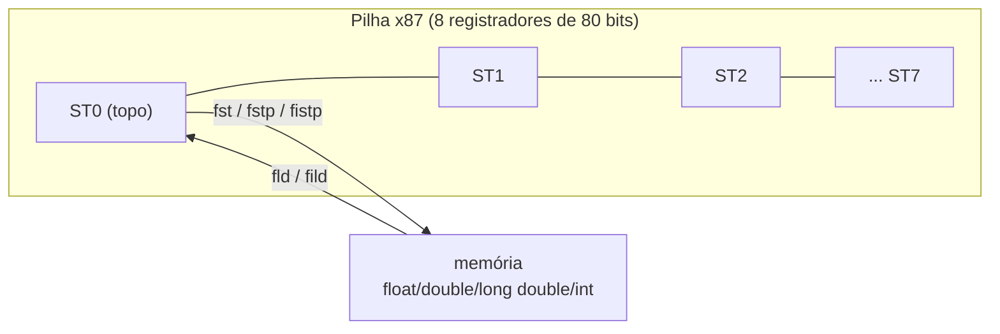
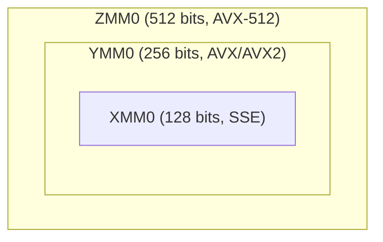
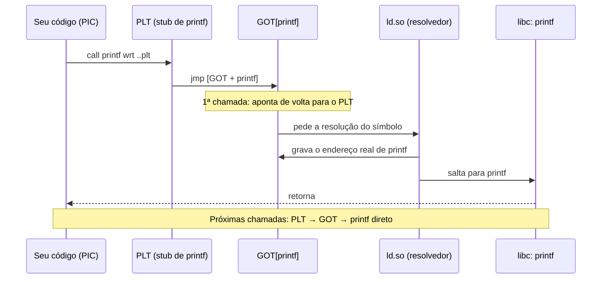
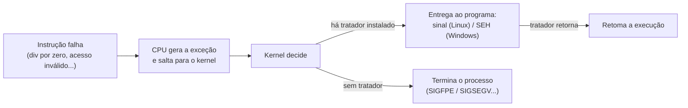

# 07 - Assembly Avançado (x86/x64)

> [!abstract] Resumo
> Aqui o curso sai do "núcleo" do x86 e entra no que se usa em código real de alto desempenho e de sistema: **manipulação de bits** (`BSF`, `POPCNT`, `BT`, BMI), **multiplicação e divisão avançadas** (128 bits, divisão por constante), **ponto flutuante** com a **FPU x87** e com **SSE/AVX** (SIMD), **macros** e diferenças entre NASM, MASM e GAS, **Assembly inline** em C/C++ (GCC e MSVC), **código independente de posição** (PIC, GOT/PLT) e **tratamento de exceções** (sinais no Linux, SEH no Windows, *unwinding*).

Voltar ao índice: [[Índice - Assembly]] · Módulo anterior: [[06 - Estruturas de Dados e Arrays]] · Próximo: [[08 - ARM e AArch64]]

**Pré-requisitos:** [[03 - Instruções Básicas e Controle de Fluxo]] (flags, `mul`/`div`, deslocamentos), [[04 - Procedimentos, Stack e Calling Conventions]] (ABIs), [[05 - Entrada-Saída e System Calls]] (syscalls), [[06 - Estruturas de Dados e Arrays]] (arrays, alinhamento).

**Objetivos:**
- Usar as instruções de bit (`bsf`, `bsr`, `popcnt`, `bt*`, `shld`/`shrd`, BMI1/BMI2) e saber quando cada uma existe na CPU.
- Fazer aritmética de 128 bits e dividir por constantes com multiplicação.
- Escrever código de ponto flutuante com x87 e, principalmente, com **SSE/AVX** (escalar e vetorial), tratando `NaN`, alinhamento e `vzeroupper`.
- Escrever macros úteis (NASM e MASM) e entender o que muda no GAS.
- Embutir Assembly em C/C++ com restrições corretas (GCC) e saber por que o MSVC x64 não permite.
- Explicar PIC/PIE, GOT e PLT e montar uma biblioteca compartilhada em Assembly.
- Capturar exceções do processador: sinais no Linux, SEH no Windows, e o papel dos dados de *unwind*.

Tags: #assembly #bits #x87 #sse #avx #simd #macros #inline-asm #pic #excecoes #x64

> [!note] O que foi testado
> Os exemplos de **Linux x64** deste módulo (NASM 2.16, GCC, GAS) foram montados e executados antes da publicação da nota. Os trechos de **MASM/MSVC/Windows** seguem a documentação e as convenções do módulo 04, mas **não** foram executados; teste-os no seu ambiente. Instruções como `popcnt`, BMI e AVX2 exigem CPU compatível (veja a seção 4.6, sobre detecção).

---

## 1. Manipulação de bits

### 1.1 Instruções de bit do x86

| Instrução | O que faz | Observações |
|-----------|-----------|-------------|
| `bt r/m, r/imm8` | copia o bit indicado para **`CF`** | Só lê. Com **imediato**, o índice é módulo o tamanho do operando |
| `bts` / `btr` / `btc` | `bt` + **liga** / **desliga** / **inverte** o bit | Com operando de **memória** e índice em **registrador**, o índice pode endereçar além do operando ("*bit string*"): lento (microcodificado) |
| `bsf d, s` | índice do **menor** bit 1 | `ZF = 1` se `s = 0` (destino **indefinido**) |
| `bsr d, s` | índice do **maior** bit 1 | idem |
| `tzcnt d, s` | nº de zeros à direita (*trailing zeros*) | BMI1. Origem 0 → resultado = tamanho do operando (32/64) e `CF = 1` |
| `lzcnt d, s` | nº de zeros à esquerda (*leading zeros*) | ABM/LZCNT. Origem 0 → tamanho do operando |
| `popcnt d, s` | nº de bits 1 | Extensão POPCNT (SSE4.2 na prática) |
| `bswap r` | inverte a ordem dos bytes (32 ou 64 bits) | Conversão de *endianness* |
| `shld d, s, n` / `shrd d, s, n` | desloca `d` trazendo bits de `s` | Deslocamentos de 128 bits e campos de bits |
| `rol` / `ror` / `rcl` / `rcr` | rotações (as `rc*` passam pelo `CF`) | `rcl`/`rcr` são lentas |

> [!warning] `lzcnt` e `tzcnt` "funcionam" em CPUs antigas, mas com **outro resultado**
> `lzcnt` é codificada como `F3 0F BD`, que em processadores sem a extensão é executada como **`bsr`** (e `tzcnt` como **`bsf`**): sem erro, **com resposta diferente** (`bsr` devolve o *índice* do bit mais alto, não a contagem de zeros à esquerda; e deixa o destino indefinido quando a origem é zero). Verifique o suporte via `cpuid` (seção 4.6) antes de usá-las.

> [!example] Testando, ligando e desligando bits
> ```nasm
> bt   edi, 5          ; CF = bit 5 de EDI
> setc al              ; AL = 1 se o bit 5 estava ligado
> bts  edi, 7          ; liga o bit 7  (mesmo efeito que: or edi, 0x80)
> btr  edi, 7          ; desliga o bit 7  (and edi, ~0x80)
> btc  edi, 0          ; inverte o bit 0  (xor edi, 1)
> ```
> Para **um bit constante** em registrador, `or`/`and`/`xor` com máscara têm o mesmo efeito e muitas vezes são equivalentes em custo. `bt*` brilha quando o **índice do bit é variável**.

### 1.2 Iterando sobre os bits ligados

Padrão clássico para **bitmaps** e tabuleiros (*bitboards*): achar o menor bit 1, processá-lo e limpá-lo com `x & (x − 1)`.

```nasm
; uint64_t soma_indices(uint64_t mask)   RDI = máscara → RAX = soma dos índices dos bits 1
soma_indices:
    xor  eax, eax
.l: test rdi, rdi
    jz   .f
    bsf  rcx, rdi              ; RCX = índice do menor bit ligado
    add  rax, rcx              ; "processa" o bit
    lea  rdx, [rdi - 1]
    and  rdi, rdx              ; x &= x - 1   → limpa o menor bit ligado
    jmp  .l
.f: ret                        ; mask = 0b10110 → 1 + 2 + 4 = 7
```

O laço roda **uma vez por bit ligado** (não 64 vezes), o que importa em máscaras esparsas.

### 1.3 Truques com `x` e `x − 1`

| Quero | Fórmula | Assembly (BMI1 disponível) | Sem BMI |
|-------|---------|----------------------------|---------|
| **Isolar** o menor bit 1 | `x & -x` | `blsi eax, edi` | `mov eax, edi` / `neg eax` / `and eax, edi` |
| **Limpar** o menor bit 1 | `x & (x-1)` | `blsr eax, edi` | `lea eax, [rdi-1]` / `and eax, edi` |
| Máscara até o menor bit 1 | `x ^ (x-1)` | `blsmsk eax, edi` | `lea eax, [rdi-1]` / `xor eax, edi` |
| **É potência de 2?** (x ≠ 0) | `(x & (x-1)) == 0` | | `lea eax,[rdi-1]` / `test eax, edi` / `setz al` (e `x ≠ 0`) |
| `x AND NOT y` | | `andn eax, esi, edi` (`eax = ~esi & edi`) | `mov eax, esi` / `not eax` / `and eax, edi` |

### 1.4 Contagem de bits: ingênua, SWAR e `popcnt`

```nasm
; Ingênua (módulo 03): um laço com shr + adc — até 32 voltas
; SWAR: sem laço, só aritmética em paralelo dentro do registrador (32 bits)
popcount_swar:                 ; EDI → EAX
    mov  eax, edi
    shr  eax, 1
    and  eax, 0x55555555       ; pares de bits: contagem em grupos de 2
    sub  edi, eax
    mov  eax, edi
    and  edi, 0x33333333       ; grupos de 4 bits
    shr  eax, 2
    and  eax, 0x33333333
    add  eax, edi
    mov  edi, eax
    shr  edi, 4
    add  eax, edi
    and  eax, 0x0F0F0F0F       ; grupos de 8 bits (um byte por contagem)
    imul eax, eax, 0x01010101  ; soma os 4 bytes no byte mais alto
    shr  eax, 24
    ret

; Com hardware (POPCNT): uma instrução
popcount_hw:
    popcnt eax, edi
    ret
```

### 1.5 `next_pow2`: arredondar para a próxima potência de 2

```nasm
; uint64_t next_pow2(uint32_t x)    → menor potência de 2 ≥ x   (x = 0 → 1)
next_pow2:
    mov  eax, 1
    cmp  edi, 1
    jbe  .f                    ; x <= 1 → 1
    lea  ecx, [rdi - 1]
    bsr  ecx, ecx              ; índice do bit mais alto de (x - 1)  (x - 1 ≠ 0 aqui)
    inc  ecx                   ; deslocamento = índice + 1
    mov  eax, 1
    shl  rax, cl               ; 1 << deslocamento  (64 bits: x > 2^31 devolve 2^32)
.f: ret                        ; next_pow2(5) = 8, (64) = 64, (65) = 128
```

### 1.6 `shld`/`shrd`: deslocamento de 128 bits

```nasm
; (RDX:RAX) = (RSI:RDI) << n      RDI = baixo, RSI = alto, RDX = n  (0 ≤ n < 64)
shl128:
    mov  rcx, rdx              ; CL = n
    mov  rax, rdi
    mov  rdx, rsi
    shld rdx, rax, cl          ; alto = (alto << n) | (bits mais altos de baixo)
    shl  rax, cl               ; baixo <<= n
    ret
```

### 1.7 BMI2: `pext`, `pdep`, deslocamentos sem flags

| Instrução | Efeito |
|-----------|--------|
| `shlx`/`shrx`/`sarx d, s, cnt` | deslocamentos com contagem em **qualquer registrador** (não exigem `CL`) e **sem alterar flags** |
| `rorx d, s, imm` | rotação sem flags |
| `bzhi d, s, idx` | zera os bits a partir do índice `idx` (extrai os `idx` bits baixos) |
| `bextr` (BMI1) | extrai um campo de bits `[início, comprimento]` |
| `pext d, s, máscara` | **extrai** os bits de `s` selecionados pela máscara e os junta nos bits baixos |
| `pdep d, s, máscara` | o inverso: **espalha** os bits baixos de `s` nas posições da máscara |
| `mulx hi, lo, src` | `hi:lo = RDX × src` **sem alterar flags** |

> [!tip] Onde isso é útil
> `pext`/`pdep` aceleram *bitboards* de xadrez, *Morton codes* e (de)compressão de campos de bits. `shlx` e `mulx` ajudam o compilador a escalonar instruções sem se preocupar com flags.

---

## 2. Multiplicação e divisão avançadas

### 2.1 Multiplicação de 64 × 64 → 128 bits

`mul r/m64` (sem sinal) e `imul r/m64` (com sinal, **uma** operando) guardam o produto de 128 bits em `RDX:RAX`:

```nasm
mov  rax, rdi
mul  rsi                      ; RDX:RAX = RDI × RSI   (RDX = metade alta)
```

> [!note] `CF` e `OF` nessas instruções
> Em `mul`, `CF = OF = 1` quando a **metade alta é diferente de zero** (o resultado não cabe no registrador de entrada). Em `imul` de 2 ou 3 operandos, `CF = OF = 1` se o resultado **truncado** perdeu informação (útil para detectar estouro: `imul eax, ebx` + `jo`).

**128 × 128 → 128 bits (módulo 2¹²⁸):** `a·b mod 2¹²⁸ = a_lo·b_lo + ((a_hi·b_lo + a_lo·b_hi) << 64)`.

```nasm
; (RDX:RAX) = (RSI:RDI) × (RCX:R8)   — a = RSI:RDI (alto:baixo), b = RCX:R8
mul128:
    mov  rax, rdi
    mul  r8                    ; RDX:RAX = a_lo × b_lo   (produto completo de 128 bits)
    imul rsi, r8               ; a_hi × b_lo  (só os 64 bits baixos importam)
    imul rcx, rdi              ; b_hi × a_lo
    add  rdx, rsi
    add  rdx, rcx
    ret
```

Com BMI2, `mulx` faz o mesmo produto **sem tocar nas flags** e sem fixar `RAX` como destino:

```nasm
mov  rdx, rdi                  ; operando implícito em RDX
mulx r9, r8, rsi               ; r9:r8 = RDX × RSI    (alto, baixo) — flags intactas
```

### 2.2 Divisão de 128 por 64

`div r64` divide `RDX:RAX` por um registrador e exige que o **quociente caiba em 64 bits** (ou seja, `RDX < divisor`); caso contrário, **#DE**. Para quocientes de 128 bits, divida em **dois passos**:

```nasm
; (RSI:RDI) ÷ RCX  → quociente de 128 bits em (R8:RAX); resto em RDX     (sem sinal)
    mov  rax, rsi              ; parte alta do dividendo
    xor  edx, edx
    div  rcx                   ; RAX = alto ÷ d,  RDX = alto mod d
    mov  r8, rax               ; quociente alto
    mov  rax, rdi              ; RDX:RAX = (resto : baixo)  →  RDX < d, então não estoura
    div  rcx                   ; RAX = quociente baixo,  RDX = resto final
```

### 2.3 Multiplicação modular com `mul` + `div`

```nasm
; uint64_t mulmod(uint64_t a, uint64_t b, uint64_t m)    (a, b < m !)
mulmod:
    mov  rcx, rdx              ; m
    mov  rax, rdi
    mul  rsi                   ; RDX:RAX = a × b  (até 128 bits)
    div  rcx                   ; RDX = (a × b) mod m   (quociente < m → cabe em 64 bits)
    mov  rax, rdx
    ret
```

> [!warning] Condição: `a` e `b` **menores que** `m`
> Se `a × b ÷ m` não couber em 64 bits (por exemplo, `a ≥ m`), o `div` gera **#DE** (`SIGFPE`). Reduza antes: `a mod m`. Este é o bloco básico de criptografia de chave pública (exponenciação modular).

### 2.4 Divisão por constante: multiplicar pelo "inverso"

`div` custa dezenas de ciclos; **multiplicar** custa 3 ou 4. Para dividir por uma **constante** `d`, o compilador troca a divisão por: **multiplicar por `⌈2ᵏ/d⌉`** e **deslocar `k` bits**. Exemplo, sem sinal de 32 bits dividido por 10:

```nasm
; uint32_t div10(uint32_t x)     (k = 35, constante = ⌈2^35 / 10⌉ = 0xCCCCCCCD)
div10:
    mov  eax, edi              ; zero-estende para RAX
    mov  ecx, 0xCCCCCCCD
    imul rax, rcx              ; RAX = x × 0xCCCCCCCD  (cabe em 64 bits)
    shr  rax, 35               ; x / 10
    ret
```

**Ingênua × otimizada:** `mov ecx, 10` / `xor edx, edx` / `div ecx` (≈ 20–26 ciclos em muitos processadores) contra 2 instruções (≈ 4 ciclos). O resultado é **exato para todos os 2³² valores** (verifique com um laço de teste em C).

| Divisor | Técnica |
|---------|---------|
| potência de 2 (sem sinal) | `shr` |
| potência de 2 (com sinal) | `sar` + correção de arredondamento (módulo 03, exercício 6) |
| outra constante | multiplicação por "número mágico" + deslocamento (e, às vezes, um ajuste de soma) |
| resto (`x % d`) | `x − (x / d) × d`, ou `and` para potências de 2 |
| múltiplos pequenos (×3, ×5, ×9) | `lea` (`lea eax, [rdi + rdi*2]`) |

### 2.5 Multiplicação por constantes com `lea` e deslocamentos

```nasm
; ×100 = ×5 × ×5 × ×4  — sem imul
lea  eax, [rdi + rdi*4]        ; ×5
lea  eax, [rax + rax*4]        ; ×25
shl  eax, 2                    ; ×100
```

`imul eax, edi, 100` (1 instrução, ≈ 3 ciclos) normalmente já é tão bom quanto isso; a decomposição vale quando `lea`/`shl` conseguem **paralelizar** ou quando a CPU executa `imul` em menos portas.

---

## 3. Ponto flutuante com a FPU x87

### 3.1 Modelo: uma **pilha** de 8 registradores de 80 bits



- Os valores são **80 bits** (precisão estendida: 64 bits de mantissa) e são convertidos de/para `float` (32), `double` (64) e `long double` (80) na carga/gravação.
- A numeração é **relativa ao topo**: `ST0` é sempre o topo, e `fld` **empilha** (o antigo `ST0` vira `ST1`).
- **Em x64**, `float` e `double` passam por **SSE** (XMM). A x87 só é usada para `long double` e algumas funções transcendentais (`fsin`, `fyl2x`...).

### 3.2 Instruções principais

| Grupo | Instruções | Exemplo |
|-------|------------|---------|
| Carga | `fld m32/m64/m80`, `fild m16/m32/m64`, `fld st(i)`, `fld1`, `fldz`, `fldpi`, `fldl2e`, `fldln2` | `fld qword [rsi]` |
| Gravação | `fst`/`fstp` (`p` = desempilha), `fist`/`fistp`, **`fisttp`** (trunca; SSE3) | `fstp qword [rdi]` |
| Aritmética | `fadd`, `fsub`, `fsubr`, `fmul`, `fdiv`, `fdivr` (+ versões `…p` que desempilham) | `faddp st1, st0` |
| Funções | `fsqrt`, `fabs`, `fchs`, `frndint`, `fsin`, `fcos`, `fptan`, `fpatan`, `fyl2x`, `f2xm1` | `fsqrt` |
| Comparação | `fcomi`, `fcomip`, `fucomi`, `fucomip` (**escrevem em `ZF`, `PF`, `CF`**) | `fcomip st0, st1` |
| Pilha | `fxch st(i)` (troca com o topo), `fstp st0` (descarta o topo) | `fxch st1` |
| Controle | `fninit`, `fnstcw`/`fldcw` (modo de arredondamento e precisão), `fnstsw ax` | |

> [!example] Hipotenusa com x87 **(ingênua)** e com SSE **(otimizada)** — System V
> ```nasm
> ; double hipotenusa(double a, double b)       a = XMM0, b = XMM1 → XMM0
> hip_x87:
>     movsd [rsp-8],  xmm0         ; red zone: passa por memória (não há mov direto XMM → x87)
>     movsd [rsp-16], xmm1
>     fld   qword [rsp-8]          ; ST0 = a
>     fmul  st0, st0               ; a²
>     fld   qword [rsp-16]         ; ST0 = b,  ST1 = a²
>     fmul  st0, st0               ; b²
>     faddp st1, st0               ; ST0 = a² + b²   (e a pilha volta a ter 1 elemento)
>     fsqrt
>     fstp  qword [rsp-8]          ; desempilha: a pilha x87 fica VAZIA, como a ABI exige
>     movsd xmm0, [rsp-8]
>     ret
>
> hip_sse:                         ; a mesma conta com SSE2: 4 instruções, tudo em registradores
>     mulsd  xmm0, xmm0
>     mulsd  xmm1, xmm1
>     addsd  xmm0, xmm1
>     sqrtsd xmm0, xmm0
>     ret
> ```
> `hip(3, 4)` devolve **5** nas duas.

> [!example] `long double` na System V (o caso em que a x87 é obrigatória)
> `long double` é **passado na memória** (pilha, alinhado em 16) e **devolvido em `ST0`**:
> ```nasm
> ; long double soma_ld(long double a, long double b)
> soma_ld:
>     fld   tword [rsp + 8]        ; a  (em [rsp] está o endereço de retorno)
>     fld   tword [rsp + 24]       ; b  (cada long double ocupa 16 bytes na pilha)
>     faddp st1                    ; ST0 = a + b
>     ret                          ; resultado em ST0
> ```

> [!example] Comparação com `fcomi`
> ```nasm
> ; int maior(double a, double b)   → 1 se a > b          (x87)
> maior_fcomi:
>     movsd [rsp-8], xmm0
>     movsd [rsp-16], xmm1
>     fld   qword [rsp-16]         ; b
>     fld   qword [rsp-8]          ; a    → ST0 = a, ST1 = b
>     xor   eax, eax
>     fcomip st0, st1              ; compara a com b e DESEMPILHA a  → flags como "cmp a, b" SEM sinal
>     fstp  st0                    ; descarta b
>     seta  al                     ; CF = 0 e ZF = 0 → a > b
>     ret
> ```
> Atenção: os resultados vão para `ZF`/`PF`/`CF` e se lêem com os saltos **sem sinal** (`ja`, `jb`, `je`...), nunca com `jg`/`jl`.

> [!warning] Armadilhas da x87
> - **Pilha de 8 posições:** empilhar um 9º valor causa *stack overflow* da FPU (resultado `NaN`/"indefinido"). A ABI exige a pilha **vazia** ao sair de uma função (exceto o retorno em `ST0`, em 32 bits ou `long double`).
> - **Precisão estendida:** resultados intermediários em 80 bits podem **diferir** dos de SSE (64 bits) no último bit. Isso explica por que a mesma conta dá `0.1 + 0.2` ligeiramente diferente entre compiladores/arquiteturas.
> - **Arredondamento de `fist`/`fistp`:** o padrão é **arredondar para o par mais próximo**, não truncar como C. Use **`fisttp`** (SSE3) ou altere o *control word* (`fnstcw`/`fldcw`).
> - **`fsub`/`fsubr`/`fdiv`/`fdivr`** com destino diferente de `ST0` têm nomes *trocados* entre sintaxes (AT&T × Intel); confira o resultado em um caso conhecido.
> - Em x86 de 32 bits (cdecl), `float`/`double` retornam em **`ST0`**: um *mismatch* entre quem espera `XMM0` e quem devolve `ST0` gera lixo.

---

## 4. SIMD: SSE, AVX e AVX-512

**SIMD** (*Single Instruction, Multiple Data*) aplica **uma instrução a vários dados** de uma vez, guardados lado a lado ("*lanes*") em um registrador largo.



```text
addps xmm0, xmm1       (4 floats em paralelo)

  xmm0:  [ a3 ][ a2 ][ a1 ][ a0 ]      32 bits cada
  xmm1:  [ b3 ][ b2 ][ b1 ][ b0 ]
         +     +     +     +
  xmm0:  [a3+b3][a2+b2][a1+b1][a0+b0]
```

| Registrador | Largura | `float` | `double` | `int8` | `int16` | `int32` | `int64` |
|-------------|:-------:|:-------:|:--------:|:------:|:-------:|:-------:|:-------:|
| `XMM` | 128 | 4 | 2 | 16 | 8 | 4 | 2 |
| `YMM` | 256 | 8 | 4 | 32 | 16 | 8 | 4 |
| `ZMM` | 512 | 16 | 8 | 64 | 32 | 16 | 8 |

Em x64 há **16** registradores `XMM0–XMM15` / `YMM0–YMM15` (32 com AVX-512, mais **máscaras `k0–k7`**). Em x86 de 32 bits, só 8.

### 4.1 Convenção de nomes

| Sufixo | Significado | Exemplo |
|--------|-------------|---------|
| `ss` | *scalar single* (1 `float`) | `addss`, `movss`, `sqrtss` |
| `sd` | *scalar double* (1 `double`) | `addsd`, `mulsd` |
| `ps` | *packed single* (4 `float`s em XMM) | `addps`, `mulps` |
| `pd` | *packed double* (2 `double`s) | `addpd` |
| `pb/pw/pd/pq` (prefixo `p`) | inteiros empacotados (8/16/32/64 bits) | `paddb`, `paddd`, `pcmpeqb` |
| prefixo `v` | codificação **VEX/EVEX** (AVX): 3 operandos, não destrutiva | `vaddps ymm0, ymm1, ymm2` |

### 4.2 Escalar: ponto flutuante "normal" no x64

Em x64 (System V e Microsoft), `float`/`double` **são** SSE escalar:

| Tarefa | Instrução |
|--------|-----------|
| Mover/carregar/guardar | `movss xmm0, [mem]`, `movsd [mem], xmm0`, `movaps xmm0, xmm1` |
| Aritmética | `addss/sd`, `subss/sd`, `mulss/sd`, `divss/sd`, `sqrtss/sd`, `maxss/sd`, `minss/sd` |
| Zerar um registrador | `xorps xmm0, xmm0` (ou `pxor xmm0, xmm0`) |
| Inteiro → float | `cvtsi2sd xmm0, eax`, `cvtsi2ss xmm0, rax` |
| Float → inteiro | `cvttsd2si eax, xmm0` (**trunca**, como C); `cvtsd2si` (arredonda conforme `MXCSR`) |
| `float` ↔ `double` | `cvtss2sd`, `cvtsd2ss` |
| Comparação | `comiss/comisd`, `ucomiss/ucomisd` → **`ZF`, `PF`, `CF`** |

> [!tip] Zere o destino antes de `cvtsi2sd`
> `cvtsi2sd xmm0, eax` só escreve os 64 bits baixos de `XMM0` e **depende do valor antigo** dos bits altos (dependência falsa). Compiladores colocam um `pxor xmm0, xmm0` antes para quebrar a dependência.

> [!warning] Comparações e `NaN`
> `comiss a, b` coloca `ZF = PF = CF = 1` quando os operandos são **não ordenados** (algum é `NaN`). Isso faz `jb` (`CF = 1`) **saltar** para `NaN`. Para escrever `a < b` de forma que seja **falsa** com `NaN`, troque os operandos e use `ja`:
> ```nasm
> ; int menor(float a, float b)    → 1 se a < b, 0 se a ≥ b ou algum for NaN
> menor_comiss:
>     xor   eax, eax
>     comiss xmm1, xmm0            ; compara b com a   (flags como "cmp b, a", sem sinal)
>     seta  al                     ; CF = 0 e ZF = 0  ⇔  b > a;  NaN → CF = ZF = 1 → falso
>     ret
> ```

### 4.3 Vetorial com SSE: somar dois arrays de `float`

```c
void soma_f32(float *dst, const float *a, const float *b, size_t n);   // dst[i] = a[i] + b[i]
```

```nasm
; System V: RDI = dst, RSI = a, RDX = b, RCX = n
soma_f32:
    xor  eax, eax                     ; i = 0
    mov  r8, rcx
    and  r8, -4                       ; n arredondado para baixo a múltiplo de 4
.v: cmp  rax, r8
    jae  .resto
    movups xmm0, [rsi + rax*4]        ; carrega 4 floats (movups: aceita endereço NÃO alinhado)
    movups xmm1, [rdx + rax*4]
    addps  xmm0, xmm1                 ; 4 somas de uma vez
    movups [rdi + rax*4], xmm0
    add  rax, 4
    jmp  .v
.resto:                               ; elementos que sobraram (n mod 4), um por vez
    cmp  rax, rcx
    jae  .f
    movss xmm0, [rsi + rax*4]
    addss xmm0, [rdx + rax*4]
    movss [rdi + rax*4], xmm0
    inc  rax
    jmp  .resto
.f: ret
```

**Ingênua × otimizada:** o laço escalar (`movss`/`addss`/`movss` por elemento) faz **4 vezes mais iterações**. O vetorial lida com 4 elementos por volta; o "resto" cuida do que sobra. É o padrão de todo laço SIMD: **corpo vetorial + epílogo escalar**.

> [!warning] Alinhamento em SSE "legado"
> Instruções SSE de **codificação antiga** (sem `v`) com **operando de memória** (`addps xmm0, [mem]`, `movaps xmm0, [mem]`, `mulps xmm0, [mem]`) **exigem endereço alinhado em 16 bytes**; caso contrário ocorre **#GP** (para o Linux, *segfault*). Opções: carregar com `movups`/`movdqu` primeiro e operar em registradores (como acima), garantir o alinhamento (`align 16`, `aligned_alloc`), ou usar AVX (VEX), que **dispensa** o alinhamento em operandos de memória (exceto `vmovaps`/`vmovdqa`).
> Operandos escalares (`addss xmm0, [mem]`) só exigem alinhamento natural **do tipo** (4 ou 8) e, na prática, nem isso.

### 4.4 Redução horizontal: produto escalar (SSE3)

```nasm
; float dot4(const float *a, const float *b)    — 4 elementos
dot4:
    movups xmm0, [rdi]
    movups xmm1, [rsi]
    mulps  xmm0, xmm1                 ; [a3b3, a2b2, a1b1, a0b0]
    haddps xmm0, xmm0                 ; [a3b3+a2b2, a1b1+a0b0, ...]
    haddps xmm0, xmm0                 ; soma total no elemento 0
    ret                               ; resultado (float) em XMM0
```

> [!note] Somas horizontais são caras
> `haddps` combina elementos **dentro** de um registrador e é relativamente lenta (várias micro-operações). Em laços longos, **acumule em vetor** (`addps xmm0, ...`) dentro do laço e faça **uma única** redução no final (veja o exercício 4).

### 4.5 AVX: 256 bits, 3 operandos

A mesma soma de arrays com AVX processa **8 floats por volta**:

```nasm
soma_f32_avx:                         ; RDI = dst, RSI = a, RDX = b, RCX = n
    xor  eax, eax
    mov  r8, rcx
    and  r8, -8                       ; múltiplo de 8
.v: cmp  rax, r8
    jae  .resto
    vmovups ymm0, [rsi + rax*4]       ; 8 floats
    vaddps  ymm0, ymm0, [rdx + rax*4] ; 3 operandos: ymm0 = ymm0 + mem (sem exigir alinhamento)
    vmovups [rdi + rax*4], ymm0
    add  rax, 8
    jmp  .v
.resto:
    cmp  rax, rcx
    jae  .f
    vmovss xmm0, [rsi + rax*4]        ; no resto, use as versões VEX (v...) também
    vaddss xmm0, xmm0, [rdx + rax*4]
    vmovss [rdi + rax*4], xmm0
    inc  rax
    jmp  .resto
.f: vzeroupper                        ; ver o aviso abaixo
    ret
```

> [!warning] `vzeroupper` antes de voltar para código SSE
> Depois de usar `YMM`, a metade alta dos registradores fica "suja". Executar instruções **SSE legadas** (sem `v`) nesse estado causa **penalidades**: uma falsa dependência (CPUs recentes) ou uma custosa troca de estado (mais antigas). Regra: **termine funções AVX com `vzeroupper`** (e antes de chamar funções que possam usar SSE legado). Compiladores o inserem automaticamente.
> Windows x64: `XMM6–XMM15` são *callee-saved* (apenas os 128 bits baixos); as metades altas dos `YMM` são voláteis.

**MASM x64:** as mesmas instruções, com argumentos em `RCX, RDX, R8, R9` (*sem testar em Windows*):

```nasm
; void soma_f32(float *dst, const float *a, const float *b, size_t n)
;               RCX = dst,   RDX = a,       R8 = b,         R9 = n
soma_f32 PROC
    xor    eax, eax
    mov    r10, r9
    and    r10, -4
vetor:
    cmp    rax, r10
    jae    resto
    movups xmm0, XMMWORD PTR [rdx + rax*4]
    movups xmm1, XMMWORD PTR [r8  + rax*4]
    addps  xmm0, xmm1
    movups XMMWORD PTR [rcx + rax*4], xmm0
    add    rax, 4
    jmp    vetor
resto:
    cmp    rax, r9
    jae    fim
    movss  xmm0, DWORD PTR [rdx + rax*4]
    addss  xmm0, DWORD PTR [r8  + rax*4]
    movss  DWORD PTR [rcx + rax*4], xmm0
    inc    rax
    jmp    resto
fim:
    ret
soma_f32 ENDP
```

### 4.6 Detectando o que a CPU suporta: `cpuid`

Nunca assuma `popcnt`, AVX2 ou BMI. Consulte `cpuid`:

| Recurso | `cpuid` | Registrador e bit |
|---------|---------|-------------------|
| SSE2 | EAX = 1 | `EDX[26]` |
| SSE3 / SSSE3 / SSE4.1 / SSE4.2 | EAX = 1 | `ECX[0]` / `[9]` / `[19]` / `[20]` |
| POPCNT | EAX = 1 | `ECX[23]` |
| OSXSAVE / AVX | EAX = 1 | `ECX[27]` / `ECX[28]` |
| BMI1 / AVX2 / BMI2 / AVX-512F | EAX = 7, ECX = 0 | `EBX[3]` / `[5]` / `[8]` / `[16]` |

AVX (e AVX2) só é **utilizável** se o **sistema operacional** também habilitou o estado dos registradores YMM, o que se confirma lendo `XCR0` com `xgetbv` (bits 1 e 2 ligados).

```nasm
; int tem_avx2(void)  → 1 se AVX2 está disponível E habilitada pelo SO
tem_avx2:
    push rbx                          ; cpuid destrói EBX, que é callee-saved
    xor  eax, eax
    cpuid                             ; EAX = maior folha suportada
    cmp  eax, 7
    jb   .nao
    mov  eax, 1
    xor  ecx, ecx
    cpuid
    mov  eax, ecx
    and  eax, (1 << 27) | (1 << 28)   ; OSXSAVE e AVX
    cmp  eax, (1 << 27) | (1 << 28)
    jne  .nao
    xor  ecx, ecx
    xgetbv                            ; EDX:EAX = XCR0
    and  eax, 6                       ; estado de XMM (bit 1) e YMM (bit 2)
    cmp  eax, 6
    jne  .nao
    mov  eax, 7
    xor  ecx, ecx
    cpuid
    bt   ebx, 5                       ; AVX2
    setc al
    movzx eax, al
    pop  rbx
    ret
.nao:
    xor  eax, eax
    pop  rbx
    ret
```

Com isso, programas reais mantêm **várias versões** de uma função (SSE2, AVX2, AVX-512) e escolhem uma em tempo de execução (*dispatch*), por ponteiro de função preenchido na inicialização.

### 4.6.1 AVX-512 em uma frase

Registradores `ZMM` de 512 bits, 32 registradores vetoriais e **máscaras `k0–k7`** que ligam/desligam elementos individualmente (`vaddps zmm0{k1}{z}, zmm1, zmm2`). Está presente em parte das CPUs Intel e nas AMD recentes (Zen 4 em diante), mas a **disponibilidade é fragmentada** (subconjuntos como AVX-512F/BW/VL) e, em alguns modelos, usar 512 bits reduz a frequência. Sempre detecte com `cpuid`.

### 4.7 Intrínsecos: SIMD sem escrever Assembly

Em C/C++, `<immintrin.h>` expõe as instruções como funções (*intrinsics*); o compilador aloca registradores e agenda as instruções:

```c
#include <immintrin.h>
void soma8(float *d, const float *a, const float *b) {      // gcc -O2 -mavx2
    __m256 x = _mm256_loadu_ps(a), y = _mm256_loadu_ps(b);
    _mm256_storeu_ps(d, _mm256_add_ps(x, y));
}
```

| Tarefa | Intrínseco | Instrução |
|--------|-----------|-----------|
| Carga não alinhada | `_mm_loadu_ps`, `_mm256_loadu_ps` | `movups`/`vmovups` |
| Soma / multiplicação | `_mm_add_ps`, `_mm_mul_ps` | `addps`, `mulps` |
| Contar bits | `_mm_popcnt_u32`, `__builtin_popcount` | `popcnt` |
| Zeros à esquerda/direita | `__builtin_clz`, `__builtin_ctz` | `bsr`/`lzcnt`, `bsf`/`tzcnt` |
| Ler o contador de ciclos | `__rdtsc()` | `rdtsc` |

> [!tip] Estratégia profissional
> Escreva em **C com intrínsecos** e confira o Assembly gerado (`gcc -O2 -mavx2 -S -masm=intel`). Reserve o Assembly "puro" para o que os intrínsecos não expressam bem ou para estudar. O módulo [[09 - Otimização, SIMD e Performance]] mede ganhos reais.

---

## 5. Macros e assemblers avançados

### 5.1 Macros em NASM

```nasm
%define SYS_write 1                    ; substituição de texto (como #define sem parâmetros)
%define SYS_exit  60

%macro PRINT 2                         ; PRINT rótulo, tamanho    (2 parâmetros: %1 e %2)
    mov  eax, SYS_write
    mov  edi, 1
    lea  rsi, [rel %1]
    mov  edx, %2
    syscall
%endmacro

%macro ESPERA 1                        ; laço com rótulo local: %% gera um nome único por expansão
%%l: dec  %1
     jnz  %%l
%endmacro

%ifidn __OUTPUT_FORMAT__, elf64        ; montagem condicional por formato de saída
    %define PLATAFORMA "linux"
%else
    %define PLATAFORMA "outra"
%endif

global _start
section .data
    a    db "primeira", 10
    alen equ $ - a
    b    db PLATAFORMA, 10
    blen equ $ - b
section .text
_start:
    PRINT a, alen                      ; cada uso é expandido em 5 instruções
    PRINT b, blen
    mov  ecx, 3
    ESPERA ecx                         ; os dois usos geram rótulos distintos (..@1.l, ..@2.l)
    mov  ecx, 3
    ESPERA ecx
    xor  edi, edi
    mov  eax, SYS_exit
    syscall
```

| Recurso NASM | Função |
|--------------|--------|
| `%define nome valor` | substituição textual (reavaliada a cada uso) |
| `%assign n n+1` | constante **numérica** reavaliada na hora (contadores) |
| `%macro nome n` … `%endmacro` | macro com `n` parâmetros (`%1`, `%2`; `%0` = quantidade; faixas `1-3`, `1-*`) |
| `%%rótulo` | rótulo **local à expansão** |
| `%rep n` … `%endrep` | repete o bloco `n` vezes na montagem |
| `%if`, `%ifdef`, `%ifidn`, `%elif`, `%else`, `%endif` | montagem condicional |
| `%include "arq.inc"` | inclui outro arquivo |
| `incbin "dados.bin"` | embute o conteúdo bruto de um arquivo |
| `times n instrução` | repete uma instrução/dado `n` vezes (`times 64 db 0`) |
| `struc`/`endstruc`, `istruc`/`at`/`iend` | estruturas |

> [!warning] Cuidados com macros
> - Uma macro **não é uma função**: cada uso **copia** o código. Abuso aumenta o binário.
> - Registradores fixos dentro da macro (`rdi`, `rsi`, `rdx`) **sobrescrevem** o que você passou como argumento se ele estiver neles: `PRINT` com um tamanho em `rdi` quebraria. Documente quais registradores a macro destrói.
> - `%define` com expressões não faz parênteses sozinho: `%define DOBRO(x) x*2` com `DOBRO(a+b)` vira `a+b*2`. Use `(x)*2`.

### 5.2 Macros em MASM

```nasm
PRINT MACRO texto, tam                 ; MASM x64
    LOCAL ok                           ; rótulo local à macro
    lea  rdx, texto
    mov  r8d, tam
    ; ... código que usa a API do Windows ...
ok:
ENDM

SALVA MACRO
    push rbx
    push rsi
    push rdi
ENDM
RESTAURA MACRO
    pop  rdi
    pop  rsi
    pop  rbx
ENDM
```

| Recurso MASM | Função |
|--------------|--------|
| `nome MACRO p1, p2` … `ENDM` | macro; `LOCAL` declara rótulos locais |
| `nome EQU valor` / `nome = valor` / `TEXTEQU` | constantes e substituição de texto |
| `IF`/`IFDEF`/`ELSE`/`ENDIF` (tempo de montagem) | montagem condicional |
| `.IF`/`.ELSE`/`.WHILE`/`.REPEAT` (tempo de execução) | geram `cmp`/`jcc` para você |
| `REPEAT n` … `ENDM`, `FOR`, `FORC` | repetição e iteração em tempo de montagem |
| `INCLUDE arq.inc` | inclui outro arquivo |
| `PROC`/`ENDP`, `PROC FRAME` | procedimentos (e dados de *unwind* em x64) |
| `INVOKE` | chamada com argumentos (**não** disponível no `ml64`) |

### 5.3 GAS (GNU Assembler)

O **GAS** é o assembler do GCC/Binutils e o único que cobre **todas** as arquiteturas do curso (x86, ARM, AArch64...). Em x86 usa **AT&T** por padrão, mas aceita Intel com `.intel_syntax noprefix`:

```asm
    .intel_syntax noprefix
    .globl _start
    .section .rodata
msg: .ascii "Ola, GAS!\n"
    .equ len, . - msg                  # constante: tamanho da mensagem
    .text
_start:
    mov  eax, 1
    mov  edi, 1
    lea  rsi, [rip + msg]              # RIP-relativo (no GAS Intel: [rip + símbolo])
    mov  edx, offset len               # "offset" é obrigatório: símbolo sozinho = MEMÓRIA
    syscall
    mov  eax, 60
    xor  edi, edi
    syscall
```

```bash
as --64 hello.s -o hello.o && ld hello.o -o hello && ./hello
```

> [!warning] Em GAS/Intel, um símbolo "nu" é um acesso à memória
> `mov edx, len` seria lido como "carregue o **conteúdo** do endereço `len`". Para usar o **valor** do símbolo, escreva `mov edx, offset len`. Esse é o equivalente à armadilha NASM × MASM do [[02 - Registradores e Memória]].

| | **NASM** | **MASM** | **GAS** |
|---|----------|----------|---------|
| Sintaxe padrão | Intel | Intel | **AT&T** (`.intel_syntax noprefix` para Intel) |
| Comentário | `;` | `;` | `#` (x86), `//` ou `@` (ARM) |
| Exportar símbolo | `global f` | `PUBLIC f` | `.globl f` |
| Seções | `section .text` | `.code` | `.text` / `.section .rodata` |
| Dados | `db dw dd dq` | `db dw dd dq` | `.byte .word .long .quad .ascii .asciz` |
| Constante | `n equ 5` | `n EQU 5` / `n = 5` | `.equ n, 5` |
| Macro | `%macro` | `MACRO` | `.macro nome args` … `.endm` (use `\arg`) |
| Repetição | `%rep` / `times` | `REPEAT` | `.rept n` … `.endr` |
| Condicional | `%if` | `IF` | `.if` … `.endif` |
| Alinhar | `align 16` | `ALIGN 16` | `.align 16` / `.p2align 4` |
| ABI/unwind | sem `.cfi_*` | `PROC FRAME` + `.PUSHREG` | `.cfi_startproc` / `.cfi_endproc` |
| Plataformas | x86/x64 | x86/x64 (Windows) | **muitas** (x86, ARM, AArch64, RISC-V...) |

---

## 6. Assembly inline em C/C++

### 6.1 GCC/Clang: *extended asm*

```text
__asm__ [volatile] ( "modelo"
                    : saídas
                    : entradas
                    : clobbers );
```

```c
#include <stdint.h>

/* Soma: "+r"(a) = entrada e saída no mesmo registrador; "r"(b) = só entrada */
static inline int soma(int a, int b) {
    __asm__("addl %1, %0" : "+r"(a) : "r"(b) : "cc");   /* "cc": altera as flags */
    return a;
}

/* Contador de ciclos: "=a" → EAX, "=d" → EDX  */
static inline uint64_t rdtsc(void) {
    uint32_t lo, hi;
    __asm__ volatile("rdtsc" : "=a"(lo), "=d"(hi));
    return ((uint64_t)hi << 32) | lo;
}

/* Inverte os bytes: o valor entra e sai no mesmo registrador */
static inline uint32_t bswap32(uint32_t x) {
    __asm__("bswap %0" : "+r"(x));
    return x;
}

/* syscall write(2) direto, no Linux x64 */
static inline long sys_write(int fd, const void *buf, unsigned long n) {
    long ret;
    __asm__ volatile("syscall"
                     : "=a"(ret)                         /* retorno em RAX             */
                     : "0"(1L), "D"(fd), "S"(buf), "d"(n)/* RAX=1 (write), RDI, RSI, RDX */
                     : "rcx", "r11", "memory");          /* syscall destrói RCX e R11  */
    return ret;
}
```

**Restrições (*constraints*) mais usadas:**

| Restrição | Significado |
|-----------|-------------|
| `"r"` | qualquer registrador de propósito geral |
| `"a"`, `"b"`, `"c"`, `"d"`, `"S"`, `"D"` | `RAX`, `RBX`, `RCX`, `RDX`, `RSI`, `RDI` |
| `"m"` | operando de memória |
| `"i"` / `"n"` | constante imediata |
| `"x"` | registrador XMM |
| `"0"`, `"1"`... | **mesmo** local do operando de número dado (entrada e saída iguais) |
| `"="` / `"+"` | só saída / entrada **e** saída |
| `"=&r"` | saída **early-clobber**: escrita antes de todas as entradas serem lidas, então não pode dividir registrador com elas |

**Clobbers:** `"cc"` (flags), `"memory"` (o código lê/escreve memória não declarada: impede o compilador de reordenar acessos), e nomes de registradores que você destrói (`"rcx"`, `"r11"`, `"xmm0"`...).

> [!warning] As regras que o compilador **não** verifica por você
> - **Declare tudo que você altera.** Um clobber esquecido gera bugs *que só aparecem com `-O2`*, quando o compilador reutiliza o registrador que você estragou.
> - **`volatile`** evita que o compilador **remova** ou **mova** o bloco (necessário para `rdtsc`, `syscall`, E/S). Sem ele, uma instrução "sem uso do resultado" pode sumir.
> - **Nunca use `push`/`pop`** dentro de um inline em código x64 que usa a *red zone* (System V): você sobrescreve variáveis abaixo de `RSP`. Compile com `-mno-red-zone` ou evite a pilha.
> - **Sintaxe:** por padrão é **AT&T** (origem primeiro, `%` nos registradores, e `%%` para escrever `%` literal). Com `-masm=intel` o *modelo* passa a ser Intel, mas fica **dependente** da flag de compilação; a alternativa portável é abrir/fechar: `".intel_syntax noprefix\n\t add %0, %1\n\t .att_syntax"`.
> - **Prefira intrínsecos** (`__builtin_popcount`, `_mm_add_ps`, `__rdtsc()`): o compilador os entende e os otimiza.

### 6.2 MSVC: `__asm` só em x86

```c
/* MSVC, 32 bits (x86): bloco __asm com sintaxe MASM */
int soma(int a, int b) {
    __asm {
        mov eax, a            ; acessa parâmetros e locais C pelo nome
        add eax, b
    }                         // valor de retorno deixado em EAX (gera aviso C4035, esperado)
}
```

| Plataforma | Inline `__asm {...}` | Alternativas |
|------------|:--------------------:|--------------|
| MSVC **x86** (32 bits) | **sim** | — |
| MSVC **x64** e **ARM64** | **não** | **intrínsecos** (`<intrin.h>`: `__rdtsc`, `_BitScanForward64`, `__cpuid`, `_mm_*`), ou um arquivo `.asm` **separado** (`ml64`) ligado ao projeto |
| GCC/Clang | **sim** (`__asm__`, sintaxe estendida) | |

### 6.3 Módulo `.asm` separado × inline

| | Inline | Arquivo `.asm` |
|---|--------|----------------|
| Cola com C | automática (nomes de variáveis, alocação de registradores) | você segue a calling convention |
| Otimização pelo compilador | pode **inlinear** e combinar | **barreira** (chamada de função) |
| Portabilidade entre compiladores | baixa | média (NASM/GAS/MASM) |
| Facilidade de erro | **alta** (clobbers) | menor |

---

## 7. Position Independent Code (PIC)

**Código independente de posição** funciona **qualquer que seja o endereço** onde o SO o carregue, sem depender de endereços absolutos. É **obrigatório** em bibliotecas compartilhadas (`.so`/`.dylib`) e é o padrão em executáveis **PIE** (compatíveis com **ASLR**).

### 7.1 Por que não usar endereços absolutos

```nasm
; NÃO-PIC: endereço absoluto de 32 bits "gravado" na instrução
    mov  edi, msg                     ; R_X86_64_32 → só funciona se o código estiver abaixo de 4 GiB
```

```text
$ gcc abs.o -o abs                    # gcc gera PIE por padrão
ld: abs.o: relocation R_X86_64_32 against `.data' can not be used when making a PIE object;
    recompile with -fPIE
```

Soluções: **(a)** escrever o código em PIC (recomendado) ou **(b)** linkar **sem PIE** (`gcc -no-pie`), aceitando perder o ASLR do executável.

### 7.2 x64: `RIP`-relativo resolve quase tudo

Em x64 existe endereçamento **relativo a `RIP`**, então basta usar:

```nasm
default rel                           ; todos os [mem] passam a ser RIP-relativos
    lea  rsi, [msg]                   ; endereço de msg  = RIP + deslocamento fixo
    mov  eax, [contador]              ; dado do mesmo módulo → [RIP + deslocamento]
    call funcao_local                 ; call relativo (rel32)
```

O deslocamento entre código e dados **é constante**, não importa onde o conjunto seja carregado.

### 7.3 Símbolos de **outros** módulos: GOT e PLT

Chamadas e dados que pertencem a **outra biblioteca** não têm endereço conhecido na montagem. O carregador dinâmico (`ld.so`) preenche tabelas:

| Tabela | Conteúdo | Uso em Assembly (NASM x64) |
|--------|----------|----------------------------|
| **GOT** (*Global Offset Table*) | endereços **de dados** (e de funções, após resolvidos) | `mov rax, [rel var wrt ..gotpcrel]` → RAX = **endereço** de `var`; depois `mov eax, [rax]` |
| **PLT** (*Procedure Linkage Table*) | pequenos *stubs* que saltam via GOT (resolução preguiçosa) | `call printf wrt ..plt` |



### 7.4 Exemplo: biblioteca compartilhada em NASM

```nasm
; libcont.asm — uma "biblioteca" com um contador interno
default rel
global incrementa:function            ; exporta a função (tipo FUNC no ELF)
section .data
    contador dq 0                     ; dado local (não exportado)
section .text
incrementa:                           ; long incrementa(void)
    mov  rax, [contador]              ; RIP-relativo: é PIC sem esforço
    inc  rax
    mov  [contador], rax
    ret
section .note.GNU-stack noalloc noexec nowrite progbits   ; "pilha não executável" (evita o aviso do ld)
```

```c
/* main.c */
#include <stdio.h>
long incrementa(void);
int main(void) { incrementa(); incrementa(); printf("%ld\n", incrementa()); return 0; }   /* 3 */
```

```bash
nasm -f elf64 libcont.asm -o libcont.o
gcc -shared libcont.o -o libcont.so                   # biblioteca compartilhada
gcc main.c -L. -lcont -Wl,-rpath,. -o prog && ./prog  # imprime 3
```

> [!note] Dados **exportados** e interposição
> Se `contador` fosse `global`, outro módulo poderia **substituí-lo** (*symbol interposition*), e o seu código precisaria acessá-lo **via GOT** (`wrt ..gotpcrel`) para respeitar isso. Manter dados **locais** (ou `visibility hidden`) evita esse custo.

### 7.5 x86 de 32 bits: sem `RIP`-relativo

Em 32 bits o PIC precisa **descobrir o próprio endereço** com um truque: um `call` para a instrução seguinte e um `pop`.

```nasm
; NASM, 32 bits: EBX = base da GOT (padrão do ABI i386 PIC)
    call .pc
.pc: pop  ebx                         ; EBX = endereço de .pc
    add  ebx, _GLOBAL_OFFSET_TABLE_ + $$ - .pc wrt ..gotpc
    mov  eax, [ebx + var wrt ..got]   ; EAX = endereço de var (via GOT)
```

PIC em x86 custa um registrador (`EBX`) e instruções extras; é uma das razões de x64 ter vencido neste ponto.

### 7.6 Windows

No Windows, o equivalente é o **ASLR** com `/DYNAMICBASE`: o carregador pode mover o módulo e aplicar **relocações base** (`.reloc`) aos ponteiros absolutos. Em x64 o código usa `RIP`-relativo e quase não precisa de relocações; ponteiros absolutos em **dados** (como tabelas `dq rótulo`) as exigem. Chamadas a DLLs vão por **IAT** (*Import Address Table*), o análogo da GOT.

---

## 8. Tratamento de exceções

### 8.1 Exceções do processador

Quando uma instrução não pode ser executada, a CPU gera uma **exceção** e desvia para o SO, que a converte em um **sinal** (Linux) ou em uma **exceção estruturada** (Windows):

| Vetor | Nome | Causa típica | Linux (sinal) | Windows (código) |
|:-----:|------|--------------|---------------|------------------|
| 0 | `#DE` | `div`/`idiv` por zero ou quociente grande demais | `SIGFPE` | `0xC0000094` (divisão por zero) |
| 3 | `#BP` | `int3` (*breakpoint*) | `SIGTRAP` | `0x80000003` |
| 6 | `#UD` | instrução inválida (`ud2`, recurso ausente) | `SIGILL` | `0xC000001D` |
| 13 | `#GP` | proteção geral (por exemplo, `movaps` desalinhado, endereço não canônico) | `SIGSEGV` | `0xC0000005` |
| 14 | `#PF` | página inexistente ou sem permissão | `SIGSEGV` (ou `SIGBUS`) | `0xC0000005` (*access violation*) |



> [!warning] Onde `RIP` aponta depois de uma falha
> Em **faltas** (*faults*: `#DE`, `#PF`, `#GP`), o `RIP` salvo aponta para **a própria instrução que falhou**. Se o tratador simplesmente **retornar**, a CPU **repete** a instrução, falha de novo, e o programa entra em laço infinito. Um tratador real precisa **corrigir a causa** (por exemplo, mapear a página), **alterar o contexto salvo** (avançar o `RIP`) ou **terminar** o processo. Em **armadilhas** (*traps*: `int3`), o `RIP` já aponta para a instrução **seguinte**.

### 8.2 Linux: capturando um sinal em Assembly

Sem libc, instalamos um tratador com a syscall **`rt_sigaction`** (13). A estrutura do kernel tem **4 campos de 8 bytes**: tratador, *flags*, *restorer* e máscara. Em x64 o kernel exige a *flag* `SA_RESTORER` (`0x04000000`) e uma função *restorer* que chama **`rt_sigreturn`** (15) para voltar do tratador.

```nasm
; sigfpe.asm — captura a divisão por zero (SIGFPE = 8)
;   nasm -f elf64 sigfpe.asm -o sigfpe.o && ld sigfpe.o -o sigfpe && ./sigfpe
global _start
section .data
    msg db "SIGFPE: divisao por zero capturada!", 10
    len equ $ - msg
section .bss
    act resb 32                       ; struct kernel_sigaction

section .text
handler:                              ; chamado pelo kernel com o número do sinal em EDI
    mov  eax, 1                       ; write(1, msg, len)
    mov  edi, 1
    lea  rsi, [rel msg]
    mov  edx, len
    syscall
    mov  eax, 231                     ; exit_group(1): NÃO retornamos (senão o "div" se repete!)
    mov  edi, 1
    syscall

restorer:                             ; exigido por SA_RESTORER: volta do tratador
    mov  eax, 15                      ; rt_sigreturn
    syscall

_start:
    lea  rax, [rel handler]
    mov  [rel act], rax               ; sa_handler
    mov  qword [rel act + 8], 0x04000000   ; sa_flags = SA_RESTORER
    lea  rax, [rel restorer]
    mov  [rel act + 16], rax          ; sa_restorer
    ;                                 ; sa_mask (act + 24) = 0 (.bss já vem zerado)
    mov  eax, 13                      ; rt_sigaction(SIGFPE, &act, NULL, 8)
    mov  edi, 8
    lea  rsi, [rel act]
    xor  edx, edx
    mov  r10d, 8                      ; tamanho da máscara de sinais (8 bytes)
    syscall

    xor  ecx, ecx                     ; provoca #DE
    mov  eax, 1
    xor  edx, edx
    div  ecx                          ; 1 / 0  →  SIGFPE
    mov  eax, 60                      ; (não chega aqui)
    xor  edi, edi
    syscall
```

Saída esperada: `SIGFPE: divisao por zero capturada!` e código de saída `1`. Para capturar **acesso inválido**, troque o sinal para `11` (`SIGSEGV`) e provoque a falta com `xor eax, eax` / `mov eax, [rax]`.

> [!note] Recuperar em vez de terminar
> Para **continuar** depois do sinal, o tratador usa o 3º argumento (`RDX` = `ucontext_t*`) e edita o `RIP` salvo (o campo fica no `uc_mcontext.gregs[REG_RIP]`), pulando a instrução defeituosa ou desviando para um código de recuperação; depois retorna pelo *restorer*. É assim que máquinas virtuais e *sandboxes* tratam faltas "esperadas". Em C, a libc faz isso por você com `sigaction`, `sigsetjmp`/`siglongjmp`.

### 8.3 Windows x64: SEH e dados de *unwind*

No Windows x64, o tratamento é **baseado em tabelas** (custo zero quando nada é lançado): para **cada função não-folha**, o linker coloca uma entrada em **`.pdata`** (início, fim e referência ao *unwind info*) e os dados em **`.xdata`**, que descrevem **o que o prólogo fez** (quais registradores foram salvos, quanto da pilha foi alocado). Com isso, o sistema **desenrola a pilha** (*unwind*) a partir de qualquer ponto, sem depender de `RBP` como cadeia de quadros.

Em MASM, você declara isso com `PROC FRAME` e diretivas que **espelham o prólogo**:

```nasm
; (MASM x64, sem testar em Windows)
minha_func PROC FRAME
    push  rbp
    .PUSHREG rbp                      ; "salvei RBP com push"
    sub   rsp, 48
    .ALLOCSTACK 48                    ; "reservei 48 bytes de pilha"
    mov   rbp, rsp
    .SETFRAME rbp, 0                  ; "RBP é meu frame pointer (RBP = RSP + 0)"
    .ENDPROLOG                        ; fim do prólogo: daqui o unwinder já sabe tudo
    ; ... corpo, podendo chamar outras funções ...
    lea   rsp, [rbp + 48]             ; epílogo reconhecível: lea/add rsp + pops + ret
    pop   rbp
    ret
minha_func ENDP
```

| Diretiva | Declara |
|----------|---------|
| `.PUSHREG reg` | um `push reg` |
| `.ALLOCSTACK n` | `sub rsp, n` |
| `.SETFRAME reg, off` | registrador de frame (`mov reg, rsp` / `lea reg, [rsp+off]`) |
| `.SAVEREG reg, off` / `.SAVEXMM128 xmm, off` | `mov [rsp+off], reg` (salva sem `push`) |
| `.ENDPROLOG` | fim do prólogo |

> [!warning] Regras do SEH x64
> - O prólogo **precisa** seguir exatamente o que as diretivas descrevem, e o epílogo deve ter uma **forma reconhecível**. Se não, o *unwind* quebra e o programa morre com exceções "sem tratador" em pontos estranhos.
> - **Funções-folha** (que não chamam nada e não alteram `RSP`) **dispensam** `PROC FRAME`.
> - Em C/C++ MSVC, o uso é `__try { ... } __except (filtro) { ... }`, e o compilador gera `.pdata`/`.xdata` sozinho:
>   ```c
>   __try { *(volatile int *)0 = 1; }                         /* escreve no endereço 0 */
>   __except (EXCEPTION_EXECUTE_HANDLER) { puts("capturada"); }
>   ```

**Windows x86 (32 bits):** o SEH é **baseado em pilha**: uma lista encadeada de registros `EXCEPTION_REGISTRATION` cuja cabeça fica em **`fs:[0]`** (o TEB). Instalar um tratador é empilhar um registro e apontar `fs:[0]` para ele:

```nasm
    push handler                      ; endereço do tratador
    push dword ptr fs:[0]             ; elo anterior da cadeia
    mov  fs:[0], esp                  ; novo topo da cadeia
    ; ... código protegido ...
    pop  dword ptr fs:[0]             ; remove o registro
    add  esp, 4
```

(É esse mecanismo que explica por que o `fs:[0]` aparece em malware e em *packers* de 32 bits.)

### 8.4 Linux/macOS: *unwinding* DWARF e exceções de C++

Em Linux (e macOS), exceções de **C++** e *backtraces* usam **informação de desenrolamento** (CFI, *Call Frame Information*) guardada na seção **`.eh_frame`**. Funções escritas em **GAS** a declaram com `.cfi_*`:

```asm
    .intel_syntax noprefix
    .text
    .globl funcao
    .type  funcao, @function
funcao:
    .cfi_startproc
    push rbp
    .cfi_def_cfa_offset 16            # CFA = RSP + 16 (o endereço de retorno + RBP salvo)
    .cfi_offset 6, -16                # o RBP antigo (registrador DWARF 6) está em CFA - 16
    mov  rbp, rsp
    .cfi_def_cfa_register 6           # a partir daqui o CFA é calculado com RBP
    mov  eax, 42
    pop  rbp
    .cfi_def_cfa 7, 8                 # RSP (DWARF 7) + 8 de novo
    ret
    .cfi_endproc
    .size funcao, .-funcao
    .section .note.GNU-stack,"",@progbits
```

Sem essas diretivas, `gdb` mostra *backtraces* truncados, e uma exceção C++ que atravesse a função **termina o programa**. O NASM **não** tem diretivas `.cfi_*`; para código que precisa ser "desenrolável", escreva em GAS (ou mantenha frames com `RBP` e aceite as limitações).

---

## 9. Erros comuns do módulo 07

> [!warning] Lista de armadilhas
> 1. **`bsf`/`bsr` com origem zero**: destino indefinido (teste `ZF` ou garanta `x ≠ 0`).
> 2. **Usar `lzcnt`/`tzcnt` sem checar a CPU**: em hardware antigo vira `bsr`/`bsf` **silenciosamente** com resultado diferente.
> 3. **`div` de 128 bits com quociente grande**: `RDX ≥ divisor` gera `#DE`. Em `mulmod`, garanta `a, b < m`.
> 4. **Esquecer o `vzeroupper`** ao sair de uma função AVX.
> 5. **Operando de memória desalinhado em SSE legado** (`addps xmm0, [mem]` com endereço não múltiplo de 16): `#GP`.
> 6. **Comparar `float` com `jl`/`jg`**: `comiss`/`fcomi` usam **`ja`/`jb`** (flags sem sinal). E esquecer que `NaN` dá `CF = ZF = PF = 1`.
> 7. **Pilha x87 desbalanceada** (esquecer de desempilhar com `fstp`/`faddp`).
> 8. **`fistp` achando que trunca**: ele arredonda ao par mais próximo (use `fisttp` ou `cvttsd2si`).
> 9. **Deixar de declarar clobbers** em inline asm (`"cc"`, `"memory"`, registradores destruídos), e **omitir `volatile`** em E/S.
> 10. **`push`/`pop` em inline asm com *red zone***.
> 11. **MSVC x64 com `__asm`**: não compila; use intrínsecos ou `.asm` separado.
> 12. **Endereço absoluto em PIE** (`mov edi, msg`): erro de relocação; use `lea rdi, [rel msg]`.
> 13. **Esquecer `wrt ..plt`** em chamadas para funções de bibliotecas em código PIC.
> 14. **Tratador de sinal que apenas retorna** após uma falta: laço infinito (o `RIP` aponta para a instrução que falhou).
> 15. **Windows x64: prólogo diferente do que `.PUSHREG`/`.ALLOCSTACK` declaram**: *unwind* corrompido.

---

## 10. Exercícios

> [!question] Exercício 1: Potência de 2?
> Escreva `int eh_pot2(uint32_t x)` que devolva 1 se `x` for potência de 2 (e 0 para `x = 0`), **sem laço** e sem `popcnt`.

> [!success] Solução
> ```nasm
> eh_pot2:                       ; EDI → EAX
>     xor   eax, eax
>     test  edi, edi
>     jz    .f                   ; x = 0 → 0
>     lea   ecx, [rdi - 1]
>     test  ecx, edi             ; x & (x - 1) == 0 ?
>     setz  al
> .f: ret
> ```

> [!question] Exercício 2: Contar bits sem `popcnt`
> Implemente `popcount` com o laço `x &= x - 1` e compare com a versão SWAR. Qual é mais rápida para `x = 0x80000000`? E para `x = 0xFFFFFFFF`?

> [!success] Solução
> ```nasm
> popcount_k:                    ; EDI → EAX   (Kernighan)
>     xor  eax, eax
> .l: test edi, edi
>     jz   .f
>     lea  ecx, [rdi - 1]
>     and  edi, ecx              ; limpa o menor bit 1
>     inc  eax
>     jmp  .l
> .f: ret
> ```
> O número de voltas é **igual à quantidade de bits 1**: 1 volta para `0x80000000` (rápida) e 32 para `0xFFFFFFFF` (lenta). O SWAR faz **sempre o mesmo trabalho** (≈ 12 instruções), independente do valor, e a instrução `popcnt` faz em uma.

> [!question] Exercício 3: ×100 sem `imul`
> Multiplique `EDI` por 100 usando apenas `lea` e `shl`, e confira com `imul`.

> [!success] Solução
> ```nasm
> lea  eax, [rdi + rdi*4]        ; ×5
> lea  eax, [rax + rax*4]        ; ×25
> shl  eax, 2                    ; ×100
> ```
> Equivale a `imul eax, edi, 100`.

> [!question] Exercício 4: Produto escalar de tamanho qualquer (SSE)
> Escreva `float dot(const float *a, const float *b, size_t n)` com **acumulador vetorial**, uma **única** redução horizontal e um epílogo escalar. (`dot` de `a = {0..10}` e `b = 2a` deve dar 770.)

> [!success] Solução
> ```nasm
> dot:                           ; RDI = a, RSI = b, RDX = n → XMM0
>     xorps  xmm0, xmm0          ; acumulador de 4 somas parciais
>     xor    eax, eax
>     mov    r8, rdx
>     and    r8, -4
> .v: cmp    rax, r8
>     jae    .h
>     movups xmm1, [rdi + rax*4]
>     movups xmm2, [rsi + rax*4]
>     mulps  xmm1, xmm2
>     addps  xmm0, xmm1          ; acumula no vetor — sem reduzir a cada volta
>     add    rax, 4
>     jmp    .v
> .h: haddps xmm0, xmm0          ; UMA redução horizontal
>     haddps xmm0, xmm0
> .t: cmp    rax, rdx            ; epílogo escalar
>     jae    .f
>     movss  xmm1, [rdi + rax*4]
>     mulss  xmm1, [rsi + rax*4]
>     addss  xmm0, xmm1
>     inc    rax
>     jmp    .t
> .f: ret
> ```
> A ordem das somas difere da versão escalar, então o último bit do resultado em ponto flutuante pode variar (soma de `float` **não é associativa**).

> [!question] Exercício 5: Macros úteis
> Crie, em NASM, `SAIR código` (chama `exit`) e `PRINT rótulo, tamanho` e use-as em um programa. Que cuidado a macro `PRINT` exige em relação aos registradores?

> [!success] Solução
> ```nasm
> %define SYS_write 1
> %define SYS_exit  60
> %macro PRINT 2
>     mov  eax, SYS_write
>     mov  edi, 1
>     lea  rsi, [rel %1]
>     mov  edx, %2
>     syscall
> %endmacro
> %macro SAIR 1
>     mov  edi, %1
>     mov  eax, SYS_exit
>     syscall
> %endmacro
> ; uso:  PRINT msg, msglen   /   SAIR 0
> ```
> Cuidado: a macro **destrói** `RAX`, `RDI`, `RSI`, `RDX`, `RCX` e `R11`. Passar como argumento um valor que esteja em um desses registradores (`SAIR eax`, `PRINT msg, edi`) dá resultado errado, porque eles são sobrescritos **antes** do uso.

> [!question] Exercício 6: Inline asm correto
> Por que `bswap32` usa `"+r"(x)` e não `"=r"(x)`? O que aconteceria com `"=r"`?

> [!success] Solução
> `bswap` **lê e escreve** o mesmo registrador. Com `"=r"` você diz ao compilador que `x` é **somente saída**, e ele pode escolher um registrador qualquer **sem** carregar o valor de entrada nele: o `bswap` operaria sobre lixo. `"+r"` declara entrada **e** saída no mesmo registrador, e o compilador carrega `x` antes.

> [!question] Exercício 7: Capturando `SIGSEGV`
> Altere o programa `sigfpe.asm` para capturar uma **leitura do endereço 0** em vez da divisão por zero.

> [!success] Solução
> Troque o número do sinal em `rt_sigaction` por `11` (`mov edi, 11`) e substitua o `div ecx` por:
> ```nasm
>     xor  eax, eax
>     mov  eax, [rax]           ; lê o endereço 0 → #PF → SIGSEGV
> ```
> O tratador continua terminando com `exit_group(1)`; se ele apenas retornasse, a mesma leitura se repetiria.

> [!question] Exercício 8 (desafio): `popcnt` com *dispatch*
> Escreva `int tem_popcnt(void)` (via `cpuid`) e use-a para escolher entre `popcount_swar` e `popcount_hw` por **ponteiro de função**.

> [!success] Solução
> ```nasm
> tem_popcnt:                    ; → EAX = 1 se POPCNT existe
>     push rbx
>     mov  eax, 1
>     xor  ecx, ecx
>     cpuid
>     bt   ecx, 23               ; ECX[23] = POPCNT
>     setc al
>     movzx eax, al
>     pop  rbx
>     ret
> ; na inicialização:
> ;   call tem_popcnt
> ;   lea  rcx, [rel popcount_swar]
> ;   lea  rdx, [rel popcount_hw]
> ;   test eax, eax
> ;   cmovnz rcx, rdx
> ;   mov  [rel popcount_fn], rcx          ; ponteiro de função usado por quem chama
> ```

Laboratório relacionado: [[Lab 07 - Floating Point e SIMD]]. Retomamos medição de desempenho de SIMD e de `popcnt` no [[09 - Otimização, SIMD e Performance]] e comparamos com ARM/NEON no [[08 - ARM e AArch64]].

---

## 11. Resumo

> [!abstract] Resumo do módulo 07
> - **Bits:** `bsf`/`bsr` (indefinidos para 0), `tzcnt`/`lzcnt`/`popcnt` (verifique a CPU), `bt/bts/btr/btc`, `shld`/`shrd`, `bswap`; truques `x & (x−1)` e `x & −x`; BMI (`blsr`, `andn`, `pext`, `pdep`, `shlx`, `mulx`).
> - **Mul/div avançadas:** `mul`/`imul` de um operando dão 128 bits em `RDX:RAX`; `div` de 128/64 exige `RDX < divisor`; `mulmod` com `mul` + `div`; divisão por **constante** = multiplicação por `⌈2ᵏ/d⌉` + `shr`.
> - **x87:** pilha de 8 registradores de 80 bits; indispensável só para `long double`; mantenha a pilha **vazia** ao sair; `fcomi` usa flags **sem sinal**.
> - **SSE/AVX:** `float`/`double` em x64 são SSE escalar; vetorial = **corpo vetorial + epílogo escalar**; SSE legado com memória **exige alinhamento 16**; **`vzeroupper`** ao sair de AVX; `comiss` com `NaN` dá `CF = ZF = PF = 1`; detecte recursos com `cpuid` (+ `xgetbv` para AVX).
> - **Macros:** NASM (`%macro`, `%%rótulo`, `%rep`, `%if`), MASM (`MACRO`, `LOCAL`, `.IF`), GAS (`.macro`, `.rept`; Intel com `.intel_syntax noprefix` e `offset` para símbolos).
> - **Inline asm:** GCC com restrições (`"+r"`, `"=a"`, `"memory"`, `"cc"`) e `volatile`; **MSVC x64 não tem `__asm`** (intrínsecos ou `.asm` separado).
> - **PIC:** x64 usa `[rel ...]`; símbolos externos via **GOT** (`wrt ..gotpcrel`) e **PLT** (`wrt ..plt`); endereços absolutos quebram em PIE.
> - **Exceções:** `#DE`→`SIGFPE`, `#PF`/`#GP`→`SIGSEGV`; um tratador que só retorna **repete** a instrução; Windows x64 usa **tabelas** (`.pdata`/`.xdata`, `PROC FRAME`); Linux/C++ usam **`.eh_frame`** (`.cfi_*` no GAS).

**Próximo:** [[08 - ARM e AArch64]] · **Ver também:** [[Glossário#Assembly (x86-64 e ARM)]] · [[Cheat Sheet de Instruções]] · [[Índice - Assembly]]
