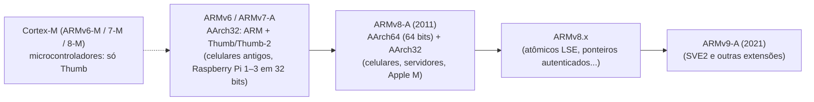
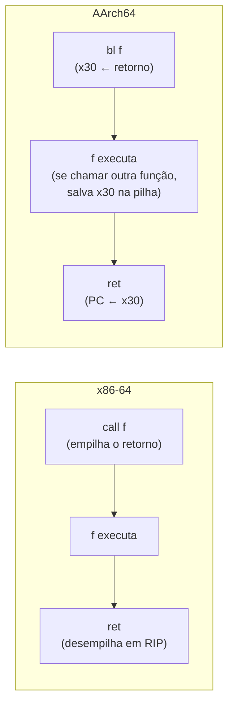
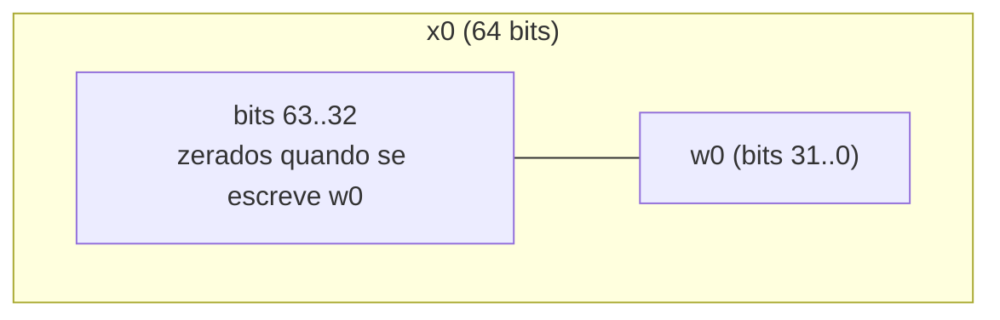
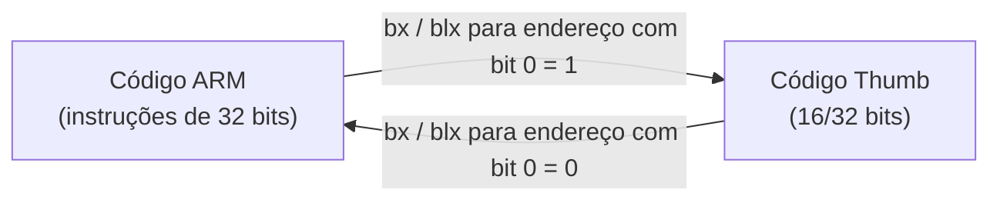

# 08 - ARM e AArch64

> [!abstract] Resumo
> ARM é a arquitetura de quase todo smartphone, de boa parte dos servidores em nuvem (Graviton, Ampere), dos Macs com Apple Silicon e de milhares de microcontroladores. Este módulo compara **x86 × ARM** ponto a ponto e ensina **AArch64** (o modo de 64 bits do ARMv8/ARMv9) com: registradores, modos de endereçamento *load/store*, instruções essenciais, **flags e condições**, a calling convention **AAPCS64**, system calls no Linux, **AArch32 e Thumb**, o **modelo de memória fraco** (barreiras e atômicos) e uma introdução a **NEON**. Os mesmos algoritmos aparecem **lado a lado em x64 e ARM**.

Voltar ao índice: [[Índice - Assembly]] · Módulo anterior: [[07 - Assembly Avançado (x86-x64)]] · Próximo: [[09 - Otimização, SIMD e Performance]]

**Pré-requisitos:** [[01 - Fundamentos de Arquitetura e Assembly]] (RISC × CISC, endianness), [[03 - Instruções Básicas e Controle de Fluxo]] (flags e saltos), [[04 - Procedimentos, Stack e Calling Conventions]] (ABIs), [[05 - Entrada-Saída e System Calls]], [[07 - Assembly Avançado (x86-x64)]] (SIMD, ordem de memória).

**Objetivos:**
- Explicar as diferenças de projeto entre x86 e ARM e o que elas mudam para o programador.
- Ler e escrever AArch64: registradores `X`/`W`, `XZR`, `SP`, `LR`; `ldr`/`str`/`ldp`/`stp` e seus modos de endereçamento.
- Usar as condições (`b.eq`, `b.lo`, `csel`, `cbz`...) sabendo que o **carry da subtração é invertido** em relação ao x86.
- Aplicar a **AAPCS64** (argumentos, retorno, registradores preservados, `x30`/`LR`) e escrever *prólogo/epílogo*.
- Fazer syscalls no Linux AArch64 e AArch32.
- Reconhecer o modo **Thumb**, `IT` blocks e a troca de estado com `bx`/`blx`.
- Entender por que o modelo de memória de ARM exige barreiras e como funcionam `ldxr`/`stxr` e `ldadd`.
- Escrever um laço vetorial em **NEON**.

Tags: #assembly #arm #aarch64 #thumb #aapcs #neon #risc

> [!warning] Sobre os testes deste módulo
> **Os exemplos ARM (AArch64 e AArch32) desta nota NÃO foram montados nem executados**: a toolchain ARM e o emulador não puderam ser instalados no ambiente em que ela foi escrita. Eles seguem a documentação oficial e foram revisados com cuidado, mas **monte-os você mesmo** (a seção 14 explica como, com `qemu-user`) e trate qualquer divergência como erro desta nota, não seu. Já os trechos **x64** usados nas comparações (`soma`, `max_arr`, `strlen`, `fatorial`) foram montados com NASM e executados, e dão os resultados esperados.

---

## 1. Panorama: famílias e versões

**ARM** (*Advanced RISC Machines*) é uma **arquitetura licenciada**: a Arm Ltd. define a ISA e projetos de referência (Cortex, Neoverse); empresas como Apple, Qualcomm, Amazon e Samsung licenciam e criam seus próprios núcleos. Por isso "ARM" não é um chip: é um conjunto de instruções com **várias implementações**.



| Família | Uso típico | ISA |
|---------|-----------|-----|
| **Cortex-A** / Apple M / Neoverse | celulares, notebooks, servidores | AArch64 (e, em parte, AArch32) |
| **Cortex-R** | tempo real (discos, automotivo) | AArch32 (Thumb-2) |
| **Cortex-M** | microcontroladores (IoT, firmware) | Thumb-2 apenas (sem modo ARM clássico) |

> [!note] Dois conjuntos de instruções, não um
> **AArch64** (instrução **A64**, 32 bits cada) é o que você verá em Apple Silicon, Android moderno, AWS Graviton e Raspberry Pi 4/5 com SO de 64 bits. **AArch32** (ARM de 32 bits e Thumb) ainda domina microcontroladores e sistemas embarcados. O módulo ensina **AArch64 primeiro** e AArch32/Thumb depois.

---

## 2. Diferenças fundamentais: x86 × ARM

| Aspecto | **x86-64** (CISC) | **AArch64** (RISC) |
|---------|-------------------|---------------------|
| Tamanho da instrução | variável, **1 a 15 bytes** | **fixo: 4 bytes** |
| Acesso à memória | **qualquer** instrução pode ter operando de memória (`add eax, [rdi]`) | **só** `ldr`/`str` (e variantes) acessam memória: arquitetura ***load/store*** |
| Operandos | 2 (destino = primeira fonte): `add eax, ebx` | **3**: `add w0, w1, w2` |
| Registradores de uso geral | 16 | **31** (`x0–x30`) + `xzr`/`sp` |
| Flags | quase toda instrução aritmética **altera** | só instruções com sufixo **`s`** (`adds`, `subs`) ou `cmp`/`tst` |
| Execução condicional | só `jcc`, `cmovcc`, `setcc` | `b.cond`, `csel`/`cset` e (em AArch32) **quase toda instrução** |
| Endereço de retorno | empilhado por `call` | guardado no registrador **`x30` (LR)** por `bl` |
| Pilha | `push`/`pop` | **não há `push`/`pop`**: usa `stp`/`ldp` com *pre/post-index* |
| Divisão por zero | exceção **#DE** | **resultado 0**, sem exceção |
| Divisão e resto | `div` dá quociente e resto | `udiv`/`sdiv` dão só o quociente; resto = `msub` |
| Constantes grandes | `mov rax, imm64` (10 bytes) | `movz` + `movk` (16 bits por instrução) ou *literal pool* |
| Ordem de memória | **forte** (TSO) | **fraca**: acessos podem ser reordenados |
| Alinhamento | acessos desalinhados em geral permitidos | permitidos em memória normal para `ldr`/`str`, **mas** `SP` precisa estar alinhado em 16 e atômicos exigem alinhamento natural |
| Endianness | little | **bi-endian** em hardware; Linux/Android/iOS/Windows usam **little** |
| Instrução de CPU "ID" | `cpuid` | `mrs` de registradores `ID_AA64*` (só no kernel); o Linux expõe via `getauxval(AT_HWCAP)` |

> [!note] Por que o projeto RISC importa
> **Instruções de tamanho fixo** simplificam o decodificador: é fácil decodificar muitas instruções **por ciclo** (os núcleos da Apple decodificam 8 por ciclo). O x86 precisa descobrir onde cada instrução termina e converte-as em micro-operações. Como **só `ldr`/`str` tocam a memória**, o hardware separa claramente "calcular" de "acessar memória", o que ajuda o escalonamento fora de ordem e o consumo de energia. O preço é **mais instruções** para o mesmo trabalho (um `add eax, [rdi]` vira `ldr` + `add`), compensado por mais registradores e instruções mais "ricas" onde importa (`ldp`, `csel`, `madd`, deslocamento embutido no operando).



---

## 3. Estados de execução e níveis de privilégio

| | x86 | ARM |
|---|-----|-----|
| Código de usuário | ring 3 | **EL0** (*Exception Level 0*) |
| Kernel do SO | ring 0 | **EL1** |
| Hipervisor | (VMX root, fora dos rings) | **EL2** |
| Firmware seguro (*TrustZone*/monitor) | sem equivalente direto (o SMM é o mais próximo) | **EL3** |

- Seu programa de usuário roda em **EL0** e usa `svc` (*supervisor call*) para pedir serviços ao EL1.
- **AArch64** é um estado de execução (largura 64 bits). **AArch32** é o estado de 32 bits (com os conjuntos **ARM** e **Thumb**). Um kernel de 64 bits pode rodar aplicativos AArch32 em EL0 (se a CPU suportar; muitos núcleos novos já **não** suportam).
- O fluxo de exceção de ARM é parecido com o do x86: uma instrução falha, o hardware vai para EL1 e o SO converte a falha em **sinal** (Linux) ou exceção (Windows). Veja o [[07 - Assembly Avançado (x86-x64)]].

---

## 4. Registradores

### 4.1 AArch64

| Registrador | Função |
|-------------|--------|
| `x0`–`x30` | 31 registradores de **64 bits** de uso geral; `w0`–`w30` são a **metade baixa de 32 bits** |
| `xzr` / `wzr` | registrador **zero**: ler dá 0, escrever descarta |
| `sp` | ponteiro de pilha (**sempre alinhado em 16 bytes** quando usado como base de acesso) |
| `pc` | contador de programa: **não** é de uso geral (só muda por desvios; `adr` lê endereços relativos a ele) |
| `x30` = `lr` | *link register*: endereço de retorno colocado por `bl` |
| `x29` = `fp` | *frame pointer* (por convenção) |
| `v0`–`v31` | registradores **SIMD/ponto flutuante** de 128 bits (vistas `b`, `h`, `s`, `d`, `q`) |
| `NZCV` | flags: **N**egativo, **Z**ero, **C**arry, o**V**erflow |



> [!note] O mesmo comportamento do x86-64 com 32 bits
> Escrever em **`w0` zera os 32 bits superiores de `x0`**, exatamente como `mov eax, ...` zera `RAX` superior ([[02 - Registradores e Memória]]). **Não existem** sub-registradores de 8 ou 16 bits (`AL`/`AX`): para trabalhar com bytes, use `ldrb`/`strb`/`ldrh`/`strh` (que **estendem com zeros** ao carregar) e instruções de extensão (`uxtb`, `sxtb`...).

> [!tip] O que significa "registrador 31"
> Na codificação, o número 31 é `sp` em algumas instruções e `xzr` em outras. É por isso que `mov x0, xzr` e `add sp, sp, #16` funcionam, mas você **não** escreve `xzr` onde só `sp` faz sentido.

### 4.2 AArch32 (resumo)

| Registrador | Função |
|-------------|--------|
| `r0`–`r12` | uso geral (`r11` = `fp` por convenção; `r12` = `ip`, *scratch*) |
| `r13` = `sp` | pilha |
| `r14` = `lr` | endereço de retorno |
| `r15` = `pc` | contador de programa (**pode ser lido e escrito** como um registrador comum: `mov pc, lr` retorna) |
| `CPSR` | flags **N, Z, C, V** + modo + bit `T` (Thumb) |
| `s0–s31` / `d0–d15` (`d0–d31`) / `q0–q15` | ponto flutuante e NEON |

---

## 5. *Load/store* e modos de endereçamento (AArch64)

### 5.1 Carregar e guardar

| Instrução | Tamanho | Exemplo |
|-----------|---------|---------|
| `ldr` / `str` | 32 (`w`) ou 64 bits (`x`) | `ldr x0, [x1]` · `str w2, [x3]` |
| `ldrb` / `strb` | 8 bits (carrega **com zeros**) | `ldrb w0, [x1]` |
| `ldrh` / `strh` | 16 bits | `ldrh w0, [x1]` |
| `ldrsb` / `ldrsh` / `ldrsw` | carrega **com extensão de sinal** (8/16/32 → 32 ou 64) | `ldrsw x0, [x1]` |
| `ldp` / `stp` | **par** de registradores (2 × 32 ou 2 × 64 bits) | `ldp x0, x1, [sp, #16]` |
| `ldur` / `stur` | com *offset* **sem escala** (−256 a 255) | `ldur w0, [x1, #-3]` |

### 5.2 Os modos de endereçamento

| Modo | Sintaxe | Efeito |
|------|---------|--------|
| Base | `[x1]` | endereço = `x1` |
| Base + imediato | `[x1, #8]` | endereço = `x1 + 8` (imediato **escalado** pelo tamanho: até 4095 × tamanho) |
| Base + registrador | `[x1, x2]` | `x1 + x2` |
| Base + registrador deslocado | `[x1, x2, lsl #2]` | `x1 + (x2 << 2)`: **índice de array** (equivale a `[rdi + rcx*4]`) |
| Base + registrador estendido | `[x1, w2, sxtw #2]` | índice de 32 bits com sinal, estendido para 64 e deslocado |
| **Pré-indexado** | `[x1, #16]!` | `x1 ← x1 + 16` **antes** de acessar; acessa `x1` novo |
| **Pós-indexado** | `[x1], #16` | acessa `x1`; **depois** `x1 ← x1 + 16` |
| Literal (relativo ao PC) | `ldr x0, label` | carrega de um endereço próximo (±1 MiB) |

```text
Pré-indexado   ldr x0, [x1, #8]!     →  x1 = x1 + 8;  x0 = [x1]
Pós-indexado   ldr x0, [x1], #8      →  x0 = [x1];    x1 = x1 + 8
```

O **pós-indexado** é o motor dos laços de ARM: carrega e avança o ponteiro **em uma única instrução** (como `lodsb`, só que geral).

> [!warning] Cuidados
> - Com *writeback* (`!` ou pós-indexado), **a base e o destino não podem ser o mesmo registrador** (`ldr x0, [x0], #8`): comportamento **imprevisível**.
> - O imediato de `ldr`/`str` com modo "base + imediato" é **sem sinal e escalado** (para `x`, múltiplos de 8, até 32760). Para offsets negativos ou desalinhados, use `ldur`/`stur`.
> - `ldp`/`stp` aceitam offsets de −512 a +504 (múltiplos de 8, para `x`).

### 5.3 Endereços e constantes

| Quero | Instrução |
|-------|-----------|
| Endereço de um rótulo (curto, ±1 MiB) | `adr x0, rótulo` |
| Endereço de um rótulo (PIC, ±4 GiB) | `adrp x0, rótulo` + `add x0, x0, :lo12:rótulo` |
| Constante de 16 bits | `mov x0, #0x1234` (assembla como `movz`) |
| Constante de 32/64 bits | `movz x0, #0x5678` + `movk x0, #0x1234, lsl #16` (+ `lsl #32`, `lsl #48`) |
| Constante qualquer (pseudo) | `ldr x0, =0x1122334455667788` (o assembler usa uma **literal pool**) |
| Inverter/negar | `movn x0, #0` → `x0 = −1` |

```asm
    movz x0, #0x5678              // x0 = 0x0000_0000_0000_5678
    movk x0, #0x1234, lsl #16     // x0 = 0x0000_0000_1234_5678  (mantém os outros bits)
```

> [!note] Por que não existe `mov x0, #qualquer`?
> Cada instrução tem **4 bytes** e precisa caber o código da operação, o registrador e a constante: sobram **16 bits** para a constante. As instruções de aritmética aceitam **12 bits** (`add x0, x1, #4095`, opcionalmente deslocado 12), e as lógicas, **padrões de bits** especiais (*bitmask immediates*, como `0xFF`, `0x0F0F0F0F...`). Um valor fora disso dá o erro **"immediate out of range"** do assembler.

---

## 6. Instruções essenciais (AArch64)

### 6.1 Aritmética

| Instrução | Efeito | Observações |
|-----------|--------|-------------|
| `add d, a, b` / `sub` | `d = a ± b` | **3 operandos**; `b` pode ser imediato de 12 bits ou registrador deslocado: `add x0, x1, x2, lsl #3` |
| `adds` / `subs` | idem, **atualiza flags** | |
| `cmp a, b` | `subs xzr, a, b` | só flags |
| `cmn a, b` | `adds xzr, a, b` | |
| `neg d, a` | `d = 0 − a` | |
| `mul d, a, b` | `d = a × b` (baixos) | alias de `madd d, a, b, xzr` |
| `madd d, a, b, c` | `d = c + a × b` | multiplica **e** soma |
| `msub d, a, b, c` | `d = c − a × b` | usada para o **resto** |
| `umulh` / `smulh` | metade **alta** de 64×64 | análogo a `mul` em x86 (`RDX`) |
| `udiv` / `sdiv` | quociente | **0 se divisor = 0**; sem resto |
| `adc` / `sbc` (+ `adcs`/`sbcs`) | com carry | aritmética multi-precisão |

```asm
    udiv x2, x0, x1             // x2 = x0 / x1
    msub x3, x2, x1, x0         // x3 = x0 - x2*x1 = x0 % x1   (resto)
```

### 6.2 Lógicas, deslocamentos e campos de bits

| Instrução | Efeito |
|-----------|--------|
| `and` / `orr` / `eor` | AND / OR / XOR (3 operandos; imediato = *bitmask*) |
| `bic` / `orn` / `eon` | AND/OR/XOR com o **segundo operando invertido** (`bic x0, x1, x2` = `x1 & ~x2`) |
| `mvn d, a` | NOT |
| `tst a, b` | `ands xzr, a, b` (só flags) |
| `lsl` / `lsr` / `asr` / `ror` | deslocamentos e rotação (por imediato ou registrador) |
| `ubfx` / `sbfx` | **extrai** um campo de bits (sem/com sinal) |
| `bfi` / `bfxil` | **insere** / copia um campo de bits |
| `clz` | zeros à esquerda (sempre disponível) |
| `rbit` | inverte a ordem de **todos** os bits (com `clz`: zeros à direita) |
| `rev` / `rev16` / `rev32` | inverte bytes (como `bswap`) |
| `sxtb` / `sxth` / `sxtw` / `uxtb` / `uxth` | extensões |

> [!tip] Operando deslocado "de graça"
> O segundo operando da maioria das instruções pode ser **deslocado ou estendido** na mesma instrução: `add x0, x1, x2, lsl #2` faz o trabalho de um `lea rax, [rdi + rcx*4]` do x86, e `and x0, x1, x2, ror #8` combina rotação com AND.

### 6.3 Seleção condicional (sem desvio)

| Instrução | Efeito |
|-----------|--------|
| `csel d, a, b, cond` | `d = cond ? a : b` (equivale a `cmov`) |
| `csinc d, a, b, cond` | `d = cond ? a : b + 1` |
| `csinv` / `csneg` | `b` invertido / negado quando a condição é falsa |
| `cset d, cond` | `d = cond ? 1 : 0` (equivale a `setcc`, com registrador inteiro) |
| `cneg d, a, cond` | `d = cond ? −a : a` |
| `ccmp a, b, #nzcv, cond` | **compara condicionalmente** (encadeia condições sem saltos) |

```asm
    cmp  w0, #0
    cneg w0, w0, lt             // |w0|: se w0 < 0, w0 = -w0
```

### 6.4 Desvios

| Instrução | Efeito |
|-----------|--------|
| `b rótulo` | salto incondicional (±128 MiB) |
| `b.cond rótulo` | salto condicional (`b.eq`, `b.ne`, `b.lt`...), ±1 MiB |
| `bl rótulo` | chama: `x30 ← retorno`, salta |
| `br x` / `blr x` | salto / chamada **indireta** por registrador |
| `ret` | retorna: `PC ← x30` (ou `ret x`) |
| `cbz x, rótulo` / `cbnz` | salta se o registrador é **zero** / **não zero** (**não usa flags**) |
| `tbz x, #bit, rótulo` / `tbnz` | salta se o **bit** indicado é 0 / 1 |

> [!tip] `cbz`/`cbnz`/`tbz`/`tbnz` evitam o `cmp`
> O padrão `test rax, rax` + `jz` do x86 vira **uma** instrução em ARM: `cbz x0, rótulo`. Testar um bit específico também é uma instrução (`tbnz w0, #5, rótulo`).

### 6.5 Sistema e outras

| Instrução | Efeito |
|-----------|--------|
| `svc #0` | *supervisor call*: chama o kernel (equivale a `syscall`) |
| `brk #imm` | ponto de interrupção (equivale a `int3`) |
| `nop`, `wfi`, `wfe` | nada; esperar interrupção/evento (economia de energia) |
| `mrs x0, cntvct_el0` | lê um registrador de sistema (contador de tempo; análogo a `rdtsc`) |
| `dmb` / `dsb` / `isb` | **barreiras** de memória e de instruções (seção 12) |

---

## 7. Flags e condições

AArch64 tem **4 flags**: `N` (negativo), `Z` (zero), `C` (carry), `V` (*overflow*). Só as atualizam as instruções com **`s`** (`adds`, `subs`, `ands`, `adcs`...) e `cmp`, `cmn`, `tst`, `ccmp`.

| Código | Sinônimo | Condição (flags) | Significado após `cmp a, b` |
|--------|----------|------------------|------------------------------|
| `eq` | | `Z = 1` | `a == b` |
| `ne` | | `Z = 0` | `a != b` |
| `hs` | `cs` | `C = 1` | `a >= b` **sem sinal** |
| `lo` | `cc` | `C = 0` | `a < b` **sem sinal** |
| `hi` | | `C = 1` e `Z = 0` | `a > b` sem sinal |
| `ls` | | `C = 0` ou `Z = 1` | `a <= b` sem sinal |
| `ge` | | `N = V` | `a >= b` **com sinal** |
| `lt` | | `N ≠ V` | `a < b` com sinal |
| `gt` | | `Z = 0` e `N = V` | `a > b` com sinal |
| `le` | | `Z = 1` ou `N ≠ V` | `a <= b` com sinal |
| `mi` / `pl` | | `N = 1` / `N = 0` | negativo / não negativo |
| `vs` / `vc` | | `V = 1` / `V = 0` | *overflow* / sem *overflow* |
| `al` | | sempre | incondicional |

> [!warning] A diferença mais perigosa: o carry da subtração é **invertido**
> No **x86**, `CF = 1` depois de `cmp a, b` significa **"houve empréstimo"** (`a < b` sem sinal). No **ARM**, `C = 1` significa **"NÃO houve empréstimo"** (`a >= b` sem sinal). Os *nomes* das condições foram escolhidos para ter o **mesmo significado** (`hi` = `ja`, `lo` = `jb`, `hs` = `jae`), mas se você olhar os bits das flags diretamente (ou fizer multi-precisão com `sbc`), a convenção é **oposta**.
>
> | `cmp w0, w1` com `w0 = 3`, `w1 = 5` | x86 | ARM |
> |------|-----|-----|
> | flag de carry/empréstimo | `CF = 1` | `C = 0` |
> | "abaixo" (sem sinal) | `jb` salta | `b.lo` salta |

### Tradução dos saltos (x86 → ARM)

| x86 | AArch64 | Significado |
|-----|---------|-------------|
| `je` / `jne` | `b.eq` / `b.ne` | igual / diferente |
| `ja` / `jae` / `jb` / `jbe` | `b.hi` / `b.hs` / `b.lo` / `b.ls` | sem sinal |
| `jg` / `jge` / `jl` / `jle` | `b.gt` / `b.ge` / `b.lt` / `b.le` | com sinal |
| `js` / `jns` | `b.mi` / `b.pl` | negativo |
| `jo` / `jno` | `b.vs` / `b.vc` | *overflow* |
| `test r, r` + `jz` | `cbz r, rótulo` | zero |
| `cmovcc` | `csel d, a, b, cond` | seleção |
| `setcc` | `cset d, cond` | 0 ou 1 |

---

## 8. Calling convention: AAPCS64

A convenção de ARM de 64 bits é a **AAPCS64** (*Procedure Call Standard for the Arm 64-bit Architecture*).

| Registrador | Papel |
|-------------|-------|
| `x0`–`x7` | **argumentos** inteiros/ponteiros e **valores de retorno** (`x0`; 128 bits em `x0:x1`) |
| `x8` | endereço do **resultado indireto** (retornos grandes); no Linux, **número da syscall** |
| `x9`–`x15` | temporários (**voláteis**, *caller-saved*) |
| `x16`, `x17` | *scratch* para ligação (PLT/veneers); voláteis |
| `x18` | **registrador da plataforma** (reservado em macOS/iOS, Windows e Android; evite em código portátil) |
| `x19`–`x28` | **preservados** (*callee-saved*) |
| `x29` (`fp`) | *frame pointer* (preservado) |
| `x30` (`lr`) | endereço de retorno |
| `sp` | pilha, **alinhada em 16 bytes** |
| `v0`–`v7` | argumentos e retornos de **ponto flutuante/vetor** |
| `v8`–`v15` | **preservados** (só os 64 bits baixos: `d8`–`d15`) |
| `v16`–`v31` | voláteis |

- **Argumentos que não cabem** em 8 registradores vão para a pilha. *Structs* de **até 16 bytes** passam em registradores; maiores, **por referência** (o chamador faz uma cópia e passa o endereço).
- **Funções variádicas** no Linux usam os mesmos registradores (sem `AL` como no x86-64). No **macOS/iOS**, os argumentos variádicos vão para a **pilha**.
- **Não há `push`/`pop`**: a pilha é ajustada com `sub sp, sp, #n` ou, melhor, por `stp`/`ldp` com *pre/post-index*.

### 8.1 Prólogo e epílogo

Como `bl` **não** empilha o endereço de retorno, uma função **folha** (que não chama ninguém) **não precisa de *frame* nenhum**; já uma função que chama outra **precisa salvar `x30`**, ou o `bl` seguinte o sobrescreveria:

```asm
// Função NÃO folha: salva FP e LR
funcao:
    stp  x29, x30, [sp, #-16]!   // sp -= 16; guarda x29 e x30 (pré-indexado)
    mov  x29, sp                 // novo frame pointer
    // ... corpo; pode usar bl ...
    ldp  x29, x30, [sp], #16     // restaura e sp += 16 (pós-indexado)
    ret

// Função folha: nada de frame
soma_quadrados:                  // w0 = a, w1 = b
    mul  w0, w0, w0
    madd w0, w1, w1, w0          // w0 = w0 + w1*w1
    ret
```

| | **x86-64 System V** | **AArch64 AAPCS64** |
|---|---------------------|---------------------|
| Argumentos inteiros | `rdi, rsi, rdx, rcx, r8, r9` (6) | `x0`–`x7` (**8**) |
| Argumentos float | `xmm0`–`xmm7` | `v0`–`v7` |
| Retorno | `rax` (`rdx:rax`) / `xmm0` | `x0` (`x0:x1`) / `v0` |
| Preservados | `rbx, rbp, r12–r15` | `x19–x28`, `x29`, `x30` (ver acima), `d8–d15` |
| Endereço de retorno | **na pilha** (`call` empilha) | **no `x30`** (`bl`) |
| Alinhamento da pilha | 16 bytes no `call` | 16 bytes **sempre** (`sp`) |
| *Red zone* | 128 bytes | **não conte com ela** no Linux (a AAPCS64 não garante) |
| Chamada variádica | `AL` = nº de `xmm` usados | nada especial (Linux); pilha (Apple) |

> [!note] Funções folha e o custo da pilha
> Em ARM, funções pequenas sem chamadas ficam **sem nenhum acesso à pilha**, e o `ret` é um simples desvio para o `x30`. É também um dos motivos pelos quais o endereço de retorno de ARM é mais difícil de sobrescrever com *buffer overflow*: **ele só vai para a pilha** quando a função chama outra. Mesmo assim, o ARMv8.3 adicionou **autenticação de ponteiros** (`paciasp`/`autiasp`) para proteger o `x30` salvo.

### 8.2 AAPCS32 (AArch32)

`r0`–`r3`: argumentos e retornos (`r0:r1` para 64 bits; valores de 64 bits em **pares alinhados**); `r4`–`r11`: preservados; `r12` (`ip`): *scratch*; `r13` = `sp` (alinhada em **8** bytes na interface pública); `r14` = `lr`; `r15` = `pc`. O idioma de função é `push {r4, r5, lr}` / ... / `pop {r4, r5, pc}` (o `pop` já **retorna**, ao carregar o `lr` salvo em `pc`). Em *hard-float* (`gnueabihf`), floats passam em `s0`–`s15`/`d0`–`d7`.

---

## 9. Primeiro programa e system calls (Linux)

### 9.1 Convenção de syscalls

| | **AArch64** | **AArch32 (EABI)** | **x86-64** |
|---|-------------|--------------------|-----------|
| Instrução | `svc #0` | `svc #0` | `syscall` |
| Número | **`x8`** | **`r7`** | `rax` |
| Argumentos | `x0`–`x5` | `r0`–`r6` | `rdi, rsi, rdx, r10, r8, r9` |
| Retorno | `x0` (negativo = `-errno`) | `r0` | `rax` |

| Syscall | AArch64 | AArch32 | x86-64 |
|---------|:-------:|:-------:|:------:|
| `read` | **63** | 3 | 0 |
| `write` | **64** | 4 | 1 |
| `openat` | **56** | 322 | 257 |
| `close` | **57** | 6 | 3 |
| `exit` | **93** | 1 | 60 |
| `exit_group` | **94** | 248 | 231 |
| `brk` | **214** | 45 | 12 |
| `getpid` | **172** | 20 | 39 |

> [!warning] O AArch64 **não tem** `open`
> A tabela de syscalls de AArch64 é a "genérica" do Linux: chamadas antigas como `open`, `unlink` e `stat` **não existem**; use `openat(AT_FDCWD, ...)` com `AT_FDCWD = -100`. As tabelas **de x86 e de ARM de 32 bits também diferem entre si**: não reaproveite números de uma para outra. (Confirme sempre em `unistd.h` ou em `man 2 syscalls` da sua plataforma.)

### 9.2 Hello World em AArch64 (Linux)

```asm
// hello_a64.s — GAS, Linux AArch64
    .global _start
    .section .rodata
msg:    .ascii "Ola, ARM64!\n"
    .equ    len, . - msg

    .text
_start:
    mov   x0, #1                // 1º arg: fd = stdout
    adr   x1, msg               // 2º arg: endereço da mensagem
    mov   x2, #len              // 3º arg: tamanho
    mov   x8, #64               // syscall write
    svc   #0

    mov   x0, #0                // código de saída
    mov   x8, #93               // syscall exit
    svc   #0
```

```bash
aarch64-linux-gnu-as hello_a64.s -o hello_a64.o
aarch64-linux-gnu-ld hello_a64.o -o hello_a64
qemu-aarch64 ./hello_a64              # em máquina x86; em ARM nativo: ./hello_a64
```

> [!note] Comentários e sintaxe
> No GAS de ARM, o comentário de linha é **`//`** (AArch64) ou **`@`** (AArch32), e **`#`** serve para **imediatos** (`#1`, `#0x10`). Rótulos numéricos (`1:`, `1b`, `1f`) são úteis em laços curtos. A sintaxe é a **do GAS**, não Intel nem AT&T: no ARM, **o destino vem primeiro** (`add x0, x1, x2`), como na Intel.

### 9.3 Hello World em AArch32 (Linux, ARM clássico)

```asm
@ hello_a32.s — GAS, Linux ARM 32 bits (EABI)
    .global _start
    .section .rodata
msg:    .ascii "Ola, ARM32!\n"
    .equ    len, . - msg

    .text
    .arm
_start:
    mov   r0, #1                @ fd = stdout
    ldr   r1, =msg              @ endereço da mensagem (via literal pool)
    mov   r2, #len              @ tamanho
    mov   r7, #4                @ syscall write (tabela de ARM 32 bits)
    svc   #0

    mov   r0, #0
    mov   r7, #1                @ syscall exit
    svc   #0
```

```bash
arm-linux-gnueabihf-as hello_a32.s -o hello_a32.o
arm-linux-gnueabihf-ld hello_a32.o -o hello_a32
qemu-arm ./hello_a32
```

### 9.4 Observações sobre macOS e Windows

- **macOS (Apple Silicon):** assembla-se com `as`/`clang`, e o formato é Mach-O: símbolos começam com `_`, endereços usam **`@PAGE`/`@PAGEOFF`** (`adrp x1, msg@PAGE` / `add x1, x1, msg@PAGEOFF`), e a syscall usa **`svc #0x80`** com o número em **`x16`** (`write` = 4, `exit` = 1). A Apple desencoraja syscalls diretas (a interface estável é a `libSystem`), e **reserva `x18`**.
- **Windows ARM64:** usa `armasm64` ou `clang`, com sua própria convenção e dados de *unwind*; a API é a mesma do Windows x64 (módulo [[05 - Entrada-Saída e System Calls]]), com argumentos em `x0`–`x7`.

---

## 10. O mesmo algoritmo em x64 e AArch64

### 10.1 Soma de um array de `int`

```c
int soma(const int *a, size_t n);
```

**x86-64 (System V):**

```nasm
soma:                           ; RDI = a, RSI = n → EAX
    xor  eax, eax
    test rsi, rsi
    jz   .f
    lea  rdx, [rdi + rsi*4]     ; fim
.l: add  eax, [rdi]             ; soma direto da memória
    add  rdi, 4
    cmp  rdi, rdx
    jb   .l
.f: ret
```

**AArch64 (AAPCS64):**

```asm
soma:                           // x0 = a, x1 = n → w0
    mov   w2, #0                // soma = 0
    cbz   x1, 2f                // n == 0 → fim
1:  ldr   w3, [x0], #4          // w3 = *a++   (carrega e avança, pós-indexado)
    add   w2, w2, w3
    subs  x1, x1, #1            // n-- e atualiza as flags
    b.ne  1b
2:  mov   w0, w2
    ret
```

| | x86-64 | AArch64 |
|---|--------|---------|
| Instruções no laço | 4 (`add`, `add`, `cmp`, `jb`) | 4 (`ldr`, `add`, `subs`, `b.ne`) |
| Ler a memória | embutido em `add eax, [rdi]` | instrução separada `ldr` |
| Avançar o ponteiro | `add rdi, 4` | **embutido** no `ldr` (pós-indexado) |
| Condição de parada | `cmp` com o ponteiro final | contador decrescente que já atualiza flags (`subs`) |

### 10.2 Máximo de um array (com seleção condicional)

**x86-64:**

```nasm
max_arr:                        ; RDI = a, RSI = n (≥ 1) → EAX
    mov   eax, [rdi]
    mov   rcx, 1
.l: cmp   rcx, rsi
    jae   .f
    mov   edx, [rdi + rcx*4]
    cmp   edx, eax
    cmovg eax, edx              ; se arr[i] > max (com sinal), max = arr[i]
    inc   rcx
    jmp   .l
.f: ret
```

**AArch64:**

```asm
max_arr:                        // x0 = a, x1 = n (>= 1) → w0
    ldr   w2, [x0], #4          // max = a[0]
    subs  x1, x1, #1            // restam n-1 elementos
    b.eq  2f
1:  ldr   w3, [x0], #4
    cmp   w3, w2
    csel  w2, w3, w2, gt        // max = (w3 > w2) ? w3 : w2   (sem desvio)
    subs  x1, x1, #1            // csel NÃO altera flags; o subs define as do laço
    b.ne  1b
2:  mov   w0, w2
    ret
```

### 10.3 `strlen`

**x86-64:**

```nasm
strlen:                         ; RDI = s → RAX
    mov  rax, rdi
.l: cmp  byte [rax], 0
    je   .f
    inc  rax
    jmp  .l
.f: sub  rax, rdi
    ret
```

**AArch64:**

```asm
strlen:                         // x0 = s → x0
    mov   x1, x0
1:  ldrb  w2, [x1], #1          // w2 = *p++  (byte, zero-estendido)
    cbnz  w2, 1b                // continua enquanto não for zero
    sub   x0, x1, x0            // p - s  (p passou do terminador em 1 byte)
    sub   x0, x0, #1
    ret
```

### 10.4 Fatorial recursivo

**x86-64 (System V):**

```nasm
fatorial:                       ; RDI = n → RAX
    cmp  rdi, 1
    ja   .rec
    mov  eax, 1
    ret
.rec:
    push rdi                    ; guarda n (também alinha a pilha)
    dec  rdi
    call fatorial
    pop  rdi
    imul rax, rdi
    ret
```

**AArch64:**

```asm
fatorial:                       // x0 = n → x0
    cmp   x0, #1
    b.hi  1f                    // n > 1 (sem sinal) → recursão
    mov   x0, #1
    ret                         // função FOLHA neste ramo: nenhum acesso à pilha
1:  stp   x29, x30, [sp, #-32]! // aloca 32 bytes e salva FP/LR (mantém sp alinhado em 16)
    mov   x29, sp
    str   x0, [sp, #16]         // guarda n
    sub   x0, x0, #1
    bl    fatorial              // x0 = fatorial(n-1)   (bl sobrescreve x30: já estava salvo)
    ldr   x1, [sp, #16]         // recupera n
    mul   x0, x0, x1            // n * fatorial(n-1)
    ldp   x29, x30, [sp], #32   // restaura e desaloca
    ret
```

> [!note] O que mudou, e por quê
> - Em x86, `push rdi` serve para **guardar `n`** e **alinhar** a pilha; em ARM o `sp` já precisa ficar alinhado, então reservamos **32 bytes** (FP, LR, `n` e preenchimento) de uma vez.
> - Em ARM, o caso base (`n ≤ 1`) retorna **sem tocar a pilha**: só o ramo recursivo paga o custo do *frame*.
> - O endereço de retorno está em `x30`, e precisamos salvá-lo **antes** do `bl`, ou ele se perderia.

### 10.5 Resto, valor absoluto e soma de 8 argumentos

```asm
// x % 10
    mov   x1, #10
    udiv  x2, x0, x1            // x2 = x0 / 10
    msub  x0, x2, x1, x0        // x0 = x0 - x2*10
    ret

// |w0|
    cmp   w0, #0
    cneg  w0, w0, lt
    ret

// int soma8(int a1..a8): os 8 argumentos chegam em w0..w7 (em x86-64 sobrariam 2 na pilha)
soma8:
    add   w0, w0, w1
    add   w0, w0, w2
    add   w0, w0, w3
    add   w0, w0, w4
    add   w0, w0, w5
    add   w0, w0, w6
    add   w0, w0, w7
    ret
```

### 10.6 Dicionário rápido de idiomas

| Tarefa | x86-64 | AArch64 |
|--------|--------|---------|
| Zerar registrador | `xor eax, eax` | `mov w0, wzr` ou `mov w0, #0` |
| Ler da memória | `mov eax, [rdi]` | `ldr w0, [x0]` |
| Elemento de array | `mov eax, [rdi + rcx*4]` | `ldr w0, [x0, x1, lsl #2]` |
| Endereço de elemento | `lea rax, [rdi + rcx*4]` | `add x0, x0, x1, lsl #2` |
| Comparar e saltar | `cmp rax, rbx` / `jl L` | `cmp x0, x1` / `b.lt L` |
| Testar zero e saltar | `test rax, rax` / `jz L` | `cbz x0, L` |
| Chamar / retornar | `call f` / `ret` | `bl f` / `ret` |
| Salvar registradores | `push rbp` / `pop rbp` | `stp x29, x30, [sp, #-16]!` / `ldp ..., [sp], #16` |
| Seleção condicional | `cmovg eax, edx` | `csel w0, w3, w0, gt` |
| Inverter bytes | `bswap eax` | `rev w0, w0` |
| Zeros à esquerda | `lzcnt` (BMI/ABM) | `clz` |
| Zeros à direita | `tzcnt` | `rbit` + `clz` |
| Contar bits | `popcnt` | NEON (`cnt` + `addv`) |
| Chamar o kernel | `syscall` | `svc #0` |
| Contador de tempo | `rdtsc` | `mrs x0, cntvct_el0` |
| Operação atômica | `lock inc dword [rdi]` | `ldxr`/`stxr` ou `ldadd` |

---

## 11. AArch32: modos ARM e Thumb

### 11.1 Os dois conjuntos

| | **ARM** (A32) | **Thumb** (T16 / **Thumb-2**) |
|---|---------------|-------------------------------|
| Tamanho da instrução | **32 bits** | **16 bits** (e, no Thumb-2, mistura de 16 e 32) |
| Registradores acessíveis | `r0`–`r15` em todas | os 16-bit só alcançam `r0`–`r7` (as de 32 bits, todos) |
| Execução condicional | **quase toda instrução** tem 4 bits de condição | bloco **`IT`** habilita até 4 instruções condicionais |
| Densidade de código | menor | **maior** (cerca de 25 a 30% menos bytes), importante em microcontroladores |
| Cortex-M | **não existe** | só Thumb-2 |

> [!note] Execução condicional em ARM (exclusiva de AArch32)
> Em ARM de 32 bits, **quase toda instrução** pode ser executada condicionalmente com um sufixo (`moveq`, `addgt`, `bxne`...), sem precisar de um salto. Isso reduz desvios previsíveis, mas gastava 4 bits de cada instrução, e **foi removido em AArch64**, onde a seleção condicional ficou restrita a `csel` e afins.

**Máximo de dois valores, sem saltos (AArch32, modo ARM):**

```asm
    .syntax unified
    .arm
max2:                           @ r0 = a, r1 = b → r0 = max (com sinal)
    cmp    r0, r1
    movlt  r0, r1               @ se a < b, r0 = b
    bx     lr
```

**Algoritmo de Euclides, o clássico do modo ARM (MDC):**

```asm
gcd:                            @ r0 = a, r1 = b → r0 = mdc
    cmp    r0, r1
    subgt  r0, r0, r1           @ se r0 > r1: r0 -= r1   (sem 's': as flags do cmp permanecem)
    sublt  r1, r1, r0           @ se r0 < r1: r1 -= r0
    bne    gcd                  @ repete enquanto forem diferentes
    bx     lr
```

**O mesmo máximo, em Thumb-2, com bloco `IT`:**

```asm
    .syntax unified
    .thumb
    .thumb_func
max2_t:                         @ r0 = a, r1 = b
    cmp    r0, r1
    it     lt                   @ a próxima instrução é executada "se lt"
    movlt  r0, r1
    bx     lr
```

### 11.2 Troca entre ARM e Thumb (*interworking*)

O estado é indicado pelo **bit 0 do endereço** usado em `bx`/`blx`: **1 = Thumb**, **0 = ARM**. O assembler cuida disso para símbolos de funções marcadas com `.thumb_func`.



```asm
    @ chamada de ARM para uma função Thumb
    ldr   r3, =max2_t           @ o assembler já coloca o bit 0 = 1 (por .thumb_func)
    blx   r3                    @ troca para Thumb, e lr aponta de volta ao modo ARM
```

> [!warning] Armadilhas de Thumb
> - **`bx lr` retorna** respeitando o modo; `mov pc, lr` **não** troca de estado.
> - No Thumb-1 (16 bits), a maior parte das instruções **sempre atualiza flags** fora de um bloco `IT`: por isso se escreve `adds`, `movs`, `subs` (com `s`) em *unified syntax*.
> - Um `blx` para um endereço de função **sem** o bit 0 correto troca para o modo errado e a CPU executa lixo (geralmente `SIGILL`).
> - Microcontroladores Cortex-M **só** têm Thumb: um endereço de função **sem** bit 0 = 1 causa *HardFault*.

### 11.3 Syntax unified e diretivas

| Diretiva | Função |
|----------|--------|
| `.syntax unified` | usa a sintaxe unificada ARM/Thumb (recomendado) |
| `.arm` / `.thumb` | escolhe o conjunto de instruções para o código a seguir |
| `.thumb_func` | marca a função como Thumb (para o bit 0 do endereço) |
| `.ltorg` | força a colocação da **literal pool** aqui (para `ldr rX, =valor`) |
| `.align n` / `.balign n` | alinhamento |

---

## 12. Modelo de memória, atômicos e barreiras

O x86 tem um modelo **forte** (*TSO*): quase todas as leituras e escritas aparecem aos outros núcleos **na ordem do programa** (a exceção é uma escrita poder ser vista depois de uma leitura posterior). O ARM tem um modelo **fraco**: o hardware pode **reordenar** leituras e escritas à vontade, desde que o resultado visto **por uma única thread** seja o correto.

```text
Thread 1                Thread 2
  dado = 42;              while (!pronto) {}
  pronto = 1;             usar(dado);        // em x86 funciona; em ARM pode ler dado antigo!
```

Em ARM, a escrita em `pronto` pode ficar visível **antes** da escrita em `dado`. A correção usa **barreiras** ou instruções com **semântica de aquisição/liberação**:

| Instrução | Função |
|-----------|--------|
| `dmb ish` | barreira de **memória** entre núcleos (*inner shareable*): nada depois passa para antes dela |
| `dsb` | espera os acessos terminarem (mais forte) |
| `isb` | descarta o pipeline (depois de modificar código ou registradores de sistema) |
| `ldar` / `stlr` | *load-acquire* / *store-release*: ordenam os acessos **sem** barreira completa |

```asm
// Publicar: escrever o dado, depois o sinalizador COM semântica de liberação
    str   w1, [x0]              // dado = valor
    stlr  w2, [x3]              // pronto = 1  (liberação: o dado fica visível antes)

// Consumir: ler o sinalizador COM semântica de aquisição
1:  ldar  w4, [x3]              // lê pronto (aquisição)
    cbz   w4, 1b
    ldr   w5, [x0]              // lê o dado: garantido atual
```

### 12.1 Atômicos: `ldxr`/`stxr` e LSE

ARM não tem o prefixo `lock`. O padrão clássico é o **monitor exclusivo**: `ldxr` lê e **marca** o endereço; `stxr` só grava **se ninguém mexeu nele** e devolve 0 (sucesso) ou 1 (falha):

```asm
// void atomic_inc(int *p)          x0 = p      (equivale a: lock inc dword [rdi])
atomic_inc:
1:  ldxr  w1, [x0]              // lê e abre o monitor exclusivo
    add   w1, w1, #1
    stxr  w2, w1, [x0]          // tenta gravar: w2 = 0 se conseguiu
    cbnz  w2, 1b                // alguém interferiu → tenta de novo
    ret
```

Com a extensão **LSE** (ARMv8.1, comum em núcleos recentes), um atômico é **uma instrução**:

```asm
    mov   w1, #1
    ldadd w1, wzr, [x0]         // atômico: [x0] += 1  (o valor antigo vai para wzr, descartado)
    ret
```

Existem também `cas` (*compare-and-swap*), `swp`, `ldclr`, `ldset`, `ldeor`, e as variantes `a`/`l`/`al` para aquisição/liberação (`ldaddal`).

> [!warning] Bugs que só aparecem em ARM
> Programas que "funcionam em x86" por acaso (sem barreiras ou atômicos corretos) **quebram em ARM**. Em C/C++, use `std::atomic`/`<stdatomic.h>` com a ordem de memória correta; em Assembly, `ldar`/`stlr` ou `dmb`. Também: `stxr` exige que **nenhum outro acesso** relevante ocorra entre o `ldxr` e o `stxr`, e atômicos exigem **alinhamento natural** (senão, *alignment fault*).

---

## 13. NEON: SIMD em ARM

NEON é o SIMD de ARM (obrigatório em AArch64). Os registradores `v0`–`v31` têm **128 bits** e podem ser vistos com vários **arranjos** (*arrangements*): `16b`, `8b`, `8h`, `4h`, `4s`, `2s`, `2d`.

| Arranjo | Conteúdo de `v0` |
|---------|-------------------|
| `v0.16b` | 16 × `int8` |
| `v0.8h` | 8 × `int16` |
| `v0.4s` | 4 × `int32` ou `float` |
| `v0.2d` | 2 × `int64` ou `double` |

| x86 (SSE/AVX) | AArch64 NEON |
|---------------|--------------|
| `movups xmm0, [mem]` | `ld1 {v0.4s}, [x0]` ou `ldr q0, [x0]` |
| `movups [mem], xmm0` | `st1 {v0.4s}, [x0]` ou `str q0, [x0]` |
| `addps xmm0, xmm1` | `fadd v0.4s, v0.4s, v1.4s` |
| `paddd xmm0, xmm1` | `add v0.4s, v0.4s, v1.4s` |
| `mulps` | `fmul v0.4s, ...` |
| fused multiply-add (`vfmadd231ps`) | `fmla v0.4s, v1.4s, v2.4s` |
| `haddps` | `faddp v0.4s, v0.4s, v0.4s` |
| `xorps xmm0, xmm0` | `movi v0.4s, #0` |
| `popcnt` (um registrador) | `cnt v0.8b, v0.8b` + `addv b0, v0.8b` |

**Soma de dois arrays de `float` (comparar com o SSE do [[07 - Assembly Avançado (x86-x64)]]):**

```asm
// void soma_f32(float *dst, const float *a, const float *b, size_t n)
//               x0           x1             x2             x3
soma_f32:
    lsr   x4, x3, #2            // x4 = n / 4  (iterações de 4 floats)
    cbz   x4, 2f
1:  ld1   {v0.4s}, [x1], #16    // carrega 4 floats de a e avança 16 bytes
    ld1   {v1.4s}, [x2], #16
    fadd  v0.4s, v0.4s, v1.4s   // 4 somas de uma vez
    st1   {v0.4s}, [x0], #16
    subs  x4, x4, #1
    b.ne  1b
2:  ands  x3, x3, #3            // resto: n % 4   (ands atualiza flags)
    b.eq  4f
3:  ldr   s0, [x1], #4          // epílogo escalar
    ldr   s1, [x2], #4
    fadd  s0, s0, s1
    str   s0, [x0], #4
    subs  x3, x3, #1
    b.ne  3b
4:  ret
```

> [!note] SVE e SVE2
> Núcleos de servidor e parte dos celulares recentes têm **SVE/SVE2**: vetores de **largura escalável** (128 a 2048 bits, definida pelo hardware) e código **independente da largura** ("*vector-length agnostic*"), com predicados em vez de epílogos escalares. O Apple Silicon usa NEON (e, nos mais novos, SME para matrizes). Módulo [[09 - Otimização, SIMD e Performance]].

---

## 14. Ferramentas e ambiente

### 14.1 Montar e executar em máquina x86 (Linux)

```bash
sudo apt install -y binutils-aarch64-linux-gnu gcc-aarch64-linux-gnu \
                    binutils-arm-linux-gnueabihf gcc-arm-linux-gnueabihf \
                    qemu-user gdb-multiarch

# AArch64
aarch64-linux-gnu-as prog.s -o prog.o && aarch64-linux-gnu-ld prog.o -o prog
qemu-aarch64 ./prog

# AArch32 (EABI hard-float)
arm-linux-gnueabihf-as prog.s -o prog.o && arm-linux-gnueabihf-ld prog.o -o prog
qemu-arm ./prog

# Misturando com C (a libc de ARM precisa ser encontrada pelo qemu):
aarch64-linux-gnu-gcc -static main.c funcao.s -o prog && qemu-aarch64 ./prog
```

### 14.2 Depurar

```bash
qemu-aarch64 -g 1234 ./prog &                              # espera um debugger na porta 1234
gdb-multiarch -q ./prog -ex 'set architecture aarch64' -ex 'target remote :1234' \
              -ex 'break _start' -ex 'continue'
# dentro do gdb:  info registers x0 x1 pc sp  ·  x/6i $pc  ·  stepi
```

### 14.3 Ler o código dos compiladores

- `aarch64-linux-gnu-gcc -O2 -S prog.c` (ou **Compiler Explorer**, escolhendo **"ARM64 gcc"** ou **"armv8-a clang"**) mostra o que o compilador gera. Compare `-O0` e `-O2`, e compare com o resultado em **x86-64**.
- `aarch64-linux-gnu-objdump -d prog` desmonta; `readelf -A prog` mostra os atributos da arquitetura.

### 14.4 Hardware nativo

| Ambiente | Observações |
|----------|-------------|
| **Mac com Apple Silicon** | AArch64 nativo; ABI e syscalls da Apple (seção 9.4); `lldb` para depurar |
| **Raspberry Pi 4/5**, instâncias Graviton/Ampere/Oracle Ampere | AArch64 Linux nativo, ideal para o curso (e *benchmarks* reais) |
| **Android** (Termux/NDK) | AArch64 Linux com a libc Bionic |
| **Cortex-M** (microcontroladores) | só Thumb-2, sem SO: ferramentas `arm-none-eabi-*` |

---

## 15. Erros comuns do módulo 08

> [!warning] Lista de armadilhas
> 1. **Achar que o carry é igual ao do x86**: em `cmp`/`subs`, **`C = 1` significa "sem empréstimo"** (`a ≥ b` sem sinal). Os nomes `hs`/`lo`/`hi`/`ls` já escondem a diferença; olhar as flags cruas, não.
> 2. **Não salvar `x30` em função não folha**: o `bl` seguinte destrói o endereço de retorno e o `ret` vai para o lugar errado (laço infinito ou *crash*).
> 3. **`sp` desalinhado**: `sub sp, sp, #8` deixa `sp` não múltiplo de 16 e o próximo acesso via `sp` **falha** (*SP alignment fault*). Aloque sempre múltiplos de 16.
> 4. **Misturar `w` e `x` numa instrução** (`add x0, w1, w2`): erro de operando. Use `sxtw`/`uxtw` ou `add x0, x1, w2, uxtw`.
> 5. **Constantes impossíveis**: `mov x0, #0x12345` ou `add x0, x1, #5000` dão *"immediate out of range"*. Use `movz`/`movk`, `ldr x0, =valor` ou instruções separadas.
> 6. **Writeback com base = destino** (`ldr x0, [x0], #8`): imprevisível.
> 7. **Usar números de syscall de x86** (`write = 1`, `exit = 60`): em AArch64, são **64** e **93**; e `open` não existe (só `openat`).
> 8. **Esquecer que a divisão por zero retorna 0** (sem exceção): você não vê o erro; teste o divisor.
> 9. **Supor ordem forte de memória**: dados compartilhados sem `dmb`/`ldar`/`stlr`/atômicos funcionam em x86 e **falham em ARM**.
> 10. **Usar `x18`** em código portátil: reservado em macOS, iOS, Windows e Android.
> 11. **`ldr x0, =valor` sem alcance**: a *literal pool* precisa estar a ±1 MiB; em arquivos grandes, use `.ltorg`.
> 12. **AArch32: errar o bit 0 em saltos Thumb** (`bx`/`blx`) ou esquecer `.thumb_func`.
> 13. **`stxr` com o registrador de status igual ao de dados ou à base**: comportamento imprevisível; use um registrador **distinto**.
> 14. **Escrever `push`/`pop` em AArch64**: não existem; use `stp`/`ldp` (em AArch32, `push`/`pop` são apelidos de `stmdb`/`ldmia` com `sp!`).

---

## 16. Exercícios

> [!question] Exercício 1: Duas linhas
> Altere o Hello World AArch64 para imprimir **duas** linhas com **duas** chamadas `write`. Que registradores você precisa **repor** entre as chamadas?

> [!success] Solução
> ```asm
>     .global _start
>     .section .rodata
> m1: .ascii "Linha 1\n"
>     .equ l1, . - m1
> m2: .ascii "Linha 2\n"
>     .equ l2, . - m2
>     .text
> _start:
>     mov  x0, #1
>     adr  x1, m1
>     mov  x2, #l1
>     mov  x8, #64
>     svc  #0
>     mov  x0, #1                 // x0 recebeu o retorno de write: reponha
>     adr  x1, m2
>     mov  x2, #l2
>     mov  x8, #64                // x8 é preservado pelo kernel, mas repor é mais claro
>     svc  #0
>     mov  x0, #0
>     mov  x8, #93
>     svc  #0
> ```
> `x0` (retorno), e `x1`/`x2` (novos argumentos) precisam ser reescritos; `x8` o kernel preserva.

> [!question] Exercício 2: `max3`
> Escreva `int max3(int a, int b, int c)` (com sinal) em AArch64, sem desvios.

> [!success] Solução
> ```asm
> max3:                           // w0 = a, w1 = b, w2 = c
>     cmp   w0, w1
>     csel  w0, w0, w1, gt        // w0 = max(a, b)
>     cmp   w0, w2
>     csel  w0, w0, w2, gt        // w0 = max(max(a, b), c)
>     ret
> ```

> [!question] Exercício 3: Flags
> Depois de `cmp w0, w1` com `w0 = 3` e `w1 = 5`: quais condições são verdadeiras: `lo`, `hs`, `lt`, `ge`, `eq`? E qual seria o valor de `C`? Compare com o `CF` do x86.

> [!success] Solução
> `3 − 5 = −2` (`0xFFFFFFFE`): `N = 1`, `Z = 0`, **`C = 0`** (houve empréstimo: *sem carry*), `V = 0`. Verdadeiras: **`lo`** (`C = 0`) e **`lt`** (`N ≠ V`). Falsas: `hs`, `ge`, `eq`. No x86, o mesmo `cmp` deixaria **`CF = 1`**: a convenção é invertida, mas `lo` ≡ `jb`.

> [!question] Exercício 4: Resto e divisão por zero
> Escreva `uint64_t resto(uint64_t a, uint64_t b)` que devolva `a % b`, **e `0` se `b = 0`** de forma explícita (sem depender do comportamento do hardware).

> [!success] Solução
> ```asm
> resto:                          // x0 = a, x1 = b → x0
>     cbz   x1, 1f                // b == 0 → devolve 0
>     udiv  x2, x0, x1
>     msub  x0, x2, x1, x0        // a - (a/b)*b
>     ret
> 1:  mov   x0, #0
>     ret
> ```
> Em ARM `udiv` por zero já daria 0 (e `msub` devolveria `a`, que **não** é o resto esperado): por isso o teste explícito importa.

> [!question] Exercício 5: Função não folha
> Escreva `uint64_t soma_fat(uint64_t a, uint64_t b)` que devolva `fatorial(a) + fatorial(b)`, chamando a função `fatorial` da seção 10.4. Que registradores você precisa salvar e onde?

> [!success] Solução
> ```asm
> soma_fat:                       // x0 = a, x1 = b
>     stp   x29, x30, [sp, #-32]! // salva FP/LR (e reserva espaço)
>     mov   x29, sp
>     str   x1, [sp, #16]         // guarda b (x1 é volátil: fatorial pode destruí-lo)
>     bl    fatorial              // x0 = fatorial(a)
>     str   x0, [sp, #24]         // guarda o resultado parcial
>     ldr   x0, [sp, #16]         // x0 = b
>     bl    fatorial              // x0 = fatorial(b)
>     ldr   x1, [sp, #24]
>     add   x0, x0, x1
>     ldp   x29, x30, [sp], #32
>     ret
> ```
> Alternativa: guardar `b` e o parcial em **`x19`/`x20`** (preservados): salve-os com `stp x19, x20, [sp, #16]` e restaure no fim.

> [!question] Exercício 6: MDC em AArch32
> Execute à mão o `gcd` da seção 11.1 para `r0 = 12`, `r1 = 18`. Quantas voltas o laço faz e qual o resultado?

> [!success] Solução
> (12, 18): `lt` → `r1 = 6`; (12, 6): `gt` → `r0 = 6`; (6, 6): `eq` → ambas condicionais não executam, `bne` não salta, retorna **`r0 = 6`**. Três voltas.

> [!question] Exercício 7: Atômico
> Escreva `int atomic_add(int *p, int v)` (devolve o valor **antigo**) com `ldxr`/`stxr` e compare com a instrução `lock xadd` do x86.

> [!success] Solução
> ```asm
> atomic_add:                     // x0 = p, w1 = v → w0 = valor antigo
> 1:  ldxr  w2, [x0]              // w2 = valor antigo
>     add   w3, w2, w1
>     stxr  w4, w3, [x0]          // w4 = 0 se gravou
>     cbnz  w4, 1b
>     mov   w0, w2
>     ret
> ```
> No x86, `mov eax, esi` / `lock xadd [rdi], eax` faz o mesmo em **uma** instrução (devolve o antigo em `eax`). Com LSE: `ldadd w1, w2, [x0]` devolve o valor antigo em `w2` (depois, `mov w0, w2` / `ret`).

> [!question] Exercício 8 (desafio): Soma de floats com NEON
> Escreva `float soma_arr(const float *a, size_t n)` com acumulador vetorial, **uma** redução horizontal e epílogo escalar. (Compare com o `dot` do módulo 07.)

> [!success] Solução
> ```asm
> soma_arr:                       // x0 = a, x1 = n → s0
>     movi  v0.4s, #0             // acumulador (4 somas parciais)
>     lsr   x2, x1, #2            // n / 4
>     cbz   x2, 2f
> 1:  ld1   {v1.4s}, [x0], #16
>     fadd  v0.4s, v0.4s, v1.4s   // acumula no vetor
>     subs  x2, x2, #1
>     b.ne  1b
> 2:  faddp v0.4s, v0.4s, v0.4s   // [a0+a1, a2+a3, ...]
>     faddp v0.4s, v0.4s, v0.4s   // lane 0 = soma total
>     ands  x1, x1, #3            // resto
>     b.eq  4f
> 3:  ldr   s1, [x0], #4
>     fadd  s0, s0, s1
>     subs  x1, x1, #1
>     b.ne  3b
> 4:  ret                         // resultado (float) em s0
> ```
> Como no x86, a **ordem das somas** difere da versão escalar e o último bit do resultado pode variar.

Laboratório relacionado: reescreva as funções do [[Lab 04 - Funções da libc]] (`strlen`, `strcpy`, `strcmp`, `memcpy`) em AArch64 e compare com as versões x64. Os exercícios de ordenação do [[Lab 06 - Ordenação]] também se prestam a uma versão ARM.

---

## 17. Resumo

> [!abstract] Resumo do módulo 08
> - **ARM** é uma ISA licenciada e **RISC**: instruções de **4 bytes** (AArch64), **load/store** (só `ldr`/`str` acessam memória), **3 operandos**, **31 registradores** (`x0`–`x30`) mais `xzr` e `sp`.
> - **`w`** é a metade de 32 bits de `x` (e zera a metade alta ao escrever); **não há** sub-registradores de 8/16 bits.
> - **Endereçamento:** base, base + imediato (escalado), base + registrador deslocado, **pré** e **pós-indexado**; constantes grandes via `movz`/`movk` ou *literal pool*; endereços via `adr`/`adrp`.
> - **Flags** só com `s`/`cmp`/`tst`; **o carry da subtração é invertido** em relação ao x86 (`C = 1` = sem empréstimo), mas `hs`/`lo`/`hi`/`ls` e `ge`/`lt`/`gt`/`le` correspondem a `jae`/`jb`/`ja`/`jbe` e `jge`/`jl`/`jg`/`jle`. `csel`, `cset`, `cbz`, `tbz` evitam desvios e `cmp`.
> - **AAPCS64:** argumentos `x0`–`x7`, retorno `x0`, preservados `x19`–`x28`/`x29`, **retorno em `x30` (LR)**; funções folha não precisam de *frame*; as demais salvam FP/LR com `stp ..., [sp, #-N]!`. `sp` sempre alinhado em 16.
> - **Syscalls Linux AArch64:** `svc #0`, número em **`x8`**, args `x0`–`x5`; `write` = 64, `exit` = 93, **sem `open`** (use `openat`). AArch32: `r7`, `write` = 4, `exit` = 1.
> - **AArch32:** modos **ARM** (32 bits, execução condicional) e **Thumb/Thumb-2** (16/32 bits, `IT`), com troca por `bx`/`blx` e o **bit 0** do endereço. Cortex-M só tem Thumb-2.
> - **Memória fraca:** use `dmb`, `ldar`/`stlr`, `ldxr`/`stxr` ou atômicos LSE (`ldadd`, `cas`); código que depende da ordem do x86 quebra.
> - **NEON:** `v0`–`v31` de 128 bits (`.4s`, `.16b`...), `ld1`/`st1`/`fadd`/`fmla`/`faddp`; SVE/SVE2 estendem a ideia a vetores de largura escalável.

**Próximo:** [[09 - Otimização, SIMD e Performance]] · **Ver também:** [[Glossário#Assembly (x86-64 e ARM)]] · [[Cheat Sheet de Instruções]] · [[Cheat Sheet de Calling Conventions]] · [[Índice - Assembly]]
