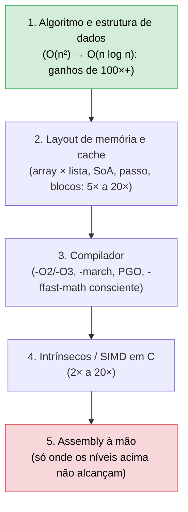
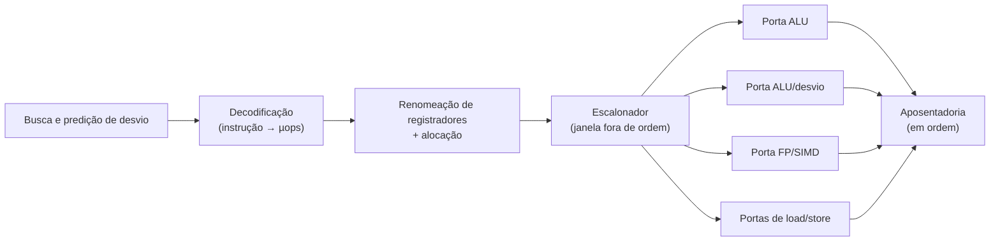
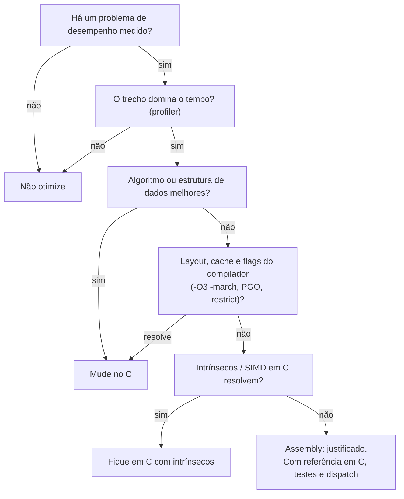

# 09 - Otimização, SIMD e Performance

> [!abstract] Resumo
> Escrever Assembly **não** deixa o código rápido por si só. O que o deixa rápido é entender **o que o processador faz de verdade**: cadeias de dependência, previsão de desvios, cache, instruções certas e SIMD. Este módulo ensina a **medir** (e a desconfiar das medições), explica pipeline, *hazards*, cache e localidade, e mostra **oito experimentos reais** (soma de floats, desvios, matrizes, listas, divisão, `popcnt`, `strlen`, `memcpy`), sempre comparando a versão **ingênua**, a **otimizada** e o **compilador**. No fim, discute **quando Assembly vale a pena e quando não vale**.

Voltar ao índice: [[00 - Índice]] · Módulo anterior: [[08 - ARM e AArch64]] · Próximo: [[10 - Laboratórios e Projetos Práticos]]

**Pré-requisitos:** [[03 - Instruções Básicas e Controle de Fluxo]] (saltos, `cmov`), [[06 - Estruturas de Dados e Arrays]] (layout e cache), [[07 - Assembly Avançado (x86-x64)]] (SSE/AVX, `popcnt`, `cpuid`).

**Objetivos:**
- Medir desempenho com método: *harness*, repetição, mínimo de várias rodadas, verificação do resultado, afinidade de CPU.
- Explicar por que uma soma com **um** acumulador é várias vezes mais lenta que com **quatro** (latência × vazão).
- Reconhecer quando um salto é caro (imprevisível) e como removê-lo.
- Prever o impacto de **cache**, *stride* e *pointer chasing* e corrigi-los.
- Escolher a instrução certa (`popcnt`, multiplicação por inverso, `lea`) e escrever SIMD correto e seguro (alinhamento, fronteira de página, *tail*).
- Usar `llvm-mca`, `cachegrind` e `perf` e ler o código do compilador.
- Decidir **quando** escrever Assembly e como fazê-lo de forma sustentável.

Tags: #assembly #otimizacao #performance #simd #pipeline #cache #profiling #benchmark

> [!note] Como os números desta nota foram obtidos
> Todos os experimentos foram **escritos em NASM e C, montados e executados** durante a escrita desta nota, e **cada resultado foi verificado** contra uma implementação de referência (0 falhas). Máquina de teste: **VM (KVM) com Intel Xeon, 2 vCPUs**, L1d 48 KiB e L2 2 MiB por núcleo, GCC 13.3, NASM 2.16, execução fixada em uma CPU com `taskset`, melhor de 9 rodadas.
> **Os valores absolutos mudam de máquina para máquina** (e de VM para VM). O que se deve levar são as **razões** e o **raciocínio**, e rodar os experimentos na sua máquina (o código está nas seções 5 e 6). O `perf` não existe neste ambiente, então os comandos dele aparecem **sem execução**.

---

## 1. A mentalidade: meça primeiro



Quanto **mais acima** na lista, **maior o ganho** e **menor o custo** de manter. Assembly é o último recurso, não o primeiro.

> [!warning] As quatro regras do desempenho
> 1. **Meça antes** de mudar qualquer coisa. Intuição sobre desempenho costuma estar errada, e os experimentos desta nota mostram vários exemplos.
> 2. **Otimize o que importa:** pela **Lei de Amdahl**, acelerar 10× uma parte que ocupa 5% do tempo rende, no máximo, ~4,7% de ganho total. Use um *profiler* para achar a região quente.
> 3. **Verifique que o resultado continua correto** (mantenha uma versão de referência em C e teste os dois contra entradas variadas, inclusive as de borda).
> 4. **Meça depois**, na máquina que importa, com dados realistas.

---

## 2. O que o processador faz de verdade

### 2.1 Do pipeline simples ao núcleo moderno

O pipeline de 5 estágios do [[01 - Fundamentos de Arquitetura e Assembly]] é o ponto de partida. Um núcleo x86 moderno acrescenta:



| Mecanismo | O que faz | Consequência para quem escreve Assembly |
|-----------|-----------|------------------------------------------|
| **µops** | cada instrução vira 1 ou mais micro-operações | número de **µops** importa mais que número de instruções |
| **Superescalar** | executa várias µops por ciclo, em **portas** diferentes | instruções **independentes** rodam em paralelo |
| **Fora de ordem** (*out-of-order*) | executa quem estiver pronta, sem esperar a ordem do programa | esconde latências **se** houver trabalho independente por perto |
| **Renomeação** | remove dependências "falsas" de nome de registrador (WAR/WAW) | reutilizar `eax` não cria dependência por si só |
| **Previsão de desvio** | adivinha o resultado de `jcc` e segue especulativamente | erro de previsão = **descarta** o trabalho (≈ 15–20 ciclos) |
| **Macro-fusão** | `cmp`/`test` + `jcc` adjacentes viram **1 µop** | mantenha-os **juntos**, sem nada no meio |
| **Cache e *prefetch*** | L1/L2/L3 e buscadores automáticos | acesso **sequencial** é adivinhado; aleatório, não |

### 2.2 Latência × vazão (*throughput*)

- **Latência:** quantos ciclos até o **resultado** de **uma** instrução estar disponível para a próxima que dependa dele.
- **Vazão (recíproco):** a cada quantos ciclos a CPU consegue **iniciar** uma nova instrução do mesmo tipo, se não houver dependência.

Ordens de grandeza típicas (**variam muito por modelo**; consulte as tabelas de Agner Fog e `uops.info`):

| Operação | Latência (ciclos) | Vazão (por ciclo) | Observação |
|----------|:-----------------:|:-----------------:|------------|
| `add`/`sub`/`and`/`xor` (inteiro) | 1 | 3–4 | |
| `lea` simples | 1 | 2–4 | `lea` com 3 componentes pode ser 2–3 |
| `imul r64` | 3 | 1 | |
| `div r32` | 6–26 | bem baixa | caiu bastante em CPUs recentes |
| `div r64` | 10–90 | bem baixa | muito pior em CPUs antigas |
| soma/mult. de ponto flutuante (`addss`, `mulss`) | 2–4 | 2 | **cadeia dependente = latência** |
| `fma` | 4 | 2 | |
| `sqrtss`/`sqrtsd` | 12–20 | baixa | |
| Carga do **L1** | 4–5 | 2–3 | |
| Carga do **L2** | 12–16 | | |
| Carga do **L3** | 40–70 | | |
| Carga da **RAM** | ~70–100 **ns** (centenas de ciclos) | | |
| Previsão de desvio errada | 15–20 | | |

> [!tip] A fórmula que decide tudo (Lei de Little)
> Para saturar uma unidade, é preciso manter em voo **`latência × vazão`** operações **independentes**. Uma soma de `float` com latência de 4 ciclos e 2 somas por ciclo exige **8 cadeias independentes** para não deixar o hardware ocioso. Com **uma** cadeia, você usa 1/8 da capacidade. É o que a seção 5.1 mede.

### 2.3 *Hazards*

| Tipo | Origem | Exemplo | Remédio |
|------|--------|---------|---------|
| **De dados** | uma instrução precisa do resultado da anterior | `add eax, 1` → `add ebx, eax` | quebrar a cadeia (vários acumuladores); reordenar |
| **De controle** | não se sabe qual é a próxima instrução (`jcc`, `ret`, `jmp [mem]`) | `if` imprevisível | tornar o desvio previsível ou removê-lo (`cmov`, máscaras) |
| **Estrutural** | duas µops disputam a mesma porta/unidade | muitos `shuffle` seguidos | misturar tipos de instrução |
| **De memória** | acesso espera cache; *store forwarding* falha; conflito de cache | *stride* de 8 KiB; acesso a dado escrito há pouco com **tamanho diferente** | mudar layout; alinhar; evitar *aliasing* |

### 2.4 Idiomas que o processador reconhece

- **`xor eax, eax`** (e `pxor xmm0, xmm0`, `xorps`) é identificado como **zeragem**: não espera o valor antigo do registrador e, em geral, nem ocupa unidade de execução.
- **Escrever em registrador de 32 bits** zera a parte alta e **quebra** dependências; escrever em **8/16 bits** (`al`, `ax`) **mantém** a dependência no valor antigo.
- **`cvtsi2sd xmm0, eax`** só escreve metade de `xmm0` e depende do conteúdo antigo da outra: compiladores inserem `pxor xmm0, xmm0` antes.
- **`popcnt`, `lzcnt`, `tzcnt`**, em **algumas** microarquiteturas Intel, têm uma **dependência falsa** do destino: zerar o destino antes ajuda.

---

## 3. Medindo desempenho

### 3.1 O *harness* mínimo

```c
#define _GNU_SOURCE
#include <time.h>
#include <sched.h>
static double now(void) { struct timespec t; clock_gettime(CLOCK_MONOTONIC, &t); return t.tv_sec*1e9 + t.tv_nsec; }
static volatile unsigned long sink;                      // consome o resultado: evita eliminação do código

// Melhor de 9 rodadas; cada rodada repete o código "reps" vezes e devolve ns por chamada
#define TIME(code, reps) ({ double best = 1e30;                                    \
    for (int t_ = 0; t_ < 9; t_++) { double t0_ = now();                           \
        for (int r_ = 0; r_ < (reps); r_++) { code; }                              \
        double dt_ = (now() - t0_) / (reps); if (dt_ < best) best = dt_; }         \
    best; })

int main(void) {
    cpu_set_t s; CPU_ZERO(&s); CPU_SET(0, &s); sched_setaffinity(0, sizeof s, &s);   // fixa na CPU 0
    // ... prepara dados, VERIFICA o resultado contra a referência, e depois:
    //     double ns = TIME(sink += minha_funcao(dados, n), 20000);
}
```

```bash
nasm -f elf64 fn.asm -o fn.o
gcc -O2 h.c fn.o -o h && taskset -c 0 ./h
```

### 3.2 Regras de uma medição honesta

| Regra | Por quê |
|-------|---------|
| **Repita e fique com o mínimo (ou a mediana)** | ruído (interrupções, outros processos) só **aumenta** o tempo; o mínimo é o melhor estimador do custo "limpo" |
| **Aqueça** (a primeira rodada) | *page faults*, cache frio e frequência da CPU distorcem |
| **Consuma o resultado** (`volatile`, `sink`) | o compilador remove código "sem efeito" |
| **Mantenha a função fora do arquivo do *harness*** (outro `.o`) | impede *inlining* e eliminação (sem LTO) |
| **Verifique a correção** em cada versão | uma versão rápida e errada não vale nada |
| **Fixe a CPU** (`taskset -c N`) | evita migração e cache frio |
| **Atenção à frequência** (*turbo*, economia de energia) | o mesmo código muda de velocidade durante a medição |
| **Em VM/nuvem**, espere ruído maior | outros *tenants*, CPUs compartilhadas |
| **Use dados realistas** | previsão de desvio e cache dependem dos dados (ordenados × aleatórios) |
| **Tamanho do conjunto de dados** | L1, L2, L3 e RAM dão comportamentos diferentes |

### 3.3 Contando ciclos: `rdtsc`

```c
#include <x86intrin.h>
static inline unsigned long long ciclos(void) { _mm_lfence(); unsigned long long t = __rdtsc(); _mm_lfence(); return t; }
```

`lfence` impede que a leitura seja reordenada em torno do código medido. Cuidados: o **TSC conta a frequência-base**, não os ciclos reais do núcleo (com *turbo*, os "ciclos" do TSC e os do núcleo diferem); e o custo da própria leitura (≈ 20–30 ciclos) só é desprezível em trechos **longos**. Para trechos curtos, meça **muitas repetições** e divida.

### 3.4 Ferramentas

| Ferramenta | Para quê | Exemplo |
|------------|----------|---------|
| **`llvm-mca`** | **simula** o pipeline e prevê ciclos por iteração de um trecho; mostra se é limitado por latência ou por vazão | seção 5.1 |
| **`perf stat`** *(não testado aqui)* | contadores de hardware: ciclos, instruções, previsões erradas, *misses* de cache | `perf stat -e cycles,instructions,branch-misses,cache-misses ./prog` |
| **`perf record` / `perf annotate`** *(não testado aqui)* | **onde** o tempo é gasto, por instrução | `perf record ./prog && perf annotate` |
| **`valgrind --tool=cachegrind`** | **simula** a hierarquia de cache e conta *misses* | seção 5.3 |
| **Compiler Explorer** + `-O2/-O3` | ver o que o compilador gera; `-fopt-info-vec-all` mostra o que **foi** e **não foi** vetorizado | |
| **Tabelas de Agner Fog** e **`uops.info`** | latência, vazão e portas de **cada instrução, por CPU** | |
| **VTune, Instruments, AMD μProf** | *profilers* gráficos de microarquitetura | |

---

## 4. A suíte de experimentos

Os experimentos abaixo usam **um único programa de medição** (`h.c`) ligado a funções em NASM (`fn.asm`) e a funções de referência em C compiladas com `gcc -O3` (e variantes). Cada experimento mostra o código, o resultado e a **conclusão**. Resultados em **ns por elemento** (menor é melhor), exceto onde indicado.

---

## 5. Experimentos

### 5.1 Cadeias de dependência: somar 4096 `float` (dados em L1)

**Ingênua** (um acumulador: cada `addss` espera o anterior):

```nasm
sum_f32_1:                         ; RDI = a, RSI = n
    xorps xmm0, xmm0
    xor   eax, eax
.l: addss xmm0, [rdi + rax*4]      ; xmm0 depende do xmm0 da volta anterior
    inc   rax
    cmp   rax, rsi
    jb    .l
    ret
```

**Quatro acumuladores** (quatro cadeias independentes):

```nasm
sum_f32_4:                         ; n múltiplo de 4
    xorps xmm0, xmm0
    xorps xmm1, xmm1
    xorps xmm2, xmm2
    xorps xmm3, xmm3
    xor   eax, eax
.l: addss xmm0, [rdi + rax*4]
    addss xmm1, [rdi + rax*4 + 4]
    addss xmm2, [rdi + rax*4 + 8]
    addss xmm3, [rdi + rax*4 + 12]
    add   rax, 4
    cmp   rax, rsi
    jb    .l
    addss xmm0, xmm1               ; reduz no fim
    addss xmm2, xmm3
    addss xmm0, xmm2
    ret
```

```text
1 acumulador:    x0 ─► x0 ─► x0 ─► x0 ─► ...        (cada soma espera a anterior)
4 acumuladores:  x0 ─► x0 ─► ...
                 x1 ─► x1 ─► ...                     (4 cadeias em paralelo)
                 x2 ─► x2 ─► ...
                 x3 ─► x3 ─► ...
```

As versões SSE (`addps`, 4 *floats* por instrução) e AVX (`vaddps ymm`, 8 *floats*) estão na nota [[07 - Assembly Avançado (x86-x64)]], aqui com 1 e 4 acumuladores (`sum_f32_sse1`, `sum_f32_sse4`, `sum_f32_avx4`).

**Resultados medidos:**

| Versão | ns/elemento | Aceleração |
|--------|:-----------:|:----------:|
| escalar, **1** acumulador (`addss`) | 0,510 | 1,0× |
| escalar, **4** acumuladores | 0,131 | 3,9× |
| SSE, 1 acumulador (`addps`) | 0,120 | 4,3× |
| SSE, **4** acumuladores | 0,044 | 11,5× |
| AVX, **4** acumuladores (`ymm`) | **0,023** | **22,1×** |
| **C `-O3`** (sem `-ffast-math`) | 0,513 | 1,0× |
| C `-Ofast -mavx2` | 0,063 | 8,1× |

**O que o `llvm-mca` prevê** (modelo Skylake, 1000 iterações do laço):

```text
1 acumulador:    Total Cycles: 4008   →  4 ciclos por iteração (por elemento)
                 Block RThroughput: 0.8   ← a vazão permitiria ~1 ciclo; a LATÊNCIA (4) manda
4 acumuladores:  Total Cycles: 4009   →  4 ciclos por iteração de 4 elementos = 1 ciclo por elemento
```

Mesma previsão da medição: **~4×** só por quebrar a cadeia (na máquina de teste a latência da soma é menor que a do modelo Skylake, mas a **razão** se mantém).

> [!success] Conclusões do experimento 5.1
> - **Latência, não vazão, limita uma cadeia dependente.** Quatro acumuladores deram 3,9×; SSE e AVX multiplicam isso pela largura do vetor.
> - **O compilador não vetoriza reduções de `float` sem `-ffast-math`**: `a + b + c` em ponto flutuante **não é associativo**, então reordenar as somas mudaria o resultado, e o GCC respeita isso: o `-O3` ficou **exatamente igual** à versão ingênua (0,513 contra 0,510). Com `-Ofast` (que **permite** reassociar) ele vetorizou, mas ainda ficou **2,7× atrás** da versão AVX de 4 acumuladores, escrita à mão. Com **inteiros** a soma é associativa e o compilador vetoriza sozinho (`-O3`).
> - Reassociar somas de `float` **muda o resultado** nos últimos bits. Isso é aceitável em muitos casos, mas é **decisão sua**, não do compilador.

### 5.2 Desvios: o custo da previsão errada

Soma dos bytes `≥ 128` de 32 768 bytes. **Ingênua** (com salto) e **sem salto** (`cmov`):

```nasm
sum_ge128_branchy:                 ; RDI = bytes, RSI = n
    xor   eax, eax
    xor   ecx, ecx
.l: movzx edx, byte [rdi + rcx]
    cmp   edx, 128
    jl    .p                       ; salta se < 128  → previsível ou não, depende dos DADOS
    add   rax, rdx
.p: inc   rcx
    cmp   rcx, rsi
    jb    .l
    ret

sum_ge128_cmov:
    xor   eax, eax
    xor   ecx, ecx
    xor   r8d, r8d                 ; zero
.l: movzx edx, byte [rdi + rcx]
    cmp   edx, 128
    cmovl edx, r8d                 ; se < 128, edx = 0 (soma 0): nenhum salto
    add   rax, rdx
    inc   rcx
    cmp   rcx, rsi
    jb    .l
    ret
```

| Versão | Dados | ns/elemento |
|--------|-------|:-----------:|
| com **salto** | **aleatórios** (50% de acertos imprevisíveis) | **3,346** |
| com **salto** | **ordenados** (previsível: um bloco de "não", depois um de "sim") | 0,261 |
| sem salto (`cmov`) | aleatórios | 0,268 |
| C `-O3` (SSE2) | aleatórios | 0,296 |
| C `-O3 -mavx2` | aleatórios | 0,339 |

> [!success] Conclusões do experimento 5.2
> - **O mesmo código** ficou **12,8× mais lento** com dados aleatórios: ~3 ns a mais por elemento, dos quais metade têm previsão errada, o que dá cerca de **6 ns (≈ 20 ciclos) por previsão errada**.
> - Dado previsível (ordenado) ou **sem salto** (`cmov`): **0,26 ns**.
> - O compilador, por conta própria, já gerou código sem desvios (0,30 ns). Ele conhece o truque.
> - **`cmov` não é sempre melhor:** com dados **muito previsíveis**, o salto custa quase nada, e `cmov` calcula os dois lados e cria uma dependência de dados. **Meça com os dados reais.**
> - É por isso que *ordenar* um array antes de processá-lo (ou usar máscaras) pode acelerar loops com `if` interno.

### 5.3 Cache e localidade: matriz por linhas × por colunas

```nasm
sum_rows:                          ; RDI = m, RSI = n (n*n ints) — endereços consecutivos
    mov   rcx, rsi
    imul  rcx, rsi
    xor   eax, eax
    xor   edx, edx
.l: add   eax, [rdi + rdx*4]
    inc   rdx
    cmp   rdx, rcx
    jb    .l
    ret

sum_cols:                          ; salta n*4 bytes a cada acesso
    xor   eax, eax
    xor   r8d, r8d                 ; j
    lea   r10, [rsi*4]             ; passo
.j: lea   r9, [rdi + r8*4]
    mov   rcx, rsi
.i: add   eax, [r9]
    add   r9, r10                  ; pula uma linha inteira
    dec   rcx
    jnz   .i
    inc   r8
    cmp   r8, rsi
    jb    .j
    ret
```

| Matriz | Por linhas | Por colunas | Razão |
|--------|:----------:|:-----------:|:-----:|
| n = 512 (1 MiB, cabe em L2) | 0,257 | 0,778 | 3,0× |
| n = 2048 (16 MiB) | 0,275 | **5,964** | **21,7×** |

**`cachegrind`** (matriz 1024×1024, simulador de cache):

```text
percorrer por LINHAS:    D1 misses:    132 840    (D1 miss rate  6,1%)
percorrer por COLUNAS:   D1 misses:  1 115 879    (D1 miss rate 51,6%;  95,2% nas leituras!)
```

Por linhas, cada linha de cache de 64 bytes traz 16 `int`s e **todos são usados** (1 *miss* a cada 16 acessos). Por colunas, cada acesso cai numa linha **diferente** e usa 4 dos 64 bytes: **1 *miss* por elemento**.

**E o passo exatamente potência de 2?** Mesma soma por colunas, variando só `n`:

| n | passo (bytes) | ns/elemento (colunas) |
|---|:-------------:|:---------------------:|
| 2046 | 8184 | 1,12 |
| 2047 | 8188 | 0,99 |
| **2048** | **8192** | **5,98** |
| 2049 | 8196 | 0,82 |

Com passo de **8192 bytes**, todos os acessos da coluna caem nos **mesmos conjuntos de cache** (a associatividade é limitada) e se **expulsam mutuamente** (*conflict misses*); também ocorre *4K aliasing* entre cargas e escritas. **Mudar `n` de 2048 para 2047 tornou o código 6× mais rápido.** É o motivo de alocar linhas com *padding* (`n + 1` ou `n + 16`) em matrizes de dimensão potência de 2.

> [!success] Conclusões do experimento 5.3
> - **Percorra a memória na ordem em que ela está** (linhas em C/NASM, colunas em Fortran/MATLAB).
> - Se for preciso percorrer por colunas (transposição, multiplicação de matrizes), use **blocos** (*tiling*): processe sub-matrizes que caibam no L1/L2.
> - **Evite passos que sejam potências de 2** (e múltiplos grandes de 4 KiB) em estruturas grandes: adicione *padding*.

### 5.4 Cache e latência: lista encadeada × array

Soma de 1 048 576 valores. A lista usa o `lista_soma` do [[06 - Estruturas de Dados e Arrays]] (`mov rdi, [rdi + 8]`); o array usa um laço simples de `uint64_t`.

| Estrutura | ns/elemento |
|-----------|:-----------:|
| lista, nós **em ordem** na memória | 1,904 |
| lista, nós **embaralhados** (mesma lista, ordem de ligação aleatória) | **39,723** |
| array de `uint64_t` (mesmos valores) | 0,305 |

- **Lista embaralhada × array: 130× mais lenta.** Cada nó só é conhecido **depois** de ler o anterior (*pointer chasing*): as leituras não se sobrepõem e **cada uma paga a latência completa** (L3 ou RAM, ~40 ns).
- A **mesma lista**, com nós **em ordem**, é 21× mais rápida: o *prefetcher* adivinha os endereços e os nós vizinhos dividem linhas de cache.
- O array ainda é ~6× mais rápido que a lista **em ordem**: não há dependência de endereço entre as leituras.

> [!success] Conclusão
> A "estrutura ideal" na teoria (inserção O(1) numa lista) perde para o array na **prática** quando o acesso é a maior parte do trabalho. Prefira estruturas **contíguas** (arrays, *arenas*, *vetores* de índices) a ponteiros espalhados.

### 5.5 Escolhendo a instrução: divisão por 10 e `popcnt`

**Divisão** (4096 `uint32_t` aleatórios; resultado conferido contra `/ 10` em C):

```nasm
div10_hw:                          ; "ingênua": div r32
    ...
.l: mov   eax, [rdi + rcx*4]
    xor   edx, edx
    div   r8d                      ; r8d = 10
    mov   [rsi + rcx*4], eax
    ...
div10_magic:                       ; multiplicação por inverso (módulo 07)
.l: mov   eax, [rdi + rcx*4]
    imul  rax, r10                 ; r10 = 0xCCCCCCCD
    shr   rax, 35
    mov   [rsi + rcx*4], eax
```

| Versão | ns/elemento |
|--------|:-----------:|
| `div r32` | 1,556 |
| `imul` + `shr` (número mágico) | 0,264 (**5,9× mais rápida**) |
| C `-O3` (gcc, vetorizado) | 0,143 (**10,9×**) |

> Nesta CPU o `div` de 32 bits já é "rápido" (≈ 6 ciclos); em processadores **mais antigos** ele leva 20–26 ciclos, e `div r64` pode passar de 80, o que aumenta a diferença.

**Contar bits** (array de 4096 `uint32_t` aleatórios; total conferido contra `__builtin_popcount`):

| Versão | ns/elemento | Observação |
|--------|:-----------:|------------|
| laço `shr` + `adc` (até 32 voltas) | 18,116 | desvio de saída imprevisível |
| Kernighan (`x &= x-1`, ~16 voltas) | 15,735 | idem |
| **SWAR** (sem desvios, ~13 instruções) | 0,929 | independe do valor |
| **`popcnt`** (hardware) | **0,262** | uma instrução |
| C `-O3` sem `-mpopcnt` | 1,215 | o compilador **não** assume que a CPU tem `popcnt` |
| C `-O3 -mavx2 -mpopcnt` | 0,271 | com a flag, usa `popcnt` |

> [!success] Conclusões do experimento 5.5
> - Trocar um **laço com desvio imprevisível** (18 ns) pela instrução dedicada (0,26 ns) rende **69×**.
> - **Sem flags de arquitetura, o compilador usa a ISA mínima** (x86-64 base): para aproveitar `popcnt`, BMI e AVX2 você precisa de `-march=native`/`-mpopcnt`/`-mavx2`, ou de *dispatch* em tempo de execução (seção 6.4).
> - O compilador conhece a divisão por constante melhor que a versão à mão (10,9× contra 5,9×): ele usou SIMD.

### 5.6 SIMD de verdade: `strlen`

Quatro versões, todas verificadas para **todos os 64 alinhamentos** e comprimentos de 0 a 149 (e comparadas com a `strlen` da libc). A ideia SIMD: comparar **16 (ou 32) bytes de uma vez** com zero (`pcmpeqb`) e extrair uma máscara de bits (`pmovmskb`):

```nasm
; SSE2: 16 bytes por volta
strlen_sse2:                       ; RDI = s → RAX = tamanho
    mov   rdx, rdi                 ; guarda s
    mov   ecx, edi
    and   rdi, -16                 ; ALINHA PARA BAIXO em 16
    and   ecx, 15                 ; quantos bytes antes de s dentro do bloco
    pxor  xmm0, xmm0
    movdqa xmm1, [rdi]             ; leitura ALINHADA (nunca cruza página)
    pcmpeqb xmm1, xmm0             ; 0xFF onde o byte é zero
    pmovmskb eax, xmm1             ; máscara de 16 bits
    shr   eax, cl                  ; descarta os bits dos bytes ANTES de s
    test  eax, eax
    jz    .l
    bsf   eax, eax                 ; índice do primeiro zero
    ret
.l: add   rdi, 16
    movdqa xmm1, [rdi]
    pcmpeqb xmm1, xmm0
    pmovmskb eax, xmm1
    test  eax, eax
    jz    .l
    bsf   eax, eax
    add   rax, rdi
    sub   rax, rdx                 ; comprimento = (bloco + índice) - s
    ret
```

A versão AVX2 é igual, com blocos de **32 bytes** (`vpcmpeqb ymm1, ymm0, [rdi]`, `vpmovmskb`, `and rdi, -32`, `and ecx, 31`) e `vzeroupper` antes de cada `ret`.

> [!warning] A leitura "além do fim" é segura **porque é alinhada**
> Esta técnica lê **até 15 (ou 31) bytes antes de `s` e depois do terminador**. Em Assembly isso é aceitável porque **um bloco de 16 (ou 32) bytes alinhado nunca cruza uma fronteira de página (4 KiB)**: se o primeiro byte do bloco é acessível, todo o bloco é. O teste do experimento colocou a string **terminando no último byte de uma página, seguida de uma página `PROT_NONE`**, e nenhuma versão causou falha. Porém **ferramentas como o Valgrind e o AddressSanitizer reportam essa leitura como erro**, e em **C/C++ ela é comportamento indefinido**. Se você usar `movdqu` não alinhado, perde essa garantia.

| `strlen` (ns por chamada, `s` desalinhado em +3) | 15 bytes | 100 | 1000 | 4000 |
|--------------------------------------------------|:--------:|:---:|:----:|:----:|
| byte a byte | 5,4 | 31,5 | 187,1 | 708,8 |
| `repne scasb` | 5,9 | 6,0 | 146,0 | 625,9 |
| **SSE2** (16 bytes/volta) | 1,7 | 2,6 | 32,6 | 82,8 |
| **AVX2** (32 bytes/volta) | 2,0 | 1,8 | 19,8 | 48,2 |
| **libc `strlen`** | 1,8 | 1,7 | **7,5** | **25,7** |

> [!success] Conclusões do experimento 5.6
> - SIMD ganha **7 a 22×** do laço byte a byte em strings de tamanho médio/longo.
> - **`repne scasb` não é uma boa ideia**, e seu desempenho é **irregular** com o tamanho (6 ns para 100 bytes, 146 ns para 1000): não há como prever isso de cabeça, motivo para **medir**.
> - A **`strlen` da libc** ainda é **2,6× mais rápida** que a nossa versão AVX2 em 1000 bytes. Ela é escolhida por `cpuid` em tempo de execução (*ifunc*), **desenrola o laço** e testa **vários vetores com uma única comparação** (combinando-os com `vpminub`), o que reduz os desvios e esconde latência. Escrever `strlen` melhor que a libc é difícil: o valor está em **entender o que ela faz**.
> - Para **textos curtos** (15 bytes), todas as versões SIMD são parecidas (~2 ns): o custo da chamada e dos desvios domina.

### 5.7 `memcpy`: o que é rápido depende do tamanho

Quatro versões à mão: `rep movsb`, laço de 8 bytes, SSE (`movdqu`, 16 B) e AVX (`vmovdqu ymm`, 32 B), contra a libc. Resultado em **GB/s** (bytes copiados / tempo; maior é melhor):

| Tamanho | `rep movsb` | laço 8 B | SSE 16 B | AVX 32 B | libc `memcpy` |
|---------|:-----------:|:--------:|:--------:|:--------:|:-------------:|
| 64 B | 25,0 | 19,2 | 18,6 | 49,9 | **76,8** |
| 1 KiB (L1) | 89,4 | 29,0 | 35,3 | 92,1 | **205,6** |
| 64 KiB (L2) | 52,6 | 37,1 | 48,5 | 50,8 | 52,4 |
| 16 MiB (RAM) | 14,8 | 14,8 | 14,8 | 14,8 | 14,8 |

> [!success] Conclusões do experimento 5.7
> - **Quando o limite é a memória (16 MiB), todas as versões empatam em 14,8 GB/s:** nenhuma instrução mais esperta ajuda; o gargalo é a **largura de banda da RAM**.
> - **Em L1/L2** o laço de 8 bytes é 2 a 3× pior que SIMD, e `rep movsb` fica competitivo a partir de ~1 KiB (confirmando a nota do [[05 - Entrada-Saída e System Calls]], mas com **custo de partida alto** para blocos pequenos: 25 GB/s em 64 B).
> - **Para blocos pequenos, a libc é 1,5 a 2,3× mais rápida:** usa **cargas/escritas sobrepostas** (cobre o tamanho com duas operações que se sobrepõem, em vez de laço e resto) e ramos por **classe de tamanho**.
> - Conclusão prática: **chame `memcpy`** (o compilador também o *inline* em tamanhos pequenos e constantes). Escrever a sua só vale em casos muito especiais.

### 5.8 Resumo dos ganhos medidos

| Experimento | Ingênua | Melhor versão | Ganho | Lição |
|-------------|---------|---------------|:-----:|-------|
| Soma de `float` | 1 acumulador | AVX 4 acumuladores | **22×** | quebrar cadeias + SIMD |
| `if` imprevisível | salto, dados aleatórios | `cmov` / máscara | **12,5×** | desvio imprevisível custa ~20 ciclos |
| Matriz 2048² | por colunas | por linhas | **21,7×** | percorrer na ordem da memória |
| Passo potência de 2 | n = 2048 | n = 2047 | **6×** | *padding* contra conflitos de cache |
| Lista × array | lista embaralhada | array | **130×** | contiguidade e *prefetch* |
| Divisão por 10 | `div` | multiplicação por inverso | **5,9×** | instrução cara → troca por barata |
| Contar bits | laço com salto | `popcnt` | **69×** | instrução dedicada |
| `strlen` (4000 B) | byte a byte | libc (AVX2/EVEX) | **28×** | SIMD + desenrolar |
| `memcpy` (16 MiB) | qualquer | qualquer | **1×** | limite de banda de memória |

---

## 6. SIMD eficiente: o checklist

### 6.1 Antes de escrever uma linha

1. **Veja se o compilador já vetoriza**: `gcc -O3 -march=native -fopt-info-vec-optimized -fopt-info-vec-missed`. Os motivos de "não vetorizado" (dependência entre iterações, aliasing, reduções de `float`) dizem **o que ajustar no C** (por exemplo, `restrict`, `-ffast-math` consciente, simplificar o laço).
2. **Use intrínsecos** (`<immintrin.h>`) antes de escrever Assembly. O compilador aloca registradores e agenda instruções por você.
3. **Escolha o *layout* de dados** que favorece SIMD: **SoA** (cada campo em seu array) em vez de AoS; arrays **contíguos**; dados **alinhados** quando possível ([[06 - Estruturas de Dados e Arrays]]).

### 6.2 Padrões de laço SIMD

| Padrão | Como |
|--------|------|
| **Corpo vetorial + epílogo escalar** | processa `n & ~(V-1)` elementos em vetores; o resto, um a um (ou com **máscara**, em AVX-512/SVE) |
| **Vários acumuladores** | 2 a 4 (às vezes 8) vetores acumulando em paralelo; **uma** redução horizontal no final |
| **Condicional sem desvio** | `pcmpeqX`/`pcmpgtX` geram máscaras de `0xFF..`; combine com `pand`/`pandn`/`por` ou `blendv` |
| **Busca em bloco** | `pcmpeqb` + `pmovmskb` + `bsf`/`tzcnt` (como no `strlen`) |
| **Fusão de multiplicação e soma** | `vfmadd231ps` (FMA3): 1 instrução e **um só arredondamento** |
| **Reduções horizontais** | **evite dentro do laço**; `haddps` é lenta (várias µops) |

### 6.3 Armadilhas de SIMD

| Armadilha | Consequência |
|-----------|--------------|
| `movaps`/`movdqa`/operando de memória em SSE legado **com endereço desalinhado** | `#GP` → `SIGSEGV` (módulo 07) |
| **Esquecer `vzeroupper`** ao sair de código AVX | penalidades ao executar SSE legado depois |
| Misturar **`movups` desalinhado atravessando linhas de cache** | custo extra por acesso que cruza linha (64 B) |
| **`gather`/`scatter`** (AVX2/AVX-512) | muitas µops: em muitos CPUs é **mais lento** que carga escalar, e só vale com localidade |
| **Reordenar somas de `float`** | mudança no último bit do resultado (decida conscientemente) |
| **Ler além do fim do array** | seguro só se não cruzar a **página** (seção 5.6); falha em ferramentas e é UB em C |
| **AVX-512** em alguns modelos | pode **reduzir a frequência** do núcleo; meça o programa inteiro, não só o laço |

### 6.4 *Dispatch*: usar o melhor que a CPU tem

Compile **várias versões** (SSE2 base, AVX2, AVX-512) e escolha **uma** na primeira chamada via `cpuid`, trocando um ponteiro de função. A função `tem_avx2` é a do [[07 - Assembly Avançado (x86-x64)]]:

```nasm
default rel
extern strlen_sse2, strlen_avx2, tem_avx2
global strlen_dispatch

section .data
strlen_ptr dq strlen_init              ; começa apontando para o inicializador

section .text
strlen_dispatch:                       ; entrada pública (mesma assinatura de strlen)
    jmp   [strlen_ptr]                 ; salto indireto: previsível depois da 1ª chamada

strlen_init:                           ; 1ª chamada: detecta, atualiza o ponteiro, repete a chamada
    push  rdi                          ; preserva o argumento (e alinha a pilha para o call)
    call  tem_avx2
    lea   rcx, [strlen_sse2]
    lea   rdx, [strlen_avx2]
    test  eax, eax
    cmovnz rcx, rdx                    ; AVX2 se disponível, senão SSE2
    mov   [strlen_ptr], rcx
    pop   rdi
    jmp   rcx                          ; executa a versão escolhida (o retorno vai ao chamador)
```

Em C/GCC, o mesmo efeito vem de **`__attribute__((target_clones("avx2","default")))`** ou de **`ifunc`**, e é exatamente como a glibc escolhe a `strlen` e a `memcpy` de cada CPU.

---

## 7. Otimizações de microarquitetura: tabela de referência

| Técnica | Quando ajuda | Observação |
|---------|--------------|------------|
| **Vários acumuladores / desenrolar** | cadeias dependentes (soma, produto escalar, hash) | o nº ideal é `latência × vazão` (seção 2.2) |
| **Remover desvios imprevisíveis** (`cmov`, `setcc`, máscaras, ordenar) | `if` dependente de dados aleatórios | **meça**: desvio previsível é barato |
| **Inversão de laço + contador decrescente** | laços curtos | um só `jcc` por volta (módulo 03) |
| **`lea` para aritmética** | ×3, ×5, ×9, somas de 3 operandos | não altera flags |
| **`test`/`cmp` + `jcc` adjacentes** | sempre | **macro-fusão** |
| **`xor reg, reg` para zerar** | sempre | idioma reconhecido; quebra dependência |
| **Registradores de 32 bits** | `mov eax, ...` em vez de `rax` | codificação menor; zera a parte alta |
| **Evitar registradores parciais** (`al`, `ax`) | leitura logo após escrita parcial | dependência falsa (use `movzx`) |
| **Alinhar o início de laços críticos** (`align 16/32`) | laços muito pequenos | ganho pequeno e dependente do modelo |
| ***Store forwarding*** | ler logo o que acabou de ser escrito | funciona se leitura ≤ escrita e **mesmo endereço**; senão custa ~12+ ciclos |
| ***4K aliasing*** | carga logo após escrita com endereços iguais nos 12 bits baixos | evite *strides* múltiplos de 4 KiB |
| ***Prefetch*** (`prefetcht0`) | percursos irregulares com padrão conhecido | o *prefetcher* de hardware já cobre acessos sequenciais |
| **Escritas não temporais** (`movntdq`) | cópias/preenchimentos **maiores que o cache** | evita poluir o cache; piora para dados reutilizados |
| ***False sharing*** | duas *threads* escrevem em variáveis na **mesma linha de 64 B** | separe os dados por 64 bytes |
| **Blocos (*tiling*)** | matrizes grandes, transposições | processe sub-blocos que caibam no L1/L2 |

---

## 8. Quando vale a pena escrever Assembly?



### 8.1 Vale a pena quando...

| Situação | Exemplo |
|----------|---------|
| O compilador **não consegue expressar** a instrução | `cpuid`, `rdtsc`, `xgetbv`, instruções de sistema, `syscall`, *context switch* |
| Instruções **especializadas** sem intrínseco ou com *codegen* ruim | AES-NI, SHA-NI, CRC32, `pclmulqdq`, `pext`/`pdep` em rotinas críticas |
| **Kernels numéricos** extremamente quentes | BLAS (GEMM), FFT, *codecs* de vídeo/áudio (dav1d, x264, libjpeg-turbo) |
| Você precisa de **controle total do código gerado** | criptografia com **tempo constante**, para não vazar informação por desvios ou acessos dependentes de segredo |
| **Interpretadores e *JITs*** | *threaded dispatch* e *stubs* de máquina |
| **Boot, kernel e firmware** | *bootloader*, tratadores de interrupção, *trampolines* |
| **Tamanho mínimo** | microcontroladores com poucos KiB |
| **Aprendizado e engenharia reversa** | entender o que o compilador gera |

### 8.2 **Não** vale a pena quando...

- **Não há medição** que mostre que o trecho é o gargalo (Lei de Amdahl).
- Um **algoritmo melhor** ou **estrutura mais amigável ao cache** resolveria (os ganhos das seções 5.3 e 5.4 são de 20× a 130×, sem uma linha de Assembly).
- O compilador **já gera código bom**: `-O3 -march=native` costuma bater Assembly escrito à mão em código "comum" (divisão por constante, `popcnt`, laços simples).
- Você precisa de **portabilidade** (x86 e ARM, [[08 - ARM e AArch64]]) e **manutenção** por uma equipe.
- O gargalo é **memória, E/S ou rede**, e não instruções (experimento 5.7, 16 MiB).
- O ganho esperado é **pequeno** (< 10–20%) e o custo, em bugs e tempo de manutenção, é alto.

### 8.3 Como fazer bem quando for necessário

1. **Mantenha uma versão de referência em C** (simples e correta) e **teste os dois** contra milhões de entradas aleatórias e de borda (alinhamentos, tamanhos 0, 1, múltiplos de vetor ± 1).
2. **Isole** o Assembly em uma função pequena, com interface C clara (*calling convention* do [[04 - Procedimentos, Stack e Calling Conventions]]).
3. **Registradores preservados e pilha:** respeite a ABI, inclusive `vzeroupper` e `XMM6–XMM15` no Windows.
4. **Faça *dispatch* por `cpuid`**, com um caminho **base** que funcione em qualquer CPU.
5. **Documente** *por que* a versão à mão existe (qual medição a justifica) e **qual CPU** foi usada.
6. **Reavalie a cada nova geração de compiladores e CPUs:** o ganho de hoje pode virar perda amanhã.
7. **Cuidado com segurança:** leituras "além do fim" (seção 5.6), desalinhamentos e sobrescritas em Assembly **não são verificadas** por nada.

---

## 9. Erros comuns do módulo 09

> [!warning] Lista de armadilhas
> 1. **Otimizar sem medir**, ou medir **uma só execução**.
> 2. **Medir código que o compilador eliminou** (resultado não consumido) ou **ter *inlined*** (função no mesmo arquivo).
> 3. **Medir com dados irreais**: previsão de desvio e cache dependem dos dados (ordenados × aleatórios, tamanho que cabe em L1 × RAM).
> 4. **Esquecer de verificar a correção** da versão otimizada.
> 5. **Confiar em "ciclos" do `rdtsc`** como se fossem ciclos do núcleo (frequência, *turbo*).
> 6. **Ignorar a cadeia de dependência**: um acumulador só deixa o hardware 80% ocioso.
> 7. **`cmov` por reflexo**: com desvio previsível, o salto pode ser mais rápido.
> 8. **Percorrer matriz por colunas**, ou usar dimensão/passo **potência de 2** sem *padding*.
> 9. **Estruturas com ponteiros espalhados** (listas, árvores) onde um array resolveria.
> 10. **SIMD desalinhado com `movaps`**, ou **esquecer `vzeroupper`**.
> 11. **Ler além do fim de um buffer** sem garantir que não cruza a página.
> 12. **Reduções de `float` esperando que o compilador as vetorize sem `-ffast-math`.**
> 13. **Assumir que a CPU tem AVX2/`popcnt`** sem `cpuid` (e compilar sem `-march`, deixando o ganho na mesa).
> 14. **Escrever `memcpy`/`strlen` próprios** esperando bater a libc.
> 15. **Tirar conclusões de uma VM barulhenta** sem repetir e fixar a CPU.

---

## 10. Exercícios

> [!question] Exercício 1: Quantos acumuladores?
> Uma CPU tem `vaddps` com **latência de 4 ciclos** e consegue iniciar **2 somas por ciclo**. Quantos acumuladores independentes você precisa para saturá-la em uma soma de `float`s? E se a latência fosse 3 e a vazão 1 por ciclo?

> [!success] Solução
> Pela Lei de Little: `latência × vazão = 4 × 2 =` **8 acumuladores**; no segundo caso, `3 × 1 =` **3**. Menos que isso, a CPU fica esperando a latência; mais que isso, não há ganho (outro gargalo, como cargas ou portas, passa a mandar). Isso explica por que, na seção 5.1, SSE e AVX melhoraram de 1 para 4 acumuladores e ainda tinham margem.

> [!question] Exercício 2: Contar negativos sem desvios
> Escreva `uint64_t count_neg(const int32_t *a, size_t n)` **sem nenhum `jcc` dentro do corpo do laço** (além do salto de volta). Compare, em teoria, com a versão com `if`.

> [!success] Solução (testada)
> ```nasm
> count_neg:                     ; RDI = a, RSI = n → RAX
>     xor   eax, eax
>     xor   ecx, ecx
> .l: mov   edx, [rdi + rcx*4]
>     shr   edx, 31              ; o bit de sinal vira 0 ou 1
>     add   rax, rdx
>     inc   rcx
>     cmp   rcx, rsi
>     jb    .l
>     ret
> ```
> Cada elemento faz o mesmo trabalho, qualquer que seja o valor: **sem desvio imprevisível**. A versão com `if (a[i] < 0) cnt++` poderia ter o mesmo custo se o compilador usasse `setl`/`cmov`, ou ser muito pior com dados aleatórios.

> [!question] Exercício 3: Contar um byte com SIMD
> Escreva `size_t count_byte(const uint8_t *a, size_t n, uint8_t c)` (n múltiplo de 16) com `pcmpeqb`, `pmovmskb` e `popcnt`.

> [!success] Solução (testada)
> ```nasm
> count_byte_sse2:               ; RDI = a, RSI = n, DL = c
>     movd  xmm1, edx            ; c no byte 0
>     punpcklbw xmm1, xmm1       ; replica para 16 bits
>     punpcklwd xmm1, xmm1       ; ... 32 bits
>     pshufd xmm1, xmm1, 0       ; ... em todos os 16 bytes
>     xor   eax, eax
>     xor   ecx, ecx
> .l: movdqu xmm0, [rdi + rcx]
>     pcmpeqb xmm0, xmm1         ; 0xFF onde o byte == c
>     pmovmskb edx, xmm0         ; 16 bits, um por byte
>     popcnt edx, edx            ; quantos iguais neste bloco
>     add   rax, rdx
>     add   rcx, 16
>     cmp   rcx, rsi
>     jb    .l
>     ret
> ```

> [!question] Exercício 4: 2048 × 2047
> Por que somar uma matriz **por colunas** com `n = 2048` foi 6× mais lento que com `n = 2047` (seção 5.3)? Como corrigir sem mudar o algoritmo?

> [!success] Solução
> Com passo de 8192 bytes, os endereços de uma coluna têm os mesmos bits de índice de conjunto do cache, então **competem pelos mesmos poucos conjuntos** (associatividade limitada) e se expulsam (*conflict misses*); também há *4K aliasing*. Correção: **adicionar *padding*** às linhas (alocar `n + 1` ou `n + 16` colunas e usar esse tamanho como passo), ou usar **blocos** (*tiling*), ou inverter a ordem dos laços.

> [!question] Exercício 5: Lendo o `llvm-mca`
> O `llvm-mca` (modelo Skylake, 1000 iterações) do laço de 1 acumulador deu `Total Cycles: 4008` e `Block RThroughput: 0.8`. O de 4 acumuladores (4 elementos por volta) deu `Total Cycles: 4009` e `Block RThroughput: 2.0`. Quantos ciclos por **elemento** em cada caso e por que `RThroughput` não explica a diferença?

> [!success] Solução
> 1 acumulador: 4008 ciclos / 1000 iterações / 1 elemento = **≈ 4 ciclos por elemento**. 4 acumuladores: 4009 / 1000 / 4 = **≈ 1 ciclo por elemento**. `Block RThroughput` é o limite **teórico por vazão** (0,8 ciclo/iteração no primeiro caso), mas a **latência da dependência** (4 ciclos por `addss`) é o gargalo real e o `Total Cycles` a reflete. Quando o `Total Cycles` é bem maior que `RThroughput × iterações`, **a cadeia de dependência manda**.

> [!question] Exercício 6: Percursos
> Reescreva `sum_cols` para uma matriz `n × n` com **blocos de 64 × 64** (para melhorar o cache). Onde você esperaria o maior ganho: n = 512 ou n = 2048?

> [!success] Solução (conceito)
> Em vez de somar **uma coluna inteira** por vez (n acessos com passo `n × 4`), some, para cada bloco de 64 linhas, **todas as colunas desse bloco**: os 64 × 64 × 4 = 16 KiB do bloco cabem no L1, e cada linha de cache buscada é usada **por inteiro** antes de ser expulsa. O ganho é maior em **n = 2048** (16 MiB, fora do L2), onde o percurso por colunas custava 22× o de linhas; em n = 512 (1 MiB, no L2) o custo era só 3×. Para uma **soma** simples, a melhor correção é inverter os laços (percorrer por linhas); os blocos pagam em **transposição** e **multiplicação de matrizes**.

> [!question] Exercício 7 (desafio): *Dispatch* e `tem_popcnt`
> Escreva um ponto de entrada `popcount_dispatch(const uint32_t *a, size_t n)` que escolha, na primeira chamada, entre `pc_swar` e `pc_hw` (seção 5.5) usando `cpuid` (`popcnt` está em `ECX[23]` da folha 1), com o mesmo padrão da seção 6.4.

> [!success] Solução (esboço)
> ```nasm
> section .data
> pc_ptr dq pc_init
> section .text
> popcount_dispatch:
>     jmp   [pc_ptr]
> pc_init:
>     push  rdi
>     push  rsi                  ; preserva os 2 argumentos (2 pushes: mantém o alinhamento do call)
>     push  rbx                  ; cpuid destrói RBX (3º push: realinha com sub abaixo)
>     sub   rsp, 8
>     mov   eax, 1
>     xor   ecx, ecx
>     cpuid
>     bt    ecx, 23              ; POPCNT
>     lea   rax, [pc_swar]
>     lea   rdx, [pc_hw]
>     cmovc rax, rdx
>     mov   [pc_ptr], rax
>     add   rsp, 8
>     pop   rbx
>     pop   rsi
>     pop   rdi
>     jmp   rax
> ```
> Atenção ao **alinhamento da pilha**: na entrada, `RSP ≡ 8 (mod 16)`; três `push` + `sub rsp, 8` mantêm o padrão consistente, e como não há `call` dentro do inicializador, o alinhamento só importaria se houvesse. O modelo geral é o `strlen_dispatch` da seção 6.4 (que foi montado e testado).

Laboratórios relacionados: **análise de performance** dos [[Lab 04 - Funções da libc]], [[Lab 06 - Ordenação]] e [[Lab 07 - Floating Point e SIMD]] (use o *harness* da seção 3.1), e o desafio de otimização do [[Lab 08 - Projeto Final]].

---

## 11. Resumo

> [!abstract] Resumo do módulo 09
> - **Meça antes e depois**, com *harness* correto (repetição, mínimo, resultado consumido, correção verificada, CPU fixa). Ferramentas: `llvm-mca` (pipeline), `cachegrind` (cache), `perf` (hardware), tabelas de Agner Fog e `uops.info`.
> - O núcleo moderno é **superescalar e fora de ordem**: instruções **independentes** rodam em paralelo; uma **cadeia dependente** é limitada pela **latência**. Satura-se uma unidade com `latência × vazão` operações independentes (**22×** em soma de `float` com AVX e 4 acumuladores).
> - **Desvio imprevisível** custa ~20 ciclos: o mesmo código ficou **12,8× mais lento** com dados aleatórios; `cmov`/máscaras resolvem, mas **meça**.
> - **Cache e localidade** dominam: percorrer por colunas foi **21,7×** mais lento; passo de 8 KiB gerou **6×** de perda por conflito; lista embaralhada foi **130×** pior que um array.
> - **Instrução certa** vale muito: `popcnt` **69×** sobre um laço; multiplicação por inverso **5,9×** sobre `div`. O compilador **só usa `popcnt`/AVX2 com `-march`**, e **não vetoriza reduções de `float` sem `-ffast-math`**.
> - **SIMD seguro:** leituras **alinhadas** não cruzam página; use corpo vetorial + epílogo; `vzeroupper`; *dispatch* por `cpuid`.
> - **Quando o limite é a memória** (16 MiB), nenhuma instrução esperta ajuda.
> - **Assembly vale** em instruções sem intrínseco, *kernels* numéricos quentes, código de sistema e tempo constante. **Não vale** sem medição, quando um algoritmo/estrutura melhor resolve ou quando o compilador já faz bem. Mantenha referência em C, testes e *dispatch*.

**Próximo:** [[10 - Laboratórios e Projetos Práticos]] · **Ver também:** [[Glossário#Assembly (x86-64 e ARM)]] · [[Cheat Sheet de Instruções]] · [[11 - Recursos e Referências]] · [[00 - Índice]]
