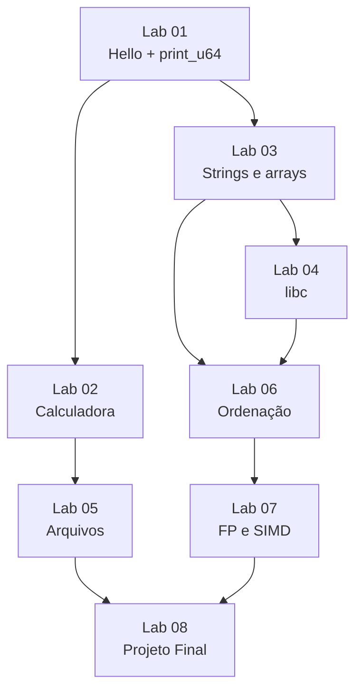

# 10 - Laboratórios e Projetos Práticos

> [!abstract] Resumo
> Aqui a teoria dos módulos 01 a 09 vira prática. São **8 laboratórios** em ordem crescente de dificuldade, do `write` com "Olá" até um projeto final (`hexdump` em Assembly). Cada lab tem **objetivos, código inicial, passo a passo, desafios progressivos e análise de desempenho**; a **solução completa e comentada** fica em uma nota separada, na pasta `Soluções/`, para você tentar antes de olhar.

Voltar ao índice: [[00 - Índice]] · Módulo anterior: [[09 - Otimização, SIMD e Performance]] · Próximo: [[11 - Recursos e Referências]]

Tags: #assembly #lab #projeto #nasm

---

## 1. Como usar os laboratórios


> [!tip] Método recomendado
> 1. **Tente sozinho primeiro.** Só abra a solução depois de travar de verdade (20 a 30 minutos) ou de terminar.
> 2. **Rode no depurador** (veja [[Cheat Sheet de GDB]]) e **veja** os registradores mudarem. Use `strace` para conferir as syscalls.
> 3. **Escreva testes** (um `test.c` em C chamando suas funções) e compare com uma implementação de referência.
> 4. **Faça os desafios em ordem**: cada um depende do anterior.
> 5. **Meça** quando o lab pedir (use o *harness* do módulo 09, seção 3.1).

> [!note] Ambiente
> Todos os labs usam **NASM + Linux x86-64** (System V). Os programas "puros" são ligados com `ld`; os que chamam a libc (Lab 04) são ligados com `gcc`. Os testes foram **montados e executados** na escrita deste módulo. Em Windows, use WSL2 ou veja as diferenças MASM nos módulos 04 e 05.

```bash
nasm -f elf64 -g -F dwarf prog.asm -o prog.o
ld prog.o -o prog          # programa sem libc
gcc -no-pie prog.o -o prog # programa com libc (Lab 04)
```

---

## 2. Os 8 laboratórios

| # | Lab | Nível | Módulos usados | O que você constrói | Solução |
|---|-----|:-----:|:--------------:|---------------------|---------|
| 01 | [[Lab 01 - Hello World e Operações Básicas]] | iniciante | 01, 02, 03, 05 | `write`/`exit`, aritmética, `print_u64` (número → texto) | [[Solução - Lab 01 - Hello World e Operações Básicas]] |
| 02 | [[Lab 02 - Calculadora em Assembly]] | iniciante | 03, 05 | leitura de `a op b`, parsing, `+ - * /`, erros | [[Solução - Lab 02 - Calculadora em Assembly]] |
| 03 | [[Lab 03 - Manipulação de Strings e Arrays]] | iniciante-intermediário | 02, 03, 04, 06 | `str_len`, `str_rev`, `str_upper`, `arr_sum`, `arr_minmax`, `str_find` | [[Solução - Lab 03 - Manipulação de Strings e Arrays]] |
| 04 | [[Lab 04 - Funções da libc]] | intermediário | 04, 07 | `main` em Assembly, `printf`, `malloc`, `qsort` com *callback* | [[Solução - Lab 04 - Funções da libc]] |
| 05 | [[Lab 05 - Sistema de Arquivos Simples]] | intermediário | 05 | `cat`, cópia e `wc` com `open/read/write/close` | [[Solução - Lab 05 - Sistema de Arquivos Simples]] |
| 06 | [[Lab 06 - Ordenação]] | intermediário | 03, 04, 06, 09 | *insertion*, *bubble* e *quicksort* recursivo | [[Solução - Lab 06 - Ordenação]] |
| 07 | [[Lab 07 - Floating Point e SIMD]] | avançado | 07, 09 | produto escalar, SAXPY, norma e Mandelbrot em escalar, SSE/AVX/FMA | [[Solução - Lab 07 - Floating Point e SIMD]] |
| 08 | [[Lab 08 - Projeto Final]] | avançado | 04, 05, 06, 09 | `hexdump` completo com marcos, E/S em blocos e testes | [[Solução - Lab 08 - Projeto Final]] |

### 2.1 Trilha de dependências



> [!tip] Quem tem pouco tempo
> **Trilha mínima:** Lab 01 → 02 → 03 → 05 → 08. **Trilha de desempenho:** Lab 03 → 06 → 07, medindo com o [[09 - Otimização, SIMD e Performance]].

---

## 3. Padrão de cada laboratório

Cada nota de lab segue a mesma estrutura, para você saber onde encontrar cada coisa:

| Seção | Conteúdo |
|-------|----------|
| **Objetivos** | o que você vai saber fazer ao final |
| **Código inicial** | esqueleto que **já monta**, com `TODO` onde você escreve |
| **Passo a passo** | marcos pequenos, com o comando para conferir cada um |
| **Desafios progressivos** | do básico ao difícil, cada um acrescenta uma capacidade |
| **Análise de desempenho** | o que medir e o que esperar |
| **Solução** (nota à parte) | código completo comentado, explicação por blocos, variações dos desafios, erros comuns |

> [!warning] Convenções que valem para todos os labs
> - **Chamável de C** quando possível (assinatura System V), para testar com um `test.c`.
> - **`section .note.GNU-stack noalloc noexec nowrite progbits`** no fim de cada arquivo, para o `ld` não avisar sobre pilha executável.
> - **Pilha alinhada em 16 bytes** antes de qualquer `call` a função da libc ([[04 - Procedimentos, Stack e Calling Conventions]]).
> - **Preserve registradores *callee-saved*** (`RBX`, `RBP`, `R12`-`R15`) quando os usar.

---

## 4. Rubrica de autoavaliação

Marque conforme avança. Se algum item "não" persistir, volte ao módulo indicado.

| Capacidade | Lab | Módulo de revisão |
|------------|:---:|-------------------|
| Fazer uma syscall e ler seu retorno | 01, 05 | [[05 - Entrada-Saída e System Calls]] |
| Converter número ↔ texto sem libc | 01, 02 | [[03 - Instruções Básicas e Controle de Fluxo]] |
| Percorrer strings e arrays com ponteiro e índice escalado | 03 | [[06 - Estruturas de Dados e Arrays]] |
| Escrever função que respeita a *calling convention* | 03, 04 | [[04 - Procedimentos, Stack e Calling Conventions]] |
| Chamar a libc com a pilha alinhada | 04 | [[04 - Procedimentos, Stack e Calling Conventions]] |
| Tratar erros de syscall (retorno negativo) | 05, 08 | [[05 - Entrada-Saída e System Calls]] |
| Escrever recursão em Assembly | 06 | [[04 - Procedimentos, Stack e Calling Conventions]] |
| Usar SIMD com epílogo escalar e `vzeroupper` | 07 | [[07 - Assembly Avançado (x86-x64)]] |
| Medir e explicar uma diferença de desempenho | 06, 07, 08 | [[09 - Otimização, SIMD e Performance]] |
| Depurar com GDB e `strace` | todos | [[Cheat Sheet de GDB]] |

---

## 5. Depois dos laboratórios: projetos extras

> [!example] Ideias para continuar sozinho
> - **`strlen`/`memchr` SIMD** com *dispatch* por `cpuid` (módulo 09, seção 6.4).
> - **Tabela de *hash*** (FNV-1a ou CRC32 com `crc32` do SSE4.2) com endereçamento aberto.
> - **Interpretador de *bytecode*** com *threaded dispatch* (`jmp [tabela + rax*8]`).
> - **Mini-`grep`** sobre o Lab 05 (busca de substring + E/S em blocos).
> > - **Porte para AArch64** do Lab 03 ou 06 ([[08 - ARM e AArch64]]), com `qemu-aarch64`.
> - **Engenharia reversa:** compile um C pequeno com `-O0` e `-O2`, leia o Assembly e reescreva à mão.

---

## 6. Resumo

> [!abstract] Resumo do módulo 10
> - São **8 labs** progressivos (Hello World → calculadora → strings/arrays → libc → arquivos → ordenação → FP/SIMD → projeto final).
> - Cada lab traz **objetivos, código inicial que monta, passo a passo, desafios e análise de desempenho**; a **solução completa** fica em `Soluções/`.
> - O método é **tentar, depurar, testar contra uma referência em C e medir**.
> - Autoavalie-se pela rubrica da seção 4 e continue com os projetos extras.

**Próximo:** [[11 - Recursos e Referências]] · **Ver também:** [[Glossário#Assembly (x86-64 e ARM)]] · [[Cheat Sheet de Instruções]] · [[Cheat Sheet de GDB]] · [[00 - Índice]]
