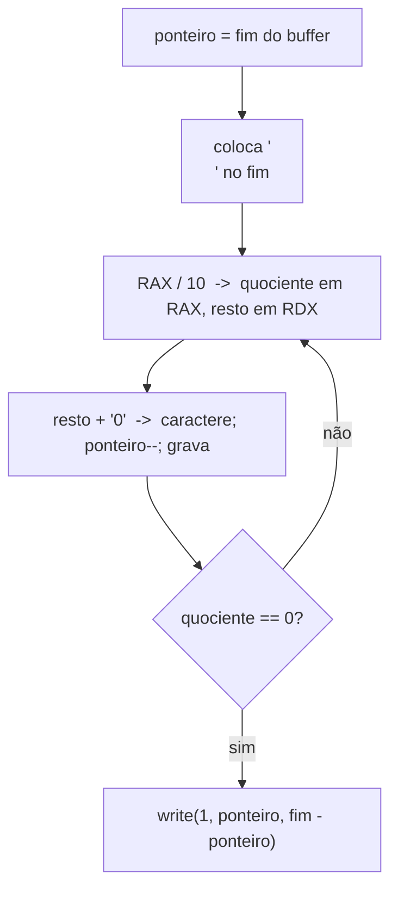

# Lab 01 - Hello World e Operações Básicas

> [!abstract] Resumo
> Seu primeiro programa **sem libc**: escrever na tela com a syscall `write`, terminar com `exit`, fazer aritmética e **imprimir números em decimal** convertendo à mão (divisão por 10). Ao final você terá a rotina `print_u64`, que será reaproveitada em quase todos os labs seguintes.

Voltar ao índice: [[Índice - Assembly]] · Módulo: [[10 - Laboratórios e Projetos Práticos]] · Próximo: [[Lab 02 - Calculadora em Assembly]] · Solução: [[Solução - Lab 01 - Hello World e Operações Básicas]]

**Pré-requisitos:** [[01 - Fundamentos de Arquitetura e Assembly]], [[02 - Registradores e Memória]], [[03 - Instruções Básicas e Controle de Fluxo]], [[05 - Entrada-Saída e System Calls]].

Tags: #assembly #lab #nasm #syscall

---

## 1. Objetivos

- Montar e ligar um programa com `nasm` + `ld` e rodá-lo.
- Usar as syscalls `write` (1) e `exit` (60) do Linux x64 (convenção: número em `RAX`; argumentos em `RDI, RSI, RDX`).
- Usar `section .data`, `section .bss`, `equ` e cálculo de tamanho com `$ - rótulo`.
- Fazer laços (`loop`, `dec/jnz`) e aritmética (`add`, `imul`, `div`).
- Converter um inteiro em texto ASCII (divisões sucessivas por 10).

> [!note] Ambiente
> Linux x86-64, NASM e `ld` (ver [[Índice - Assembly]]). Para **Windows/MASM**, veja o quadro "NASM × MASM" ao final: no Windows não existem syscalls estáveis, e o programa chama a **Windows API** (`WriteFile`) através de `kernel32`.

## 2. Material de partida (*starter code*)

Salve como `lab01.asm`. Ele **monta e roda**, mas só imprime a mensagem; as partes com `TODO` são suas.

```nasm
; lab01.asm - ESQUELETO
default rel
global _start

section .data
msg      db "Ola, Assembly!", 10
msg_len  equ $ - msg

section .bss
buf resb 32                  ; espaço para o número em texto

section .text
; print(RSI = ponteiro, RDX = tamanho)
print:
    mov  eax, 1              ; SYS_write
    mov  edi, 1              ; fd = stdout
    syscall
    ret

; print_u64: RAX = número  ->  imprime em decimal + '\n'
print_u64:
    ; TODO (Passo 3): converter RAX em texto no final de buf e chamar print
    ret

_start:
    lea  rsi, [msg]
    mov  edx, msg_len
    call print

    ; TODO (Passo 2): somar 1..100 em RAX e imprimir com print_u64

    mov  eax, 60             ; SYS_exit
    xor  edi, edi            ; código 0
    syscall

section .note.GNU-stack noalloc noexec nowrite progbits
```

```bash
nasm -f elf64 lab01.asm -o lab01.o
ld lab01.o -o lab01
./lab01
```

## 3. Passo a passo

### Passo 1: montar e executar o esqueleto
Rode os três comandos acima. Você deve ver `Ola, Assembly!`. Confirme com `echo $?` que o código de saída é 0.

> [!question] Pergunta
> O que acontece se você **remover** a syscall `exit`? (Dica: depois do último `syscall` o processador continua executando o que vier na memória.)

### Passo 2: somar de 1 a 100
Use `RCX` como contador e `RAX` como acumulador (módulo [[03 - Instruções Básicas e Controle de Fluxo]], instrução `loop` ou `dec` + `jnz`). O resultado deve ser **5050**.

### Passo 3: converter número em texto
Algoritmo (de trás para frente, porque o **último** dígito é o primeiro que a divisão entrega):



> [!warning] Antes de `div`, zere `RDX`
> `div rcx` divide **`RDX:RAX`** (128 bits) por `RCX`. Se `RDX` tiver lixo, o quociente estoura e o programa recebe `SIGFPE`.

### Passo 4: fatorial
Calcule **10!** com `imul` e imprima. Resultado esperado: **3628800**.

## 4. Desafios progressivos

| Nível | Desafio | Dica |
|:-----:|---------|------|
| ★ | Imprimir **`11 + 22 = 33`** com rótulos de texto antes de cada número | reaproveite `print` e `print_u64` |
| ★ | Imprimir os **números de 1 a 10**, um por linha | um laço chamando `print_u64` (cuidado: `print` destrói `RCX`, pois `syscall` altera `RCX` e `R11`: guarde o contador em `RBX`/`R12`) |
| ★★ | Imprimir **2⁰ até 2³²** | `shl` ou dobrar com `add rax, rax` |
| ★★ | Imprimir a **sequência de Fibonacci** até 90 | `fib(93)` ainda cabe em 64 bits sem sinal; `fib(94)` não |
| ★★ | Imprimir **números negativos** (`print_i64`) | teste o sinal com `test rax, rax` / `js`, `neg`, e escreva `-` na frente |
| ★★★ | Imprimir em **hexadecimal** e **binário** com a mesma rotina parametrizada pela base | divisor em `RCX` (16 ou 2); dígitos `'0'..'9'`, `'a'..'f'` com tabela |
| ★★★ | Sem `div`: converter usando a **multiplicação por inverso** (módulo [[09 - Otimização, SIMD e Performance]]) | `imul` por `0xCCCCCCCD` + `shr 35` para 32 bits |

## 5. Verificação

```bash
./lab01
# Ola, Assembly!
# Soma 1..100 = 5050
# 10! = 3628800
strace ./lab01          # veja as syscalls que o seu programa faz
```

> [!tip] Depure com o GDB
> `gdb ./lab01` → `break _start` → `layout regs` → `stepi`. Observe `RAX`, `RDX` e a memória de `buf` mudando ([[Cheat Sheet de GDB]]).

## 6. Análise de desempenho

Medições feitas ao escrever este lab (Linux, VM Intel Xeon):

| Observação | Resultado |
|------------|-----------|
| Syscalls feitas pela solução (`strace -c`) | **5 `write`** + 1 `execve` (mais a `exit`) |
| Onde o tempo realmente vai | no **kernel**: cada `write` custa centenas de nanossegundos; o laço da soma (100 voltas) custa ~100 ciclos, menos de 0,1 µs |
| `div` de 64 bits na conversão decimal | cada dígito custa **uma divisão**. Em CPUs antigas, `div r64` leva dezenas de ciclos; em CPUs recentes, ~10–20. Para 1 número, irrelevante; para **milhões**, vale a multiplicação por inverso |

> [!tip] Lição de desempenho
> A solução tem **uma `write` por pedaço de texto**. Para imprimir milhares de linhas, **acumule tudo num buffer** e faça **uma** `write` grande (é exatamente o que o [[Lab 08 - Projeto Final]] faz). O custo de uma syscall domina o custo de formatar o texto.

## 7. NASM × MASM

| Tarefa | NASM / Linux | MASM / Windows (x64) *(não testado aqui)* |
|--------|--------------|-------------------------------------------|
| Saída de texto | `syscall` com `RAX = 1` | `call WriteFile` (via `GetStdHandle(-11)`) |
| Terminar | `syscall`, `RAX = 60` | `call ExitProcess` |
| Argumentos | `RDI, RSI, RDX...` | `RCX, RDX, R8, R9` + 32 bytes de *shadow space* |
| Seções | `section .data` | `.data` |
| Tamanho de string | `$ - msg` | `SIZEOF msg` / `LENGTHOF` |
| Ligação | `ld` | `link /subsystem:console` com `kernel32.lib` |

## 8. Próximo passo

Com `print_u64` em mãos, vá ao [[Solução - Lab 01 - Hello World e Operações Básicas|gabarito]] para comparar e depois ao [[Lab 02 - Calculadora em Assembly]], onde você também vai **ler** da entrada e **converter texto em número**.

> [!abstract] O que você praticou
> `write`/`exit`, seções, `equ`, laços, `div`/`imul`, conversão número→texto, depuração com `strace`/GDB.
