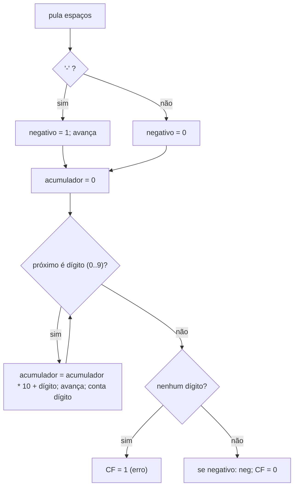

# Lab 02 - Calculadora em Assembly

> [!abstract] Resumo
> Uma calculadora interativa que lê linhas como `12 + 30` ou `-7 * 6` da entrada padrão, faz a conta (`+ - * /`) e imprime o resultado, tratando **números negativos**, **divisão por zero** e **erros de sintaxe**. Você escreve um *parser* de inteiros, uma leitura de linha e a impressão com sinal.

Voltar ao índice: [[00 - Índice]] · Módulo: [[10 - Laboratórios e Projetos Práticos]] · Anterior: [[Lab 01 - Hello World e Operações Básicas]] · Próximo: [[Lab 03 - Manipulação de Strings e Arrays]] · Solução: [[Solução - Lab 02 - Calculadora em Assembly]]

**Pré-requisitos:** [[Lab 01 - Hello World e Operações Básicas]], [[03 - Instruções Básicas e Controle de Fluxo]] (saltos, `cmov`), [[05 - Entrada-Saída e System Calls]].

Tags: #assembly #lab #nasm #parsing

---

## 1. Objetivos

- Ler da entrada padrão com `read` e montar uma **linha** em um buffer.
- Converter texto em inteiro **com sinal** (`atoi` à mão).
- Escolher a operação com uma **cadeia de comparações** (ou uma tabela de saltos).
- Usar `imul` e `cqo` + `idiv` (divisão **com sinal**).
- Tratar erros sem travar o programa.

## 2. Material de partida

```nasm
; lab02.asm - ESQUELETO
default rel
global _start

section .data
prompt    db "calc> "
prompt_n  equ $ - prompt
e_div     db "erro: divisao por zero", 10
e_div_n   equ $ - e_div
e_syn     db "erro: sintaxe (use: A op B, op em + - * /)", 10
e_syn_n   equ $ - e_syn

section .bss
inbuf  resb 128
outbuf resb 32

section .text
write:                       ; RSI = ptr, RDX = tamanho
    mov eax, 1
    mov edi, 1
    syscall
    ret

; read_line: preenche inbuf (terminado em 0). RAX = bytes lidos; 0 = EOF
read_line:
    ; TODO (Passo 1)
    xor eax, eax
    ret

; parse_int: RSI = ptr -> RAX = valor com sinal; RSI avança; CF=1 se não havia dígito
parse_int:
    ; TODO (Passo 2)
    stc
    ret

; print_i64: RAX (com sinal) -> imprime + '\n'
print_i64:
    ; TODO (Passo 4): reaproveite print_u64 do Lab 01 e trate o sinal
    ret

_start:
.loop:
    lea rsi, [prompt]
    mov edx, prompt_n
    call write
    call read_line
    test rax, rax
    jle .exit
    ; TODO (Passo 3): parse A, op, parse B, calcular, imprimir
    jmp .loop
.exit:
    mov eax, 60
    xor edi, edi
    syscall

section .note.GNU-stack noalloc noexec nowrite progbits
```

## 3. Passo a passo

### Passo 1: ler uma linha
Faça `read(0, inbuf, ...)`. **Cuidado:** se a entrada vier de um *pipe* (`printf ... | ./lab02`), um único `read` pode trazer **várias linhas de uma vez**, e o seu programa processaria só a primeira. Duas soluções:

| Estratégia | Prós | Contras |
|------------|------|---------|
| **Ler 1 byte por vez** até `'\n'` | simples, correta com pipe e teclado | 1 syscall por byte (lenta para entradas grandes) |
| **Ler um bloco grande** e guardar um ponteiro de consumo | rápida | mais código (você mantém o estado entre linhas) |

Comece pela primeira; a análise de desempenho (seção 6) mede o custo.

### Passo 2: `parse_int`


> [!tip] Truque do dígito
> Para testar "é dígito?" com **uma comparação**: `sub edx, '0'` e depois `cmp edx, 9` / `ja não_é`. Como a comparação é **sem sinal**, valores menores que `'0'` viram números enormes e também caem em "não é dígito".

### Passo 3: despachar a operação
Leia `A`, pule espaços, leia o caractere da operação, leia `B`. Depois compare o operador com `'+'`, `'-'`, `'*'`, `'/'`.

### Passo 4: imprimir com sinal
Se `RAX < 0`, faça `neg rax`, converta como no Lab 01 e escreva `'-'` **antes** dos dígitos.

> [!warning] Divisão com sinal
> Use **`cqo`** (estende o sinal de `RAX` para `RDX:RAX`) e **`idiv`**. Com `xor edx, edx` + `idiv`, `-100 / 7` dá resultado errado, pois `RDX:RAX` seria um número gigante positivo. Em C e em `idiv`, a divisão **trunca em direção a zero** (`-100 / 7 = -14`, resto `-2`).

## 4. Desafios progressivos

| Nível | Desafio | Dica |
|:-----:|---------|------|
| ★ | Aceitar **`%`** (resto) | `idiv` deixa o resto em `RDX` |
| ★ | Aceitar **vários espaços** e espaços **antes** do primeiro número | já tratado em `parse_int` se pular espaços no início |
| ★★ | Mostrar **quociente e resto** da divisão | dois `print_i64` |
| ★★ | **Detectar overflow** da soma/multiplicação | `jo` depois de `add`/`imul` |
| ★★ | Aceitar números em **hexadecimal** (`0x1F`) | testar o prefixo `0x`; dígitos `a-f` |
| ★★★ | Implementar `**` (potência) por **multiplicações sucessivas** (elevação ao quadrado) | $O(\log b)$ |
| ★★★ | **Expressões** com precedência (`2 + 3 * 4`) usando **pilha** (algoritmo *shunting-yard*) | use a pilha do processador (`push`/`pop`) como pilha de operandos |
| ★★★ | **Calculadora RPN** (`3 4 + 2 *`) | ótimo para treinar a pilha de operandos |

## 5. Verificação

```bash
printf '12 + 30\n-7 * 6\n100 / 7\n-100 / 7\n5 / 0\nabc\n2 - 9\n' | ./lab02
# calc> 42
# calc> -42
# calc> 14
# calc> -14
# calc> erro: divisao por zero
# calc> erro: sintaxe (use: A op B, op em + - * /)
# calc> -7
```

Teste também os **casos de borda**: `0 / 5`, `-0 + 0`, linha vazia, `9223372036854775807 + 1` (overflow!), `-9223372036854775808 / -1` (**`idiv` gera `#DE` / `SIGFPE`** porque o quociente não cabe em 64 bits com sinal: um caso real de erro).

## 6. Análise de desempenho

Medido com `strace -c` e `time`, 100 000 linhas `12 + 30`:

| Medida | Resultado |
|--------|-----------|
| Syscalls de leitura (1 byte por vez) | **800 001 `read`** (8 bytes por linha) e **200 001 `write`** |
| Tempo total | ≈ **0,16 s** (≈ 1,6 µs por linha, quase tudo **kernel**) |
| Sob `strace` | ≈ 9 µs por syscall (o `strace` multiplica o custo) |

> [!tip] Lição
> O cálculo em si custa **dezenas de ciclos**; as **9 syscalls por linha** custam milhares. Para entradas grandes: leia um bloco de 4–64 KiB com **um** `read` e processe linha por linha na memória (como o `wc` do [[Lab 05 - Sistema de Arquivos Simples]]). É o padrão **buffer de entrada + ponteiro de consumo**.

## 7. Próximo passo

Compare com a [[Solução - Lab 02 - Calculadora em Assembly|solução]] e siga para o [[Lab 03 - Manipulação de Strings e Arrays]], onde você vai escrever funções reutilizáveis (convenção System V) que são chamadas **de código C**.

> [!abstract] O que você praticou
> `read`, *parsing* de inteiros, `imul`/`cqo`/`idiv`, tratamento de erros, sinal em decimal, noção do custo de syscalls.
