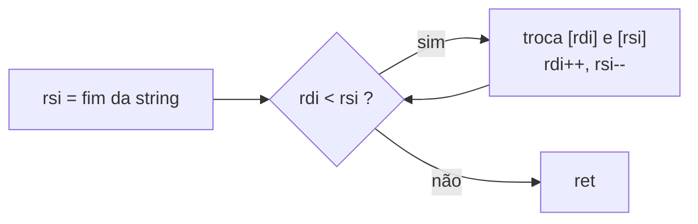

# Lab 03 - Manipulação de Strings e Arrays

> [!abstract] Resumo
> Você vai escrever **funções reutilizáveis** em Assembly (convenção **System V**), chamadas **a partir de código C**: `str_len`, `str_rev`, `str_upper`, `str_is_pal`, `arr_sum`, `arr_minmax` e `str_find`. Um testador em C funciona como "corretor automático": ele compara cada função com a libc e com referências em C, e o seu trabalho é fazê-lo imprimir `lab03 OK`.

Voltar ao índice: [[Índice - Assembly]] · Módulo: [[10 - Laboratórios e Projetos Práticos]] · Anterior: [[Lab 02 - Calculadora em Assembly]] · Próximo: [[Lab 04 - Funções da libc]] · Solução: [[Solução - Lab 03 - Manipulação de Strings e Arrays]]

**Pré-requisitos:** [[02 - Registradores e Memória]] (modos de endereçamento, `movzx`/`movsxd`), [[03 - Instruções Básicas e Controle de Fluxo]] (`cmp`, saltos, `cmov`), [[04 - Procedimentos, Stack e Calling Conventions]] (System V), [[06 - Estruturas de Dados e Arrays]].

Tags: #assembly #lab #nasm #strings #arrays #system-v

---

## 1. Objetivos

- Escrever **funções folha** (que não chamam outras e não precisam de *stack frame*) seguindo a ABI System V: argumentos em `RDI, RSI, RDX, RCX`, retorno em `RAX`, e só usando registradores **livres** (`RAX, RCX, RDX, RSI, RDI, R8-R11`).
- Percorrer *strings* terminadas em zero com **ponteiros** e **índices**, e distinguir acesso a **byte** (`movzx`, `cmp byte [...]`) de acesso a **dword** (`mov eax, [...]`, `movsxd`).
- Testar um intervalo com **uma comparação sem sinal** (`lea` + `cmp` + `ja`).
- Usar `cmovl`/`cmovg` para calcular mínimo e máximo **sem desvios**.
- Ligar Assembly a C (`nasm -f elf64` + `gcc`) e depurar com um testador automático.

> [!note] NASM × MASM
> Em **MASM x64 (Windows)** a convenção muda: argumentos em `RCX, RDX, R8, R9` (e *shadow space* de 32 bytes na pilha). A lógica dos algoritmos é idêntica; só mudam os registradores dos parâmetros e a sintaxe (`proc`/`endp`, `byte ptr`). Veja a tabela em [[Cheat Sheet de Calling Conventions]].

## 2. Material de partida (*starter code*)

Dois arquivos: o seu `lab03.asm` (esqueleto abaixo) e o testador `test3.c`.

```nasm
; starter03.asm - ESQUELETO do Lab 03 (convenção System V: argumentos em RDI, RSI, RDX, RCX; retorno em RAX)
default rel
global str_len, str_rev, str_upper, str_is_pal, arr_sum, arr_minmax, str_find

section .text

; size_t str_len(const char *s)          <- JÁ FEITA, como exemplo
str_len:
    xor  eax, eax
.l: cmp  byte [rdi + rax], 0
    je   .d
    inc  rax
    jmp  .l
.d: ret

; void str_rev(char *s)                  inverte a string no lugar
str_rev:
    ; TODO (Passo 2): dois ponteiros, um no início e outro no último caractere; troque e aproxime
    ret

; void str_upper(char *s)                'a'..'z' -> 'A'..'Z'
str_upper:
    ; TODO (Passo 3)
    ret

; int str_is_pal(const char *s)          1 se for palíndromo (comparação exata), 0 se não
str_is_pal:
    ; TODO (Passo 4)
    xor  eax, eax
    ret

; int64_t arr_sum(const int32_t *a, size_t n)    soma com extensão de sinal (movsxd)
arr_sum:
    ; TODO (Passo 5)
    xor  eax, eax
    ret

; void arr_minmax(const int32_t *a, size_t n, int32_t *min, int32_t *max)    (n >= 1)
arr_minmax:
    ; TODO (Passo 5): RDX = &min, RCX = &max
    ret

; const char *str_find(const char *hay, const char *needle)    ponteiro para o 1º casamento ou NULL
str_find:
    ; TODO (Passo 6)
    xor  eax, eax
    ret

section .note.GNU-stack noalloc noexec nowrite progbits
```

> [!example]- Testador em C (`test3.c`), clique para abrir
> ```c
> // test3.c - confere as funções do Lab 03 contra a libc / referências em C
> #include <ctype.h>
> #include <stdint.h>
> #include <stdio.h>
> #include <stdlib.h>
> #include <string.h>
>
> size_t str_len(const char *);
> void str_rev(char *);
> void str_upper(char *);
> int str_is_pal(const char *);
> int64_t arr_sum(const int32_t *, size_t);
> void arr_minmax(const int32_t *, size_t, int32_t *, int32_t *);
> const char *str_find(const char *, const char *);
>
> #define CHECK(cond, ...)                                                       \
>   do {                                                                         \
>     if (!(cond)) {                                                             \
>       printf("FALHOU: " __VA_ARGS__);                                          \
>       printf("\n");                                                            \
>       return 1;                                                                \
>     }                                                                          \
>   } while (0)
>
> int main(void) {
>   const char *textos[] = {"",     "a",     "ab",   "hello",
>                           "Assembly x86-64!", "arara", "abca"};
>   for (int i = 0; i < 7; i++) {
>     char s[64], r[64], u[64];
>     strcpy(s, textos[i]);
>     size_t n = strlen(s);
>     CHECK(str_len(s) == n, "str_len(\"%s\")", s);
>
>     strcpy(r, s);
>     str_rev(r);
>     for (size_t k = 0; k < n; k++)
>       CHECK(r[k] == s[n - 1 - k], "str_rev(\"%s\")", s);
>
>     strcpy(u, s);
>     str_upper(u);
>     for (size_t k = 0; k <= n; k++)
>       CHECK(u[k] == toupper((unsigned char)s[k]), "str_upper(\"%s\")", s);
>
>     int pal = 1;
>     for (size_t k = 0; k < n / 2; k++)
>       if (s[k] != s[n - 1 - k]) pal = 0;
>     CHECK(str_is_pal(s) == pal, "str_is_pal(\"%s\")", s);
>   }
>
>   srand(1);
>   for (int it = 0; it < 2000; it++) {
>     size_t n = 1 + rand() % 50;
>     int32_t a[64], mn = INT32_MAX, mx = INT32_MIN;
>     int64_t soma = 0;
>     for (size_t k = 0; k < n; k++) {
>       a[k] = rand() - RAND_MAX / 2;
>       soma += a[k];
>       if (a[k] < mn) mn = a[k];
>       if (a[k] > mx) mx = a[k];
>     }
>     int32_t m, M;
>     arr_minmax(a, n, &m, &M);
>     CHECK(arr_sum(a, n) == soma && m == mn && M == mx, "arrays, n=%zu", n);
>   }
>
>   const char *palheiros[] = {"abcabcd", "aaaa", "", "xyz", "needle in haystack"};
>   const char *agulhas[] = {"abcd", "aa", "", "z", "hay", "ack", "q"};
>   for (int i = 0; i < 5; i++)
>     for (int j = 0; j < 7; j++)
>       CHECK(str_find(palheiros[i], agulhas[j]) == strstr(palheiros[i], agulhas[j]),
>             "str_find(\"%s\", \"%s\")", palheiros[i], agulhas[j]);
>
>   puts("lab03 OK: todos os testes passaram");
>   return 0;
> }
> ```

```bash
nasm -f elf64 lab03.asm -o lab03.o
gcc -O2 -Wall test3.c lab03.o -o test3
./test3          # no início: "FALHOU: str_is_pal(\"\")"; no fim: "lab03 OK: todos os testes passaram"
```

## 3. Passo a passo

### Passo 1: entenda a ABI com o exemplo `str_len`
Leia `str_len` linha por linha. `RDI` é o ponteiro; `RAX` é, ao mesmo tempo, **índice** e **valor de retorno** (já termina com o tamanho). Nenhum `push`/`pop`: a função só usa registradores livres.

### Passo 2: `str_rev` (inverter no lugar)

Primeiro ache o final (`cmp byte [rsi], 0`), recue um caractere e depois troque os bytes de dois ponteiros que se aproximam. **Atenção à string vazia:** depois do `dec rsi`, `rsi` fica **antes** de `rdi`; a condição `rdi < rsi` (sem sinal, `jae` para sair) já trata o caso.

### Passo 3: `str_upper`
Para saber se um caractere está em `'a'..'z'` com **uma** comparação: `lea ecx, [rax - 'a']` e `cmp cl, 25` / `ja não_é_letra` (comparação **sem sinal**: tudo abaixo de `'a'` vira um número grande). Converta com `sub byte [rdi], 32` (ou `and ..., 0xDF`: o bit 5 é a diferença entre maiúscula e minúscula em ASCII).

### Passo 4: `str_is_pal`
Mesma ideia de dois ponteiros do Passo 2, mas em vez de trocar, **compare**; qualquer diferença devolve 0. Se os ponteiros se encontrarem, devolva 1. A string vazia e as de 1 caractere são palíndromos.

### Passo 5: `arr_sum` e `arr_minmax`
- `arr_sum`: elementos `int32_t` somados em `int64_t`: use **`movsxd`** (extensão **com sinal**) e não `mov eax, [..]` (que zera a parte alta e transforma `-1` em `4294967295`).
- `arr_minmax`: guarde o mínimo em `EAX`, o máximo em `R8D`; para cada elemento use `cmp` + **`cmovl`**/**`cmovg`**. No fim, escreva os resultados nos ponteiros recebidos em `RDX` e `RCX`.

### Passo 6: `str_find` (busca ingênua)
Para cada posição `p` de `hay`, compare `needle` com `hay + p` até acabar a agulha (casou) ou haver diferença (próxima posição). Agulha vazia devolve `hay`. Complexidade `O(n·m)`.

> [!tip] Depure com o GDB
> `gdb ./test3` → `break str_rev` → `run` → `layout asm` → `stepi` / `info registers rdi rsi` / `x/s $rdi`. Veja o [[Cheat Sheet de GDB]].

## 4. Desafios progressivos

| Nível | Desafio | Dica |
|:-----:|---------|------|
| ★ | `count_vowels(s)` (ASCII, maiúsculas e minúsculas) | máscara de bits `0x104111` + `bt` (bits 0, 4, 8, 14 e 20 = a, e, i, o, u) |
| ★ | `str_lower`, `str_toggle_case` | `xor byte [rdi], 0x20` inverte a caixa de uma letra |
| ★★ | `str_is_pal_ci`: palíndromo **ignorando** espaços e caixa | dois ponteiros que **pulam** não-letras |
| ★★ | `arr_reverse(a, n)` e `arr_rotate(a, n, k)` | três reversões |
| ★★ | `arr_binary_search(a, n, x)` | `lea` para `(lo+hi)/2` sem estouro: `lo + (hi-lo)/2` |
| ★★★ | `str_find` mais rápido (*Boyer-Moore-Horspool*) | tabela de 256 bytes em `.bss` |
| ★★★ | `arr_sum` com **SSE2** (`paddd`) | veja a seção 6 e o módulo [[07 - Assembly Avançado (x86-x64)]] |

## 5. Verificação

```bash
./test3
# lab03 OK: todos os testes passaram

valgrind -q --error-exitcode=9 ./test3 ; echo $?    # 0 = nenhum acesso inválido à memória
```

O testador cobre: string vazia, 1 e 2 caracteres, palíndromos pares/ímpares, 2000 vetores aleatórios (incluindo números negativos) e combinações de agulha/palheiro com casos de borda (agulha vazia, no fim, ausente).

## 6. Análise de desempenho

Medido (melhor de 9 rodadas, CPU fixa, VM Intel Xeon; **valores ilustrativos**):

| Função (4096 elementos) | Sua versão | Referência | Razão |
|-------------------------|:----------:|:----------:|:-----:|
| `str_len` (4096 bytes) | 1079 ns | **21 ns** (libc, SIMD) | **51×** mais lenta |
| `arr_sum` (4096 `int32`) | 1052 ns (~0,26 ns/elem) | 526 ns (`gcc -O3`, SSE2) | 2× mais lenta |
| `str_rev` (4096 bytes) | 1773 ns | n/a | n/a |

> [!tip] Lição
> - Seu laço escalar executa **cerca de 1 elemento por ciclo** (uma cadeia `add` + contador). O compilador, ao ver que a soma de inteiros é **associativa**, processa **4 elementos por instrução** com SSE2.
> - A `strlen` da libc compara **16 a 32 bytes por vez** (módulo [[09 - Otimização, SIMD e Performance]], seção 5.6) e é 51× mais rápida: não escreva `strlen` própria na prática.
> - O valor deste lab é o **domínio da ABI e dos ponteiros**. A otimização vem depois: refaça `arr_sum` com `paddd` (desafio ★★★) e meça.

## 7. Próximo passo

Compare com a [[Solução - Lab 03 - Manipulação de Strings e Arrays|solução]]. No [[Lab 04 - Funções da libc]] você fará o caminho inverso: o **Assembly chama a libc** (`printf`, `malloc`, `qsort`), e a **pilha alinhada** passa a ser uma questão de vida ou morte.

> [!abstract] O que você praticou
> Convenção System V em funções folha, ponteiros e índices, `movzx`/`movsxd`, teste de intervalo com `lea`+`cmp`, `cmov`, testes automatizados em C e `valgrind`.
