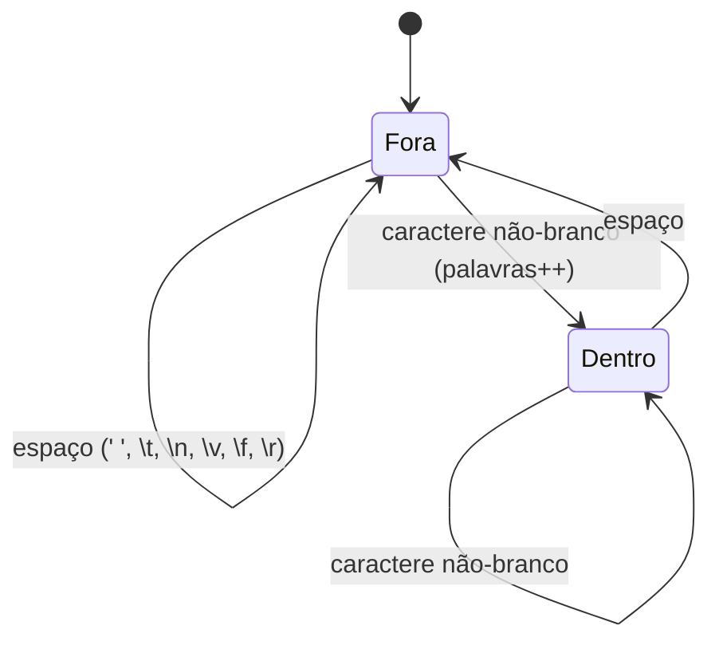

# Lab 05 - Sistema de Arquivos Simples

> [!abstract] Resumo
> Um mini-utilitário **sem libc** com três comandos: `cat`, `cp` e `wc`. Você vai ler `argc/argv` direto da **pilha inicial**, usar as syscalls `open`, `read`, `write`, `close` e `exit`, tratar **erros** (retorno negativo = `-errno`), **escritas parciais** e **buffers**, e escrever uma pequena **máquina de estados** para contar palavras. A análise de desempenho mede o preço de cada syscall: o mesmo `cp` varia de **2 s a 3 ms** só mudando o tamanho do buffer.

Voltar ao índice: [[00 - Índice]] · Módulo: [[10 - Laboratórios e Projetos Práticos]] · Anterior: [[Lab 04 - Funções da libc]] · Próximo: [[Lab 06 - Ordenação]] · Solução: [[Solução - Lab 05 - Sistema de Arquivos Simples]]

**Pré-requisitos:** [[05 - Entrada-Saída e System Calls]] (leitura obrigatória), [[04 - Procedimentos, Stack e Calling Conventions]], [[Lab 01 - Hello World e Operações Básicas]] (`print_dec`), [[Lab 02 - Calculadora em Assembly]] (*buffer* de entrada).

Tags: #assembly #lab #nasm #syscall #arquivos

---

## 1. Objetivos

- Entender a **pilha inicial** de um processo Linux: `argc`, `argv[]`, `NULL`, `envp[]`.
- Usar `open` (2), `read` (0), `write` (1), `close` (3), `exit` (60) e seus códigos de erro (`RAX` entre `-4095` e `-1`).
- Escrever `write_all`, que **repete** a escrita até terminar (um `write` pode escrever **menos** do que o pedido).
- Implementar `streq` (comparar *strings*) e um **despachante** de subcomandos.
- Processar um arquivo **em blocos** (buffer de 64 KiB) sem carregá-lo inteiro.
- Escrever uma máquina de estados (dentro/fora de palavra) e imprimir números em decimal.

> [!note] NASM (Linux) × MASM (Windows)
> No Windows não há `open/read/write`: o equivalente é `CreateFileA`, `ReadFile`, `WriteFile` e `CloseHandle` (`kernel32`), com *handles* em vez de *file descriptors* e a convenção Microsoft x64. A estrutura do programa (abrir, laço de leitura/escrita, fechar) é a mesma.

## 2. Material de partida (*starter code*)

```nasm
; starter05.asm - ESQUELETO do Lab 05:  ./lab05 cat ARQ | cp ORIG DEST | wc ARQ
default rel
global _start

SYS_read  equ 0
SYS_write equ 1
SYS_open  equ 2
SYS_close equ 3
SYS_exit  equ 60
O_RDONLY  equ 0
O_WRONLY_CREAT_TRUNC equ 0x241          ; O_WRONLY | O_CREAT | O_TRUNC
BUFSZ equ 65536

section .data
usage   db "uso: lab05 cat ARQ | cp ORIG DEST | wc ARQ", 10
usage_n equ $ - usage

section .bss
buf resb BUFSZ

section .text
; die(RSI = mensagem, RDX = tamanho): escreve em stderr e sai com código 1
die:
    mov  edi, 2
    mov  eax, SYS_write
    syscall
    mov  edi, 1
    mov  eax, SYS_exit
    syscall

; TODO (Passo 2): streq(RDI, RSI)  ->  ZF = 1 se as strings são iguais
; TODO (Passo 3): write_all(RDI = fd, RSI = ptr, RDX = tamanho)  (trata escrita parcial)
; TODO (Passo 4): open_or_die(RDI = caminho, RSI = flags)  ->  RAX = fd   (modo 0644o)

_start:
    mov  rbx, [rsp]              ; argc
    lea  r15, [rsp + 8]          ; argv  (argv[0] = [r15], argv[1] = [r15 + 8], ...)
    cmp  rbx, 3
    jb   .usage
    ; TODO (Passo 2): comparar argv[1] com "cat", "cp" e "wc" e saltar para o tratador
.usage:
    lea  rsi, [usage]
    mov  edx, usage_n
    jmp  die

section .note.GNU-stack noalloc noexec nowrite progbits
```

```bash
nasm -f elf64 lab05.asm -o lab05.o
ld lab05.o -o lab05
./lab05                       # imprime o uso e sai com código 1
```

## 3. Passo a passo

### Passo 1: a pilha no `_start`
Quando o kernel entrega o controle ao processo, **não há endereço de retorno**: `RSP` aponta para `argc`.

```text
 [rsp]       argc
 [rsp + 8]   argv[0]   (ponteiro para "./lab05")
 [rsp + 16]  argv[1]   (ponteiro para "cat", "cp", "wc")
 [rsp + 24]  argv[2]   ...
    ...      NULL
             envp[0] ...
```

Por isso o esqueleto faz `mov rbx, [rsp]` (argc) e `lea r15, [rsp + 8]` (endereço do vetor `argv`).

### Passo 2: `streq` e o despachante
`streq(RDI, RSI)` compara byte a byte até achar diferença **ou o zero**; devolve `ZF = 1` se iguais. Compare `argv[1]` com `"cat"`, `"cp"` e `"wc"` (em `.rodata`) e salte para cada tratador; se nenhum casar, mostre o uso.

### Passo 3: `write_all`
`write` pode devolver **menos** bytes que o pedido (principalmente em *pipes* e *sockets*). O laço: `write`; se `RAX < 0` → erro; avance `RSI` e diminua `RDX` por `RAX`; repita até `RDX = 0`. **Atenção:** a instrução `syscall` **destrói `RCX` e `R11`** e `RAX`; guarde `RDI/RSI/RDX` na pilha (ou em registradores preservados) se precisar deles depois.

### Passo 4: `open_or_die` e o `cat`
`open(path, O_RDONLY, 0)` → `RDI` = caminho, `RSI` = flags, `RDX` = modo. Se `RAX < 0`, escreva a mensagem em **stderr** (fd 2) e saia com código **1**. O `cat`: `read(fd, buf, BUFSZ)`; `RAX = 0` é **fim do arquivo**; senão `write_all(1, buf, RAX)` e repita.

### Passo 5: o `cp`
Abra a origem (`O_RDONLY`) e o destino com `O_WRONLY | O_CREAT | O_TRUNC` = `0x241` e modo `0644o`. O laço de cópia é o **mesmo do `cat`**, com o destino diferente em vez de `1`: reaproveite o código (uma variável: `r13` = fd de saída).

> [!tip] Octal em NASM
> `0644o` (sufixo `o` ou `q`) é octal: `rw-r--r--`. Sem o sufixo, `0644` seria decimal.

### Passo 6: o `wc`

Para cada byte: se for `'\n'`, incremente linhas; se for branco, estado = fora; se não, e o estado era "fora", incremente palavras e mude para "dentro". Branco = `' '` ou `9..13` (use o truque `lea ecx,[rax-9]` / `cmp cl,4` / `jbe`). Some também os bytes lidos. No fim, imprima os três números com `print_dec`.

## 4. Desafios progressivos

| Nível | Desafio | Dica |
|:-----:|---------|------|
| ★ | `cp` que **imprime** quantos bytes copiou | some os retornos de `read` |
| ★ | `wc -l`, `wc -c` (flags) | compare `argv[2]` |
| ★★ | `head -n N` e `tail -c N` | `lseek` (syscall 8) para ir ao fim |
| ★★ | `cp` que **preserva as permissões** da origem | `fstat` (syscall 5): `st_mode` está no deslocamento 24 de `struct stat` |
| ★★ | Ler da **entrada padrão** quando não há argumento (`cat` sem arquivo) | fd 0 |
| ★★★ | `grep -c texto arquivo` (contar linhas com a substring) | reaproveite `str_find` do [[Lab 03 - Manipulação de Strings e Arrays]]; cuidado com linhas que cruzam o limite do buffer |
| ★★★ | Troque o laço `read`/`write` por **`copy_file_range`** (syscall 326) ou **`sendfile`** (40) | o kernel copia sem passar os dados pelo espaço do usuário |

## 5. Verificação

```bash
printf 'a b\n\n  c\td e f\nlast' > in.txt
./lab05 cat in.txt | cmp - in.txt && echo "cat ok"
./lab05 cp in.txt copia.txt && cmp in.txt copia.txt && echo "cp ok"
./lab05 wc in.txt        # 3 linhas 7 palavras 19 bytes
wc in.txt                #  3  7 19 in.txt

./lab05 cat nao_existe ; echo $?     # erro: nao foi possivel abrir/criar arquivo  |  1
./lab05 cp in.txt /nao/existe/x ; echo $?      # idem | 1
./lab05 foo in.txt ; echo $?         # uso: ...  |  1
: > vazio ; ./lab05 wc vazio         # 0 linhas 0 palavras 0 bytes
head -c 300000 /dev/urandom > big.bin
./lab05 cp big.bin out.bin && cmp big.bin out.bin && echo "binario ok"
```

> [!warning] `wc` e o *locale*
> Em arquivos **ASCII e UTF-8 válido**, o resultado coincide com o `wc` do GNU (comparado em vários arquivos de texto). Em **dados binários**, ou em texto UTF-8 no *locale* `C`, o `wc` do GNU **ignora bytes não imprimíveis** (≥ 0x80 no *locale* `C`) ao contar palavras, e o seu laço conta qualquer não-branco como parte da palavra. A diferença é de **definição**, não de bug.

## 6. Análise de desempenho

Mesmo programa, variando só `BUFSZ`. Cópia de **5 MB** (melhor de 3, VM Intel Xeon; **valores ilustrativos**):

| `BUFSZ` | Tempo | Syscalls (≈) |
|:-------:|:-----:|:------------:|
| 1 byte | **1,98 s** | 10 milhões |
| 64 bytes | 0,036 s | 156 mil |
| 4 KiB | 0,0044 s | 2,4 mil |
| 64 KiB | 0,0031 s | 153 |
| 1 MiB | 0,0029 s | 10 |

Cópia de **50 MB**: 4 KiB → 40,7 ms; 64 KiB → 26,7 ms; 1 MiB → 23,4 ms; **`cp` do GNU (coreutils 9.4) → 18,4 ms** (o `strace` mostra **uma única** chamada `copy_file_range` para os 50 MB: o kernel copia sem passar os dados pelo espaço do usuário). Contagem real com `strace -c`: 64 KiB → **764 `read` + 764 `write`**; 4 KiB → **12 208 + 12 208**.

`wc` em 50 MB: **0,039 s** (o seu) contra **0,075 s** (`wc` do GNU, que trata *locale* e multibyte).

> [!tip] Lição
> - Uma syscall custa **~0,2 µs** a 1 µs **de ida e volta ao kernel** (mais em VMs, e muito mais sob `strace`). Com buffer de 1 byte, o custo por **byte** foi de **~400 ns**, dominado só pelas syscalls.
> - Passar de 4 KiB para 64 KiB ainda ajudou (menos syscalls); acima disso o ganho é pequeno (o gargalo vira a **memória**).
> - O jeito mais rápido de copiar é **não copiar no espaço do usuário**: o `cp` do GNU foi ~1,3× mais rápido que o seu, mesmo com buffer de 1 MiB (18,4 contra 23,4 ms).

## 7. Próximo passo

Compare com a [[Solução - Lab 05 - Sistema de Arquivos Simples|solução]] e siga para o [[Lab 06 - Ordenação]]: algoritmos de ordenação em Assembly, com **testes automáticos** contra o `qsort` e comparação de complexidade.

> [!abstract] O que você praticou
> Pilha inicial (`argc/argv`), `open/read/write/close`, códigos de erro, escrita parcial, `streq`, máquina de estados, `print_dec`, buffers e o custo de syscalls.
