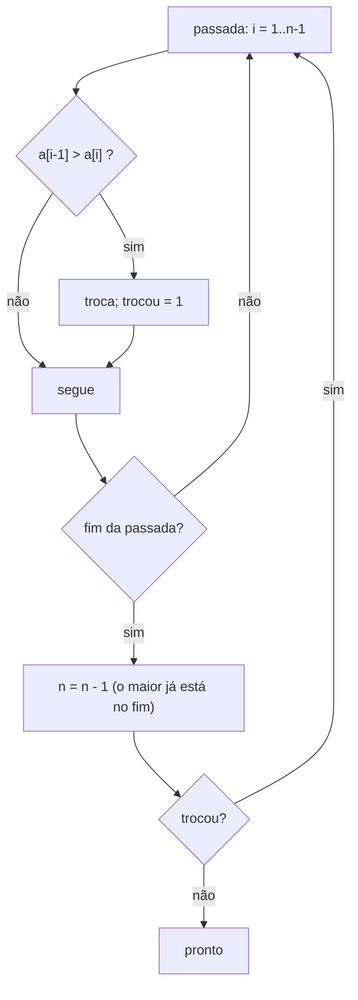
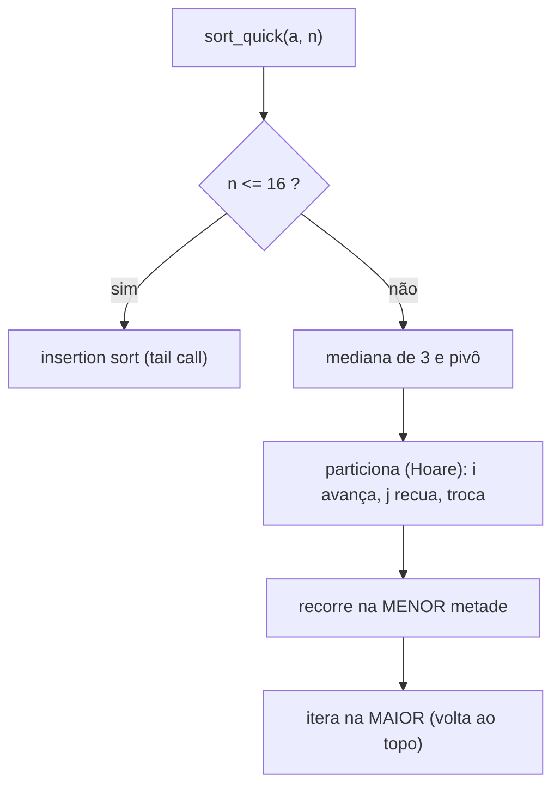

# Lab 06 - Ordenação

> [!abstract] Resumo
> Três algoritmos de ordenação de `int32_t` em Assembly, com a mesma assinatura `void f(int32_t *a, size_t n)`: **bubble sort** (com parada antecipada), **insertion sort** e **quicksort** (recursivo, com o particionamento de Hoare). Um testador em C compara cada um com o `qsort` da libc em milhares de casos e **mede o tempo**. É o lab de **laços aninhados, endereçamento indexado, recursão com registradores preservados** e de comparar a **complexidade teórica** com o que o hardware faz.

Voltar ao índice: [[Índice - Assembly]] · Módulo: [[10 - Laboratórios e Projetos Práticos]] · Anterior: [[Lab 05 - Sistema de Arquivos Simples]] · Próximo: [[Lab 07 - Floating Point e SIMD]] · Solução: [[Solução - Lab 06 - Ordenação]]

**Pré-requisitos:** [[03 - Instruções Básicas e Controle de Fluxo]], [[04 - Procedimentos, Stack e Calling Conventions]] (recursão), [[06 - Estruturas de Dados e Arrays]], [[Lab 03 - Manipulação de Strings e Arrays]].

Tags: #assembly #lab #nasm #ordenacao #recursao #algoritmos

---

## 1. Objetivos

- Implementar laços aninhados com **endereçamento indexado** (`[rdi + rcx*4]`, `[rdi + rcx*4 - 4]`).
- Trocar elementos usando registradores como temporários (sem `xchg` com memória).
- Escrever **recursão** em Assembly: salvar/restaurar registradores, manter a pilha alinhada e **limitar a profundidade** (recursão só na menor metade).
- Comparar `O(n²)` e `O(n log n)` **em tempo real** e entender por que a constante e o padrão dos dados importam.
- Usar um *oracle* (o `qsort`) para testar: mesmos dados, resultados idênticos.

## 2. Material de partida (*starter code*)

```nasm
; starter06.asm - ESQUELETO do Lab 06: void f(int32_t *a, size_t n)   (RDI = a, RSI = n)
default rel
global sort_bubble, sort_insertion, sort_quick

section .text
sort_bubble:
    ; TODO (Passo 1)
    ret

sort_insertion:
    ; TODO (Passo 2)
    ret

sort_quick:
    ; TODO (Passo 3)
    ret

section .note.GNU-stack noalloc noexec nowrite progbits
```

> [!example]- Testador e *benchmark* em C (`test6.c`), clique para abrir
> ```c
> #define _GNU_SOURCE
> #include <sched.h>
> #include <stdint.h>
> #include <stdio.h>
> #include <stdlib.h>
> #include <string.h>
> #include <time.h>
> void sort_bubble(int32_t *, size_t);
> void sort_insertion(int32_t *, size_t);
> void sort_quick(int32_t *, size_t);
> static int cmp(const void *a, const void *b) {
>   int x = *(int *)a, y = *(int *)b;
>   return (x > y) - (x < y);
> }
> static double now(void) {
>   struct timespec t;
>   clock_gettime(CLOCK_MONOTONIC, &t);
>   return t.tv_sec * 1e3 + t.tv_nsec / 1e6;
> }
> typedef void (*F)(int32_t *, size_t);
> static void gen(int32_t *a, size_t n, int kind) {
>   for (size_t i = 0; i < n; i++) {
>     if (kind == 0)
>       a[i] = rand() - RAND_MAX / 2;
>     else if (kind == 1)
>       a[i] = i;
>     else if (kind == 2)
>       a[i] = n - i;
>     else
>       a[i] = rand() % 4;
>   }
> }
> int main() {
>   cpu_set_t s;
>   CPU_ZERO(&s);
>   CPU_SET(0, &s);
>   sched_setaffinity(0, sizeof s, &s);
>   F fs[3] = {sort_bubble, sort_insertion, sort_quick};
>   const char *nm[3] = {"bubble", "insertion", "quick"};
>   srand(7);
>   for (int f = 0; f < 3; f++)
>     for (int kind = 0; kind < 4; kind++)
>       for (size_t n = 0; n <= 300; n++) {
>         int32_t *a = malloc((n + 1) * 4), *b = malloc((n + 1) * 4);
>         gen(a, n, kind);
>         memcpy(b, a, n * 4);
>         fs[f](a, n);
>         qsort(b, n, 4, cmp);
>         if (memcmp(a, b, n * 4)) {
>           printf("FAIL %s kind=%d n=%zu\n", nm[f], kind, n);
>           return 1;
>         }
>         free(a);
>         free(b);
>       }
>   for (int f = 2; f < 3; f++)
>     for (int kind = 0; kind < 4; kind++) {
>       size_t n = 1000000;
>       int32_t *a = malloc(n * 4), *b = malloc(n * 4);
>       gen(a, n, kind);
>       memcpy(b, a, n * 4);
>       fs[f](a, n);
>       qsort(b, n, 4, cmp);
>       if (memcmp(a, b, n * 4)) {
>         printf("FAIL big kind=%d\n", kind);
>         return 1;
>       }
>       free(a);
>       free(b);
>     }
>   puts("testes OK");
>   size_t ns[] = {1000, 5000, 20000};
>   for (int ni = 0; ni < 3; ni++) {
>     size_t n = ns[ni];
>     printf("n=%zu (ms, aleatorio):", n);
>     int32_t *a = malloc(n * 4), *o = malloc(n * 4);
>     gen(o, n, 0);
>     for (int f = 0; f < 3; f++) {
>       double best = 1e30;
>       for (int t = 0; t < 5; t++) {
>         memcpy(a, o, n * 4);
>         double t0 = now();
>         fs[f](a, n);
>         double d = now() - t0;
>         if (d < best)
>           best = d;
>       }
>       printf("  %s=%.3f", nm[f], best);
>     }
>     double best = 1e30;
>     for (int t = 0; t < 5; t++) {
>       memcpy(a, o, n * 4);
>       double t0 = now();
>       qsort(a, n, 4, cmp);
>       double d = now() - t0;
>       if (d < best)
>         best = d;
>     }
>     printf("  libc_qsort=%.3f\n", best);
>     free(a);
>     free(o);
>   }
>   {
>     size_t n = 1000000;
>     int32_t *a = malloc(n * 4), *o = malloc(n * 4);
>     gen(o, n, 0);
>     double best = 1e30;
>     for (int t = 0; t < 5; t++) {
>       memcpy(a, o, n * 4);
>       double t0 = now();
>       sort_quick(a, n);
>       double d = now() - t0;
>       if (d < best)
>         best = d;
>     }
>     double bq = 1e30;
>     for (int t = 0; t < 5; t++) {
>       memcpy(a, o, n * 4);
>       double t0 = now();
>       qsort(a, n, 4, cmp);
>       double d = now() - t0;
>       if (d < bq)
>         bq = d;
>     }
>     printf("n=1e6 aleatorio: quick_asm=%.1f ms  libc_qsort=%.1f ms\n", best, bq);
>     gen(o, n, 1);
>     memcpy(a, o, n * 4);
>     double t0 = now();
>     sort_quick(a, n);
>     printf("n=1e6 ja ordenado: quick_asm=%.1f ms\n", now() - t0);
>     gen(o, n, 3);
>     memcpy(a, o, n * 4);
>     t0 = now();
>     sort_quick(a, n);
>     printf("n=1e6 so 4 valores distintos: quick_asm=%.1f ms\n", now() - t0);
>   }
> }
> ```

```bash
nasm -f elf64 lab06.asm -o lab06.o
gcc -O2 test6.c lab06.o -o test6
./test6          # no início: "FAIL bubble kind=0 n=2"
```

## 3. Passo a passo

### Passo 1: bubble sort com parada antecipada

Cuidado com `n < 2` (retorne logo) e use comparação **sem sinal** nos índices (`jae`), mas **com sinal** nos valores (`jle`, `jg`): são `int32_t`.

### Passo 2: insertion sort
Para cada `i`, guarde `chave = a[i]` e **desloque** para a direita todos os elementos maiores que ela, até achar o lugar. Um `mov` de memória para memória não existe em x86: use um registrador. O laço interno **para** quando `j = 0` ou `a[j-1] <= chave`.

### Passo 3: quicksort com particionamento de Hoare
Ideia: escolha um **pivô**, ponha à esquerda o que é `<=` e à direita o que é `>=`, e ordene as duas partes. Decisões de projeto que valem pontos:

| Decisão | Por quê |
|---------|---------|
| **Hoare** (dois ponteiros que se encontram) em vez de **Lomuto** | com **muitos valores repetidos**, o Lomuto vira `O(n²)`: medimos **1,3 s** para 200 000 elementos com 4 valores distintos, contra **2,5 ms** do Hoare (525×) |
| Pivô = **mediana de 3** (`a[0]`, `a[n/2]`, `a[n-1]`) | evita o pior caso em dados já ordenados ou inversos; as comparações ainda servem de **sentinelas** (os laços internos não passam dos limites) |
| Recorrer só na **menor metade** e iterar na maior | a profundidade da pilha fica `O(log n)`: nenhum *stack overflow* mesmo em dados ruins |
| **Insertion sort** para `n <= 16` | o custo da recursão supera o ganho para vetores pequenos |



> [!warning] Alinhamento e registradores
> Cada `call` recursivo exige a pilha alinhada em 16 bytes, e **todo** registrador que você precisa depois da chamada (base, tamanhos) tem de estar em registrador **preservado** ou ser **empilhado** antes. Conte os `push`: o comentário na solução mostra a conta.

## 4. Desafios progressivos

| Nível | Desafio | Dica |
|:-----:|---------|------|
| ★ | **Selection sort** | `min` por varredura e uma troca por passada |
| ★ | Ordem **decrescente** (parâmetro ou rotina nova) | inverta o `jle`/`jg` |
| ★★ | `sort_insertion` com **busca binária** da posição | `rep movsd` não serve (sobreposição para a direita; use `std` ou um laço) |
| ★★ | **Shell sort** (lacunas de Knuth: 1, 4, 13, 40...) | insertion sort com passo `h` |
| ★★ | **Contagem** (*counting sort*) para valores em `0..255` | vetor de 256 contadores em `.bss` |
| ★★★ | **Heapsort** (`O(n log n)` sem recursão, pior caso garantido) | índices `2i+1` e `2i+2`: `lea` |
| ★★★ | Ordenação **sem desvios** para n pequeno (rede de ordenação com `cmp` + `cmov`) | 5 elementos = 9 comparações |
| ★★★ | **Radix sort** de 32 bits (4 passadas de 8 bits) | histograma + soma de prefixos |

## 5. Verificação

```text
testes OK                                  <- 3 algoritmos × 4 tipos de dados × n = 0..300, e quick até n = 1 000 000
n=1000 (ms, aleatorio):  bubble=0.490  insertion=0.078  quick=0.025  libc_qsort=0.049
```

O testador usa quatro tipos de dados: **aleatórios**, **já ordenados**, **inversos** e **só 4 valores distintos** (aqui é onde o Lomuto morre), com `n` de **0 a 300** (todos os tamanhos pequenos e bordas) e **1 milhão** de elementos para o quicksort. Cada resultado é comparado **byte a byte** (`memcmp`) com o do `qsort`.

## 6. Análise de desempenho

Vetores **aleatórios** de `int32_t`, em milissegundos (melhor de 5; VM Intel Xeon; **valores ilustrativos**):

| `n` | bubble | insertion | **quick (seu)** | `qsort` da libc |
|----:|-------:|----------:|----------------:|----------------:|
| 1 000 | 0,49 | 0,078 | **0,025** | 0,049 |
| 5 000 | 11,2 | 1,67 | **0,18** | 0,33 |
| 20 000 | 399 | 28,9 | **0,84** | 1,54 |
| 1 000 000 | n/a | n/a | **59,8** | 110,5 |

Em `n = 20 000` com **outros formatos de dados**:

| Entrada | bubble | insertion | quick |
|---------|-------:|----------:|------:|
| aleatória | 385 ms | 26,5 ms | 0,81 ms |
| **já ordenada** | **0,005 ms** | **0,008 ms** | 0,073 ms |
| **inversa** | 273 ms | **52,3 ms** | 0,073 ms |

> [!tip] Lições
> 1. `O(n²)` não é só teoria: o bubble gasta **399 ms** para 20 000 elementos; o quick, **0,84 ms** (**475×** mais rápido). Ao multiplicar `n` por 4, o bubble ficou **36×** mais lento, mais que os 16× do modelo `n²` (o modelo ignora as previsões erradas de desvio e outros efeitos: **meça**).
> 2. Os **algoritmos adaptativos** (bubble com parada antecipada, insertion) são imbatíveis em dados **quase ordenados** (0,005 ms): por isso o quicksort cai para insertion em partes pequenas, e `std::sort` e Timsort fazem o mesmo.
> 3. Seu quicksort **ganha do `qsort` da libc por ~1,8×**, não por ser Assembly, mas porque **compara inline** (a libc chama o comparador por ponteiro de função a cada comparação: veja o [[Lab 04 - Funções da libc]]).
> 4. Na entrada com **4 valores distintos**, o quick de Hoare ordena 1 milhão de elementos em **15,3 ms**. O Lomuto levaria **dezenas de segundos**.

## 7. Próximo passo

Compare com a [[Solução - Lab 06 - Ordenação|solução]] e siga para o [[Lab 07 - Floating Point e SIMD]]: `float`/`double`, registradores `XMM`/`YMM` e vetorização à mão.

> [!abstract] O que você praticou
> Laços aninhados, endereçamento com escala, recursão em Assembly (pilha, alinhamento, registradores preservados), Hoare × Lomuto, mediana de 3, *tail call*, testes contra um *oracle* e medição de complexidade.
