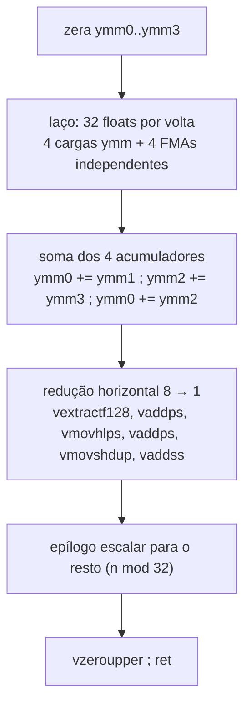
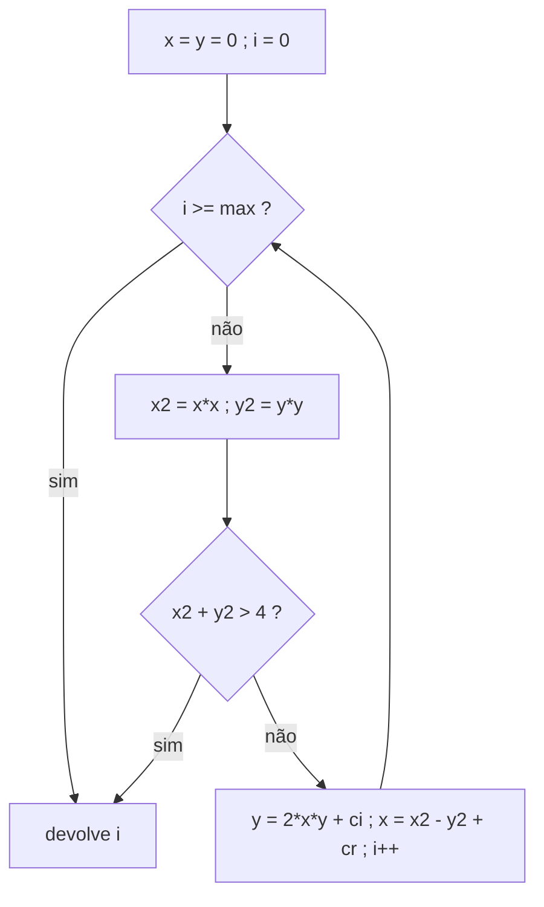

# Lab 07 - Floating Point e SIMD

> [!abstract] Resumo
> Ponto flutuante em Assembly, do **escalar** (`movss`, `mulss`, `addss`, `sqrtss`, `ucomisd`) ao **vetorial** (AVX2 + FMA com registradores `YMM`). Você escreve produto escalar, `saxpy`, norma de vetor e o laço do **conjunto de Mandelbrot**, compara as versões escalar e vetorial (até **16×** de ganho) e descobre **quando o SIMD não ajuda** (memória) e **quando o compilador empata** (laços limitados por latência).

Voltar ao índice: [[Índice - Assembly]] · Módulo: [[10 - Laboratórios e Projetos Práticos]] · Anterior: [[Lab 06 - Ordenação]] · Próximo: [[Lab 08 - Projeto Final]] · Solução: [[Solução - Lab 07 - Floating Point e SIMD]]

**Pré-requisitos:** [[07 - Assembly Avançado (x86-x64)]] (SSE/AVX, `vzeroupper`, `cpuid`), [[09 - Otimização, SIMD e Performance]] (latência × vazão, acumuladores múltiplos), [[04 - Procedimentos, Stack e Calling Conventions]] (`float`/`double` em `XMM0..XMM7`).

Tags: #assembly #lab #nasm #simd #avx #fma #ponto-flutuante

---

## 1. Objetivos

- Passar e devolver `float`/`double` na ABI System V: **argumentos em `XMM0..XMM7`**, retorno em `XMM0`; ponteiros e inteiros continuam em `RDI, RSI, RDX...`.
- Usar instruções **escalares** (`...ss` / `...sd`) e **vetoriais** (`...ps` / `...pd`), com `xmm` (128 bits) e `ymm` (256 bits).
- Aplicar **FMA** (`vfmadd231ps`): multiplicar e somar com **um só arredondamento**.
- **Quebrar a cadeia de dependência** com 4 acumuladores (módulo [[09 - Otimização, SIMD e Performance]]).
- Fazer **redução horizontal** (8 lanes → 1) e tratar o **resto** (epílogo escalar).
- Entender `vzeroupper` e por que `ucomisd` + `ja` se comporta bem com `NaN`.
- Testar código de ponto flutuante com **tolerância** (reassociar somas muda os últimos bits).

> [!warning] Requisito de hardware
> As versões `*_avx` exigem **AVX2 e FMA** (Intel Haswell 2013+, AMD Zen). O testador verifica com `__builtin_cpu_supports` e **avisa** se a CPU não tiver. Verifique com `grep -o -w -E 'avx2|fma' /proc/cpuinfo | sort -u`.

## 2. Material de partida (*starter code*)

```nasm
; starter07.asm - ESQUELETO do Lab 07 (System V; float em XMM0..XMM7, ponteiros em RDI, RSI, RDX)
default rel
global dot_scalar, dot_avx, saxpy_scalar, saxpy_avx, norm_f32, mandel_iter

section .text
; float dot_scalar(const float *a, const float *b, size_t n)      <- JÁ FEITA, como exemplo
dot_scalar:
    xorps xmm0, xmm0
    xor   eax, eax
.l: cmp   rax, rdx
    jae   .d
    movss xmm1, [rdi + rax*4]
    mulss xmm1, [rsi + rax*4]
    addss xmm0, xmm1
    inc   rax
    jmp   .l
.d: ret

dot_avx:                  ; TODO (Passo 2): 4 acumuladores YMM + FMA + epílogo escalar
    xorps xmm0, xmm0
    ret

saxpy_scalar:             ; void saxpy_scalar(float a, const float *x, float *y, size_t n):  y[i] += a * x[i]
    ret                   ;   a = XMM0, x = RDI, y = RSI, n = RDX   (TODO, Passo 3)

saxpy_avx:                ; TODO (Passo 3)
    ret

norm_f32:                 ; float norm_f32(const float *a, size_t n) = sqrt(soma a[i]²)   (TODO, Passo 4)
    xorps xmm0, xmm0
    ret

mandel_iter:              ; int mandel_iter(double cr, double ci, int max)   (TODO, Passo 5)
    xor  eax, eax
    ret

section .note.GNU-stack noalloc noexec nowrite progbits
```

> [!example]- Testador e *benchmark* em C (`test7.c`), clique para abrir
> ```c
> #define _GNU_SOURCE
> #include <math.h>
> #include <sched.h>
> #include <stdio.h>
> #include <stdlib.h>
> #include <string.h>
> #include <time.h>
> float dot_scalar(const float *, const float *, size_t);
> float dot_avx(const float *, const float *, size_t);
> void saxpy_scalar(float, const float *, float *, size_t);
> void saxpy_avx(float, const float *, float *, size_t);
> float norm_f32(const float *, size_t);
> int mandel_iter(double, double, int);
> static double now(void) {
>   struct timespec t;
>   clock_gettime(CLOCK_MONOTONIC, &t);
>   return t.tv_sec * 1e9 + t.tv_nsec;
> }
> static volatile float sinkf;
> static volatile int sinki;
> static int mref(double cr, double ci, int mx) {
>   double x = 0, y = 0;
>   int i = 0;
>   while (i < mx) {
>     double x2 = x * x, y2 = y * y;
>     if (x2 + y2 > 4)
>       break;
>     y = 2 * x * y + ci;
>     x = x2 - y2 + cr;
>     i++;
>   }
>   return i;
> }
> int main() {
>   cpu_set_t s;
>   CPU_ZERO(&s);
>   CPU_SET(0, &s);
>   sched_setaffinity(0, sizeof s, &s);
>   if (!__builtin_cpu_supports("avx2") || !__builtin_cpu_supports("fma")) {
>     puts("sem AVX2/FMA");
>     return 0;
>   }
>   srand(3);
>   for (size_t n = 0; n <= 200; n++) {
>     float *a = malloc((n + 1) * 4), *b = malloc((n + 1) * 4), *y1 = malloc((n + 1) * 4),
>           *y2 = malloc((n + 1) * 4);
>     double ref = 0;
>     for (size_t i = 0; i < n; i++) {
>       a[i] = rand() / (float)RAND_MAX - .5f;
>       b[i] = rand() / (float)RAND_MAX - .5f;
>       y1[i] = y2[i] = a[i] * 3;
>       ref += (double)a[i] * b[i];
>     }
>     double e1 = fabs(dot_scalar(a, b, n) - ref), e2 = fabs(dot_avx(a, b, n) - ref);
>     if (e1 > 1e-4 || e2 > 1e-4) {
>       printf("dot FAIL n=%zu %g %g\n", n, e1, e2);
>       return 1;
>     }
>     saxpy_scalar(2.5f, a, y1, n);
>     saxpy_avx(2.5f, a, y2, n);
>     for (size_t i = 0; i < n; i++)
>       if (fabsf(y1[i] - y2[i]) > 1e-5f) {
>         printf("saxpy FAIL n=%zu\n", n);
>         return 1;
>       }
>     double nr = 0;
>     for (size_t i = 0; i < n; i++)
>       nr += (double)a[i] * a[i];
>     if (fabs(norm_f32(a, n) - sqrt(nr)) > 1e-4) {
>       printf("norm FAIL n=%zu\n", n);
>       return 1;
>     }
>     free(a);
>     free(b);
>     free(y1);
>     free(y2);
>   }
>   for (int i = 0; i < 20000; i++) {
>     double cr = -2.2 + 3.2 * rand() / RAND_MAX, ci = -1.5 + 3.0 * rand() / RAND_MAX;
>     if (mandel_iter(cr, ci, 200) != mref(cr, ci, 200)) {
>       puts("mandel FAIL");
>       return 1;
>     }
>   }
>   puts("lab07 testes OK");
>   size_t n = 4096;
>   float *a = aligned_alloc(64, n * 4), *b = aligned_alloc(64, n * 4), *y = aligned_alloc(64, n * 4);
>   for (size_t i = 0; i < n; i++) {
>     a[i] = 1.0f / (1 + i % 7);
>     b[i] = 1.0f / (1 + i % 5);
>     y[i] = 0;
>   }
> #define T(code, reps)                                                                              \
>   ({                                                                                               \
>     double best = 1e30;                                                                            \
>     for (int t = 0; t < 9; t++) {                                                                  \
>       double t0 = now();                                                                           \
>       for (int r = 0; r < (reps); r++) {                                                           \
>         code;                                                                                      \
>       }                                                                                            \
>       double d = (now() - t0) / (reps);                                                            \
>       if (d < best)                                                                                \
>         best = d;                                                                                  \
>     }                                                                                              \
>     best;                                                                                          \
>   })
>   double t1 = T(sinkf += dot_scalar(a, b, n), 20000) / n,
>          t2 = T(sinkf += dot_avx(a, b, n), 20000) / n;
>   printf("dot  : scalar %.3f ns/elem | avx+fma(4 acc) %.3f ns/elem | %.1fx\n", t1, t2, t1 / t2);
>   double s1 = T(saxpy_scalar(1e-9f, a, y, n), 20000) / n,
>          s2 = T(saxpy_avx(1e-9f, a, y, n), 20000) / n;
>   printf("saxpy: scalar %.3f ns/elem | avx+fma %.3f ns/elem | %.1fx\n", s1, s2, s1 / s2);
>   double m1 = T(sinki += mandel_iter(-0.5, 0.5, 1000), 2000),
>          m2 = T(sinki += mref(-0.5, 0.5, 1000), 2000);
>   printf("mandel(1000 it, ponto interno): asm %.0f ns, C -O2 %.0f ns\n", m1, m2);
>   return 0;
> }
> ```

```bash
nasm -f elf64 lab07.asm -o lab07.o
gcc -O2 test7.c lab07.o -o test7 -lm
./test7          # no início: "dot FAIL n=1 ..."
```

## 3. Passo a passo

### Passo 1: leia `dot_scalar` (o exemplo)
`movss xmm1, [rdi + rax*4]` carrega **um** `float`; `mulss xmm1, [rsi + rax*4]` multiplica (operando de memória); `addss xmm0, xmm1` acumula. **Todo `addss` depende do anterior** (`xmm0` ← `xmm0 + ...`): esta é a **cadeia crítica**; o laço roda na velocidade da **latência** da soma, não da vazão.

### Passo 2: `dot_avx` (4 acumuladores, FMA, `YMM`)

- Laço principal em blocos de **32** (`and rcx, -32`): 4 vetores de 8 `float`.
- `vfmadd231ps ymm0, ymm4, [rsi + ...]` faz `ymm0 += ymm4 * mem`. Os 3 sufixos (132, 213, 231) dizem **qual operando é o somado**; no `231`, o **destino** é o somador.
- A redução horizontal **só uma vez**, depois do laço.
- Termine com **`vzeroupper`** (evita a penalidade de transição AVX → SSE no código que vem depois).

### Passo 3: `saxpy` (`y[i] += a * x[i]`)
`a` chega em **`XMM0`** (primeiro argumento de ponto flutuante) e os ponteiros em `RDI`, `RSI`; `n` em `RDX`. **`vbroadcastss ymm1, xmm0`** copia `a` para as 8 posições. Corpo: carregar `y`, `vfmadd231ps` com `x` da memória, guardar. Resto em escalar. *Não há acumulador*: cada elemento é independente.

### Passo 4: `norm_f32`
`sqrt(soma de a[i]²)` = `dot(a, a)` + `sqrtss`. Para **chamar** `dot_avx` com o mesmo vetor duas vezes, ajuste os argumentos (`RDX = n`, `RSI = a`). **Alinhamento:** na entrada `RSP ≡ 8`; faça `sub rsp, 8` antes do `call` e `add rsp, 8` depois.

### Passo 5: `mandel_iter`
Recorrência `z ← z² + c` com `z = x + iy`: `x' = x² − y² + cr`, `y' = 2xy + ci`. Pare quando `x² + y² > 4` ou ao chegar a `max`.


Use `ucomisd` + `ja` para o teste de escape. **Cuidado com a ordem:** `y` usa o `x` **antigo**, então calcule `y'` **antes** de atualizar `x`.

## 4. Desafios progressivos

| Nível | Desafio | Dica |
|:-----:|---------|------|
| ★ | `vec_max(a, n)` e `vec_min` escalares com `maxss`/`minss` | `maxss xmm0, [mem]` |
| ★ | `vec_scale(a, k, n)` | `vmulps` com `k` em broadcast |
| ★★ | `dot` em **`double`** (4 `double` por `YMM`) | `vfmadd231pd`, 2 vezes menos elementos por vetor |
| ★★ | **`sum` com 8 acumuladores** e comparar com 4 | veja o módulo 09: `latência × vazão` |
| ★★ | `matvec`: matriz `m × n` por vetor | `dot_avx` em cada linha |
| ★★★ | **Mandelbrot vetorial**: 4 pontos `double` por `YMM` | máscara com `vcmppd` + `vmovmskpd`; contador por *lane* com `vpsubq` |
| ★★★ | Matriz × matriz em blocos (`sgemm` simplificado) | *tiling* e FMA com *broadcast* |
| ★★★ | **`cpuid` + *dispatch***: usar a versão AVX só se existir | veja a seção 6.4 do [[09 - Otimização, SIMD e Performance]] |

## 5. Verificação

```text
lab07 testes OK
dot  : scalar 0.516 ns/elem | avx+fma(4 acc) 0.032 ns/elem | 16.3x
saxpy: scalar 0.307 ns/elem | avx+fma 0.045 ns/elem | 6.8x
mandel(1000 it, ponto interno): asm 2401 ns, C -O2 2304 ns
```

Os testes cobrem **todos os `n` de 0 a 200** (incluindo todos os restos módulo 8 e 32), comparando com referências em `double`, com tolerância de `1e-4` (soma) e `1e-5` (`saxpy`); e **20 000 pontos aleatórios** para o Mandelbrot (resultado **exatamente igual** ao do C).

**Desenhando o conjunto** (`mandel.c`, 22 linhas): um pequeno programa em C pede `mandel_iter` para cada ponto e imprime um caractere conforme o nº de iterações:

```text
         .....::::::::::::::::--------==+#*==-----::::..........
        ...::::::::::::::::---------==*+*@*++-------:::::.......
       ..:::::::::::::::--------======+@@@@@+====----::::::.....
      ..:::::::::::::--------==+%#*+@@@@@@@@%*@+++++--::::::....
      .:::::::::::---------====++#@@@@@@@@@@@@@@%@#==--::::::...
     .::::::-----==+=========++%@@@@@@@@@@@@@@@@@@@++---::::::..
     ----------===+#@@@@@@@@*@@@@@@@@@@@@@@@@@@@@@@*=----::::::.
    :--========+*%%@@@@@@@@@@@@@@@@@@@@@@@@@@@@@@@*==----::::::.
```

(Simétrico em relação ao eixo real, como deve ser: se `mandel_iter(c) ≠ mandel_iter(conj(c))`, tem bug.)

## 6. Análise de desempenho

4096 `float` em L1 (melhor de 9; VM Intel Xeon com AVX2+FMA; **ilustrativo**):

| Produto escalar (`dot`) | ns/elemento | Ganho |
|-------------------------|:-----------:|:-----:|
| **seu** `dot_scalar` (1 acumulador) | 0,516 | 1× |
| `gcc -O3` (sem `-ffast-math`) | 0,513 | 1× (**não** vetoriza) |
| `gcc -Ofast -mavx2 -mfma` | 0,061 | 8,4× |
| **seu** `dot_avx` (4 acumuladores + FMA) | **0,032** | **16,3×** |

| `saxpy` | ns/elemento |
|---------|:-----------:|
| `saxpy_scalar` | 0,307 |
| `saxpy_avx` | 0,045 (6,8×) |
| C `-O3` (SSE2 padrão) | 0,079 |
| C `-Ofast -mavx2 -mfma` | **0,039** (um pouco **melhor** que a nossa) |

**Fora do cache:** `dot` de **16 milhões** de `float` (2 vetores × 64 MiB):

| Versão | ns/elemento | Banda aproximada |
|--------|:-----------:|:----------------:|
| `dot_scalar` | 1,25 | ~6 GB/s |
| `dot_avx` | 0,28 | ~28 GB/s |

**Mandelbrot** (1000 iterações, ponto interno): Assembly 2401 ns, C `-O2` 2304 ns: **empate**.

> [!tip] Lições
> 1. O `gcc -O3` **não vetoriza** a redução de `float` sem `-ffast-math` (soma de ponto flutuante **não é associativa**). Com `-Ofast`, chega a 0,061 e ainda perde para os 4 acumuladores + FMA à mão (**1,9×**).
> 2. No `saxpy` **não há dependência**: o compilador com `-mavx2 -mfma` iguala (ou supera) o Assembly. **SIMD à mão paga quando o compilador não pode agir sozinho**, e não o contrário.
> 3. Com dados **fora do cache**, o ganho de 16× cai para **4,4×**: o limite passa a ser a **banda da RAM** (veja o experimento 5.7 do [[09 - Otimização, SIMD e Performance]]).
> 4. No Mandelbrot, o laço é uma **única cadeia dependente** (`x`, `y`): Assembly e C empatam. A forma de ganhar é **processar 4 pontos ao mesmo tempo** (desafio ★★★), não escrever o mesmo laço em Assembly.

## 7. Próximo passo

Veja a [[Solução - Lab 07 - Floating Point e SIMD|solução]] e passe ao [[Lab 08 - Projeto Final]]: um projeto completo, **sem libc**, que reúne E/S, buffers, formatação e testes.

> [!abstract] O que você praticou
> `float`/`double` na ABI, instruções escalares e vetoriais, FMA, `YMM`, vários acumuladores, redução horizontal, epílogo escalar, `vzeroupper`, `ucomisd`, testes com tolerância e medição contra o compilador.
