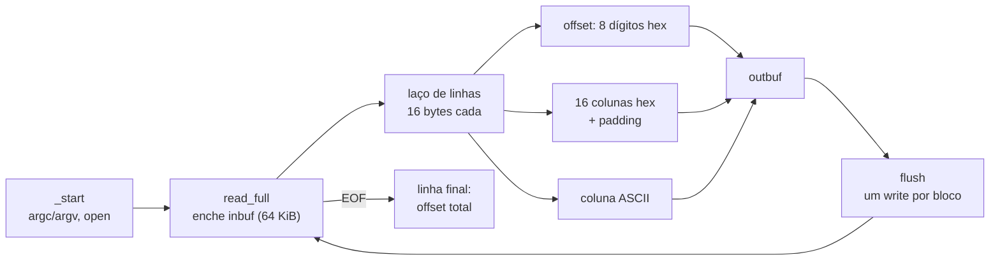

# Lab 08 - Projeto Final

> [!abstract] Resumo
> **Projeto:** `hd`, um clone de **`hexdump -vC`** em Assembly puro (sem libc). Ele lê um arquivo (ou a entrada padrão) e imprime *offset*, bytes em hexadecimal e coluna ASCII, **idêntico** ao formato do `hexdump`. É um projeto que reúne tudo: `argc/argv`, `open/read/write`, buffers, laços aninhados, tabelas de conversão, tratamento de erros, testes de borda e medição de desempenho. Diferente dos labs anteriores, este vem como **especificação**: você planeja, implementa por marcos e se auto-avalia com uma rubrica.

Voltar ao índice: [[00 - Índice]] · Módulo: [[10 - Laboratórios e Projetos Práticos]] · Anterior: [[Lab 07 - Floating Point e SIMD]] · Próximo: [[11 - Recursos e Referências]] · Solução: [[Solução - Lab 08 - Projeto Final]]

**Pré-requisitos:** [[Lab 05 - Sistema de Arquivos Simples]] (E/S e buffers), [[Lab 01 - Hello World e Operações Básicas]] (conversão numérica), [[09 - Otimização, SIMD e Performance]] (medição). Recomendado: [[Cheat Sheet de GDB]].

Tags: #assembly #lab #projeto #nasm #syscall

---

## 1. Objetivos

- Projetar um programa de **200 linhas** em módulos (funções com responsabilidade única) e dividi-lo em **marcos** testáveis.
- Tratar **entrada em blocos**: um `read` pode devolver menos que o pedido (principalmente em *pipe*); o programa precisa funcionar com **arquivo e com pipe**.
- **Formatar** dados em memória (conversão para hexadecimal por tabela, preenchimento, alinhamento de colunas) e **escrever em lote** (um `write` por bloco, não por linha).
- Cobrir **bordas**: arquivo vazio, 1 byte, 15/16/17 bytes, limites do buffer (65 535/65 536/65 537), arquivo inexistente.
- Medir e **otimizar** com base em dados.

## 2. Especificação

```text
uso:   hd [arquivo]          (sem argumento, lê a entrada padrão)
saída: idêntica a   hexdump -vC [arquivo]

00000000  48 65 6c 6c 6f 2c 20 57  6f 72 6c 64 21 0a        |Hello, World!.|
0000000e
```

| Campo | Regra |
|-------|-------|
| **Offset** | 8 dígitos hexadecimais minúsculos, depois **2 espaços** |
| **Bytes** | 16 colunas `xx ` (hex minúsculo + espaço); **um espaço extra** depois da 8ª coluna; linha incompleta preenchida com 3 espaços por byte que falta |
| **Separador** | um espaço, `\|` |
| **ASCII** | bytes `0x20..0x7E` como estão; **os demais como `.`**; fecha com `\|` e `\n` |
| **Última linha** | só o *offset* total (8 dígitos + `\n`), **exceto** em arquivo **vazio** (nada é impresso) |
| **Erros** | arquivo inexistente: mensagem em **stderr** e código de saída **1**; mais de 1 argumento: uso e código 1 |

> [!note] `-v`
> `hexdump -C` sem `-v` **resume** linhas repetidas com `*`. Este projeto implementa o formato **com `-v`** (todas as linhas). O resumo com `*` é um dos desafios.

## 3. Material de partida (*starter code*)

O esqueleto funciona como `cat`: lê e escreve os mesmos bytes. Sua missão é trocar a escrita pelo **formatador**.

```nasm
; starter08.asm - ESQUELETO do projeto "hd": por enquanto funciona como "cat" (lê e escreve os mesmos bytes).
; Sua missão: trocar o "copiar" por "formatar em hexdump -vC".
default rel
global _start

INSZ equ 65536                      ; múltiplo de 16

section .bss
inbuf resb INSZ

section .text
_start:
    xor  r12d, r12d                 ; fd = 0 (stdin)
    cmp  qword [rsp], 2
    jb   .read
    mov  rdi, [rsp + 16]            ; argv[1]
    xor  esi, esi                   ; O_RDONLY
    mov  eax, 2                     ; open
    syscall
    test rax, rax
    js   .fim
    mov  r12, rax
.read:
    mov  rdi, r12
    lea  rsi, [inbuf]
    mov  edx, INSZ
    xor  eax, eax                   ; read
    syscall
    test rax, rax
    jle  .fim                       ; 0 = EOF, <0 = erro
    ; TODO: em vez de escrever os bytes crus, gerar as linhas "00000000  48 65 ... |He...|"
    mov  rdx, rax
    mov  edi, 1
    lea  rsi, [inbuf]
    mov  eax, 1                     ; write   (TODO: tratar escrita parcial!)
    syscall
    jmp  .read
.fim:
    xor  edi, edi
    mov  eax, 60
    syscall

section .note.GNU-stack noalloc noexec nowrite progbits
```

> [!example]- Teste automático (`teste8.sh`) e referência (`ref.py`), clique para abrir
> O script compara o `hd` com `hexdump -vC` (se existir) ou com `ref.py` (referência em Python do mesmo formato) em **21 tamanhos de borda**, em modo arquivo e modo *pipe*, e confere o código de saída de erro.
> ```bash
> #!/usr/bin/env bash
> # teste8.sh - compara o seu "hd" com a referência em tamanhos de borda (0, 1, 15, 16, 17, ... 131073 bytes)
> set -u
> nasm -f elf64 lab08.asm -o lab08.o && ld lab08.o -o hd || exit 1
> if command -v hexdump >/dev/null; then ref() { hexdump -vC "$1"; }       # referência de verdade
> else ref() { python3 ref.py "$1"; }; fi                                   # fallback: mesmo formato, em Python
> head -c 300000 /dev/urandom > aleatorio.bin
> falhas=0
> for n in 0 1 2 7 8 9 15 16 17 31 32 33 255 256 4095 4096 65535 65536 65537 131073 300000; do
>   head -c "$n" aleatorio.bin > t.bin
>   if cmp -s <(./hd t.bin) <(ref t.bin); then :; else echo "FALHOU: arquivo de $n bytes"; falhas=1; fi
> done
> # entrada por pipe (read devolve blocos parciais) e com texto
> printf 'Hello, World!\n' > h.txt
> cmp -s <(./hd h.txt) <(ref h.txt) || { echo "FALHOU: texto"; falhas=1; }
> cmp -s <(cat aleatorio.bin | ./hd) <(ref aleatorio.bin) || { echo "FALHOU: pipe"; falhas=1; }
> ./hd nao_existe 2>/dev/null; [ $? -eq 1 ] || { echo "FALHOU: código de saída com arquivo inexistente"; falhas=1; }
> [ $falhas -eq 0 ] && echo "lab08 OK: todos os testes passaram"
> exit $falhas
> ```
> ```python
> import sys
> d=open(sys.argv[1],'rb').read(); o=[]
> for i in range(0,len(d),16):
>     c=d[i:i+16]; h=''
>     for k in range(16):
>         h+=('%02x '%c[k]) if k<len(c) else '   '
>         if k==7: h+=' '
>     o.append('%08x  %s |%s|\n'%(i,h,''.join(chr(b) if 32<=b<127 else '.' for b in c)))
> if d: o.append('%08x\n'%len(d))
> sys.stdout.write(''.join(o))
> ```

```bash
nasm -f elf64 lab08.asm -o lab08.o && ld lab08.o -o hd
./teste8.sh
```

## 4. Planejamento

### 4.1 Arquitetura



### 4.2 Registradores sugeridos

| Registrador | Papel |
|-------------|-------|
| `R12` | *file descriptor* (0 = stdin) |
| `R13` | *offset* global (bytes já impressos) |
| `R14` | ponteiro para a tabela `"0123456789abcdef"` |
| `R15` | bytes lidos no bloco atual |
| `RSI` / `RDI` | origem (`inbuf`) / destino (`outbuf`) |
| `RBX` | fim dos dados do bloco |
| `RBP` | bytes da linha atual (1..16) |

### 4.3 Truques úteis

- **Offset em hex com `rol`:** `rol eax, 4` leva o nibble mais alto para os 4 bits baixos; `and edx, 15` o isola; `mov dl, [r14 + rdx]` converte em caractere. Oito repetições dão os 8 dígitos, **sem divisão**.
- **ASCII imprimível:** `lea edx, [rax - 32]` / `cmp dl, 94` / `jbe .imprimivel` testa `0x20..0x7E` com uma comparação.
- **Tamanho do buffer de saída:** cada linha ocupa **no máximo 79 bytes**; para 64 KiB de entrada: `(INSZ / 16) * 80` bytes bastam.

## 5. Marcos

| Marco | Entrega | Teste de aceitação |
|:-----:|---------|--------------------|
| **M1** | `read_full` + `flush`: comporta-se como `cat` com arquivo **e** com *pipe* | `echo oi \| ./hd` e `./hd arq` imprimem os mesmos bytes |
| **M2** | Imprime só o **offset** de cada linha de 16 bytes | `00000000`, `00000010`, ... e o total no fim |
| **M3** | Imprime offset + **bytes em hex** (sem ASCII) | compare as colunas com `hexdump -vC` |
| **M4** | **Colunas completas**: espaço extra no meio, `\|`, ASCII | arquivo de 16 bytes idêntico |
| **M5** | **Última linha incompleta** (padding) e linha final do total | arquivos de 1, 15, 17, 31 bytes |
| **M6** | **Bordas e erros**: vazio, 65 535/65 536/65 537 bytes, inexistente | `./teste8.sh` imprime `lab08 OK` |
| **M7** | Medição e otimização | seção 7 |

## 6. Desafios (extensões)

| Trilha | Desafio | Dica |
|:------:|---------|------|
| ★ | `-n N`: só os primeiros `N` bytes | contador decrescente |
| ★ | `-s N`: pular os primeiros `N` bytes | `lseek` (8) ou ler e descartar (serve para *pipe*) |
| ★★ | **Resumir linhas repetidas com `*`** (como o `hexdump -C` padrão) | compare a linha atual com a anterior (16 bytes com `movdqu` + `pcmpeqb` + `pmovmskb`); imprima `*` uma vez |
| ★★ | **Tabela de 256 entradas** (2 caracteres por byte) | a solução traz a variação testada |
| ★★ | **CRC-32** do arquivo (`hd -c`) | tabela de 256 `dword` gerada na inicialização, polinômio `0xEDB88320` |
| ★★★ | Formatar com **SIMD**: 16 bytes → 32 dígitos hex com `pshufb` | separar nibbles (`pand`, `psrlw`), `pshufb` na tabela de dígitos |
| ★★★ | Reconhecer o **cabeçalho ELF** e imprimir `Class`, `Machine` e `Entry` | os 64 primeiros bytes; veja [[07 - Assembly Avançado (x86-x64)]] |
| ★★★ | **Portar para AArch64** (mesmas syscalls, números diferentes) | [[08 - ARM e AArch64]]: `svc #0`, `x8` = número da syscall |

## 7. Análise de desempenho

Arquivo de **50 MB** aleatórios, saída para `/dev/null` (melhor de 3; VM Intel Xeon; **ilustrativo**):

| Versão | Tempo | ns/byte de entrada |
|--------|:-----:|:------------------:|
| **`hd` (sua versão, 2 consultas de nibble por byte)** | **0,105 s** | 2,1 |
| `hd` com **tabela de 256 entradas** (1 consulta de 16 bits) | **0,089 s** | 1,8 |
| `od -v -tx1z -Ax` (GNU) | 4,10 s | 82 (39× mais lento) |
| referência em Python | 24,4 s | 488 |

Impacto do **tamanho do buffer de entrada** (`INSZ`):

| `INSZ` | Tempo | Syscalls (`read` + `write`) |
|:------:|:-----:|:---------------------------:|
| 256 bytes | 0,160 s | 195 314 + 195 314 |
| 4 KiB | 0,106 s | ~12 200 + ~12 200 |
| 64 KiB | 0,105 s | 764 + 764 |

> [!tip] Lições
> 1. Com buffers de 64 KiB, o tempo de **kernel** (`sys`) foi de ~8 ms dos 105: o resto é do **formatador** (~2 ns por byte de entrada, ou ~31 ns por linha de 16 bytes).
> 2. Trocar **duas consultas de 8 bits** por **uma de 16 bits** economizou 15%: em laços quentes, cada instrução conta; mais ainda se a coluna ASCII e a hex fossem feitas com **SIMD** (desafio ★★★).
> 3. O `od` do GNU (versão com formato parecido) leva **4 s** para o mesmo trabalho: programas genéricos pagam pela flexibilidade. Esse é o argumento de **quando Assembly vale a pena**: formato fixo, alto volume (módulo [[09 - Otimização, SIMD e Performance]], seção 8).
> 4. Com `INSZ = 256`, o tempo sobe de 105 para 160 ms (+55 ms: 195 mil leituras + 195 mil escritas): a lição do [[Lab 05 - Sistema de Arquivos Simples]] em outro cenário.

## 8. Rubrica de auto-avaliação

| Critério | Pontos | Como conferir |
|----------|:------:|---------------|
| Formato idêntico ao `hexdump -vC` em arquivos de 0 a 300 000 bytes | 30 | `./teste8.sh` |
| Funciona com **arquivo e pipe** | 10 | `cat arq \| ./hd` |
| Erros: arquivo inexistente (stderr + código 1) | 10 | `./hd x; echo $?` |
| Sem *buffer overflow*: tamanhos de buffer justificados | 10 | revisão do código e `valgrind`/`gdb` |
| Estrutura: funções pequenas, comentários e registradores documentados | 15 | leitura |
| Mediu o desempenho e explicou onde está o tempo | 15 | seção 7 refeita na sua máquina |
| Pelo menos **um desafio** implementado | 10 | seção 6 |

**90+**: excelente · **70-89**: sólido · **abaixo de 70**: reveja os marcos M4-M6.

## 9. Próximo passo

Compare com a [[Solução - Lab 08 - Projeto Final|solução]]. Depois do projeto, siga para o [[11 - Recursos e Referências]]: livros, manuais, *cheat sheets*, glossário e um roteiro de continuidade (engenharia reversa, sistemas operacionais, compiladores, segurança).

> [!abstract] O que você praticou
> Projeto em marcos, `argc/argv`, E/S em blocos (arquivo e *pipe*), formatação em memória, tabelas, escrita em lote, tratamento de erros, testes de borda contra uma referência e medição com variação de parâmetros.
