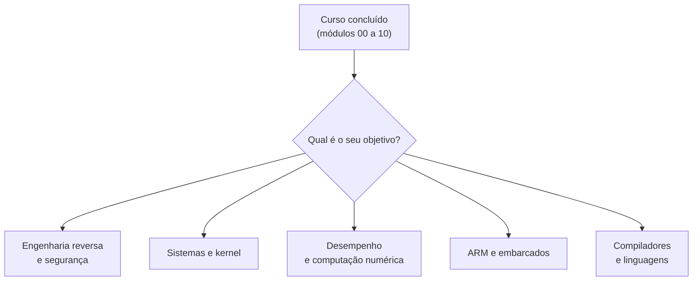

# 11 - Recursos e Referências

> [!abstract] Resumo
> Fechamento do curso: **onde aprofundar** (livros, manuais oficiais, sites e ferramentas), as **notas de consulta rápida** do vault ([[Cheat Sheet de Instruções]], [[Cheat Sheet de Calling Conventions]], [[Cheat Sheet de GDB]], [[Glossário#Assembly (x86-64 e ARM)]]) e um **roadmap de continuidade** com trilhas por objetivo: engenharia reversa, sistemas, desempenho, ARM e segurança.

Voltar ao índice: [[Índice - Assembly]] · Módulo anterior: [[10 - Laboratórios e Projetos Práticos]]

Tags: #assembly #referencias #livros #roadmap

> [!note] Sobre esta lista
> Os livros e documentos abaixo são **obras reais e conhecidas**, citadas por título e autor/organização. **Não incluí links longos de memória** (podem mudar); para cada fonte dou o **nome do site ou o termo de busca** que a encontra. Edições novas surgem: confira a mais recente.

---

## 1. Notas de consulta rápida deste vault

| Nota | Para quê |
|------|----------|
| [[Cheat Sheet de Instruções]] | instruções x86-64 mais usadas, flags, condições de salto, syscalls |
| [[Cheat Sheet de Calling Conventions]] | System V, Microsoft x64, cdecl/stdcall/fastcall, AAPCS64/32 lado a lado |
| [[Cheat Sheet de GDB]] | comandos de depuração para Assembly |
| [[Glossário#Assembly (x86-64 e ARM)]] | termos do curso em ordem alfabética, com link para onde aparecem |

---

## 2. Livros

### 2.1 Para começar

| Livro | Autor(es) | Foco | Observação |
|-------|-----------|------|------------|
| *Programming from the Ground Up* | Jonathan Bartlett | x86 (32 bits) com sintaxe GAS, do zero | gratuito (licença livre); bom para a lógica, mas é 32 bits |
| *Assembly Language Step by Step* | Jeff Duntemann | NASM, Linux | didático, passo a passo (edição de 32 bits na maior parte) |
| *The Art of Assembly Language* | Randall Hyde | HLA e conceitos de máquina | a edição de 64 bits usa Assembly de alto nível próprio (HLA) |
| *Computer Organization and Design* | Patterson e Hennessy | arquitetura (MIPS/RISC-V/ARM) | explica o **pipeline** e a hierarquia de memória |

### 2.2 Intermediário a avançado

| Livro | Autor(es) | Foco |
|-------|-----------|------|
| *Computer Systems: A Programmer's Perspective* (CS:APP) | Bryant e O'Hallaron | **a melhor ponte** entre C, Assembly x86-64, linking, memória, cache e processos |
| *Modern X86 Assembly Language Programming* | Daniel Kusswurm | x64, SSE, AVX, AVX2, AVX-512 com MASM e C++ |
| *Hacker's Delight* | Henry S. Warren Jr. | truques de bits e aritmética (divisão por constante, popcount) |
| *Write Great Code* (vol. 1 e 2) | Randall Hyde | o que o compilador gera e como escrever código eficiente |

### 2.3 Engenharia reversa e segurança

| Livro | Autor(es) | Foco |
|-------|-----------|------|
| *Practical Binary Analysis* | Dennis Andriesse | ELF, desmontagem, instrumentação |
| *Reversing: Secrets of Reverse Engineering* | Eldad Eilam | fundamentos de engenharia reversa |
| *Practical Malware Analysis* | Sikorski e Honig | análise de binários Windows |
| *Hacking: The Art of Exploitation* | Jon Erickson | memória, pilha e exploração em Linux |

### 2.4 Desempenho e microarquitetura

| Recurso | Autor/Origem | Foco |
|---------|--------------|------|
| **Manuais de otimização** (*Optimizing software in C++*, *Optimizing subroutines in assembly language*, *Instruction tables*, *The microarchitecture of Intel, AMD and VIA CPUs*) | Agner Fog | os **melhores manuais** de microarquitetura; gratuitos (site: *agner.org/optimize*) |
| *Intel 64 and IA-32 Architectures Optimization Reference Manual* | Intel | otimização por geração de CPU |
| *Computer Architecture: A Quantitative Approach* | Hennessy e Patterson | análise quantitativa de desempenho |

### 2.5 ARM

| Livro / documento | Origem | Foco |
|-------------------|--------|------|
| *Arm Architecture Reference Manual for A-profile* (o "Arm ARM") | Arm | a referência definitiva de AArch64/AArch32 |
| *Procedure Call Standard for the Arm 64-bit Architecture* (AAPCS64) | Arm | a convenção de chamada |
| *Programming with 64-Bit ARM Assembly Language* | Stephen Smith | AArch64 prático |

---

## 3. Manuais e especificações oficiais

| Documento | O que contém | Como achar |
|-----------|--------------|------------|
| **Intel SDM** (*Intel 64 and IA-32 Architectures Software Developer's Manual*) | **a** referência de instruções x86-64, volumes 1 a 4 | buscar "Intel SDM" no site da Intel |
| **AMD APM** (*AMD64 Architecture Programmer's Manual*) | idem para AMD | buscar "AMD64 APM" |
| **System V AMD64 ABI** | convenção de chamada, layout, TLS | buscar "x86-64 psABI" |
| **Microsoft x64 calling convention** | convenção do Windows, *shadow space*, SEH | documentação da Microsoft ("x64 calling convention") |
| **Documentação do NASM** | sintaxe, macros, diretivas | *nasm.us* |
| **Documentação do MASM** | ML64, diretivas | documentação da Microsoft ("MASM reference") |
| **Manual do GAS** (`as`) | sintaxe AT&T e Intel | documentação GNU binutils |
| **DWARF** | formato de informações de depuração | *dwarfstd.org* |
| **ELF** | formato de executáveis Linux | `man 5 elf` |
| **Linux man-pages** | `man 2 syscalls`, `man 2 write`, `errno` | `man` ou *man7.org* |

> [!tip] Como ler o Intel SDM sem se perder
> Vá direto ao **Volume 2** (referência de conjunto de instruções, A-Z). Cada instrução tem: **opcode e formas**, **operação em pseudocódigo**, **flags afetadas** e **exceções**. O site **felixcloutier.com/x86** reúne esse conteúdo de forma navegável.

---

## 4. Ferramentas e sites úteis

| Ferramenta | Uso |
|------------|-----|
| **Compiler Explorer** (*godbolt.org*) | ver o Assembly que GCC/Clang/MSVC geram, com cores e comparação |
| **uops.info** | latência, vazão e portas de cada instrução, **por microarquitetura** |
| **felixcloutier.com/x86** | referência de instruções x86 (versão navegável do SDM) |
| **Agner Fog** | tabelas de instruções e manuais de otimização |
| **NASM** / **GAS** / **MASM** | montadores |
| **GDB** (+ GEF, pwndbg, peda) | depuração, com extensões para Assembly |
| **strace / ltrace** | syscalls e chamadas a bibliotecas |
| **objdump -d -M intel**, **readelf**, **nm** | inspeção de binários |
| **Ghidra**, **radare2/Cutter**, **IDA Free**, **Binary Ninja** | desmontadores e descompiladores |
| **valgrind** (cachegrind, memcheck) | cache e erros de memória |
| **perf** (Linux), **VTune**, **μProf** | contadores de hardware e perfil |
| **llvm-mca** | simulação do pipeline para prever ciclos |
| **qemu-user** | executar binários ARM/AArch64/RISC-V no x86 |
| **Windows**: x64dbg, WinDbg, Visual Studio | depuração no Windows |

---

## 5. Roadmap de continuidade

### 5.1 Trilha: engenharia reversa e segurança

1. Revise [[04 - Procedimentos, Stack e Calling Conventions]] e [[07 - Assembly Avançado (x86-x64)]] (PIC, GOT/PLT, SEH).
2. Pratique com **crackmes** simples e leia código de `-O0` e `-O2` no Compiler Explorer.
3. Aprenda **Ghidra** (descompilador) e **GDB com GEF/pwndbg**.
4. Estude **ELF/PE**, *packers* básicos, e o livro *Practical Binary Analysis*.
5. Avance para **exploração** (estouro de pilha, ROP) e **análise de malware**, **sempre em ambiente isolado** (VM sem rede) e dentro da lei.

### 5.2 Trilha: sistemas operacionais e kernel

1. Releia [[05 - Entrada-Saída e System Calls]] e o `entry/syscall` do kernel Linux.
2. Escreva um **bootloader** de 512 bytes (modo real → modo protegido → modo longo).
3. Implemente **interrupções**, **paginação** e um **escalonador simples** (*xv6* e *OSDev wiki* são excelentes guias).
4. Leia o **Volume 3 do Intel SDM** (programação de sistemas).

### 5.3 Trilha: desempenho e computação numérica

1. Domine o [[09 - Otimização, SIMD e Performance]]: *harness*, `llvm-mca`, `perf`.
2. Estude os **manuais de Agner Fog** e o `uops.info`.
3. Implemente **kernels** clássicos: GEMM por blocos, FFT, convolução, *hashing*, CRC, *base64* SIMD.
4. Aprenda **intrínsecos** (`<immintrin.h>`) e **AVX-512**; estude *simdjson* e *dav1d* como exemplos reais.
5. Pratique **dispatch** por `cpuid` e *multi-versioning*.

### 5.4 Trilha: ARM e embarcados

1. Refaça os [[Lab 03 - Manipulação de Strings e Arrays]] e [[Lab 06 - Ordenação]] em AArch64 ([[08 - ARM e AArch64]]) com `qemu-aarch64`.
2. Estude **NEON**, depois **SVE/SVE2**.
3. Experimente uma placa real (Raspberry Pi, microcontroladores Cortex-M) e o **modo Thumb**.
4. Leia o **Arm ARM** e o **AAPCS64**.
5. Em seguida, **RISC-V**: um conjunto de instruções aberto e simples, muito usado no ensino.

### 5.5 Trilha: compiladores e linguagens

1. Escreva um **gerador de código** para uma linguagem pequena que emita NASM.
2. Implemente **alocação de registradores** (varredura linear) e **seleção de instruções**.
3. Estude **LLVM IR** e como ele é traduzido para x86-64 e AArch64.
4. Construa um **interpretador** com *threaded dispatch* e depois um **JIT** simples.

### 5.6 Linha do tempo sugerida

| Período | Foco | Entregável |
|---------|------|------------|
| Mês 1 | refazer os Labs 01 a 05 **sem consultar** a solução | rotinas `print_u64`, `atoi`, `strlen`, E/S de arquivos |
| Mês 2 | Labs 06 a 08 + medir tudo | `hexdump`, *sort* otimizado, relatório de desempenho |
| Mês 3 | **um projeto próprio** da trilha escolhida | repositório público com testes e README |
| Contínuo | ler Assembly de código real (libc, kernel, codecs) | anotações no vault |

> [!success] Regra de ouro para continuar
> **Leia mais Assembly do que escreve.** Abra o `objdump -d` de programas reais, compare `-O0` com `-O2`, e pergunte-se sempre: *o que o processador faz aqui?* Esse hábito vale mais do que qualquer livro.

---

## 6. Comunidades e prática

| Recurso | Para quê |
|---------|----------|
| **OSDev Wiki** | desenvolvimento de sistemas operacionais |
| **Stack Overflow** (tags `assembly`, `x86-64`, `nasm`) | dúvidas pontuais (as respostas sobre microarquitetura de Peter Cordes são excelentes) |
| **Reddit** (r/asm, r/ReverseEngineering) | discussão e notícias |
| **CTFs** (picoCTF, pwnable.kr, crackmes.one) | prática de engenharia reversa e exploração |
| **Advent of Code** | resolver problemas em Assembly como desafio |
| **Projetos de código aberto** (glibc, dav1d, openssl, simdjson) | ler Assembly e intrínsecos reais |

---

## 7. Resumo do curso

> [!abstract] O que você aprendeu
> | Módulo | Essência |
> |--------|----------|
> | [[01 - Fundamentos de Arquitetura e Assembly]] | como o processador executa instruções |
> | [[02 - Registradores e Memória]] | registradores, endereçamento, *endianness* |
> | [[03 - Instruções Básicas e Controle de Fluxo]] | aritmética, flags, saltos, laços |
> | [[04 - Procedimentos, Stack e Calling Conventions]] | pilha, ABI, funções |
> | [[05 - Entrada-Saída e System Calls]] | falar com o sistema operacional |
> | [[06 - Estruturas de Dados e Arrays]] | arrays, structs, listas, cache |
> | [[07 - Assembly Avançado (x86-x64)]] | SSE/AVX, PIC, SEH, `cpuid` |
> | [[08 - ARM e AArch64]] | RISC, *load/store*, outra ISA |
> | [[09 - Otimização, SIMD e Performance]] | medir, pipeline, cache, quando vale a pena |
> | [[10 - Laboratórios e Projetos Práticos]] | 8 labs e um projeto final |

**Voltar ao índice:** [[Índice - Assembly]] · **Ver também:** [[Glossário#Assembly (x86-64 e ARM)]] · [[Cheat Sheet de Instruções]] · [[Cheat Sheet de Calling Conventions]] · [[Cheat Sheet de GDB]]
