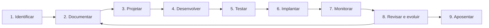

# Ciclo de Vida da Automação

## Objetivo
Conhecer as fases pelas quais uma automação de segurança passa, do levantamento à desativação, tratando-a como produto de software. Mapa: [[MOC - Fundamentos - Automação]].

## Conceito
Automações de segurança são código com privilégios elevados. Por isso precisam de ciclo de vida formal, e não de scripts soltos no servidor de alguém.

1. **Identificar:** localizar tarefas repetitivas por meio de tickets, tempo gasto e métricas ([[Métricas - MTTD, MTTR, Falso Positivo e ROI]]).
2. **Documentar:** escrever o procedimento manual como [[Runbooks|runbook]]. Sem isso, não há o que automatizar.
3. **Projetar:** definir gatilhos, entradas, saídas, privilégios mínimos, pontos de aprovação e plano de [[Rollback]].
4. **Desenvolver:** codificar em repositório versionado, com revisão por pares.
5. **Testar:** testes unitários, execução em ambiente de homologação e modo simulação (dry-run). Para detecções, veja [[Testes de Detecção]].
6. **Implantar:** promoção gradual, primeiro apenas notificando, depois agindo.
7. **Monitorar:** acompanhar falhas, latência, falsos positivos e mudanças em APIs integradas.
8. **Revisar:** reavaliar periodicamente se o gatilho e as exceções continuam válidos.
9. **Aposentar:** remover automações obsoletas e revogar suas credenciais ([[Gestão de Segredos]]).

## Exemplo prático
> [!example] Bloqueio de IP malicioso
> O runbook manual vira um playbook: gatilho por alerta do [[SIEM]], enriquecimento do IP, verificação em lista de exceções, bloqueio com TTL de 24h e registro. Fase de teste em dry-run por duas semanas, medindo quantos bloqueios seriam indevidos, antes de ativar de verdade. Veja [[Lab - Bloqueio Automatizado]].

## Boas práticas
- Versione tudo em Git e exija revisão antes de promover ([[Infrastructure as Code]], [[Detection as Code]]).
- Use conta de serviço com privilégio mínimo e segredos em cofre.
- Implemente idempotência: reexecutar não pode causar efeito duplicado.
- Todo gatilho precisa de limite de taxa para evitar tempestade de ações.
- Atribua um dono responsável a cada automação.

## Erros comuns
- Pular a documentação e automatizar de memória.
- Implantar direto em produção sem dry-run.
- Esquecer de monitorar a própria automação: ela falha em silêncio quando uma API muda.
- Nunca aposentar fluxos antigos, acumulando dívida técnica e credenciais órfãs.

> [!warning] Credenciais órfãs
> Contas de serviço de automações abandonadas são alvos atraentes. Inclua a revogação no passo de aposentadoria.

## Para revisar
> [!question] Perguntas
> 1. Por que documentar o runbook antes de codificar?
> 2. O que significa idempotência e por que importa?
> 3. Qual a função do dry-run?
> 4. O que fazer ao aposentar uma automação?
> 5. Por que monitorar a própria automação?

## Links relacionados
[[Por que Automatizar Segurança]], [[Níveis de Maturidade da Automação]], [[Governança da Automação]], [[Segurança em Pipelines CI-CD]].
