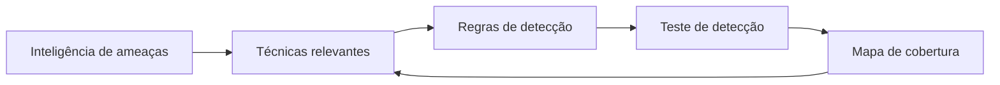

# Framework MITRE ATT&CK

## Objetivo
Usar o ATT&CK como linguagem comum para mapear detecções, medir cobertura e priorizar automações defensivas. Mapa: [[MOC - Fundamentos - Automação]].

## Conceito
O MITRE ATT&CK é uma base de conhecimento de táticas, técnicas e procedimentos (TTPs) observados em ataques reais. Organiza-se em **táticas** (o objetivo do adversário, como Acesso Inicial, Execução, Persistência, Escalada de Privilégios, Evasão de Defesa, Acesso a Credenciais, Descoberta, Movimentação Lateral, Coleta, Comando e Controle, Exfiltração e Impacto), **técnicas** e **subtécnicas** (por exemplo, T1566 Phishing e T1566.001 Spearphishing Attachment).

Para a defesa, o valor está em três usos:

1. **Mapeamento de cobertura:** associar cada regra de detecção a técnicas e visualizar lacunas (a camada do ATT&CK Navigator).
2. **Priorização:** focar nas técnicas mais usadas por adversários relevantes ao seu setor.
3. **Linguagem comum:** enriquecer alertas e casos com identificadores de técnica, o que facilita triagem e relatórios.



## Exemplo prático
> [!example] Marcação de regra
> Uma regra [[Regras Sigma - Automação|Sigma]] recebe tags de técnica, e o pipeline publica a cobertura automaticamente.

```yaml
title: Execução suspeita de PowerShell codificado
status: experimental
tags:
  - attack.execution
  - attack.t1059.001
logsource:
  product: windows
  category: process_creation
```

O pipeline de [[Detection as Code]] lê as tags, gera a camada do Navigator e destaca técnicas sem regra associada.

## Boas práticas
- Mapeie detecções em nível de subtécnica quando possível.
- Valide cobertura com [[Testes de Detecção]] e [[Emulação de Adversário para Validação Defensiva]], e não apenas com a existência da regra.
- Atualize o mapeamento a cada release do ATT&CK.
- Enriquecimento de alertas com técnica ajuda a [[Triagem Automática de Alertas]].

## Erros comuns
- Perseguir 100% de cobertura: é irreal e ignora a priorização por risco.
- Contar uma regra como cobertura sem verificar se ela dispara de fato.
- Confundir técnica com ferramenta; um mesmo malware usa várias técnicas.
- Esquecer as fontes de log necessárias: sem telemetria não há detecção.

> [!warning] Escopo defensivo
> Este vault usa o ATT&CK somente para detecção e resposta. Não descreve execução de técnicas ofensivas.

## Para revisar
> [!question] Perguntas
> 1. Qual a diferença entre tática, técnica e subtécnica?
> 2. Como o ATT&CK apoia a medição de cobertura?
> 3. Por que a existência de uma regra não garante cobertura?
> 4. Como marcar uma regra Sigma com uma técnica?

## Links relacionados
[[Framework NIST CSF]], [[Framework CIS Controls]], [[Threat Hunting Automatizado]], [[Feeds de Inteligência de Ameaças]].
