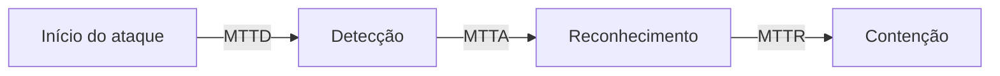

# Métricas - MTTD, MTTR, Falso Positivo e ROI

## Objetivo
Definir, calcular e interpretar as métricas que comprovam o valor da automação e orientam a melhoria contínua. Mapa: [[MOC - Fundamentos - Automação]].

## Conceito
**MTTD (Mean Time To Detect):** tempo médio entre o início do evento malicioso e sua detecção. Mede a qualidade da cobertura e da [[Detection as Code|engenharia de detecção]].

**MTTA (Mean Time To Acknowledge):** tempo até um analista ou fluxo assumir o alerta. A [[Triagem Automática de Alertas|triagem automática]] o reduz drasticamente.

**MTTR (Mean Time To Respond/Recover):** tempo entre a detecção e a contenção ou recuperação. Defina qual das duas variantes sua equipe usa e mantenha o padrão.

**Taxa de falso positivo (FPR):** proporção de alertas que não representam ameaça real. Fórmula: `FP / (FP + TP)` entre alertas fechados. Alta taxa gera fadiga.

**ROI:** retorno sobre o investimento, calculado como `(benefício - custo) / custo`. O benefício costuma ser horas economizadas multiplicadas pelo custo-hora, somado ao risco evitado.

```python
def roi_automacao(horas_salvas_mes, custo_hora, custo_mensal_total):
    beneficio = horas_salvas_mes * custo_hora
    return (beneficio - custo_mensal_total) / custo_mensal_total

# 120 h/mês economizadas, R$ 90/h, custo mensal de R$ 6.000
print(f"ROI: {roi_automacao(120, 90, 6000):.0%}")  # ROI: 80%
```



## Exemplo prático
> [!example] Antes e depois
> Antes: MTTA de 40 minutos, MTTR de 6 horas, FPR de 70%. Depois da automação de enriquecimento e contenção reversível: MTTA de 2 minutos, MTTR de 45 minutos, FPR de 35% após ajuste das regras. O ganho de 120 horas mensais alimenta o cálculo de ROI acima.

## Boas práticas
- Estabeleça uma linha de base antes de automatizar; sem ela não há comparação.
- Prefira mediana e percentis (P90) além da média, pois outliers distorcem.
- Acompanhe também a taxa de falso negativo, estimada com [[Testes de Detecção]].
- Registre tempos automaticamente no sistema de [[Gestão de Casos]].
- Apresente métricas por severidade e por tipo de incidente.

## Erros comuns
- Otimizar MTTR fechando casos sem investigar.
- Comemorar queda de alertas que, na verdade, é perda de cobertura.
- Calcular ROI ignorando custo de manutenção das integrações.
- Misturar definições de MTTR entre equipes.

> [!warning] Lei de Goodhart
> Quando uma métrica vira meta, deixa de ser boa métrica. Combine indicadores para evitar distorções.

## Para revisar
> [!question] Perguntas
> 1. Qual a diferença entre MTTD e MTTR?
> 2. Como se calcula a taxa de falso positivo?
> 3. Por que usar mediana além da média?
> 4. Quais custos entram no cálculo do ROI?
> 5. Como a queda de alertas pode ser enganosa?

## Links relacionados
[[Por que Automatizar Segurança]], [[Níveis de Maturidade da Automação]], [[Framework NIST CSF]], [[Lab - Relatórios Automáticos]].
