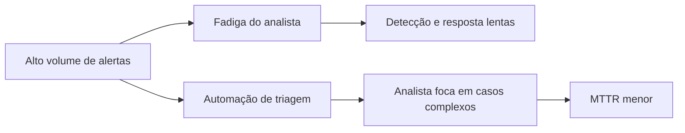

# Por que Automatizar Segurança

## Objetivo
Entender os motivos técnicos e de negócio que levam equipes de segurança a automatizar tarefas, e reconhecer os limites dessa decisão. Mapa: [[MOC - Fundamentos - Automação]].

## Conceito
Automatizar segurança é transformar procedimentos repetíveis, definidos e verificáveis em fluxos executados por software, com mínima intervenção humana. Os principais vetores de motivação são quatro.

**Volume e velocidade.** Um [[SIEM]] médio gera milhares de alertas por dia. Sem automação, analistas gastam a maior parte do tempo em triagem manual, o que produz fadiga de alerta e aumenta a chance de perder um sinal verdadeiro.

**Escassez de profissionais.** Há déficit global de pessoal qualificado. Automatizar tarefas de baixo valor libera analistas para investigação, caça a ameaças e engenharia de detecção.

**Consistência.** Humanos variam conforme cansaço e experiência. Um fluxo codificado executa sempre os mesmos passos, na mesma ordem, e registra tudo, o que melhora a auditoria.

**Redução do tempo de exposição.** Atacantes operam em minutos. Reduzir o [[Métricas - MTTD, MTTR, Falso Positivo e ROI|MTTR]] por meio de contenção automática limita o raio de impacto.

## Exemplo prático
> [!example] Triagem de phishing
> Um usuário reporta um e-mail suspeito. Um fluxo extrai URLs e anexos, consulta reputação via API, verifica se outros destinatários receberam a mesma mensagem e abre um caso já enriquecido. O analista recebe a decisão pronta para aprovar, em vez de gastar 20 minutos coletando dados. Veja [[Playbook de Phishing]].

## Boas práticas
- Comece por tarefas de alto volume e baixo risco, como enriquecimento de IOCs ([[Enriquecimento de IOCs]]).
- Meça o antes e o depois com métricas objetivas.
- Documente cada automação como código versionado ([[Infrastructure as Code]]).
- Mantenha humanos no circuito para decisões de alto impacto ([[Human in the Loop - Automação]]).

## Erros comuns
- Automatizar um processo mal definido: o erro apenas acontece mais rápido.
- Ignorar custo de manutenção de integrações que quebram com mudanças de API.
- Contenção automática sem rollback ([[Rollback]]).
- Esperar que a automação substitua o analista, em vez de ampliar sua capacidade.

> [!warning] Automação amplifica
> Uma regra ruim automatizada bloqueia usuários legítimos em escala. Valide em modo observação antes de ativar ações destrutivas.

## Para revisar
> [!question] Perguntas
> 1. Quais são os quatro principais motivadores para automatizar segurança?
> 2. Por que automatizar um processo mal definido é arriscado?
> 3. Como a automação reduz o tempo de exposição a um ataque?
> 4. Que tipo de tarefa é um bom ponto de partida?

## Links relacionados
[[O que Automatizar e o que Não Automatizar]], [[Ciclo de Vida da Automação]], [[Níveis de Maturidade da Automação]], [[SOAR]], [[Triagem Automática de Alertas]].
