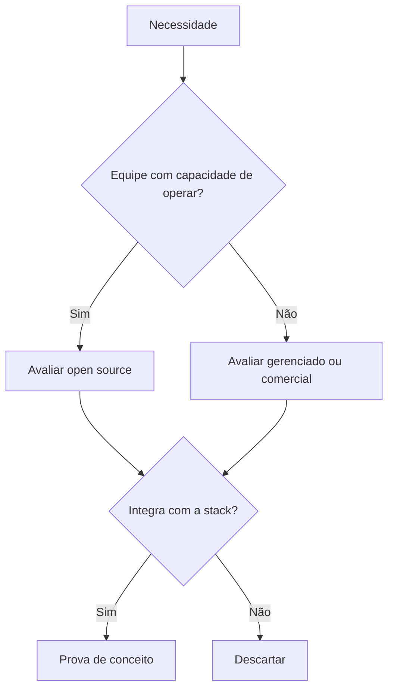

# Comparativo de Ferramentas - Automação

## Objetivo
Comparar categorias de ferramentas de segurança, open source e comerciais, e aplicar critérios objetivos de escolha. Mapa: [[MOC - Arquitetura e Ferramentas]].

## Conceito
Não existe ferramenta universalmente melhor; a escolha depende de equipe, orçamento, maturidade ([[Níveis de Maturidade da Automação]]) e requisitos de conformidade. A tabela mostra exemplos representativos por categoria (a lista não é exaustiva e o mercado muda; confirme em fontes atuais).

| Categoria | Open source (exemplos) | Comerciais (exemplos) |
|---|---|---|
| [[SIEM]] | Wazuh, Security Onion, Elastic (parte) | Splunk, Microsoft Sentinel, IBM QRadar |
| [[SOAR]] | Shuffle, StackStorm, n8n (uso geral) | Palo Alto XSOAR, Splunk SOAR, Sentinel (playbooks) |
| [[EDR e XDR]] | Wazuh, osquery, Velociraptor | CrowdStrike, SentinelOne, Microsoft Defender |
| [[CSPM]] | Prowler, ScoutSuite, Cloud Custodian | Wiz, Prisma Cloud, Defender for Cloud |
| Gestão de casos | TheHive (histórico), DFIR-IRIS | ServiceNow, Jira Service Management |
| Inteligência de ameaças | [[MISP - Automação]], OpenCTI | Recorded Future, Mandiant |
| Vulnerabilidades | OpenVAS, Trivy | Tenable, Qualys, Rapid7 |

**Critérios de decisão:**

1. **Integrações e API:** cobertura e qualidade da API determinam o potencial de automação ([[Orquestração via APIs]]).
2. **Custo total:** licença, infraestrutura, pessoas e manutenção. Open source não é gratuito em esforço.
3. **Esforço operacional:** equipe pequena tende a ganhar com soluções gerenciadas.
4. **Lock-in:** capacidade de exportar regras, playbooks e dados em formatos abertos ([[Regras Sigma - Automação]], [[STIX e TAXII]]).
5. **Conformidade e residência de dados:** requisitos legais ([[Aspectos Legais e LGPD]]).
6. **Comunidade e suporte:** atividade do projeto ou SLA contratual.

## Exemplo prático
> [!example] Matriz ponderada
> Atribua pesos aos critérios (integração 30%, custo 25%, operação 20%, lock-in 15%, suporte 10%), pontue cada candidato de 1 a 5 e some. Faça uma prova de conceito de duas semanas com um caso de uso real, como o [[Playbook de Phishing]], antes de decidir.

## Boas práticas
- Defina requisitos antes de ver demonstrações.
- Teste a API na prova de conceito, não apenas a interface.
- Prefira padrões abertos para reduzir dependência.
- Documente a decisão e revise anualmente.
- Combine ferramentas: a stack mista é comum.

## Erros comuns
- Escolher pelo marketing ou pela moda.
- Subestimar o custo de operar open source.
- Ignorar o custo de ingestão de dados em soluções por volume.
- Comprar suíte sem processos prontos.

> [!warning] Informação datada
> Nomes de produtos, licenciamento e posição de mercado mudam com frequência. Verifique a situação atual antes de decidir.

## Para revisar
> [!question] Perguntas
> 1. Quais critérios pesam mais para viabilizar automação?
> 2. Por que open source não é sinônimo de custo zero?
> 3. Como reduzir lock-in?
> 4. Para que serve uma prova de conceito?

## Links relacionados
[[Infrastructure as Code]], [[Gestão de Segredos]], [[Webhooks, Filas e Integrações]], [[Governança da Automação]].
