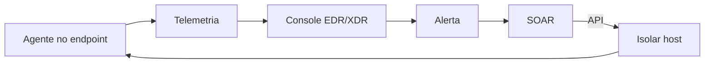

# EDR e XDR

## Objetivo
Entender como EDR e XDR fornecem telemetria e ações de resposta, e como automatizar seu uso com segurança. Mapa: [[MOC - Arquitetura e Ferramentas]].

## Conceito
**EDR (Endpoint Detection and Response)** instala um agente no endpoint para coletar telemetria detalhada (processos, conexões, arquivos, registro) e permitir resposta remota: isolar o host, encerrar processo, coletar artefatos e colocar arquivo em quarentena. **XDR (Extended Detection and Response)** amplia a correlação para e-mail, identidade, rede e nuvem, oferecendo uma visão unificada de incidentes.

Do ponto de vista da automação, o EDR é duplamente importante: fonte de alertas e **atuador** de contenção.

Ações típicas expostas por API:

| Ação | Impacto | Reversível |
|---|---|---|
| Consultar host e processos | Nenhum | Sim |
| Coletar artefatos forenses | Baixo | Sim |
| Quarentenar arquivo | Médio | Sim |
| Isolar host da rede | Alto | Sim, com liberação |
| Encerrar processo | Médio | Não |



O XDR reduz a fragmentação, mas introduz dependência de um único fornecedor. Muitas equipes combinam EDR com [[SIEM]] para reter logs de longo prazo e correlacionar com fontes externas ao ecossistema.

## Exemplo prático
> [!example] Isolamento condicionado
> Detectado comportamento compatível com ransomware, o fluxo consulta a criticidade do ativo no [[Inventário de Ativos]]. Se for estação comum, isola automaticamente; se for servidor crítico, solicita aprovação. Todas as ações vão ao caso. Veja [[Playbook de Malware]].

```python
def decidir_isolamento(host, score):
    if host["criticidade"] == "alta":
        return "solicitar_aprovacao"
    if score >= 90:
        return "isolar_automaticamente"
    return "apenas_notificar"
```

## Boas práticas
- Teste as ações de resposta em grupo piloto antes de ampliar.
- Mantenha lista de exclusão (servidores críticos, controladores de domínio).
- Garanta que o isolamento preserve o canal de gerenciamento do agente.
- Audite quem e o que dispara ações no EDR ([[Trilha de Auditoria]]).
- Verifique cobertura: hosts sem agente são pontos cegos.

## Erros comuns
- Isolamento automático de servidor de produção por falso positivo.
- Credencial de API do EDR com privilégio excessivo.
- Confiar apenas na detecção do agente, sem correlação em outras camadas.
- Esquecer o processo de liberação após o isolamento ([[Rollback]]).

> [!warning] Privilégio da API
> A API do EDR é capaz de interromper a operação inteira. Proteja o token no cofre ([[Gestão de Segredos]]) e limite o escopo.

## Para revisar
> [!question] Perguntas
> 1. Qual a diferença entre EDR e XDR?
> 2. Quais ações de resposta o EDR costuma oferecer?
> 3. Por que condicionar o isolamento à criticidade do ativo?
> 4. Que risco existe ao concentrar tudo em um único fornecedor XDR?

## Links relacionados
[[SIEM]], [[SOAR]], [[Contenção Automatizada]], [[Comparativo de Ferramentas - Automação]], [[Human in the Loop - Automação]].
