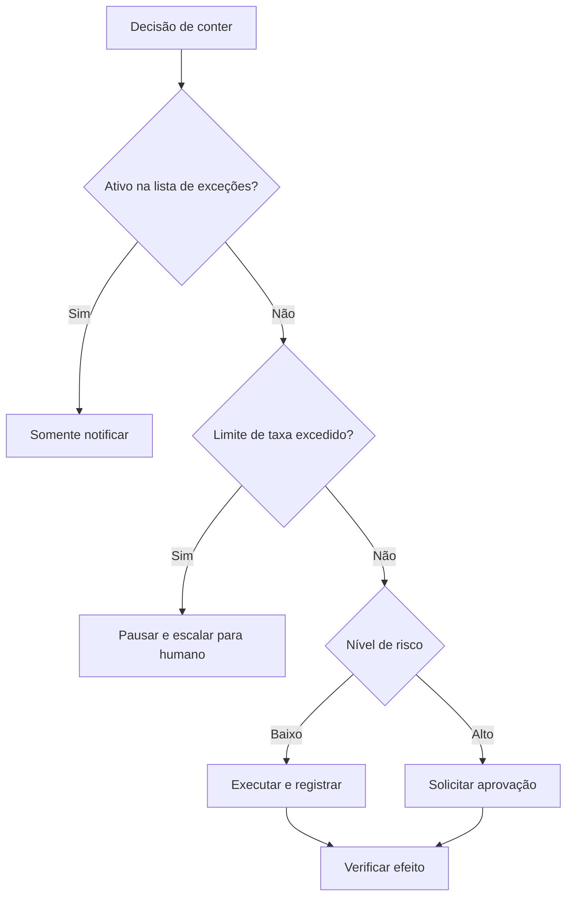

# Contenção Automatizada

## Objetivo
Projetar ações de contenção automáticas que limitem o dano sem causar interrupções indevidas, com salvaguardas e reversibilidade. Mapa: [[MOC - SOC e Resposta a Incidentes]].

## Conceito
Contenção é limitar a propagação e o impacto de um incidente: isolar host, bloquear IP ou domínio, revogar sessão, suspender conta, restringir regra de acesso. Automatizá-la reduz o MTTR ([[Métricas - MTTD, MTTR, Falso Positivo e ROI]]), mas o custo de um falso positivo é real. Por isso a contenção segue o princípio da **proporcionalidade**: ações mais drásticas exigem mais confiança e mais aprovação.

**Escada de ações:**

| Nível | Exemplo | Reversível | Automatizar? |
|---|---|---|---|
| 1 | Notificar, marcar alerta | Sim | Sempre |
| 2 | Bloquear indicador com TTL, revogar sessão | Sim | Com alta confiança |
| 3 | Isolar endpoint comum, quarentena de arquivo | Sim | Com confiança e exceções |
| 4 | Desativar conta privilegiada, isolar servidor crítico | Parcial | Com aprovação |
| 5 | Desligar sistema, apagar dados | Não | Somente manual |

**Salvaguardas obrigatórias:**

- **Lista de exceções:** ativos e contas que nunca sofrem ação automática (controladores de domínio, contas quebra-vidro).
- **Limite de taxa:** teto de ações por intervalo, evitando bloqueio em massa por regra defeituosa.
- **TTL:** bloqueios expiram, exigindo renovação explícita.
- **Idempotência e verificação:** confirmar que a ação surtiu efeito.
- **Botão de pausa global ("kill switch")** para suspender todas as ações automáticas.



## Exemplo prático
> [!example] Disjuntor de taxa
> Se o fluxo tentar bloquear mais de 20 IPs em 10 minutos, é sinal de regra defeituosa ou ataque em massa. O fluxo pausa a automação e escala.

```python
from collections import deque
import time

class LimiteDeTaxa:
    def __init__(self, maximo=20, janela=600):
        self.maximo, self.janela, self.eventos = maximo, janela, deque()

    def permitir(self) -> bool:
        agora = time.time()
        while self.eventos and agora - self.eventos[0] > self.janela:
            self.eventos.popleft()
        if len(self.eventos) >= self.maximo:
            return False
        self.eventos.append(agora)
        return True
```

## Boas práticas
- Prefira ações reversíveis e documente o desfazer de cada uma ([[Rollback]]).
- Teste em dry-run e promova gradualmente ([[Ciclo de Vida da Automação]]).
- Registre quem, o quê, quando e por quê ([[Trilha de Auditoria]]).
- Revise bloqueios e exceções periodicamente.
- Notifique donos dos ativos afetados.

## Erros comuns
- Ausência de lista de exceções, bloqueando serviços essenciais.
- Bloqueios permanentes sem revisão.
- Contenção baseada em um único sinal fraco.
- Sem kill switch para emergências.

> [!warning] Efeito dominó
> Uma regra defeituosa com ação automática pode derrubar a organização mais rápido que um atacante. Use limites e pausa global.

## Para revisar
> [!question] Perguntas
> 1. O que significa proporcionalidade na contenção?
> 2. Para que serve o limite de taxa?
> 3. Por que usar TTL em bloqueios?
> 4. Que ações jamais devem ser totalmente automáticas?
> 5. O que é um kill switch?

## Links relacionados
[[SOAR]], [[Playbook de Malware]], [[Playbook de Conta Comprometida]], [[Lab - Bloqueio Automatizado]], [[Governança da Automação]].
