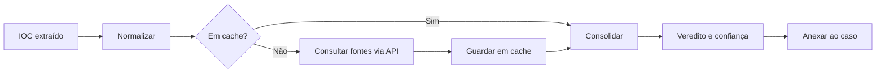

# Enriquecimento de IOCs

## Objetivo
Adicionar contexto de reputação, origem e relações a indicadores de comprometimento (IOCs) de forma automática, rápida e rastreável. Mapa: [[MOC - SOC e Resposta a Incidentes]].

## Conceito
IOCs são artefatos observáveis associados a atividade maliciosa: endereços IP, domínios, URLs, hashes de arquivo e endereços de e-mail. Um indicador isolado diz pouco; o **enriquecimento** consulta fontes para responder: já foi visto em campanhas? Qual a reputação? Quando surgiu o domínio? A quais famílias está associado?

Fontes típicas:

- Serviços de reputação e análise de arquivos e URLs, via API.
- Plataformas de inteligência internas ([[MISP - Automação]], OpenCTI) e [[Feeds de Inteligência de Ameaças]].
- Dados passivos: DNS, WHOIS e certificados.
- Contexto interno: quais hosts e usuários contataram o indicador ([[SIEM]]).

Aspectos de projeto:

- **Cache:** evita consultas repetidas e respeita limites de cota.
- **Normalização:** defang/refang de URLs, minúsculas em domínios e hashes.
- **Consolidação:** unir respostas de várias fontes em um veredito único com confiança.
- **Validade:** IOCs envelhecem; endereços de nuvem compartilhada mudam de dono.
- **Privacidade:** não envie dados internos sensíveis a serviços externos públicos.



## Exemplo prático
> [!example] Consolidação de veredito
> Três fontes avaliam um domínio: duas como malicioso e uma como desconhecido. O fluxo calcula confiança proporcional e registra as evidências.

```python
def veredito(respostas: list[dict]) -> dict:
    mal = sum(1 for r in respostas if r["status"] == "malicioso")
    total = len(respostas)
    conf = mal / total if total else 0
    rotulo = "malicioso" if conf >= 0.6 else "suspeito" if conf > 0 else "sem_evidencia"
    return {"rotulo": rotulo, "confianca": round(conf, 2), "fontes": total}
```

Veja a implementação completa em [[Lab - Enriquecimento de IOCs]].

## Boas práticas
- Registre a fonte e o horário de cada consulta para auditoria.
- Trate "sem evidência" como diferente de "benigno".
- Limite taxa e use chaves em cofre ([[Gestão de Segredos]]).
- Valide o formato do indicador antes de consultar, evitando injeção em consultas.
- Reavalie indicadores antigos periodicamente.

## Erros comuns
- Tratar a pontuação de uma única fonte como verdade.
- Enviar URLs internas ou com tokens a serviços públicos.
- Bloquear indicador de infraestrutura compartilhada (CDN, DNS público) por reputação momentânea.
- Sem cache, estourando cotas de API.

> [!warning] Vazamento por consulta
> Consultar um serviço público com dado interno pode expor informação sensível. Avalie o que sai do perímetro ([[Aspectos Legais e LGPD]]).

## Para revisar
> [!question] Perguntas
> 1. Quais tipos de IOC são comuns?
> 2. Por que usar cache nas consultas?
> 3. "Sem evidência" equivale a "benigno"?
> 4. Que riscos de privacidade existem ao consultar fontes públicas?
> 5. Como consolidar vereditos divergentes?

## Links relacionados
[[Orquestração via APIs]], [[STIX e TAXII]], [[Playbook de Phishing]], [[Playbook de Malware]], [[SOAR]].
