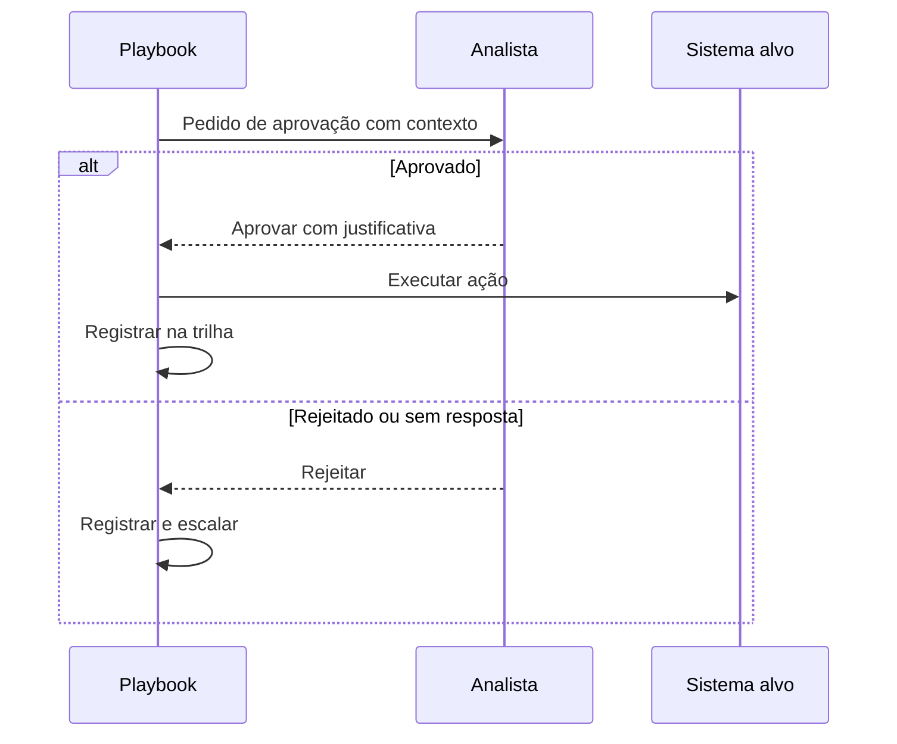

# Human in the Loop - Automação

## Objetivo
Definir onde, quando e como inserir decisão humana em fluxos automatizados, equilibrando velocidade e controle. Mapa: [[MOC - SOC e Resposta a Incidentes]].

## Conceito
**Human-in-the-loop (HITL)** significa que o fluxo pausa em pontos definidos e aguarda confirmação de uma pessoa antes de agir. Variantes relacionadas:

- **Human-in-the-loop:** o humano aprova cada ação crítica.
- **Human-on-the-loop:** a automação age e o humano supervisiona, podendo intervir ou reverter.
- **Human-out-of-the-loop:** totalmente automático, reservado a ações de baixo risco e reversíveis.

A escolha depende de **impacto**, **confiança** e **reversibilidade** ([[Contenção Automatizada]]). Um bom desenho de aprovação evita dois extremos: aprovar tudo (gargalo) e aprovar nada (risco).

**Elementos de um pedido de aprovação bem feito:**

1. **Contexto resumido:** o que aconteceu e por que o fluxo recomenda a ação.
2. **Evidências:** dados de enriquecimento e escore, com explicação.
3. **Ação proposta e impacto:** o que será afetado, em quantos ativos.
4. **Opções:** aprovar, rejeitar, modificar ou escalar.
5. **Prazo e padrão:** o que ocorre se ninguém responder (normalmente, não agir ou escalar).
6. **Registro:** quem aprovou, quando e com qual justificativa ([[Trilha de Auditoria]]).



## Exemplo prático
> [!example] Aprovação com expiração
> Um pedido para isolar um servidor expira em 15 minutos. Sem resposta, o fluxo escala ao plantonista em vez de agir sozinho.

```python
def aguardar_aprovacao(pedido, timeout_min=15):
    resposta = pedido.esperar(timeout=timeout_min * 60)
    if resposta is None:
        escalar_para_plantao(pedido)
        return "escalado"
    registrar_decisao(pedido, resposta.usuario, resposta.justificativa)
    return "aprovado" if resposta.aprovou else "rejeitado"
```

## Boas práticas
- Aprovadores devem ter autoridade e treinamento, e ser distintos de quem escreveu a automação ([[Segregação de Funções]]).
- Mostre evidências, não apenas um botão.
- Meça tempo de aprovação e taxa de rejeição para calibrar.
- Mova ações com histórico de acerto para níveis menos restritivos, de forma controlada.
- Previna "fadiga de aprovação": poucas aprovações, bem escolhidas.

## Erros comuns
- Pedidos sem contexto, aprovados no automático.
- Sem timeout, deixando o incidente parado.
- Aprovação por canais inseguros ou sem registro.
- Ação padrão perigosa quando não há resposta.

> [!warning] Aprovação cega
> Se quase tudo é aprovado em segundos, o controle é só aparente. Revise o desenho do pedido.

## Para revisar
> [!question] Perguntas
> 1. Diferencie in-the-loop, on-the-loop e out-of-the-loop.
> 2. O que deve constar em um pedido de aprovação?
> 3. Qual deve ser o padrão se ninguém responder?
> 4. O que é fadiga de aprovação?

## Links relacionados
[[Playbook de Conta Comprometida]], [[Playbook de Exfiltração de Dados]], [[Runbooks]], [[IA e LLMs na Automação de Segurança]].
