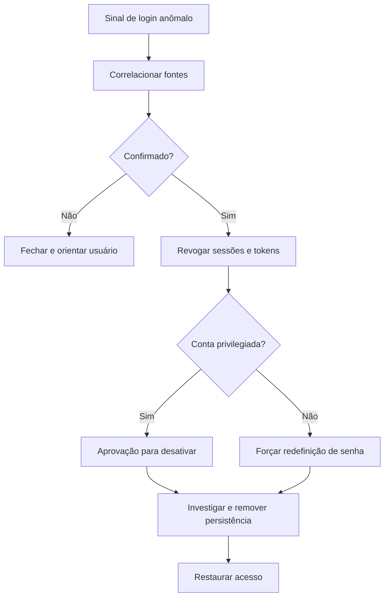

# Playbook de Conta Comprometida

## Objetivo
Detectar e conter o uso indevido de credenciais, com revogação de acesso rápida e proporcional ao privilégio da conta. Mapa: [[MOC - SOC e Resposta a Incidentes]].

## Conceito
Uma conta comprometida permite ao adversário agir como usuário legítimo, o que dificulta a detecção. Os sinais incluem login de local ou dispositivo incomum, "viagem impossível", falhas em sequência seguidas de sucesso, criação de regras de encaminhamento de e-mail, registro de novo fator de autenticação e acesso a recursos fora do padrão.

**Etapas:**

1. **Confirmar:** comparar com o comportamento habitual do usuário e correlacionar fontes (identidade, e-mail, VPN).
2. **Classificar o privilégio:** conta comum, privilegiada ou de serviço. Determina o grau de automação permitido.
3. **Conter:** revogar sessões e tokens ativos, exigir nova autenticação, redefinir senha e rever fatores MFA.
4. **Investigar:** linha do tempo de atividades, regras de e-mail, aplicativos autorizados, acessos a dados.
5. **Erradicar:** remover persistência (regras, aplicativos, chaves) e redefinir credenciais associadas.
6. **Recuperar e comunicar:** restaurar acesso com validação do usuário e notificar partes interessadas.



Contas de serviço seguem tratamento especial: a revogação deve ser coordenada com os sistemas dependentes e acompanhada de rotação ([[Lab - Rotação de Credenciais]]), pois a interrupção pode afetar a produção.

## Exemplo prático
> [!example] Contenção graduada
> Login simultâneo do Brasil e de outro continente em 5 minutos. O fluxo revoga as sessões (reversível) imediatamente e envia notificação ao usuário. Como a conta é de um gestor financeiro, solicita aprovação do analista antes de desativá-la.

```python
def conter_conta(conta, aprovado=False):
    revogar_sessoes(conta["id"])          # reversível, automático
    if conta["privilegiada"] and not aprovado:
        return "aguardando_aprovacao"
    forcar_redefinicao_senha(conta["id"])
    return "contida"
```

## Boas práticas
- Revogue tokens de atualização e sessões, não apenas a senha.
- Verifique persistência: regras de caixa, aplicativos autorizados e novos fatores.
- Exija MFA resistente a phishing para contas privilegiadas.
- Mantenha lista de contas "quebra-vidro" fora de ações automáticas, com monitoramento próprio.
- Registre tudo na [[Trilha de Auditoria]].

## Erros comuns
- Redefinir a senha e manter sessões ativas.
- Desativar conta de serviço crítica sem coordenação.
- Esquecer a persistência, permitindo retorno do adversário.
- Comunicação tardia ao usuário e ao gestor.

> [!warning] Conta de serviço
> Desativar uma conta de serviço pode derrubar processos de negócio. Exija aprovação e plano de reversão ([[Rollback]]).

## Para revisar
> [!question] Perguntas
> 1. Quais sinais indicam comprometimento de conta?
> 2. Por que revogar tokens além da senha?
> 3. Como tratar contas privilegiadas e de serviço?
> 4. Que persistências verificar em e-mail e identidade?

## Links relacionados
[[Playbook de Phishing]], [[Runbooks]], [[SOAR]], [[Framework MITRE ATT&CK]].
