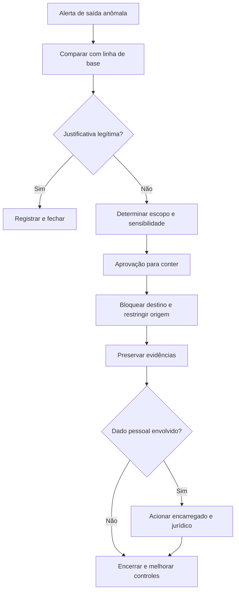

# Playbook de Exfiltração de Dados

## Objetivo
Detectar e conter a saída indevida de dados, avaliar o impacto e acionar as obrigações de comunicação. Mapa: [[MOC - SOC e Resposta a Incidentes]].

## Conceito
Exfiltração é a transferência não autorizada de dados para fora da organização (tática de mesmo nome no [[Framework MITRE ATT&CK]]). Pode ocorrer por serviços de nuvem pessoais, e-mail, transferência de arquivos, túneis em protocolos comuns ou dispositivos removíveis, por atacante externo ou por ameaça interna.

**Indicadores de detecção (conceituais):**

- Volume de saída muito acima da linha de base do usuário ou do host.
- Acesso massivo a repositórios ou bases em curto período.
- Conexões para destinos raros ou recém-criados.
- Compactação ou criptografia de grandes conjuntos antes da saída.
- Uso fora do horário habitual.
- Alertas de ferramentas de prevenção de perda de dados (DLP).

**Etapas do playbook:**

1. **Validar:** comparar com a linha de base e checar justificativa de negócio (migração, backup autorizado).
2. **Determinar o escopo:** quais dados, de quem, quantos registros, qual sensibilidade ([[Inventário de Ativos]], classificação).
3. **Conter:** bloquear o destino, restringir a conta ou o host de origem, suspender o compartilhamento externo.
4. **Preservar evidências:** logs de rede, de acesso e de DLP.
5. **Avaliar impacto legal:** se houver dado pessoal, acionar o encarregado e o jurídico ([[Aspectos Legais e LGPD]]).
6. **Erradicar e recuperar:** fechar a via de saída, rotacionar credenciais e reforçar controles.



## Exemplo prático
> [!example] Contenção com aprovação
> Um servidor de arquivos envia 40 GB a um destino nunca visto. O fluxo bloqueia o destino no firewall com TTL (baixo risco), mas solicita aprovação para suspender a conta que originou a transferência, por ser de um gestor de projeto.

```yaml
playbook: exfiltration_response
auto_actions:
  - block_destination(ttl=24h)
approval_required:
  - disable_account
  - isolate_host
legal_notify_if: contains_personal_data
```

## Boas práticas
- Defina linhas de base por usuário, função e ativo.
- Combine fontes: rede, nuvem, DLP e endpoint.
- Envolva jurídico e privacidade desde o início, pois há prazos legais.
- Preserve evidências com integridade ([[Gestão de Casos]]).
- Restrinja o acesso ao caso, que pode conter dados sensíveis.

## Erros comuns
- Bloquear destinos legítimos (backup, nuvem corporativa) por falta de lista de permissões.
- Atuar só no ponto de saída e não na origem do acesso.
- Atrasar a comunicação legal.
- Reutilizar credenciais comprometidas sem rotação ([[Gestão de Segredos]]).

> [!warning] Dados sensíveis no caso
> O próprio caso pode conter amostras de dados. Aplique controle de acesso e minimização.

## Para revisar
> [!question] Perguntas
> 1. Quais indicadores sugerem exfiltração?
> 2. Por que a linha de base é essencial?
> 3. Quando acionar o jurídico e o encarregado?
> 4. Que ações exigem aprovação humana?

## Links relacionados
[[Playbook de Malware]], [[Playbook de Conta Comprometida]], [[SIEM]], [[Runbooks]], [[Trilha de Auditoria]].
