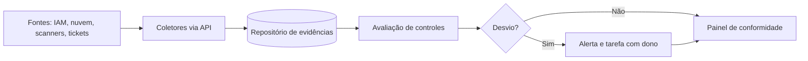

# Auditoria Contínua

## Objetivo
Substituir a coleta manual e pontual de evidências por monitoramento automático dos controles, com painéis e alertas de desvio. Mapa: [[MOC - Vulnerabilidades e Compliance]].

## Conceito
A **auditoria contínua** testa controles de forma recorrente ou em tempo quase real, em vez de uma vez por ano. O princípio é transformar a auditoria em fluxo de dados: coletar, avaliar, registrar, alertar e relatar.

**Componentes:**

- **Coleta automática de evidências:** configurações, logs de acesso, resultados de varredura, aprovações de mudanças e registros de treinamento, obtidos via API.
- **Avaliação de controles:** regras de [[Compliance as Code]] aplicadas sobre as evidências.
- **Detecção de desvio:** alerta quando um controle sai da conformidade (por exemplo, MFA desativado em conta privilegiada).
- **Repositório de evidências:** armazenamento com integridade, retenção e carimbo de tempo.
- **Painel e relatórios:** visão por controle, por framework e por responsável.
- **Fluxo de tratamento:** cada desvio gera tarefa, dono, prazo e acompanhamento ([[Gestão de Casos]]).

**Tipos de controle monitorados:** acesso (revisão de privilégios, contas órfãs), mudança (alterações sem aprovação), configuração (desvios de baseline), vulnerabilidades (SLA de correção), backup (restaurações testadas) e logs (fontes ativas).



## Exemplo prático
> [!example] Revisão automática de contas órfãs
> Semanalmente, o fluxo compara a lista de contas ativas com a base de recursos humanos. Contas de pessoas desligadas ainda ativas geram tarefa urgente e evidência do desvio.

```python
def contas_orfas(contas_ativas, colaboradores_ativos):
    ativos = {c["email"] for c in colaboradores_ativos}
    return [c for c in contas_ativas if c["email"] not in ativos]
```

## Boas práticas
- Comece pelos controles de maior risco e fácil coleta (acesso, MFA, logs, criptografia).
- Garanta que a coleta seja independente de quem é auditado ([[Segregação de Funções]]).
- Preserve evidências com integridade e retenção definidas.
- Defina limiares e responsáveis por desvio, evitando alertas sem dono.
- Reporte tendência, não apenas fotografias pontuais.

## Erros comuns
- Painel verde por falha na coleta: falta de dado interpretada como conformidade.
- Evidência que pode ser alterada por quem é auditado.
- Controles demais sem priorização.
- Desvios sem prazo de tratamento.

> [!warning] Ausência de dado
> Trate "sem evidência" como desvio, nunca como conformidade.

## Para revisar
> [!question] Perguntas
> 1. O que diferencia auditoria contínua da anual?
> 2. Por que a coleta deve ser independente do auditado?
> 3. Como a falta de dados pode gerar falsa conformidade?
> 4. Dê exemplos de controles fáceis de monitorar.

## Links relacionados
[[Hardening com CIS Benchmarks]], [[Varredura Contínua de Vulnerabilidades]], [[Aspectos Legais e LGPD]], [[Framework NIST CSF]].
