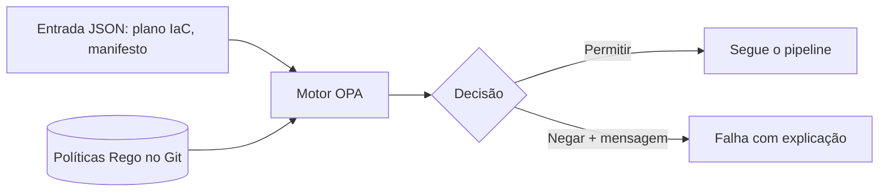

# Políticas como Código com OPA

## Objetivo
Escrever e aplicar políticas de segurança como código, avaliadas automaticamente em pipelines, clusters e APIs. Mapa: [[MOC - DevSecOps]].

## Conceito
O **Open Policy Agent (OPA)** é um motor de políticas de uso geral. Ele separa a **decisão** ("isto é permitido?") da **aplicação** ("bloquear"). As políticas são escritas em **Rego**, uma linguagem declarativa, e avaliam uma entrada em JSON, retornando permitir, negar ou mensagens de violação.

**Onde aplicar:**

- **Pipeline de IaC:** avaliar o plano do Terraform e reprovar recursos inseguros antes da criação ([[Infrastructure as Code]]).
- **Admissão no Kubernetes:** impedir implantação de contêineres privilegiados ou de imagens não assinadas (via Gatekeeper ou Kyverno, este com linguagem própria).
- **Autorização de APIs e serviços.**
- **Conformidade contínua:** reavaliar o estado real ([[Compliance as Code]]).

**Vantagens:** políticas versionadas, testáveis, revisáveis e reaproveitáveis; decisão consistente em vários pontos; mensagens de erro claras para o desenvolvedor.



## Exemplo prático
> [!example] Proibir contêiner privilegiado
> Política Rego que nega pods com `privileged: true`, com teste unitário.

```rego
package k8s.seguranca

negar[msg] {
  input.kind == "Pod"
  container := input.spec.containers[_]
  container.securityContext.privileged == true
  msg := sprintf("contêiner %s não pode ser privilegiado", [container.name])
}

negar[msg] {
  input.kind == "Pod"
  container := input.spec.containers[_]
  not container.securityContext.runAsNonRoot
  msg := sprintf("contêiner %s deve executar como usuário não root", [container.name])
}
```

```bash
# Avaliar um manifesto e testar as políticas
opa eval --data politicas/ --input pod.json "data.k8s.seguranca.negar"
opa test politicas/ -v
```

## Boas práticas
- Comece em modo auditoria (avisa sem bloquear) e passe a bloquear aos poucos.
- Escreva testes para casos permitidos e negados.
- Mensagens devem dizer o que está errado e como corrigir.
- Gerencie exceções por dados (listas com validade), não alterando a política.
- Versione e promova políticas como código, com revisão ([[Ciclo de Vida da Automação]]).
- Alinhe políticas a controles do [[Framework CIS Controls]].

## Erros comuns
- Ativar bloqueio de imediato e quebrar equipes.
- Políticas sem testes, que falham silenciosamente.
- Mensagens genéricas que frustram desenvolvedores.
- Exceções permanentes e não rastreadas.

> [!warning] Fail-open versus fail-closed
> Decida conscientemente o que ocorre se o motor de políticas estiver indisponível. Em controles críticos, prefira negar, com plano para contingência.

## Para revisar
> [!question] Perguntas
> 1. Qual a vantagem de separar decisão e aplicação?
> 2. Em que pontos do ciclo o OPA pode atuar?
> 3. Por que começar em modo auditoria?
> 4. O que é fail-closed?

## Links relacionados
[[Scan de Containers]], [[CSPM]], [[Shift Left]], [[Governança da Automação]].
