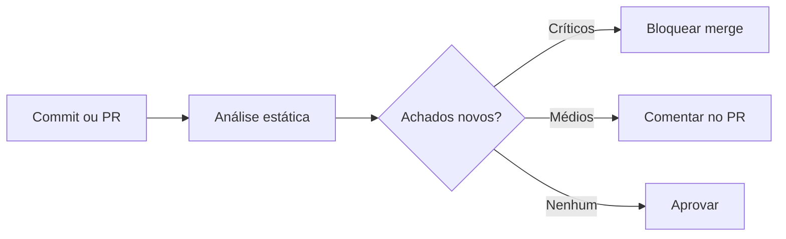

# SAST

## Objetivo
Integrar análise estática de código ao fluxo de desenvolvimento, obtendo feedback rápido e com baixo ruído. Mapa: [[MOC - DevSecOps]].

## Conceito
O **SAST** (Static Application Security Testing) analisa o código-fonte, bytecode ou binários **sem executá-los**, procurando padrões associados a falhas: injeção, uso inseguro de criptografia, desserialização insegura, tratamento incorreto de entradas, segredos embutidos. Por atuar cedo, é a base do [[Shift Left]].

**Técnicas usadas:**

- **Correspondência de padrões:** regras sintáticas simples (rápidas, mais ruidosas).
- **Análise de fluxo de dados (taint analysis):** rastreia dados não confiáveis (fontes) até operações perigosas (sorvedouros), com ou sem sanitização.
- **Análise semântica:** entende tipos e chamadas entre arquivos.

**Pontos fortes:** feedback imediato ao desenvolvedor, indica arquivo e linha, cobre código ainda não implantado. **Limites:** não enxerga problemas de configuração em tempo de execução nem de lógica de negócio (para isso, [[DAST]]), e gera falsos positivos.



## Exemplo prático
> [!example] SAST no pull request
> O pipeline analisa apenas o código alterado e falha só para achados novos de alta severidade, evitando travar o time por dívida antiga.

```yaml
name: sast
on: [pull_request]
jobs:
  analise:
    runs-on: ubuntu-latest
    steps:
      - uses: actions/checkout@v4
      - name: Executar analisador estático
        run: |
          semgrep scan --config auto --severity ERROR --error \
            --baseline-commit origin/main .
```

O `--baseline-commit` limita o resultado ao que mudou. Ajuste a ferramenta e regras ao seu stack.

## Boas práticas
- Comece em modo informativo e endureça aos poucos.
- Trate achados antigos como backlog priorizado, e achados novos como bloqueio.
- Escreva regras próprias para padrões específicos da organização.
- Registre supressões com justificativa e revisão.
- Meça tempo de correção e taxa de falsos positivos ([[Métricas - MTTD, MTTR, Falso Positivo e ROI]]).

## Erros comuns
- Ativar todas as regras de uma vez e gerar milhares de alertas.
- Bloquear o pipeline por severidade baixa.
- Ignorar achados sem triagem, por fadiga.
- Tratar SAST como suficiente e dispensar testes dinâmicos e revisão.

> [!tip] Foco no delta
> Analisar o que mudou mantém o feedback rápido e o desenvolvedor engajado.

## Para revisar
> [!question] Perguntas
> 1. O que é taint analysis?
> 2. Que tipos de falha o SAST não detecta bem?
> 3. Por que analisar apenas o delta no PR?
> 4. Como lidar com falsos positivos de forma sustentável?

## Links relacionados
[[SCA]], [[Secret Scanning]], [[Políticas como Código com OPA]], [[Framework NIST CSF]].
