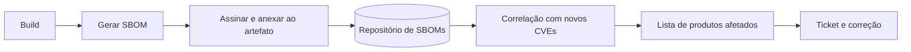

# SBOM

## Objetivo
Gerar, armazenar e usar listas de materiais de software para responder rapidamente "onde estamos afetados?" quando surge uma nova vulnerabilidade. Mapa: [[MOC - DevSecOps]].

## Conceito
O **SBOM** (Software Bill of Materials) é um inventário formal e legível por máquina dos componentes de um software: pacotes, versões, fornecedores, licenças, hashes e relações de dependência. É o "rótulo de ingredientes" da aplicação.

**Formatos principais:**

- **CycloneDX** (OWASP): foco em segurança, suporta VEX.
- **SPDX** (Linux Foundation): foco em licenças e conformidade, padrão ISO.

**Para que serve:**

1. **Resposta rápida a vulnerabilidades:** ao divulgar uma falha em uma biblioteca, consulta-se os SBOMs para listar produtos afetados sem nova varredura.
2. **Transparência da cadeia de suprimentos:** clientes e reguladores podem exigir o SBOM.
3. **Gestão de licenças.**
4. **Base para o [[SCA]] e o [[Scan de Containers]].**

**VEX (Vulnerability Exploitability eXchange):** complementa o SBOM indicando se determinada vulnerabilidade **afeta de fato** o produto (por exemplo, "não afetado: função não utilizada"), reduzindo ruído.



## Exemplo prático
> [!example] Geração e consulta
> O pipeline gera o SBOM da imagem e o armazena junto do artefato. Depois, um job consulta todos os SBOMs buscando um pacote vulnerável.

```bash
# Gerar SBOM em CycloneDX para uma imagem (ferramenta de exemplo)
syft meu-registro/app:1.4.2 -o cyclonedx-json > sbom.cdx.json
# Consultar presença de um componente
jq -r '.components[] | select(.name=="log4j-core") | "\(.name) \(.version)"' sbom.cdx.json
```

```python
import json

def produtos_afetados(sboms: dict, pacote: str, versoes_ruins: set):
    achados = []
    for produto, caminho in sboms.items():
        comps = json.load(open(caminho)).get("components", [])
        if any(c["name"] == pacote and c["version"] in versoes_ruins for c in comps):
            achados.append(produto)
    return achados
```

## Boas práticas
- Gere o SBOM **a cada build**, a partir do artefato final.
- Assine e armazene com versionamento; ligue ao identificador do artefato.
- Inclua dependências transitivas e do sistema operacional da imagem.
- Mantenha um repositório consultável por API ([[Orquestração via APIs]]).
- Combine com VEX para filtrar achados não explorávveis.

## Erros comuns
- Gerar SBOM do código-fonte e não do artefato implantado.
- Gerar uma vez e nunca atualizar.
- Não relacionar o SBOM ao [[Inventário de Ativos]], sem saber onde cada versão roda.
- Tratar o SBOM como relatório de vulnerabilidades; ele é inventário.

> [!tip] Valor na crise
> O SBOM paga seu custo no dia em que uma biblioteca amplamente usada recebe uma falha crítica.

## Para revisar
> [!question] Perguntas
> 1. Quais são os dois principais formatos de SBOM?
> 2. Para que serve o VEX?
> 3. Por que gerar o SBOM do artefato final?
> 4. Como o SBOM acelera a resposta a uma nova vulnerabilidade?

## Links relacionados
[[Segurança em Pipelines CI-CD]], [[Priorização com CVSS, EPSS e KEV]], [[Compliance as Code]], [[Shift Left]].
