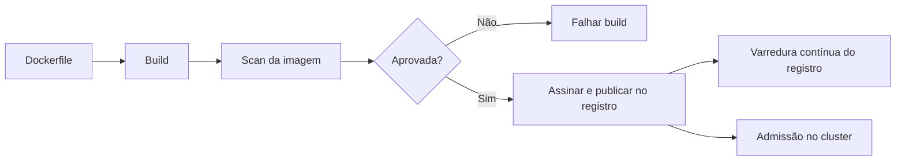

# Scan de Containers

## Objetivo
Verificar imagens de contêiner e sua configuração quanto a vulnerabilidades, segredos e más práticas, antes e depois da implantação. Mapa: [[MOC - DevSecOps]].

## Conceito
Uma imagem de contêiner empacota sistema operacional base, bibliotecas e aplicação. Cada camada pode trazer vulnerabilidades. O **scan de containers** analisa essas camadas e a configuração, em quatro frentes:

1. **Pacotes do sistema operacional:** versões vulneráveis de bibliotecas da imagem base.
2. **Dependências da aplicação:** semelhante ao [[SCA]], dentro da imagem.
3. **Segredos e arquivos sensíveis** copiados por engano ([[Secret Scanning]]).
4. **Configuração:** execução como root, portas desnecessárias, ausência de usuário não privilegiado, sistema de arquivos gravável.

**Boas decisões de construção reduzem o ruído:**

- Imagens base mínimas (distroless ou slim) têm menos pacotes e, portanto, menos falhas.
- Builds em múltiplos estágios deixam ferramentas de compilação fora da imagem final.
- Fixar a imagem base por digest garante reprodutibilidade.

**Em quais pontos varrer:** no build (CI), no registro de imagens (varredura contínua, pois novas falhas surgem depois) e no cluster em execução (admissão e inventário, veja [[Políticas como Código com OPA]]).



## Exemplo prático
> [!example] Scan com falha por severidade
> O pipeline bloqueia a publicação de imagens com vulnerabilidades críticas que possuem correção disponível.

```bash
# Varredura da imagem (ferramenta de exemplo)
trivy image --severity CRITICAL,HIGH --ignore-unfixed --exit-code 1 meu-registro/app:1.4.2
```

```dockerfile
FROM python:3.12-slim AS final
RUN useradd --system --no-create-home appuser
COPY --chown=appuser app/ /app/
USER appuser
CMD ["python", "/app/main.py"]
```

## Boas práticas
- Reconstrua imagens regularmente para absorver patches da base.
- Gere o [[SBOM]] junto da imagem e assine-a.
- Impeça implantação de imagens não verificadas por política de admissão.
- Use `--ignore-unfixed` para focar no que é acionável, registrando o restante.
- Limite privilégios em tempo de execução (usuário sem root, sistema de arquivos somente leitura).

## Erros comuns
- Varrer só no build, perdendo vulnerabilidades descobertas depois.
- Usar a tag `latest`, sem versão reproduzível.
- Executar contêineres como root por padrão.
- Imagens enormes com ferramentas desnecessárias.

> [!tip] Menos é mais
> Cada pacote removido da imagem é uma vulnerabilidade a menos para gerenciar.

## Para revisar
> [!question] Perguntas
> 1. Quais as quatro frentes do scan de containers?
> 2. Por que reduzir a imagem base ajuda?
> 3. Por que varrer também o registro?
> 4. Que riscos tem rodar como root?

## Links relacionados
[[Segurança em Pipelines CI-CD]], [[Hardening com CIS Benchmarks]], [[CSPM]], [[Shift Left]].
