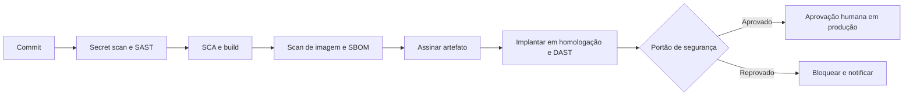

# Segurança em Pipelines CI/CD

## Objetivo
Proteger o próprio pipeline, que concentra privilégios e acesso a código e produção, e usá-lo como ponto de aplicação de controles. Mapa: [[MOC - DevSecOps]].

## Conceito
O pipeline tem duas faces: é onde se **aplicam** os testes de segurança ([[SAST]], [[SCA]], [[DAST]], [[Scan de Containers]]) e é também um **alvo valioso**, pois possui credenciais de implantação e poder de alterar o que roda em produção. Comprometer o pipeline equivale a comprometer o produto (cadeia de suprimentos).

**Proteções do pipeline:**

- **Menor privilégio:** cada job com permissões mínimas; tokens de curta duração e escopo por repositório.
- **Autenticação federada (OIDC):** o pipeline obtém credenciais temporárias do provedor de nuvem, sem segredos estáticos ([[Gestão de Segredos]]).
- **Proteção de ramos:** revisão obrigatória, checagens exigidas e proibição de push direto.
- **Fixar dependências de ações e imagens** por versão imutável (hash/digest), pois ações de terceiros executam código no seu pipeline.
- **Runners isolados e efêmeros:** evitam vazamento entre jobs.
- **Separação de funções:** quem escreve o código não aprova sozinho a implantação em produção ([[Segregação de Funções]]).
- **Integridade do artefato:** assinatura, proveniência e [[SBOM]].

**Portões de segurança (quality gates):** critérios objetivos para avançar (sem segredos, sem vulnerabilidade crítica com correção, políticas atendidas, [[Políticas como Código com OPA]]).



## Exemplo prático
> [!example] Permissões mínimas e ações fixadas
> Workflow com permissões somente leitura por padrão e ação de terceiros fixada por hash.

```yaml
name: ci-seguro
on: [pull_request]
permissions:
  contents: read
jobs:
  testes:
    runs-on: ubuntu-latest
    steps:
      - uses: actions/checkout@b4ffde65f46336ab88eb53be808477a3936bae11 # versão fixada por hash
      - name: Varredura de segredos
        run: gitleaks detect --source . --redact --exit-code 1
```

O hash acima é ilustrativo; use o hash real da versão que você auditou.

## Boas práticas
- Trate a configuração do pipeline como código, com revisão.
- Registre trilha de auditoria de execuções e implantações ([[Trilha de Auditoria]]).
- Evite expor segredos a PRs vindos de forks.
- Monitore alterações no pipeline e em suas permissões.
- Pratique recuperação: capacidade de reverter implantações ([[Rollback]]).

## Erros comuns
- Segredos estáticos de produção disponíveis a qualquer job.
- Usar ações ou imagens de terceiros por tag mutável.
- Pipeline com permissão de administrador.
- Portões de segurança que qualquer pessoa pode desativar.

> [!warning] Alvo da cadeia de suprimentos
> Um pipeline comprometido distribui código malicioso com a assinatura legítima da empresa. Proteja-o como infraestrutura crítica.

## Para revisar
> [!question] Perguntas
> 1. Por que o pipeline é um alvo valioso?
> 2. Qual a vantagem do OIDC sobre segredos estáticos?
> 3. Por que fixar ações de terceiros por hash?
> 4. O que é um portão de segurança?

## Links relacionados
[[Infrastructure as Code]], [[Secret Scanning]], [[Compliance as Code]], [[Governança da Automação]].
