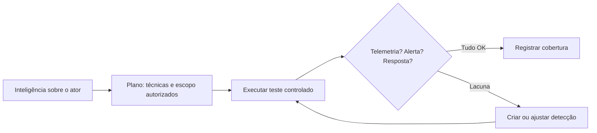

# Emulação de Adversário para Validação Defensiva

## Objetivo
Usar emulação controlada e autorizada de comportamentos de adversários para validar detecções e respostas, sempre com foco defensivo. Mapa: [[MOC - Threat Intel e Detecção]].

## Conceito
A **emulação de adversário** reproduz, de forma controlada, **comportamentos** (técnicas do [[Framework MITRE ATT&CK]]) descritos em inteligência sobre atores relevantes, para responder a uma pergunta defensiva: *nossas detecções e processos teriam enxergado isso?* Quando equipes ofensiva e defensiva trabalham juntas, fala-se em **purple team**: cada passo da emulação é seguido de verificação imediata se houve telemetria, alerta e resposta.

**Princípios:**

- **Autorização formal e escopo definido:** apenas em ativos próprios, com aprovação por escrito, janelas e contatos de emergência.
- **Segurança:** ações inofensivas (benignas), reversíveis e rastreáveis; sem carga destrutiva nem exposição de dados reais.
- **Foco no comportamento observável:** o objetivo é produzir a evidência (log, evento) que a detecção deve capturar, não obter acesso.
- **Medição:** para cada técnica, registrar se houve **telemetria**, **detecção** e **resposta**.
- **Ciclo de melhoria:** lacunas viram novas regras ([[Detection as Code]]) e novos testes ([[Testes de Detecção]]).

**Fontes de testes controlados:** bibliotecas públicas de testes atômicos mapeados ao ATT&CK, com cada teste descrito, com limpeza e pré-requisitos, e ferramentas de automação de emulação mantidas por comunidades e fornecedores. Avalie e revise cada teste antes de executar; este vault não reproduz técnicas ofensivas funcionais.



## Exemplo prático
> [!example] Matriz de resultado por técnica
> Após cada teste autorizado, a equipe registra o resultado em três colunas, e o painel mostra onde investir.

| Técnica | Telemetria | Alerta | Resposta | Ação |
|---|---|---|---|---|
| T1059.001 (interpretador de comandos) | Sim | Sim | Sim | Cobertura confirmada |
| T1003 (acesso a credenciais) | Sim | Não | N/A | Criar regra comportamental |
| T1021 (serviços remotos) | Não | Não | N/A | Habilitar coleta de log |

```python
def resumo_cobertura(resultados):
    total = len(resultados)
    detectados = sum(1 for r in resultados if r["alerta"])
    sem_telemetria = [r["tecnica"] for r in resultados if not r["telemetria"]]
    return {"detectadas_pct": round(100 * detectados / total, 1),
            "lacunas_de_telemetria": sem_telemetria}
```

## Boas práticas
- Comunique a janela ao SOC ou registre-a, para distinguir teste de ataque real, sem enfraquecer a medição.
- Execute em ambiente de teste primeiro e, depois, em produção com cuidado e reversão.
- Mantenha trilha de auditoria das ações executadas ([[Trilha de Auditoria]]).
- Priorize técnicas observadas contra seu setor ([[Feeds de Inteligência de Ameaças]]).
- Reexecute periodicamente para detectar regressões.

## Erros comuns
- Executar sem autorização ou fora do escopo.
- Medir apenas "alerta disparou", ignorando telemetria e resposta.
- Testes que deixam resíduos sem limpeza.
- Não converter lacunas em ações com dono e prazo.

> [!warning] Somente com autorização
> Emulação envolve executar comportamentos de ataque. Faça-a exclusivamente em ativos sob sua responsabilidade, com aprovação formal. Nunca em sistemas de terceiros.

## Para revisar
> [!question] Perguntas
> 1. O que diferencia emulação defensiva de um ataque real?
> 2. Que três perguntas se faz para cada técnica testada?
> 3. O que é purple team?
> 4. Por que a autorização e o escopo são indispensáveis?

## Links relacionados
[[Threat Hunting Automatizado]], [[Regras Sigma - Automação]], [[Métricas - MTTD, MTTR, Falso Positivo e ROI]], [[Governança da Automação]].
