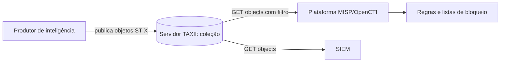

# STIX e TAXII

## Objetivo
Entender os padrões abertos para representar e transportar inteligência de ameaças, viabilizando compartilhamento e automação entre ferramentas. Mapa: [[MOC - Threat Intel e Detecção]].

## Conceito
**STIX (Structured Threat Information eXpression)** é a linguagem: define como descrever ameaças em JSON. **TAXII (Trusted Automated eXchange of Indicator Information)** é o transporte: protocolo sobre HTTPS para publicar e consumir esses objetos.

**Objetos principais do STIX 2.1:**

- **Domain Objects (SDO):** Indicator, Malware, Threat Actor, Campaign, Attack Pattern (técnicas do [[Framework MITRE ATT&CK]]), Vulnerability, Identity, Report, Course of Action.
- **Relationship Objects (SRO):** ligam objetos (por exemplo, um Indicator "indicates" um Malware; um Campaign "uses" um Attack Pattern) e Sighting (observações).
- **Cyber Observable Objects (SCO):** artefatos concretos, como endereço IP, domínio, arquivo.

**Padrão de indicador:** a propriedade `pattern` descreve o que observar, com a sintaxe de padrões STIX, por exemplo, `[domain-name:value = 'exemplo-malicioso.test']`.

**TAXII 2.1:** organiza o conteúdo em **servidores**, **API roots** e **coleções**. Clientes fazem requisições para listar coleções, obter objetos (com filtros por data e tipo) e, quando permitido, publicar.



## Exemplo prático
> [!example] Objeto Indicator e consumo
> Um indicador STIX e um consumidor que busca objetos novos de uma coleção TAXII. O domínio usa o TLD reservado `.test`, apenas ilustrativo.

```json
{
  "type": "indicator",
  "spec_version": "2.1",
  "id": "indicator--6f1a2c3e-0000-4000-8000-000000000001",
  "created": "2026-01-10T12:00:00.000Z",
  "modified": "2026-01-10T12:00:00.000Z",
  "name": "Domínio de C2 de exemplo",
  "pattern": "[domain-name:value = 'c2-exemplo.test']",
  "pattern_type": "stix",
  "valid_from": "2026-01-10T12:00:00Z",
  "valid_until": "2026-02-10T12:00:00Z",
  "confidence": 75
}
```

```python
from taxii2client.v21 import Collection

colecao = Collection("https://taxii.exemplo.local/api1/collections/ID/",
                     user="svc-ti", password=obter_segredo("TAXII_PASS"))
resposta = colecao.get_objects(added_after="2026-01-01T00:00:00Z", type=["indicator"])
for obj in resposta.get("objects", []):
    registrar(obj["id"], obj["pattern"], obj.get("valid_until"))
```

## Boas práticas
- Respeite `valid_until` e remova indicadores expirados.
- Use relacionamentos para dar contexto (ator, campanha, técnica), não apenas indicadores soltos.
- Valide os objetos recebidos contra o esquema antes de processá-los.
- Autentique-se com credenciais de serviço em cofre ([[Gestão de Segredos]]).
- Aplique marcações de sensibilidade (TLP) nos objetos compartilhados.

## Erros comuns
- Confundir STIX (formato) com TAXII (transporte).
- Consumir apenas indicadores e descartar relacionamentos e contexto.
- Não paginar nem filtrar por data, repetindo downloads completos.
- Importar sem validar, aceitando dados malformados.

> [!tip] Interoperabilidade
> Usar STIX/TAXII reduz a dependência de um fornecedor e facilita trocar de plataforma ([[Comparativo de Ferramentas - Automação]]).

## Para revisar
> [!question] Perguntas
> 1. Qual a diferença entre STIX e TAXII?
> 2. Cite três tipos de objeto de domínio do STIX.
> 3. Para que servem os objetos de relacionamento?
> 4. Como evitar baixar toda a coleção a cada consulta?

## Links relacionados
[[Enriquecimento de IOCs]], [[Detection as Code]], [[Regras Sigma - Automação]], [[Webhooks, Filas e Integrações]].
