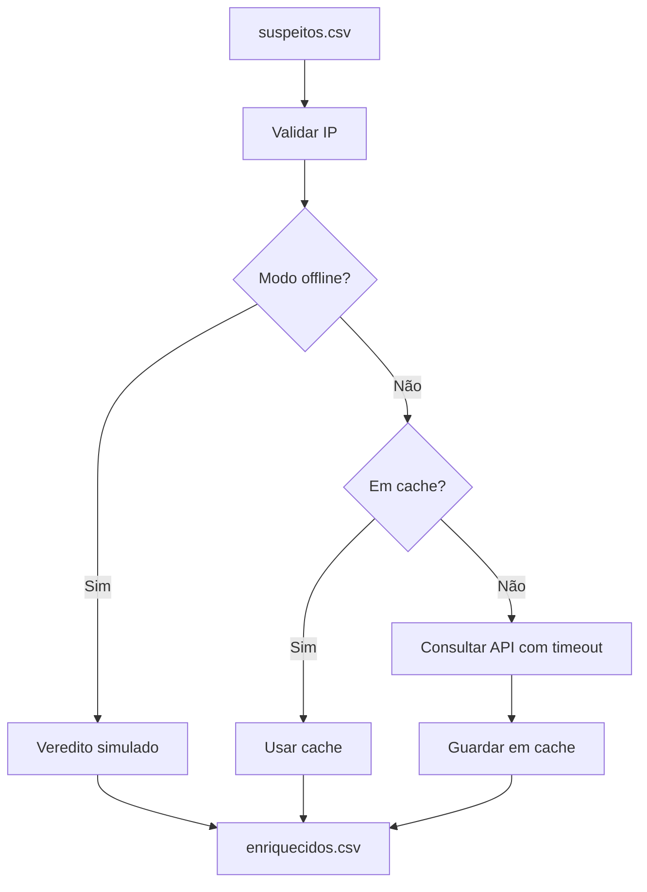

# Lab - Enriquecimento de IOCs

## Objetivo
Construir um enriquecedor de IPs com validação de entrada, cache, limite de taxa, segredo em variável de ambiente e modo offline para treino. Mapa: [[MOC - Laboratórios e Scripts]].

> [!warning] Escopo
> Defensivo. O endereço da API de inteligência é fictício (`ti.exemplo.local`); adapte-o ao serviço que você contratou ou hospeda ([[MISP - Automação]], por exemplo). Nunca envie dados internos sensíveis a serviços públicos.

## Conceito
O enriquecimento aplica os princípios de [[Orquestração via APIs]] e de [[Enriquecimento de IOCs]]: validar o indicador antes de consultar (evita injeção e desperdício), usar cache para economizar cota, respeitar o limite de taxa, ler o token do ambiente ([[Gestão de Segredos]]) e tratar erros sem interromper o lote. O **modo offline** simula veredito para que o laboratório funcione sem conta em nenhum serviço.



## Exemplo prático
Salve como `enriquecer_iocs.py`.

```python
#!/usr/bin/env python3
"""Enriquece IPs com reputação. Defensivo e somente leitura."""
import argparse, csv, ipaddress, json, os, time
from pathlib import Path

CACHE = Path("cache_ioc.json")
BASE = os.environ.get("TI_API_BASE", "https://ti.exemplo.local/api/v1")

def carregar_cache():
    try:
        return json.loads(CACHE.read_text(encoding="utf-8"))
    except (FileNotFoundError, json.JSONDecodeError):
        return {}

def consultar_api(ip):
    import requests  # instale com: pip install requests
    token = os.environ["TI_API_TOKEN"]  # nunca escreva o token no código
    r = requests.get(f"{BASE}/ip/{ip}",
                     headers={"Authorization": f"Bearer {token}"}, timeout=10)
    r.raise_for_status()
    dados = r.json()  # esperado: {"status": "...", "fonte": "..."}
    return {"status": dados.get("status", "desconhecido"),
            "fonte": dados.get("fonte", "api")}

def simular(tentativas):
    status = "malicioso" if tentativas >= 10 else "suspeito"
    return {"status": status, "fonte": "simulado"}

def main():
    ap = argparse.ArgumentParser()
    ap.add_argument("entrada")
    ap.add_argument("--saida", default="enriquecidos.csv")
    ap.add_argument("--offline", action="store_true")
    args = ap.parse_args()

    cache = {} if args.offline else carregar_cache()
    linhas_saida = []
    with open(args.entrada, newline="", encoding="utf-8") as f:
        for linha in csv.DictReader(f):
            try:
                ip = str(ipaddress.ip_address(linha["ip"].strip()))
            except ValueError:
                print(f"ignorado (IP inválido): {linha['ip']!r}")
                continue
            tentativas = int(linha.get("tentativas", 0))
            if args.offline:
                res = simular(tentativas)
            elif ip in cache:
                res = cache[ip]
            else:
                try:
                    res = consultar_api(ip)
                    cache[ip] = res
                    time.sleep(1)  # limite de taxa simples
                except Exception as erro:
                    print(f"falha ao consultar {ip}: {erro}")
                    res = {"status": "sem_evidencia", "fonte": "erro"}
            linhas_saida.append([ip, tentativas, res["status"], res["fonte"]])

    if not args.offline:
        CACHE.write_text(json.dumps(cache), encoding="utf-8")
    with open(args.saida, "w", newline="", encoding="utf-8") as f:
        w = csv.writer(f)
        w.writerow(["ip", "tentativas", "veredito", "fonte"])
        w.writerows(linhas_saida)
    print(f"{len(linhas_saida)} indicador(es) enriquecido(s) em {args.saida}")

if __name__ == "__main__":
    main()
```

Execução de treino: `python3 enriquecer_iocs.py suspeitos.csv --offline`. Em uso real: `export TI_API_TOKEN=...` (injetado pelo cofre) e execute sem `--offline`.

### Como interpretar o resultado
O arquivo `enriquecidos.csv` traz o veredito por IP e a fonte da informação. Trate `malicioso` como candidato a contenção com TTL, `suspeito` como item para revisão humana e `sem_evidencia` como ausência de dado, nunca como inocência. Em uso real, combine mais de uma fonte antes de agir e confira se o IP pertence a infraestrutura compartilhada.

## Boas práticas
- Em falha de consulta, registre `sem_evidencia`, que é diferente de benigno.
- Rotacione o token e use escopo mínimo.
- Armazene o horário da consulta para decidir quando reavaliar o cache.
- Consolide várias fontes antes de decidir bloqueios.
- Não registre tokens em logs nem em histórico do shell.

## Erros comuns
- Consultar IPs privados ou inválidos, desperdiçando cota.
- Cache sem validade, mantendo vereditos obsoletos.
- Tratar falha de rede como "limpo".
- Chave de API no código-fonte ([[Secret Scanning]]).

## Para revisar
> [!question] Perguntas
> 1. Por que validar o IP antes da consulta?
> 2. Para que serve o modo offline?
> 3. Que status usar quando a consulta falha, e por quê?
> 4. Como o cache economiza cota?

## Links relacionados
[[Lab - Parsing de Logs]], [[Lab - Bloqueio Automatizado]], [[Feeds de Inteligência de Ameaças]], [[Laboratório Guiado]].
