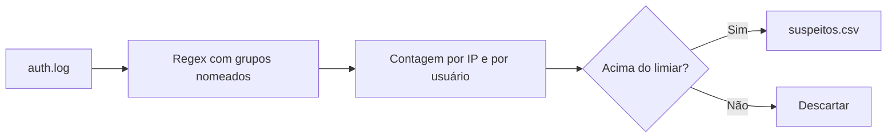

# Lab - Parsing de Logs

## Objetivo
Extrair eventos relevantes de logs de autenticação, contar ocorrências por origem e gerar uma lista de IPs suspeitos para as etapas seguintes. Mapa: [[MOC - Laboratórios e Scripts]].

> [!warning] Escopo
> Código somente de leitura, defensivo, para ser executado em logs do seu próprio ambiente ou em dados de exemplo. Os IPs de exemplo usam faixas reservadas para documentação.

## Conceito
Antes de qualquer correlação no [[SIEM]], é preciso transformar linhas de texto em dados estruturados. O parsing por expressão regular é a técnica mais simples: define-se um padrão com **grupos nomeados** (usuário, IP) e aplica-se a cada linha. Em seguida, agregam-se os resultados (contagem por IP) e aplica-se um limiar. É o mesmo princípio de uma regra de força bruta ([[Regras Sigma - Automação]]), porém executado localmente.

Cuidados: ler o arquivo com tratamento de codificação, ignorar linhas que não casam, validar o IP extraído e evitar carregar arquivos enormes inteiros na memória (iterar linha a linha).



## Exemplo prático
Salve como `parse_logs.py`.

```python
#!/usr/bin/env python3
"""Analisa auth.log em busca de falhas de SSH. Somente leitura."""
import argparse, csv, re
from collections import Counter

PADRAO = re.compile(
    r"Failed password for (?:invalid user )?(?P<usuario>\S+) "
    r"from (?P<ip>\d{1,3}(?:\.\d{1,3}){3}) port \d+")

def analisar(linhas):
    por_ip, por_usuario = Counter(), Counter()
    for linha in linhas:
        m = PADRAO.search(linha)
        if m:
            por_ip[m["ip"]] += 1
            por_usuario[m["usuario"]] += 1
    return por_ip, por_usuario

def main():
    ap = argparse.ArgumentParser()
    ap.add_argument("arquivo")
    ap.add_argument("--limite", type=int, default=5)
    ap.add_argument("--saida", default="suspeitos.csv")
    args = ap.parse_args()
    with open(args.arquivo, encoding="utf-8", errors="replace") as f:
        por_ip, por_usuario = analisar(f)
    suspeitos = [(ip, n) for ip, n in por_ip.most_common() if n >= args.limite]
    with open(args.saida, "w", newline="", encoding="utf-8") as f:
        escritor = csv.writer(f)
        escritor.writerow(["ip", "tentativas"])
        escritor.writerows(suspeitos)
    print(f"{len(suspeitos)} IP(s) acima do limite. "
          f"Usuários mais visados: {por_usuario.most_common(3)}")

if __name__ == "__main__":
    main()
```

Equivalente rápido em Bash, para inspeção manual:

```bash
grep "Failed password" auth.log \
  | grep -oE 'from [0-9]+\.[0-9]+\.[0-9]+\.[0-9]+' \
  | awk '{print $2}' | sort | uniq -c | sort -rn | head
```

Execução: `python3 parse_logs.py auth.log --limite 5`. O resultado esperado é um arquivo `suspeitos.csv` com as colunas `ip,tentativas`.

## Boas práticas
- Itere o arquivo linha a linha e use `errors="replace"` para não falhar com bytes inválidos.
- Teste a expressão regular com linhas reais e variações de formato.
- Trate o limiar como parâmetro e ajuste-o pela linha de base do ambiente.
- Não exponha usuários ou IPs em relatórios públicos ([[Aspectos Legais e LGPD]]).
- Registre o horário e o arquivo de origem da análise na [[Trilha de Auditoria]].

## Erros comuns
- Expressão regular frouxa demais, capturando campos errados.
- Considerar apenas falhas e ignorar um sucesso após muitas falhas (o sinal mais importante).
- Ler o arquivo inteiro na memória.
- Tratar o IP de um proxy ou NAT como a origem real.

## Para revisar
> [!question] Perguntas
> 1. Qual a vantagem de grupos nomeados na regex?
> 2. Por que iterar linha a linha em vez de ler tudo?
> 3. Que sinal adicional tornaria a detecção mais robusta?
> 4. Por que parametrizar o limiar?

## Links relacionados
[[Lab - Enriquecimento de IOCs]], [[Laboratório Guiado]], [[Triagem Automática de Alertas]], [[Testes de Detecção]].
