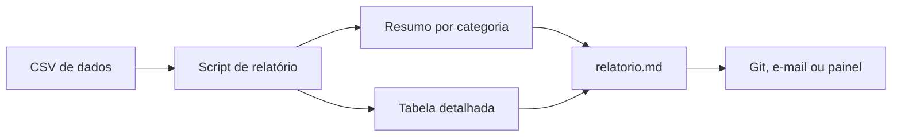

# Lab - Relatórios Automáticos

## Objetivo
Gerar relatórios Markdown reproduzíveis a partir de arquivos CSV (achados, incidentes, conformidade), prontos para versionar, publicar ou enviar. Mapa: [[MOC - Laboratórios e Scripts]].

## Conceito
Relatórios manuais consomem horas e divergem entre autores. Automatizá-los garante **consistência**, **frequência** e **rastreabilidade**: o mesmo script, aplicado a dados diferentes, produz o mesmo formato. É o canal de entrega de [[Métricas - MTTD, MTTR, Falso Positivo e ROI]], de [[Auditoria Contínua]] e de resumos executivos.

Um bom relatório automático tem: **título e data**, **resumo agregado** (contagem por categoria), **detalhe tabular**, **origem dos dados** e **versão do script**. O formato Markdown é leve, versionável no Git e convertível a PDF ou HTML. O script abaixo é genérico: agrupa por qualquer coluna do CSV.



## Exemplo prático
Salve como `relatorio.py`.

```python
#!/usr/bin/env python3
"""Gera relatório Markdown a partir de um CSV. Somente leitura dos dados."""
import argparse, csv
from collections import Counter
from datetime import date

def celula(valor):
    return str(valor).replace("|", "\\|").replace("\n", " ")

def main():
    ap = argparse.ArgumentParser()
    ap.add_argument("arquivo")
    ap.add_argument("--agrupar", required=True, help="coluna usada no resumo")
    ap.add_argument("--titulo", default="Relatório de Segurança")
    ap.add_argument("--saida", default="relatorio.md")
    args = ap.parse_args()

    with open(args.arquivo, newline="", encoding="utf-8") as f:
        linhas = list(csv.DictReader(f))
    if not linhas:
        raise SystemExit("arquivo sem registros")
    if args.agrupar not in linhas[0]:
        raise SystemExit(f"coluna inexistente: {args.agrupar}")

    colunas = list(linhas[0].keys())
    resumo = Counter(l[args.agrupar] for l in linhas)

    md = [f"# {args.titulo}", "",
          f"Gerado em {date.today().isoformat()} a partir de `{args.arquivo}`.", "",
          f"Total de registros: **{len(linhas)}**", "",
          f"## Resumo por {args.agrupar}", "",
          f"| {args.agrupar} | Quantidade |", "|---|---|"]
    md += [f"| {celula(k)} | {v} |" for k, v in resumo.most_common()]
    md += ["", "## Detalhe", "",
           "| " + " | ".join(colunas) + " |",
           "|" + "---|" * len(colunas)]
    md += ["| " + " | ".join(celula(l[c]) for c in colunas) + " |" for l in linhas]

    with open(args.saida, "w", encoding="utf-8") as f:
        f.write("\n".join(md) + "\n")
    print(f"relatório escrito em {args.saida}")

if __name__ == "__main__":
    main()
```

Execução: `python3 relatorio.py enriquecidos.csv --agrupar veredito --titulo "IPs suspeitos da semana"`.

Para executar periodicamente, use o agendador do seu ambiente (cron, tarefa agendada do Windows ou pipeline agendado) e publique o arquivo gerado em repositório ou canal interno.

### Como interpretar o resultado
O relatório gerado traz um resumo por categoria e a tabela completa. Leia primeiro o resumo para identificar concentração (por exemplo, muitos registros em um único veredito) e depois consulte o detalhe. Versione os relatórios no Git para comparar períodos e comprovar a evolução.

## Boas práticas
- Gere o relatório a partir da fonte de dados, nunca editando a mão.
- Inclua data, origem e versão do script para auditoria.
- Escape caracteres especiais nas tabelas (como o `|`).
- Aplique minimização: não inclua dados pessoais que o leitor não precise ([[Aspectos Legais e LGPD]]).
- Valide o esquema do CSV antes de processar.

## Erros comuns
- Relatório que mistura períodos sem avisar.
- Dados sensíveis expostos em canal amplo.
- Falha silenciosa quando o CSV chega vazio (o script acima aborta com mensagem).
- Métricas sem definição, interpretadas de formas diferentes.

## Para revisar
> [!question] Perguntas
> 1. Que elementos todo relatório automático deve conter?
> 2. Por que escapar o caractere `|` em tabelas Markdown?
> 3. Como garantir que o relatório é reproduzível?
> 4. Que cuidado de privacidade aplicar?

## Links relacionados
[[Lab - Verificação de Hardening]], [[Lab - Enriquecimento de IOCs]], [[Gestão de Casos]], [[Níveis de Maturidade da Automação]].
