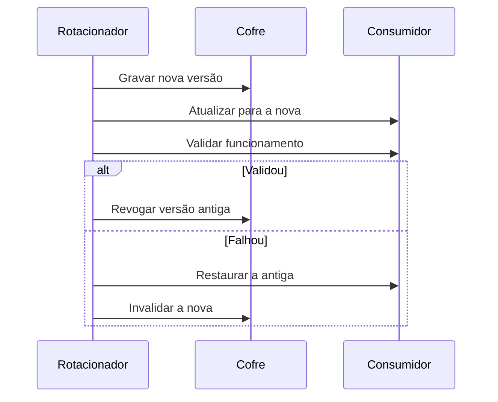

# Lab - Rotação de Credenciais

## Objetivo
Implementar um procedimento de rotação seguro e reversível: gerar novo segredo, distribuir ao consumidor, validar e só então revogar o antigo, com modo de simulação. Mapa: [[MOC - Laboratórios e Scripts]].

> [!warning] Escopo
> O laboratório usa um **cofre simulado em memória**. Em produção, troque-o pela API do seu cofre ([[Gestão de Segredos]]). O script nunca imprime valores de segredos.

## Conceito
Rotacionar sem derrubar serviços exige uma sequência que preserve a credencial antiga até a nova ser comprovadamente funcional:

1. **Gerar** um segredo forte com gerador criptograficamente seguro.
2. **Gravar** como nova versão no cofre (a antiga continua válida).
3. **Atualizar** o consumidor (aplicação, pipeline, integração).
4. **Validar** que o consumidor funciona com a nova.
5. **Revogar** a antiga. Se a validação falhar, **reverter** para a antiga e marcar a nova como inválida ([[Rollback]]).

Esse padrão (às vezes chamado de dupla credencial) evita janelas de indisponibilidade. A rotação também é a resposta obrigatória a vazamentos detectados por [[Secret Scanning]].



## Exemplo prático
Salve como `rotacionar.py`.

```python
#!/usr/bin/env python3
"""Rotação segura com validação e reversão. Cofre simulado."""
import logging, secrets, string

logging.basicConfig(level=logging.INFO, format="%(asctime)s %(levelname)s %(message)s")
ALFABETO = string.ascii_letters + string.digits

def gerar_segredo(tamanho=40):
    return "".join(secrets.choice(ALFABETO) for _ in range(tamanho))

class CofreSimulado:
    def __init__(self):
        self.versoes = {}
    def gravar(self, nome, valor):
        self.versoes.setdefault(nome, []).append(valor)
        return len(self.versoes[nome]) - 1
    def ler(self, nome, versao):
        return self.versoes[nome][versao]
    def invalidar(self, nome, versao):
        self.versoes[nome][versao] = None

def rotacionar(nome, cofre, aplicar_no_consumidor, validar, dry_run=True):
    versao_antiga = len(cofre.versoes[nome]) - 1
    if dry_run:
        logging.info("[DRY-RUN] rotacionaria %s (versão atual %d)", nome, versao_antiga)
        return True
    antigo = cofre.ler(nome, versao_antiga)
    versao_nova = cofre.gravar(nome, gerar_segredo())
    try:
        aplicar_no_consumidor(cofre.ler(nome, versao_nova))
        if not validar():
            raise RuntimeError("validação falhou")
    except Exception as erro:
        logging.error("rotação de %s falhou (%s); revertendo", nome, erro)
        aplicar_no_consumidor(antigo)
        cofre.invalidar(nome, versao_nova)
        return False
    cofre.invalidar(nome, versao_antiga)
    logging.info("rotação de %s concluída (versão %d)", nome, versao_nova)
    return True

if __name__ == "__main__":
    cofre = CofreSimulado()
    cofre.gravar("svc-relatorios", gerar_segredo())
    estado = {"atual": None}
    ok = rotacionar("svc-relatorios", cofre,
                    aplicar_no_consumidor=lambda s: estado.update(atual=s),
                    validar=lambda: estado["atual"] is not None,
                    dry_run=False)
    print("sucesso" if ok else "revertido")
```

Experimente alterar `validar` para retornar `False` e observe a reversão automática.

## Boas práticas
- Use o módulo `secrets`, nunca `random`, para gerar segredos.
- Dê preferência a credenciais dinâmicas e de curta duração, reduzindo a necessidade de rotação manual.
- Registre quem rotacionou, quando e por quê, sem registrar o valor ([[Trilha de Auditoria]]).
- Mantenha janela de convivência curta entre versão nova e antiga.
- Teste o procedimento de reversão, não só o caminho feliz.

## Erros comuns
- Revogar a antiga antes de validar a nova.
- Esquecer consumidores secundários que usam o mesmo segredo.
- Imprimir o segredo em logs ou no terminal.
- Rotação manual esporádica, sem automação nem dono.

## Para revisar
> [!question] Perguntas
> 1. Por que validar antes de revogar a credencial antiga?
> 2. Por que usar `secrets` em vez de `random`?
> 3. O que fazer se a validação falhar?
> 4. Como a rotação se relaciona com a detecção de vazamentos?

## Links relacionados
[[Secret Scanning]], [[Orquestração via APIs]], [[Playbook de Conta Comprometida]], [[Governança da Automação]].
