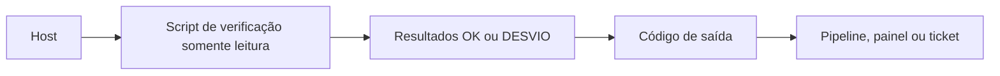

# Lab - Verificação de Hardening

## Objetivo
Escrever verificações **somente leitura** de configurações seguras em Linux (Bash) e Windows (PowerShell), com saída padronizada e código de retorno utilizável por pipelines. Mapa: [[MOC - Laboratórios e Scripts]].

> [!warning] Escopo
> Os scripts apenas **leem** o estado do sistema; não alteram nada. Execute-os em máquinas próprias ou autorizadas. Os valores esperados são exemplos didáticos; alinhe-os ao benchmark adotado ([[Hardening com CIS Benchmarks]]).

## Conceito
Verificar antes de remediar separa **avaliação** de **correção**, reduzindo risco. Cada checagem compara um valor atual com o esperado e emite `OK` ou `DESVIO`; o código de saída diferente de zero permite falhar um job de CI ou alimentar a [[Auditoria Contínua]]. A saída consistente (texto ou JSON) facilita agregar resultados de muitos hosts ([[Compliance as Code]]).



## Exemplo prático

### Linux (Bash)
Salve como `verificar_hardening.sh`.

```bash
#!/usr/bin/env bash
# Verificação somente leitura. Nenhuma alteração é feita.
set -u
ok=0; desvios=0

checar() {  # descricao esperado atual
  if [[ "$3" == "$2" ]]; then
    echo "OK     $1"; ok=$((ok + 1))
  else
    echo "DESVIO $1 (atual=${3:-n/d}, esperado=$2)"; desvios=$((desvios + 1))
  fi
}

valor_ssh() {
  grep -Ei "^\s*$1\s" /etc/ssh/sshd_config 2>/dev/null | awk '{print tolower($2)}' | tail -1
}

checar "SSH: login direto do root desativado" "no" "$(valor_ssh PermitRootLogin)"
checar "SSH: autenticação por senha desativada" "no" "$(valor_ssh PasswordAuthentication)"

perm=$(stat -c %a /etc/shadow 2>/dev/null)
[[ -n "$perm" && "${perm: -1}" == "0" ]] && r="sem-acesso-global" || r="legivel-por-outros"
checar "/etc/shadow sem acesso a 'outros'" "sem-acesso-global" "$r"

checar "IPv4 forwarding desativado (se não for roteador)" "0" "$(sysctl -n net.ipv4.ip_forward 2>/dev/null)"

echo "Resumo: $ok OK, $desvios desvio(s)"
[[ $desvios -eq 0 ]]
```

### Windows (PowerShell)
Salve como `verificar_hardening.ps1`.

```powershell
# Verificação somente leitura. Nenhuma alteração é feita.
$resultados = New-Object System.Collections.Generic.List[object]
function Add-Resultado($Item, $Conforme, $Valor) {
    $resultados.Add([pscustomobject]@{ Item = $Item; Conforme = [bool]$Conforme; Valor = $Valor })
}

$smb1 = (Get-SmbServerConfiguration).EnableSMB1Protocol
Add-Resultado "SMBv1 desativado" (-not $smb1) $smb1

foreach ($perfil in Get-NetFirewallProfile) {
    Add-Resultado "Firewall perfil $($perfil.Name) ativo" ($perfil.Enabled -eq 'True') $perfil.Enabled
}

$rtp = (Get-MpComputerStatus).RealTimeProtectionEnabled
Add-Resultado "Proteção em tempo real do Defender ativa" $rtp $rtp

$resultados | Format-Table -AutoSize
if ($resultados | Where-Object { -not $_.Conforme }) { exit 1 } else { exit 0 }
```

Execução: `bash verificar_hardening.sh; echo "código: $?"` e `powershell -ExecutionPolicy Bypass -File .\verificar_hardening.ps1` em ambiente autorizado (o `Bypass` vale apenas para essa execução; siga a política da sua organização).

### Como interpretar o resultado
Cada linha `DESVIO` é um achado a tratar, não uma falha do script. Classifique-o em corrigir, aceitar com exceção documentada ou reavaliar o valor esperado. Registre o resumo por host para acompanhar a tendência de aderência ao longo das semanas.

## Boas práticas
- Mantenha avaliação e remediação em scripts separados; remedie via [[Infrastructure as Code]] com aprovação.
- Emita saída estruturada (JSON) quando integrar a painéis.
- Documente exceções aprovadas em arquivo de dados, não no script.
- Teste os scripts em uma máquina de laboratório antes de espalhá-los.
- Execute com o menor privilégio possível; alguns comandos exigem administrador.

## Erros comuns
- Confundir ausência de configuração com valor padrão seguro (o padrão varia por versão).
- Aplicar correções dentro do script de verificação.
- Ignorar diferenças entre distribuições e versões.
- Não tratar comandos ausentes, gerando falsos desvios.

## Para revisar
> [!question] Perguntas
> 1. Por que separar verificação e remediação?
> 2. Qual a utilidade do código de saída?
> 3. Por que o valor esperado deve vir do benchmark escolhido?
> 4. Como lidar com exceções aprovadas?

## Links relacionados
[[Lab - Relatórios Automáticos]], [[Inventário de Ativos]], [[CSPM]], [[Laboratório Guiado]].
