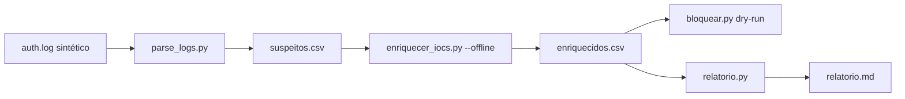

# Laboratório Guiado

## Objetivo
Executar, de ponta a ponta e em ambiente isolado, um mini-fluxo de resposta automatizada: **ler logs, identificar suspeitos, enriquecer, decidir, simular bloqueio e gerar relatório**. Mapa: [[MOC - Laboratórios e Scripts]].

> [!warning] Escopo e segurança
> Todos os dados são sintéticos e usam faixas de IP reservadas para documentação. Nenhuma etapa age sobre sistemas reais: o bloqueio roda em **dry-run**. Execute em sua própria máquina ou em uma VM de laboratório.

## Conceito
O laboratório une os scripts anteriores em um pipeline simples, espelhando um playbook de [[SOAR]]:



Cada etapa recebe a saída da anterior por arquivo, o que facilita inspecionar, testar e substituir componentes (por exemplo, trocar o modo offline por uma consulta real).

## Exemplo prático (passo a passo)

**Passo 1 — Preparar a pasta.** Crie `lab/` e salve nela os scripts: `parse_logs.py` ([[Lab - Parsing de Logs]]), `enriquecer_iocs.py` ([[Lab - Enriquecimento de IOCs]]), `bloquear.py` ([[Lab - Bloqueio Automatizado]]) e `relatorio.py` ([[Lab - Relatórios Automáticos]]).

**Passo 2 — Gerar o log sintético.**

```python
# gerar_log.py
import random
random.seed(7)
linhas = []
for _ in range(14):
    linhas.append("Jan 10 10:00:00 srv sshd[100]: Failed password for invalid user admin from 203.0.113.50 port 4000 ssh2")
for _ in range(6):
    linhas.append("Jan 10 10:05:00 srv sshd[101]: Failed password for root from 198.51.100.23 port 4100 ssh2")
for _ in range(2):
    linhas.append("Jan 10 10:09:00 srv sshd[102]: Failed password for maria from 192.168.1.20 port 4200 ssh2")
linhas.append("Jan 10 10:10:00 srv sshd[103]: Accepted password for maria from 192.168.1.20 port 4201 ssh2")
random.shuffle(linhas)
open("auth.log", "w", encoding="utf-8").write("\n".join(linhas) + "\n")
```

Execute: `python3 gerar_log.py`.

**Passo 3 — Identificar suspeitos.**

```bash
python3 parse_logs.py auth.log --limite 5
cat suspeitos.csv
```

Esperado: dois IPs acima do limite (203.0.113.50 com 14 tentativas e 198.51.100.23 com 6); o IP interno ficou abaixo.

**Passo 4 — Enriquecer em modo offline.**

```bash
python3 enriquecer_iocs.py suspeitos.csv --offline
cat enriquecidos.csv
```

Esperado: o primeiro IP como `malicioso` (14 tentativas) e o segundo como `suspeito`, por regra simulada.

**Passo 5 — Decidir e simular a contenção.**

```bash
python3 bloquear.py enriquecidos.csv
```

Esperado: uma única linha `[DRY-RUN] bloquearia 203.0.113.50`. O suspeito de menor confiança vai para revisão humana ([[Human in the Loop - Automação]]).

**Passo 6 — Gerar o relatório.**

```bash
python3 relatorio.py enriquecidos.csv --agrupar veredito --titulo "Lab: IPs suspeitos"
```

Abra `relatorio.md` e confira resumo e detalhe.

**Passo 7 — Desafios.** (a) Reduza o limite para 2 e observe o IP interno aparecer (e ser protegido pela lista de exceções). (b) Adicione uma etapa que registre cada decisão em um arquivo de auditoria ([[Trilha de Auditoria]]). (c) Escreva testes automatizados para a função `pode_bloquear`.

## Boas práticas
- Rode cada etapa isoladamente antes de encadear.
- Guarde as saídas intermediárias para depuração e auditoria.
- Mantenha dry-run até compreender plenamente o efeito.
- Versione os scripts e os dados de teste em Git ([[Ciclo de Vida da Automação]]).
- Documente a decisão de cada limiar.

## Erros comuns
- Executar a etapa de bloqueio com `--aplicar` fora de um laboratório controlado.
- Esquecer de recriar `suspeitos.csv` após mudar o limite.
- Confundir o veredito simulado com inteligência real.
- Não verificar o conteúdo de cada arquivo intermediário.

## Para revisar
> [!question] Perguntas
> 1. Por que encadear etapas por arquivos intermediários?
> 2. Que decisões deveriam ser humanas neste fluxo?
> 3. Como transformar este pipeline em um playbook de SOAR?
> 4. Que métricas você mediria ([[Métricas - MTTD, MTTR, Falso Positivo e ROI]])?

## Links relacionados
[[Lab - Verificação de Hardening]], [[Lab - Rotação de Credenciais]], [[Contenção Automatizada]], [[Triagem Automática de Alertas]].
