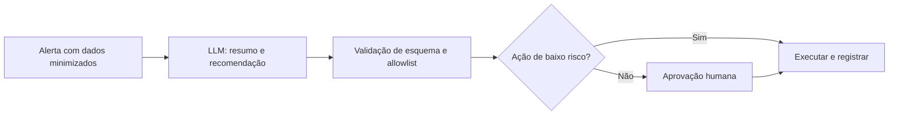

# IA e LLMs na Automação de Segurança

## Objetivo
Identificar onde modelos de linguagem (LLMs) agregam valor em automação de segurança e como integrá-los com controles que limitem seus riscos. Mapa: [[MOC - IA, Governança e Boas Práticas]].

## Conceito
LLMs são bons em **linguagem**: resumir, classificar, extrair, traduzir e explicar. São fracos em **determinismo** e **fatos**: podem errar com confiança. Por isso, a regra de ouro é usá-los como **assistentes que produzem rascunhos e recomendações**, e não como executores autônomos de ações críticas.

**Casos de uso de bom retorno e risco controlável:**

- **Resumo de casos e alertas** para passagem de turno e relatórios ([[Gestão de Casos]]).
- **Extração de IOCs e entidades** de relatórios de inteligência e e-mails, com validação posterior ([[Enriquecimento de IOCs]]).
- **Explicação de eventos e comandos** a analistas menos experientes.
- **Assistência na escrita de consultas e regras** ([[Regras Sigma - Automação]]), sempre revisadas e testadas ([[Testes de Detecção]]).
- **Classificação de e-mails reportados** como apoio à triagem ([[Playbook de Phishing]]).
- **Sugestão de próximos passos de investigação**, citando as fontes dos dados.

**Casos de uso de alto risco (exigem cautela extra):** execução autônoma de contenção, alteração de regras de firewall, decisões sobre contas privilegiadas e qualquer ação irreversível.

**Padrões de arquitetura seguros:**

1. **Saída estruturada e validada:** o modelo devolve JSON conforme um esquema; o código valida e rejeita o que não conferir.
2. **Lista de ações permitidas (allowlist):** o modelo só *sugere* ações de um catálogo fechado.
3. **Humano no circuito** para ações acima de determinado risco ([[Human in the Loop - Automação]]).
4. **Contexto mínimo:** enviar apenas os dados necessários (minimização, [[Aspectos Legais e LGPD]]).
5. **Fundamentação (grounding):** exigir que a resposta cite os registros usados, e verificar.



## Exemplo prático
> [!example] Recomendação validada
> O modelo sugere uma ação; o código só aceita ações de um catálogo e exige aprovação para as de risco alto.

```python
import json

ACOES = {"notificar": "baixo", "bloquear_ip_ttl": "medio", "isolar_host": "alto"}

def validar_recomendacao(texto_modelo: str):
    dados = json.loads(texto_modelo)  # falha se não for JSON
    acao = dados.get("acao")
    if acao not in ACOES:
        raise ValueError(f"ação fora do catálogo: {acao!r}")
    return {"acao": acao, "risco": ACOES[acao],
            "justificativa": str(dados.get("justificativa", ""))[:500],
            "requer_aprovacao": ACOES[acao] != "baixo"}
```

## Boas práticas
- Trate a saída do modelo como **entrada não confiável**, nunca como comando.
- Registre prompt (sem dados sensíveis), versão do modelo e resposta ([[Trilha de Auditoria]]).
- Meça qualidade com conjuntos de teste e acompanhe regressões ao trocar de modelo.
- Prefira modelos e provedores com garantias contratuais de privacidade, ou hospede localmente quando o dado for sensível.
- Comece por tarefas de leitura e resumo, depois avance a recomendações.

## Erros comuns
- Dar ao modelo credenciais e permissão para agir diretamente.
- Confiar em explicações plausíveis sem verificar contra os dados.
- Enviar dados pessoais ou segredos a serviços externos sem avaliação.
- Não definir quem responde por um erro do assistente.

> [!warning] Responsabilidade
> A responsabilidade pela decisão continua sendo humana e da organização. A IA assiste, não responde.

## Para revisar
> [!question] Perguntas
> 1. Em que tipo de tarefa os LLMs são mais confiáveis?
> 2. Por que usar saída estruturada e lista de ações permitidas?
> 3. Que ações não devem ser autônomas?
> 4. Como aplicar o princípio de minimização ao enviar dados ao modelo?

## Links relacionados
[[Governança da Automação]], [[Anti-Padrões de Automação de Segurança]], [[SOAR]], [[Contenção Automatizada]].
