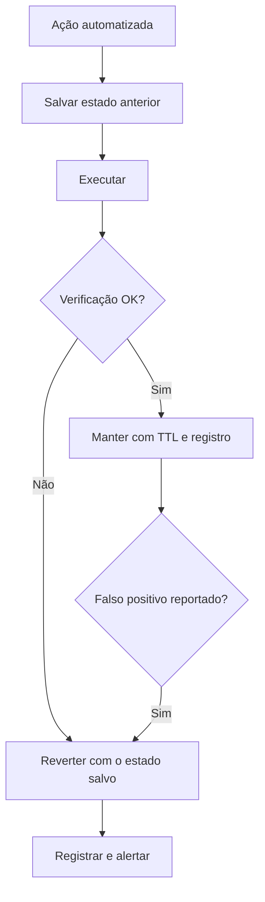

# Rollback

## Objetivo
Projetar cada ação automatizada com um caminho de reversão testado, reduzindo o dano de falsos positivos e de erros operacionais. Mapa: [[MOC - IA, Governança e Boas Práticas]].

## Conceito
**Rollback** é a capacidade de desfazer o efeito de uma ação e restaurar o estado anterior. Em automação de segurança, é o que torna aceitável agir rapidamente com incerteza: se a decisão estava errada, o custo é pequeno e curto.

**Classificação por reversibilidade:**

| Tipo | Exemplo | Como reverter |
|---|---|---|
| Totalmente reversível | Bloqueio de IP com TTL, quarentena de arquivo | Remover regra, restaurar arquivo |
| Reversível com esforço | Isolamento de host, desativação de conta | Liberar e restabelecer acessos e sessões |
| Parcialmente reversível | Rotação de credenciais, patch | Restaurar versão antiga do segredo; reverter versão se houver snapshot |
| Irreversível | Exclusão de dados, desligamento definitivo | Não automatizar; somente com aprovação e backup |

**Princípios de projeto:**

1. **Capture o estado anterior antes de agir** (valor, configuração, regras existentes) e guarde-o junto do registro da ação ([[Trilha de Auditoria]]).
2. **Escreva o "desfazer" ao mesmo tempo que o "fazer".** Um playbook sem etapa de reversão está incompleto ([[Runbooks]]).
3. **Prefira ações com expiração (TTL)**, que se revertem sozinhas.
4. **Idempotência:** reexecutar a reversão não causa dano.
5. **Teste a reversão** com a mesma frequência que a ação.
6. **Reversão em lote:** capacidade de desfazer todas as ações de uma execução ou de um intervalo de tempo, útil quando uma regra defeituosa agiu em massa.
7. **Kill switch:** interruptor para pausar novas ações enquanto se reverte ([[Contenção Automatizada]]).



## Exemplo prático
> [!example] Ação com contexto de reversão
> A função guarda o estado anterior e oferece a operação inversa; um desfazer em lote percorre os registros de uma execução.

```python
def com_reversao(acao, alvo, executar, desfazer, estado_atual, registro):
    anterior = estado_atual(alvo)
    executar(alvo)
    registro.append({"acao": acao, "alvo": alvo, "anterior": anterior,
                     "desfazer": desfazer})

def reverter_execucao(registro):
    for item in reversed(registro):
        item["desfazer"](item["alvo"], item["anterior"])
    registro.clear()
```

## Boas práticas
- Defina SLAs de reversão: em quanto tempo o falso positivo é corrigido.
- Facilite o pedido de reversão pelo usuário afetado (canal claro).
- Faça snapshot ou backup antes de mudanças em massa ([[Patch Management Automatizado]]).
- Registre quem reverteu e por quê, alimentando o ajuste das regras.
- Inclua cenários de reversão em exercícios (game days).

## Erros comuns
- Reversão que depende de memória do operador.
- Estado anterior não capturado, impossibilitando o retorno exato.
- Reverter sem tratar a causa, causando ciclos de ação e reversão.
- Nunca testar o procedimento.

> [!tip] Medir reversões
> A taxa de ações revertidas é um excelente indicador de qualidade de uma automação ([[Métricas - MTTD, MTTR, Falso Positivo e ROI]]).

## Para revisar
> [!question] Perguntas
> 1. Por que o rollback viabiliza ações rápidas sob incerteza?
> 2. Que ações são irreversíveis e como tratá-las?
> 3. O que deve ser capturado antes de agir?
> 4. Qual o papel do TTL como reversão automática?

## Links relacionados
[[Lab - Bloqueio Automatizado]], [[Lab - Rotação de Credenciais]], [[Governança da Automação]], [[Human in the Loop - Automação]].
