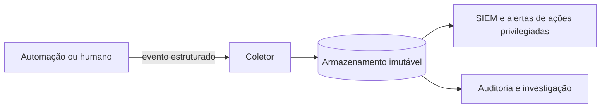

# Trilha de Auditoria

## Objetivo
Projetar registros de auditoria das automações que permitam reconstruir **quem fez o quê, quando, por quê e com qual resultado**, com integridade e retenção adequadas. Mapa: [[MOC - IA, Governança e Boas Práticas]].

## Conceito
A **trilha de auditoria** é o registro cronológico e imutável das ações relevantes. Para automações, é a base para investigar falhas, provar conformidade ([[Auditoria Contínua]]), apoiar decisões de reversão ([[Rollback]]) e atribuir responsabilidade. Se a ação não está registrada, para fins de auditoria, ela não ocorreu.

**O que registrar em cada ação (5W):**

- **Quem:** identidade do ator (humano, automação, versão do playbook), e aprovador quando houver ([[Human in the Loop - Automação]]).
- **O quê:** ação, alvo e parâmetros (sem segredos).
- **Quando:** carimbo de tempo em UTC, com fonte de relógio sincronizada.
- **Por quê:** gatilho, alerta ou caso de origem, e a justificativa/escore.
- **Resultado:** sucesso, falha, valor anterior (para reversão).
- **Correlação:** identificador do caso e da execução, para amarrar eventos ([[Gestão de Casos]]).

**Propriedades desejáveis:**

- **Integridade:** armazenamento append-only ou com assinatura/encadeamento de hashes, de forma que alterações sejam detectáveis.
- **Separação:** o ator não pode apagar ou editar seus próprios registros ([[Segregação de Funções]]).
- **Disponibilidade e retenção** definidas por requisito legal e de negócio.
- **Proteção de dados:** minimizar dados pessoais e aplicar controle de acesso ([[Aspectos Legais e LGPD]]).
- **Consultabilidade:** formato estruturado (JSON), enviado ao [[SIEM]].



## Exemplo prático
> [!example] Registro encadeado por hash
> Cada entrada inclui o hash da anterior, tornando evidente qualquer adulteração do histórico.

```python
import hashlib, json
from datetime import datetime, timezone

def registrar(trilha: list, ator: str, acao: str, alvo: str, caso: str, resultado: str):
    anterior = trilha[-1]["hash"] if trilha else "0" * 64
    entrada = {
        "quando": datetime.now(timezone.utc).isoformat(),
        "ator": ator, "acao": acao, "alvo": alvo,
        "caso": caso, "resultado": resultado, "hash_anterior": anterior,
    }
    corpo = json.dumps(entrada, sort_keys=True).encode()
    entrada["hash"] = hashlib.sha256(corpo).hexdigest()
    trilha.append(entrada)
    return entrada

def verificar(trilha: list) -> bool:
    anterior = "0" * 64
    for e in trilha:
        copia = {k: v for k, v in e.items() if k != "hash"}
        if copia["hash_anterior"] != anterior:
            return False
        if hashlib.sha256(json.dumps(copia, sort_keys=True).encode()).hexdigest() != e["hash"]:
            return False
        anterior = e["hash"]
    return True
```

Em produção, envie as entradas a um armazenamento externo e imutável; o encadeamento local é apenas didático.

## Boas práticas
- Padronize o esquema de eventos de todas as automações.
- Alerte sobre ações privilegiadas e sobre falhas de registro.
- Nunca registre segredos; mascare dados sensíveis.
- Registre também **negações** (ações bloqueadas por política) e **aprovações rejeitadas**.
- Teste periodicamente a capacidade de reconstruir um incidente a partir dos registros.

## Erros comuns
- Registros apenas em arquivos locais do servidor da automação.
- Falta de sincronização de relógio, impossibilitando a linha do tempo.
- Logs volumosos sem estrutura, impossíveis de consultar.
- Registrar dados pessoais em excesso.

> [!warning] Registros também são dados sensíveis
> A trilha pode conter nomes, IPs e identificadores. Aplique controle de acesso e retenção.

## Para revisar
> [!question] Perguntas
> 1. Quais campos compõem o registro de uma ação automatizada?
> 2. Por que o ator não deve poder alterar seus registros?
> 3. Como o encadeamento de hashes detecta adulteração?
> 4. Por que registrar também as ações negadas?

## Links relacionados
[[Contenção Automatizada]], [[Compliance as Code]], [[Riscos de IA em Segurança]], [[Anti-Padrões de Automação de Segurança]].
