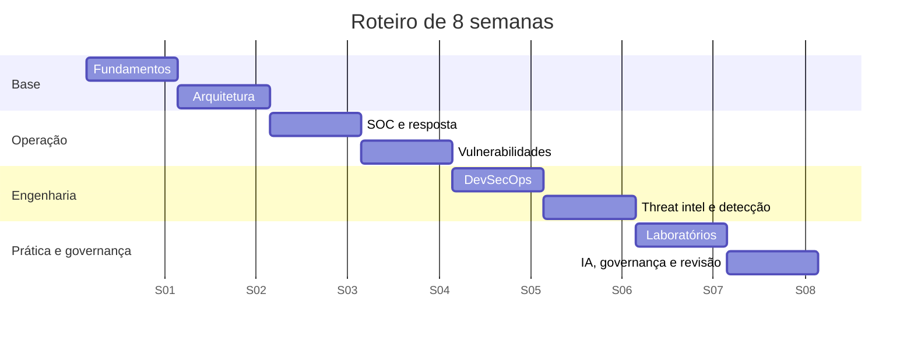

# Roteiro de Estudos de 8 Semanas

## Objetivo
Oferecer um cronograma realista para percorrer todo o vault em oito semanas, com leitura, prática e revisão equilibradas. Mapa: [[MOC - Revisão - Automação]].

## Conceito
O roteiro assume cerca de 6 a 8 horas semanais: três sessões de leitura e anotação, uma de laboratório ou exercício e uma curta de revisão com [[Flashcards - Automação]]. Ajuste o ritmo conforme sua experiência; quem já atua em SOC pode comprimir as semanas 1 e 2.

### Cronograma

**Semana 1: Fundamentos.** Leia [[Por que Automatizar Segurança]], [[O que Automatizar e o que Não Automatizar]], [[Ciclo de Vida da Automação]], [[Níveis de Maturidade da Automação]], [[Métricas - MTTD, MTTR, Falso Positivo e ROI]] e os três frameworks. Exercícios 1 a 4. Meta: avaliar a maturidade de um processo real.

**Semana 2: Arquitetura e ferramentas.** [[SIEM]], [[SOAR]], [[EDR e XDR]], [[CSPM]], [[Orquestração via APIs]], [[Webhooks, Filas e Integrações]], [[Infrastructure as Code]], [[Gestão de Segredos]] e [[Comparativo de Ferramentas - Automação]]. Exercícios 5 a 8. Meta: desenhar a arquitetura de integração do seu ambiente.

**Semana 3: SOC e resposta.** Triagem, enriquecimento, os quatro playbooks, [[Contenção Automatizada]], [[Runbooks]], [[Human in the Loop - Automação]] e [[Gestão de Casos]]. Exercícios 9 a 12. Meta: escrever um runbook completo.

**Semana 4: Vulnerabilidades e compliance.** [[Varredura Contínua de Vulnerabilidades]], [[Priorização com CVSS, EPSS e KEV]], [[Patch Management Automatizado]], [[Compliance as Code]], [[Auditoria Contínua]], [[Hardening com CIS Benchmarks]] e [[Inventário de Ativos]]. Exercícios 13 a 16. Meta: priorizar uma fila real.

**Semana 5: DevSecOps.** [[SAST]], [[DAST]], [[SCA]], [[SBOM]], [[Secret Scanning]], [[Scan de Containers]], [[Políticas como Código com OPA]], [[Segurança em Pipelines CI-CD]] e [[Shift Left]]. Exercícios 17 a 19. Meta: montar um pipeline de referência.

**Semana 6: Threat intel e detecção.** [[Feeds de Inteligência de Ameaças]], [[STIX e TAXII]], [[MISP - Automação]], [[Detection as Code]], [[Regras Sigma - Automação]], [[YARA - Automação]], [[Testes de Detecção]], [[Threat Hunting Automatizado]] e [[Emulação de Adversário para Validação Defensiva]]. Exercícios 20 a 23. Meta: uma regra Sigma com testes.

**Semana 7: Laboratórios.** Faça o [[Laboratório Guiado]] e, depois, os labs de [[Lab - Verificação de Hardening]], [[Lab - Rotação de Credenciais]] e [[Lab - Relatórios Automáticos]]. Exercícios 24 a 26. Meta: pipeline funcional em ambiente de laboratório.

**Semana 8: IA, governança e revisão.** [[IA e LLMs na Automação de Segurança]], [[Riscos de IA em Segurança]], [[Governança da Automação]], [[Segregação de Funções]], [[Trilha de Auditoria]], [[Rollback]], [[Anti-Padrões de Automação de Segurança]] e [[Aspectos Legais e LGPD]]. Exercícios 27 a 30. Meta: registro de governança e revisão geral com o [[Glossário#Automação de Segurança]].

## Exemplo prático
> [!example] Semana típica
> Segunda, quarta e sexta: 1h30 de leitura e anotações. Sábado: 2h de exercício ou laboratório. Todos os dias: 10 minutos de flashcards. Domingo: revisão das perguntas "Para revisar" da semana.

## Boas práticas
- Escreva um resumo de uma página ao fim de cada semana.
- Aplique cada tema a um caso do seu ambiente.
- Conecte novas notas pessoais às do vault com wikilinks.
- Revise o grafo do Obsidian para enxergar lacunas.

## Erros comuns
- Ler sem praticar.
- Pular os laboratórios por falta de tempo.
- Deixar a revisão para o fim.
- Tentar absorver tudo em duas semanas.

## Para revisar
> [!question] Perguntas
> 1. Que semana exige mais prática e por quê?
> 2. Como você aplicará cada tema ao seu ambiente?
> 3. Que meta de semana você ainda não cumpriu?

## Links relacionados
[[Referências e Certificações]], [[Convenções - Automação]], [[Banco de Exercícios]], [[Home - Automação]].
