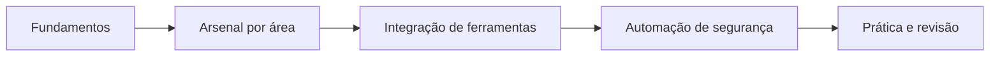

# Trilha de aprendizado - Cibersegurança

Ordem sugerida para estudar as três partes do material. As etapas não são rígidas: quem já conhece os fundamentos pode começar direto pela parte que interessa.

## Etapa 1 - Fundamentos

- [[MOC - Conceitos]], [[MOC - Padrões e Frameworks]] e [[MOC - Cheatsheets]] (Arsenal)
- [[MOC - Fundamentos - Integração]]: segurança aplicada ao desenvolvimento de ferramentas
- [[MOC - Fundamentos - Automação]]: ciclo de vida e princípios da automação defensiva

## Etapa 2 - Arsenal por área

- Visão geral e fluxo de um teste: [[MOC - Arsenal de Cibersegurança]] e [[Fluxo Típico de Pentest]]
- [[MOC - Ofensivo]], [[MOC - Defensivo]] e [[MOC - DFIR e Engenharia Reversa]]
- Correlação com técnicas: [[Matriz ATT&CK - Referência Cruzada]]

## Etapa 3 - Integração de ferramentas

- [[MOC - Integração de Ferramentas]]: arquitetura, APIs e autenticação, integrações com SIEM e scanners, DevSecOps e segurança da própria ferramenta

## Etapa 4 - Automação de segurança

- [[MOC - Automação de Segurança]]: SOC e resposta a incidentes, vulnerabilidades e compliance, DevSecOps, threat intel e IA
- Plano de estudo em semanas: [[Roteiro de Estudos de 8 Semanas]]

## Etapa 5 - Prática e revisão

- [[MOC - Revisão - Integração]] e [[MOC - Revisão - Automação]]
- [[Banco de Exercícios]]

## Veja também

- [[Home - Cibersegurança]]
- [[Índice - Cibersegurança]]
- [[Glossário#Cibersegurança]]
